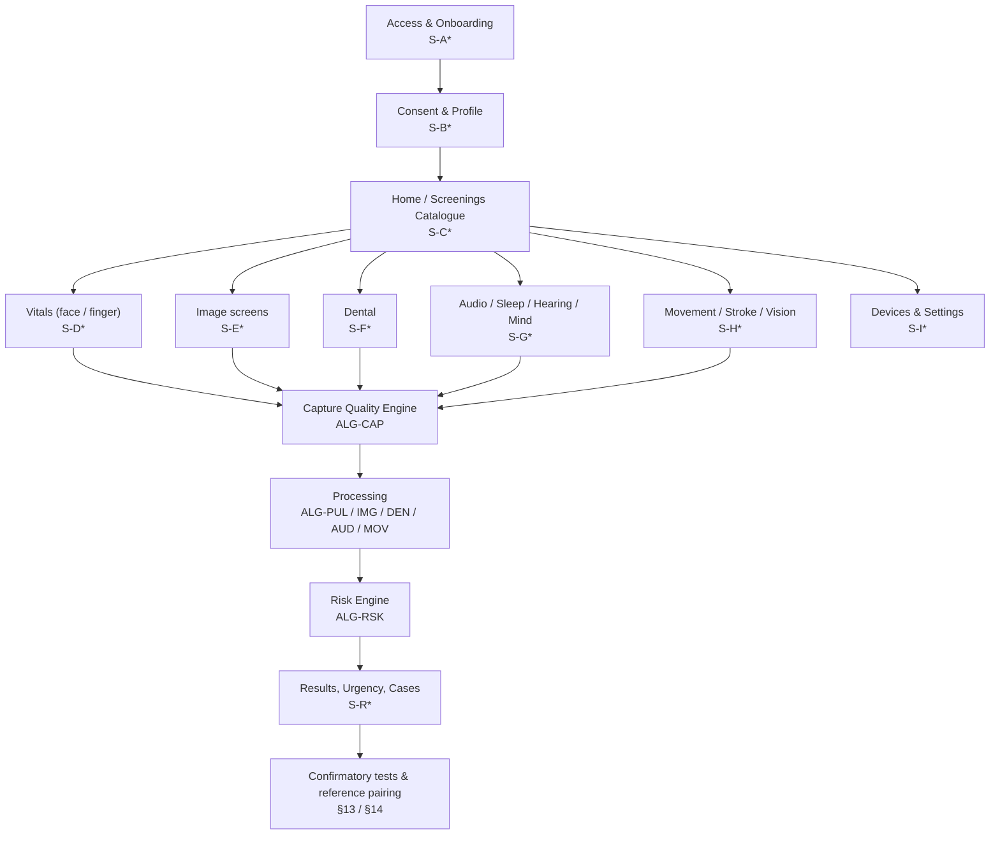

# 01 — Project Overview: VitalsMirror

> Provenance tags: see `00_README_Index.md §2`. Spec = *VitalsMirror — Algorithm Specifications & Test Cards* (Oct 18, 2026).

## 1. What is VitalsMirror?

VitalsMirror is a **smartphone-based health screening platform**. Using only the phone's built-in camera, microphone, speaker, touch screen and motion sensors (optionally a smart ring and clip-on fundus camera), it:

1. **Captures** face/finger video, photos, audio and movement under strict real-time quality control (Spec §2).
2. **Measures** vital signs and physiological markers — heart rate, respiratory rate, HRV, stress, SpO2 band, BP band, rhythm, pulse waveform & vascular age, diabetes risk (Spec §3–§4).
3. **Screens** for conditions via images (anaemia, jaundice, cataract, oral cancer, diabetic foot, child eye, newborn jaundice, skin, retinopathy), dental photos, audio (TB, COPD/asthma, lung function, voice, sleep apnoea, hearing, cognition, mood, heart failure) and movement (Parkinson's signs, gait, fall risk, tremor, stroke FAST, vision, reaction time) (Spec §6–§9).
4. **Decides urgency deterministically** (emergency > urgent > routine) via a versioned risk engine and opens one follow-up **case** per condition (Spec §10).
5. **Directs to confirmation** — every flag maps to standard confirmatory investigations and lab cut-offs (Spec §13).
6. **Learns safely** — reference results paired within strict time windows validate and train models (Spec §11, §14).

**[DOC]** All of this is described in the Spec. The UI design, navigation and account layer are **[DER]/[STD]** additions to execute these workflows.

## 2. Objectives

| # | Objective | Source |
|---|---|---|
| O1 | Contactless, low-cost screening with only a phone | Spec §2–§9 |
| O2 | Clinically validated accuracy before any result is shown | Spec §4 intro, acceptance criteria per card |
| O3 | Fairness across skin tones (I–VI) and phone models | Spec §2 CAP-05, §4.1 acceptance |
| O4 | Reproducibility — deterministic, versioned rules & masters | Spec §1, §10 |
| O5 | Safety — screening bands, not diagnoses; escalation for emergencies | Spec §10 T1–T16, §13 |
| O6 | Reach — schools, anganwadis, clinics; untrained photographers; te/hi/en | Spec §6.4, §7.1, §8 AUD-10 |
| O7 | Continuous improvement via paired reference tests & sampled negatives | Spec §11.2, §14, FRS REF-03 |

## 3. Target users

| User | Description | App surface | Tag |
|---|---|---|---|
| **Member** | Adult screening themselves | Mobile app | DER |
| **Guardian / Parent** | Captures and consents for a child (1–12 y) or newborn (0–28 d) | Mobile app (dependent profiles) | DOC (§7.1 "guardian", "parent") |
| **Operator** | Trained field worker screening many people (schools, anganwadis, clinics) | Mobile app — Operator mode | DOC/OPEN (§7.1, §6.4) |
| **Clinician** | Runs mood pathway; acts on referrals | Back-office (out of mobile scope) | DOC/OPEN (§8 AUD-11) |
| **Specialist reviewer** | Reviews high/uncertain image results (IMG-10) | Back-office | DOC/OPEN |
| **Clinical safety lead / ML team** | Approve masters, thresholds, pairing rules | Back-office | DOC |

## 4. Module map

## 5. Scope of this phase (Phase 1 — UI)

| In scope now | Out of scope now |
|---|---|
| Complete documentation set | Training / validating ML models |
| Design system & theme | Real backend endpoints (contracts only) |
| All screens, navigation, gates, states (UI) | Native camera/audio DSP plugins |
| Deterministic, documented calculations that need no model: formulas ALG-FRM-01…12, 14, 15; HRV time-domain ALG-HRV-01/02; Baevsky ALG-HRV-04; band assignment; urgency rules where fully specified | Clinician / specialist web portal |
| Mock repositories & mock processing clearly labelled `[MOCK]` | Partner (fundus, TB, ring) live integrations |

## 6. Key principles for anyone working on this project

1. **The Spec wins.** If code or these docs disagree with the Spec, the Spec is right — fix the docs/code.
2. **Never invent medicine.** No guessed thresholds, ranges or outputs. Unknown → `[OPEN]` + "not yet available" UI.
3. **Screening, not diagnosis.** Every result shows a band, a confidence, and the recommended confirmatory test.
4. **Quality before results.** No result without passing capture (G-21), signal (G-22), confidence (G-23) and release (G-24) gates.
5. **Safety overrides flow.** Emergency results and crisis screens (G-37) interrupt any flow.
6. **Versioned & deterministic.** Store `algorithm_version` and `range_version` with every result.
