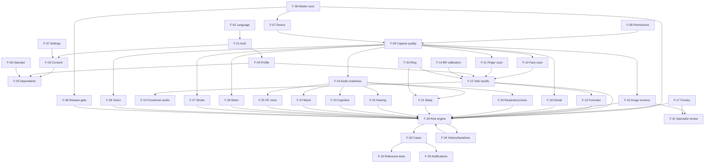

# 04 — Feature Analysis

> For **every** feature F-01…F-38: what it is, why it is needed, who uses it, required inputs, how it works, outputs/markers, dependencies (features, gates G-xx, algorithms ALG-xxx), screens (S-xx), tag and Spec reference.
> IDs from [00_README_Index.md](00_README_Index.md); requirements in [02_Application_Requirements.md](02_Application_Requirements.md); roles in [03_User_Roles_and_Permissions.md](03_User_Roles_and_Permissions.md). Unknowns → `16_Open_Questions_and_Assumptions.md` (temp IDs `OQ-FEA-nn` plus IDs from 02/03).

## Sub-template (used for every feature)

| Field | Content |
|---|---|
| **What** | One-paragraph definition |
| **Why** | Clinical / product reason |
| **Who** | Roles (03) |
| **Inputs** | Data, captures, masters |
| **How** | Ordered steps |
| **Outputs** | Markers / records |
| **Depends on** | Features · Gates · Algorithms |
| **Screens** | S-xx |
| **Tag / Ref** | Provenance · Spec section |

---

## 1. Feature dependency graph

---

## 2. Access & setup features

### F-01 Authentication & Session

| Field | Content |
|---|---|
| **What** | Sign-in with mobile number + OTP, token session, sign-out. |
| **Why** | Results are personal health data; must be bound to an identity and synced. |
| **Who** | Member, Guardian, Operator (auth model [OPEN] OQ-REQ-01). |
| **Inputs** | Mobile number (E.164, India +91 default [DER]), OTP. |
| **How** | 1. Enter number (S-A04). 2. Request OTP. 3. Verify (S-A05). 4. Store tokens securely. 5. Route to consent/profile if incomplete, else Home. |
| **Outputs** | `User`, session tokens. |
| **Depends on** | F-02 · G-01, G-36 · — |
| **Screens** | S-A04, S-A05 (S-A01 restores session) |
| **Tag / Ref** | STD/OPEN · not in Spec; FRS not provided |

### F-02 Language & Localisation

| Field | Content |
|---|---|
| **What** | Telugu / Hindi / English UI, voice prompts, speech recognition locale. |
| **Why** | Spec requires speech recognition in te/hi/en (AUD-10); voice-paced movement tests (§9). |
| **Who** | All mobile roles. |
| **Inputs** | Selected locale. |
| **How** | 1. Choose at S-A02. 2. Persist. 3. Apply to UI strings, TTS prompts, metronome voice, ASR locale. 4. Changeable at S-I03. |
| **Outputs** | `locale` setting; recorded per session for speech tasks. |
| **Depends on** | — · — · ALG-AUD-10, ALG-MOV-08 (language-dependent) |
| **Screens** | S-A02, S-I03 |
| **Tag / Ref** | DER · §8 AUD-10, §9 intro |

### F-03 Consent Management

| Field | Content |
|---|---|
| **What** | Capture, display, version and withdraw consents: screening, dental (guardian), training-data, clinician pathway (mood), HF enrolment. |
| **Why** | Spec preconditions: screening consent (§6), dental consent guardian for children (§7.1), training-consented records only (§11.2), clinician pathway (§8 AUD-11). |
| **Who** | Member, Guardian; Operator witnesses; Clinician activates pathway. |
| **Inputs** | Consent template (version, language), signer identity, subject. |
| **How** | 1. Consent Center lists required/optional consents (S-B01). 2. Detail + sign (S-B02), guardian variant for dependents. 3. Store record + version. 4. Gates G-04…G-08 evaluated from active consents. 5. Withdraw from S-I04. |
| **Outputs** | `Consent` records. |
| **Depends on** | F-01, F-05 · G-04, G-05, G-06, G-07, G-08 · — |
| **Screens** | S-B01, S-B02, S-I04, S-F01 |
| **Tag / Ref** | DOC · §6 intro, §7.1, §8 AUD-11/12, §11.2 |

### F-04 Member Profile & Health Context

| Field | Content |
|---|---|
| **What** | Demographics and health context used by algorithms and band lookup. |
| **Why** | BP needs age, sex, height, weight (§4.6); DM needs BMI, waist, family history, activity (§4.9); anaemia needs pregnancy (§6.1); oral offer needs tobacco/areca (§6.4); foot offer needs diabetes status (§6.5); cognitive needs education (§8 AUD-10); RSK-01 needs age/sex/pregnancy. |
| **Who** | Member, Guardian (for dependent), Operator (for participant). |
| **Inputs** | DOB, sex, height_cm, weight_kg, waist_cm, pregnancy + gestation, family history, activity, tobacco/areca, diabetes status, education level, HF enrolment (read-only). |
| **How** | 1. Basics (S-B03) → G-02. 2. Health context (S-B04) → G-03. 3. Validation (12_Error_Handling). 4. BMI (FRM-09), WHtR (FRM-10) recomputed on change. 5. Pre-scan context (caffeine/smoke/exercise in 30 min) at S-D02 for RSK-06. |
| **Outputs** | `HealthProfile`; derived BMI, WHtR. |
| **Depends on** | F-01 · G-02, G-03, G-29 · ALG-FRM-09/10, ALG-RSK-01/06 |
| **Screens** | S-B03, S-B04, S-D02 |
| **Tag / Ref** | DOC · §4.6, §4.9, §5, §6.1, §6.4, §6.5, §8 AUD-10, §10 RSK-06 |

### F-05 Family / Dependents

| Field | Content |
|---|---|
| **What** | Guardian-managed child (1–12) and newborn (0–28 d) profiles. |
| **Why** | Child eye (§6.6), newborn jaundice (§6.7), dental child mode (§7), growth z-scores (FRM-12) target children; guardian consent required (§7.1). |
| **Who** | Guardian; Operator (with guardian consent). |
| **Inputs** | Name, DOB (+ birth time for newborn), sex, gestation (newborn), height/weight (growth), relationship. |
| **How** | 1. Add dependent (S-B06). 2. Guardian signs consents for dependent. 3. Active subject switcher on Home. 4. Screens filtered by age eligibility (G-09). |
| **Outputs** | `Dependent` (a `Member` with `guardianId`). |
| **Depends on** | F-03, F-04 · G-05, G-09 · ALG-FRM-12 |
| **Screens** | S-B05, S-B06 |
| **Tag / Ref** | DER · §5 FRM-12, §6.6, §6.7, §7 |

### F-06 Operator (Field Worker) Mode

| Field | Content |
|---|---|
| **What** | Mode where a trained worker registers and screens many participants. |
| **Why** | Spec validates in schools, anganwadis, clinics and compares parent vs operator photographers (§7.1), untrained photographers (§6.4). |
| **Who** | Operator. |
| **Inputs** | Operator identity/site [OPEN], participant search/registration data. |
| **How** | 1. Choose Operator mode (S-A06). 2. Search/register participant (S-A08). 3. Record consent (participant/guardian). 4. Run screens; photographer_type = operator. 5. Queue uploads (offline). |
| **Outputs** | Participants, sessions tagged `photographerType=operator`, `siteId`. |
| **Depends on** | F-01, F-03, F-05 · G-01, G-04, G-36 · — |
| **Screens** | S-A06, S-A08 |
| **Tag / Ref** | DER/OPEN · §6.4, §7.1; OQ-REQ-06 |

### F-07 Device Capability & Calibration

| Field | Content |
|---|---|
| **What** | Identify phone model and load its calibration profile from `mst_device_model`; verify camera fps and audio capability. |
| **Why** | SpO2 coefficients per model (§4.5), mic profile (CAP-11), noise offset (CAP-12), blur calibration (CAP-06), focal length (CAP-15), ≥ 30 fps (§4.8). |
| **Who** | System, run for any user. |
| **Inputs** | Manufacturer, model, OS; `mst_device_model`. |
| **How** | 1. Read device identifiers. 2. Lookup (cached master). 3. Probe camera fps (front/rear), torch, audio sample rates, processing-disable support. 4. Run CAP-11 mic self-check (optional at S-B07). 5. Store `DeviceProfile`; set capability flags (e.g. `spo2Supported`). |
| **Outputs** | `DeviceProfile`, G-16 status. |
| **Depends on** | F-36, F-08 · G-16, G-17 · ALG-CAP-06/11/12/15, ALG-SPO-01 |
| **Screens** | S-B07 |
| **Tag / Ref** | DOC · §2 CAP-11/15, §4.5, §4.8; unsupported device behaviour OQ-REQ-07 |

### F-08 Runtime Permissions

| Field | Content |
|---|---|
| **What** | Just-in-time OS permission requests with primers. |
| **Why** | Camera, mic, motion sensors (§9 intro), Bluetooth needed for captures/devices. |
| **Who** | All mobile roles. |
| **Inputs** | OS permission state. |
| **How** | 1. Primer (S-A07) explaining purpose. 2. OS request. 3. On deny → disable dependent tasks, show Settings CTA. See 03 §6. |
| **Outputs** | Gate states G-11…G-15. |
| **Depends on** | — · G-11, G-12, G-13, G-14, G-15 · — |
| **Screens** | S-A07 |
| **Tag / Ref** | DER · §9 intro |

---

## 3. Capture & vitals features

### F-09 Capture Quality Engine (ALG-CAP-01…15)

| Field | Content |
|---|---|
| **What** | Real-time on-device checks that accept or reject every capture with a specific instruction. |
| **Why** | Spec: capture accepted only when every check passes for the full recording (or 2 s continuous framing for photos) (§2). |
| **Who** | System, embedded in all capture screens. |
| **Inputs** | Video frames, landmarks, images, audio, device profile thresholds (`mst_quality_threshold`). |
| **How** | 1. Select check set per task (face: CAP-01…05; photo: CAP-06…10; audio: CAP-11…13; AV: CAP-14; vision: CAP-15). 2. Evaluate per frame/window. 3. Show the *first failing* check's message. 4. Accept when all pass for required duration. 5. Store raw markers. |
| **Outputs** | `QualityCheckResult` per check: face_size_px, yaw_deg, pitch_deg, roi_pixel_count, illuminance_luma, motion_px_s, motion_high_pct, skin_valid_pct, blur_score, glare_pct, dark_pct, iq_score/iq_reason, part_found/coverage, card_found/colour_error_de, mic_response_dev_db/audio_processing_detected, noise_dba, clip_pct/audio_snr_db, av_offset_ms/sync_found, face_distance_cm. Aggregate capture quality score → RSK-06. |
| **Depends on** | F-07, F-08, F-36 · G-11, G-12, G-16, G-20, G-21, G-33 · ALG-CAP-01…15 |
| **Screens** | Overlay in S-D03, S-D04, S-E03, S-F03, S-G01, S-H01, S-H06, S-H07 |
| **Tag / Ref** | DOC · §2 (CAP-08 classifier [MOCK] until model available) |

### F-10 Vitals Scan — Face (rPPG)

| Field | Content |
|---|---|
| **What** | 60-s front-camera scan producing a clean pulse wave and beat list. |
| **Why** | Contactless vitals are the core use case; all §4 cards start from §3 outputs. |
| **Who** | Member, Operator (Guardian for child [OPEN] OQ-ROLE-03). |
| **Inputs** | Front camera ≥ 30 fps, profile (G-02), pre-scan context. |
| **How** | 1. Setup/mode choice (S-D01). 2. Context check (S-D02). 3. Capture with CAP-01…05 (S-D03); first 3 s discarded; ≥ 80 % frames must pass. 4. PUL-01 ROI traces → PUL-02 detrend/filter → PUL-03 POS / PUL-04 CHROM → PUL-05 neural (≤ 15 s; > 20 s fallback POS + flag) → PUL-07 spectral HR → PUL-08 beats → PUL-09 SQI → PUL-10 IBI clean (S-D05). 5. On fail → retake guidance (S-D06), max 3, then offer finger mode. |
| **Outputs** | `PulseSignalSummary`: hr_spec_bpm, hr_pos_bpm, hr_neural_bpm, pulse_snr_db, template_corr_mean, clean_beat_count, ibi_ms[], ectopic_count, neural_fallback flag. |
| **Depends on** | F-09, F-07, F-04 · G-02, G-04, G-11, G-16, G-21, G-22, G-25 · ALG-CAP-01…05, ALG-PUL-01…05, 07…10 |
| **Screens** | S-D01…S-D06 |
| **Tag / Ref** | DOC · §3, §4.1 (neural model [MOCK]) |

### F-11 Vitals Scan — Finger (contact PPG + SpO2)

| Field | Content |
|---|---|
| **What** | 30–60 s rear-camera + torch fingertip scan. |
| **Why** | Fallback after 3 failed face scans (§4.1); required for SpO2 (§4.5); preferred for waveform (§4.8); satisfies BP precondition (§4.6). |
| **Who** | Member, Operator. |
| **Inputs** | Rear camera + torch, device SpO2 coefficients. |
| **How** | 1. Instruct finger over lens + torch (S-D04). 2. PUL-06: centre 50 %, mean red, invert, PUL-02 filter. 3. Saturation (mean red > 250) → "press lighter"; no pulse → "cover lens fully". 4. Continue with PUL-07…10. 5. SpO2 ratio-of-ratios with device A, B. |
| **Outputs** | bvp_finger, beat list, PI, SPO2_ROR, SPO2_EST (internal), SPO2_BAND. |
| **Depends on** | F-09, F-07 · G-11, G-16, G-22 · ALG-PUL-06…10, ALG-SPO-01, ALG-WAV-01 (PI) |
| **Screens** | S-D04, S-D05 |
| **Tag / Ref** | DOC · §3 PUL-06, §4.5 |

### F-12 Vital-Sign Results

| Field | Content |
|---|---|
| **What** | HR, RR, HRV, stress, SpO2 band, BP band, rhythm, waveform/vascular age, diabetes risk. |
| **Why** | The nine §4 cards. |
| **Who** | Member, Guardian, Operator (view scope OQ-ROLE-04). |
| **Inputs** | Pulse outputs (F-10/F-11), landmarks motion (RR), profile, BP calibration, ring flag. |
| **How** | 1. HR (§4.1): spectral vs beat HR within 3 bpm. 2. RR (§4.2) 4-series fusion. 3. HRV (§4.3) ≥ 50 beats; LF/HF ≥ 120 s. 4. Stress SI (§4.4). 5. SpO2 band (§4.5, finger only). 6. BP (§4.6) model + cuff offset; band-only. 7. Rhythm (§4.7) classifier + 2-scan confirmation. 8. Waveform (§4.8). 9. DM risk (§4.9). 10. RSK-01 bands, RSK-06 confidence, F-38 release gate. |
| **Outputs** | HR, HR_POS, HR_NEURAL, HR_SPEC_DIFF; RR, RR_RIIV/RIAV/RIFV/MOTION, RR_SPREAD; SDNN, RMSSD, SD1, SD2, PNN50, SD1_SD2, LF, HF, LF_HF; BAEVSKY_SI, STRESS_BAND; SPO2_BAND; BP_BAND, BP_CONFIDENCE (SBP/DBP internal); IRREG_PROB, IRREG_BAND, ECTOPIC_PM; PI, RISE_TIME, NOTCH_TIME, NOTCH_REL_H, RI, AIX, WIDTH_25/50/75, AREA_RATIO, SDPPG_BA/CA/DA/EA, AGING_INDEX, VASC_AGE, VASC_AGE_GAP, PTT_PROXY; DM_PROB_57, DM_PROB_65, DM_BAND. |
| **Depends on** | F-10, F-11, F-04, F-14, F-33, F-38 · G-02, G-03, G-22, G-23, G-24, G-26, G-27 · ALG-PUL-07, ALG-RSP-01, ALG-HRV-01…04, ALG-SPO-01, ALG-BP-01, ALG-RHY-01, ALG-WAV-01…05, ALG-DM-01 |
| **Screens** | S-D07, S-D08 |
| **Tag / Ref** | DOC · §4.1–4.9 (trained models [MOCK]) |

### F-13 Derived Formulas (ALG-FRM-01…15)

| Field | Content |
|---|---|
| **What** | Deterministic formulas: MAP, PP, shock index, RPP, CR ratio, HRmax, HRR, VO2max, BMI, WHtR, body fat, WHO z, GLI-2012, orthostatic rise, HR recovery. |
| **Why** | Contextual and fitness metrics; shock index feeds emergency rule (T4/T5). |
| **Who** | System; displayed to Member/Guardian/Operator. |
| **Inputs** | Vitals markers, profile, `mst_growth_reference`, GLI coefficients. |
| **How** | 1. Check every input present, not hidden, above quality (G-29) — otherwise skip. 2. Compute. 3. Round to Spec decimals. 4. Validate against valid range. 5. Band via RSK-01. |
| **Outputs** | map_mmhg, pp_mmhg, shock_index, rpp, cr_ratio, hrmax_bpm, hrr_bpm, vo2max_est, bmi, whtr, body_fat_pct, haz/waz/bmiz, fev1_pred_pct/fvc_pred_pct/ratio_lln, ortho_hr_rise_bpm, hr_recovery_1m_bpm. |
| **Depends on** | F-12, F-04, F-15, F-20 · G-29 · ALG-FRM-01…15 |
| **Screens** | S-D07, S-D09 |
| **Tag / Ref** | DOC · §5 (BP-derived visibility OQ-REQ-08) |

### F-14 BP Personal Cuff Calibration

| Field | Content |
|---|---|
| **What** | User enters a cuff BP alongside a scan; offset applied for 30 days. |
| **Why** | §4.6 Step 3: apply offset if cuff within 30 days. |
| **Who** | Member; Operator with cuff. |
| **Inputs** | Cuff SBP/DBP (validated cuff, mean of 2 readings per §14 [OPEN for calibration]), paired scan. |
| **How** | 1. S-D10: enter cuff values. 2. Pair with scan (≤ 10 min suggested by §14). 3. Compute offset vs model estimate (server/on-device). 4. Store with expiry 30 d (G-26). 5. Reminder before expiry. |
| **Outputs** | `BpCalibration {offsetSbp, offsetDbp, createdAt, expiresAt}`. |
| **Depends on** | F-12 · G-26 · ALG-BP-01 |
| **Screens** | S-D10 |
| **Tag / Ref** | DOC · §4.6; OQ-REQ-09 |

### F-15 Functional Cardio Tests

| Field | Content |
|---|---|
| **What** | Orthostatic test, HR recovery after exercise, paced-breathing retake for RR. |
| **Why** | FRM-14/15 defined; paced-breathing retake offered when RR unavailable (§4.2). |
| **Who** | Member, Operator. |
| **Inputs** | HR series (lying last 30 s; standing 0–3 min; end-exercise and +60 s). |
| **How** | Orthostatic: lie, scan → stand, continuous HR 3 min (S-D11). Recovery: exercise, scan end + 60 s (S-D12). Paced breathing: guided breathing during re-scan (S-D13). |
| **Outputs** | ortho_hr_rise_bpm (flag ≥ 30, normal < 30), hr_recovery_1m_bpm (normal ≥ 12), RR. |
| **Depends on** | F-10/F-11, F-12 · G-21, G-22 · ALG-FRM-14/15, ALG-RSP-01 |
| **Screens** | S-D11, S-D12, S-D13 |
| **Tag / Ref** | DOC/DER · §5, §4.2; protocols OQ-REQ-10 |

---

## 4. Image & dental features

### F-16 Image Screens (IMG-01…08)

| Field | Content |
|---|---|
| **What** | Guided photo screens: anaemia, adult jaundice, cataract, oral lesion, diabetic foot, child eye, newborn jaundice, skin. |
| **Why** | Low-cost screening of common conditions (§6). |
| **Who** | Member, Guardian (child eye, newborn), Operator; Specialist reviews. |
| **Inputs** | Per screen (§6.1–6.8): eyelid photos ×2/eye; sclera looking up; front-of-eye; mouth views; soles/heels/toes; child flash photo 0.5–1 m; newborn forehead/chest with card; skin close-up. Profile: age, sex, pregnancy, tobacco, diabetes, age in hours, gestation. |
| **How** | 1. Eligibility (G-09/G-10): cataract ≥ 40 or on request; oral always offered to tobacco users; foot for diabetes/high DM risk monthly; child eye 1–12; newborn 0–28 d. 2. Intro (S-E01). 3. Colour card setup (S-E02) — mandatory newborn, preferred anaemia, used jaundice/foot. 4. Guided capture with CAP-06/07/08/09/10 (S-E03). 5. Review (S-E04). 6. Inference (on-device/server [OPEN]). 7. Band; within ± 0.1 of threshold or high → IMG-10. 8. Retake max 3 → "not assessed". |
| **Outputs** | HB_EST (internal), ANAEMIA_PROB, ANAEMIA_BAND; SCLERA_BSTAR, JAUNDICE_PROB, JAUNDICE_BAND; CATARACT_PROB_L/R, CATARACT_BAND; ORAL_CLASS, ORAL_PROB_SUSP, ORAL_PROB_HIGH, lesion regions; DFU_CLASS, DFU_PROB, WOUND_AREA; REFLEX_ASYM, HIRSCHBERG_DEG, WHITE_PUPIL_PROB, CHILD_EYE_BAND; NEO_BILI_EST, NEO_JAUNDICE_BAND; SKIN_CLASS, SKIN_PROB, SKIN_BAND. |
| **Depends on** | F-03, F-04, F-05, F-09, F-31 · G-04, G-09, G-10, G-11, G-20, G-21, G-25, G-34 · ALG-CAP-06…10, ALG-IMG-01…08, IMG-10 |
| **Screens** | S-E01, S-E02, S-E03, S-E04, S-R01 |
| **Tag / Ref** | DOC · §6.1–6.8 (models [MOCK]; skin thresholds OQ-REQ-11) |

### F-17 Fundus Partner Integration (IMG-09)

| Field | Content |
|---|---|
| **What** | Clip-on fundus camera → partner AI (e.g. Medios AI) → adapter. |
| **Why** | DR and glaucoma screening for diabetics (DM high triggers eye follow-up §4.9). |
| **Who** | Operator primarily; Member with device. |
| **Inputs** | Fundus images from partner device; partner API. |
| **How** | 1. Connect device (S-E06, G-31). 2. Capture per partner guidance. 3. Send to partner AI. 4. Adapter maps response to envelope. 5. Referable → IMG-10 / case. |
| **Outputs** | DR_REFERABLE, DR_GRADE, GLAUCOMA_SUSPECT. |
| **Depends on** | F-03, F-08 · G-04, G-15, G-31, G-36 · ALG-IMG-09 |
| **Screens** | S-E06, S-R01 |
| **Tag / Ref** | DOC · §6.8; device/API OQ-REQ-12 |

### F-18 Dental Screening

| Field | Content |
|---|---|
| **What** | 4-view mouth photo exam with FDI tooth chart, findings, gum/plaque, sealant need, caries risk, change over time. |
| **Why** | Caries screening in children and adults (§7). |
| **Who** | Member, Guardian ("parent"), Operator. |
| **Inputs** | 4 views (front closed, front open, upper occlusal, lower occlusal); age (dentition); Q_CARIES_RISK; previous exam. |
| **How** | 1. Consent (G-05) (S-F01). 2. Questionnaire (S-F02). 3. Capture with CAP-06/07/09 per view (S-F03), child-mode guidance for 1–12. 4. DEN-01 view classifier. 5. Tooth detect + FDI numbering (primary 51–85 < 6 y, mixed 6–12, permanent 11–48). 6. Per-tooth findings, merge duplicates (highest severity). 7. DEN-04 gum/plaque; DEN-05 sealant (6–9 y). 8. DEN-06 caries risk (BR-DEN). 9. DEN-07 change vs last exam. 10. Missing view → "partial". |
| **Outputs** | `DentalExam` (views_completed, partial), `ToothFinding` (tooth_fdi, finding_code, finding_prob, bbox), GUM_INFLAM_BAND, PLAQUE_BAND, sealant_needed_teeth[], caries_risk_level, change_vs_previous. |
| **Depends on** | F-03, F-05, F-09, F-34 · G-05, G-09, G-11, G-21, G-25 · ALG-DEN-01…07 |
| **Screens** | S-F01…S-F05 |
| **Tag / Ref** | DOC · §7; BR-DEN OQ-REQ-13 |

---

## 5. Audio features

### F-19 Audio Readiness

| Field | Content |
|---|---|
| **What** | Mic self-check, room-noise, clipping/SNR monitoring, AV sync. |
| **Why** | All audio algorithms require CAP-11/12/13 (§8 intro). |
| **Who** | All mobile roles. |
| **Inputs** | Speaker sweep, 3 s silence, live audio; device profile. |
| **How** | 1. Configure 44.1–48 kHz mono, processing off. 2. CAP-11 sweep 100 Hz–8 kHz 1.5 s (≤ 6 dB deviation, no processing). 3. CAP-12 3 s silence ≤ 45 dBA. 4. During task CAP-13 clip ≤ 1 %, SNR ≥ 15 dB. 5. CAP-14 beep+flash for AV tasks. |
| **Outputs** | mic_response_dev_db, audio_processing_detected, noise_dba, clip_pct, audio_snr_db, av_offset_ms, sync_found. |
| **Depends on** | F-07, F-08 · G-12, G-16, G-17, G-18 · ALG-CAP-11…14 |
| **Screens** | S-G01 |
| **Tag / Ref** | DOC · §2, §8 intro |

### F-20 Respiratory & Voice Audio

| Field | Content |
|---|---|
| **What** | Cough detection, TB risk, obstruction, lung function, voice quality. |
| **Why** | TB prioritisation, COPD/asthma flag, spirometry proxy (§8 AUD-01…06). |
| **Who** | Member, Operator. |
| **Inputs** | Cough task, "aaa" ≥ 3 s, "sss", "zzz", sentence, breath sounds, 3 forced exhales (~30 cm); Q_TB_SYMPTOMS, Q_MMRC, Q_EXPOSURE; height, age, sex. |
| **How** | 1. Questionnaires (S-G02). 2. Cough task (S-G03) → AUD-01 (≥ 3 valid). 3. Voice tasks (S-G04) → AUD-06. 4. Forced exhale ×3 (S-G05) → AUD-05 best of 3, repeatability 10 %, FRM-13. 5. AUD-02 embedding (HeAR, licence). 6. AUD-03 TB (or partner API). 7. AUD-04 obstruction. 8. Results (S-G06). |
| **Outputs** | COUGH_COUNT_VALID, cough_events[]; audio_embedding[]; TB_PROB, TB_BAND; OAD_PROB, OAD_BAND, ASTHMA_VS_COPD_PROB; FEV1_L, FVC_L, FEV1_FVC, PEF_LS, % predicted, RATIO_LLN; F0_HZ, JITTER_PCT, SHIMMER_PCT, HNR_DB, CPPS_DB, MPT_S, SZ_RATIO. |
| **Depends on** | F-19, F-04 · G-12, G-17, G-18, G-21 · ALG-AUD-01…06, ALG-FRM-13 |
| **Screens** | S-G02…S-G06 |
| **Tag / Ref** | DOC · §8; questionnaires OQ-REQ-14; HeAR licence OQ-API |

### F-21 Sleep Monitoring

| Field | Content |
|---|---|
| **What** | Overnight sonar breathing and apnoea estimate. |
| **Why** | OSA screening (§8 AUD-07/08). |
| **Who** | Member (home). |
| **Inputs** | Sonar chirps 18–20 kHz, audio (snore/gasp), ring SpO2 optional. |
| **How** | 1. Setup: charging, bedside, 0.3–1 m (G-30) (S-G07). 2. Night mode (S-G08) RR per 30-s epoch. 3. Events: apnoea ≥ 90 % drop ≥ 10 s; hypopnoea ≥ 30 % ≥ 10 s (+ SpO2 dip ≥ 3 % if ring). 4. AHI = events ÷ valid hours; requires ≥ 4 h. 5. Report (S-G09). |
| **Outputs** | SONAR_RR, sonar_breath_wave, APNOEA_EVENTS, HYPOPNOEA_EVENTS, AHI_EST, OSA_BAND, VALID_SLEEP_H. |
| **Depends on** | F-19, F-33 · G-12, G-17, G-30, G-32 · ALG-AUD-07/08 |
| **Screens** | S-G07, S-G08, S-G09 |
| **Tag / Ref** | DOC · §8 AUD-07/08 |

### F-22 Hearing Screen

| Field | Content |
|---|---|
| **What** | Pure-tone or digits-in-noise hearing screen. |
| **Why** | Hearing loss screening (§8 AUD-09). |
| **Who** | Member, Operator. |
| **Inputs** | Earphones detected (G-19), quiet room, age. |
| **How** | 1. Detect earphones + CAP-12. 2. Pure tone 0.5, 1, 2, 4 kHz each ear, up 5 dB / down 10 dB; or DIN staircase → SRT (S-G10). 3. Band (S-G11). |
| **Outputs** | HEAR_L/R_xxx (dB HL), DIN_SRT_DB, HEARING_BAND. |
| **Depends on** | F-19 · G-12, G-18, G-19 · ALG-AUD-09 |
| **Screens** | S-G10, S-G11 |
| **Tag / Ref** | DOC · §8 AUD-09; calibration OQ-REQ-15; DIN normative cut-off OQ-FEA-01 |

### F-23 Cognitive Speech Screen

| Field | Content |
|---|---|
| **What** | Animal naming 60 s + picture description → cognitive band. |
| **Why** | Cognitive decline screening (§8 AUD-10). |
| **Who** | Member/participant age ≥ 50. |
| **Inputs** | Speech audio, language (te/hi/en), age, education level. |
| **How** | 1. Eligibility age ≥ 50. 2. Tasks (S-G12). 3. ASR → valid words, repetitions, pauses > 2 s, rate, lexical diversity, info units → classifier. |
| **Outputs** | FLUENCY_COUNT, PAUSE_RATE, SPEECH_RATE, LEXICAL_DIV, COG_BAND. |
| **Depends on** | F-02, F-04, F-19 · G-09, G-12, G-17, G-18 · ALG-AUD-10 |
| **Screens** | S-G12 |
| **Tag / Ref** | DOC · §8 AUD-10; picture stimulus & norms OQ-FEA-02 |

### F-24 Mood Screen & Crisis Pathway

| Field | Content |
|---|---|
| **What** | 60-s free speech + PHQ-9 + GAD-7 inside clinician pathway; crisis screen on PHQ-9 item 9 > 0. |
| **Why** | Mood screening support (§8 AUD-11). |
| **Who** | Member in clinician pathway; Clinician. |
| **Inputs** | Free speech, PHQ-9 (0–27), GAD-7 (0–21). |
| **How** | 1. G-07 check. 2. Questionnaires + speech (S-G13). 3. Item 9 > 0 → immediately S-G14 (G-37), regardless of other results. 4. Voice score only if released (adds ≥ 0.03 AUC). |
| **Outputs** | MOOD_VOICE_SCORE, PHQ9, GAD7. |
| **Depends on** | F-03, F-19, F-38 · G-07, G-12, G-37 · ALG-AUD-11 |
| **Screens** | S-G13, S-G14 |
| **Tag / Ref** | DOC · §8 AUD-11; helplines OQ-REQ-16 |

### F-25 Heart-Failure Voice Monitoring

| Field | Content |
|---|---|
| **What** | Daily 30-s fixed sentence vs 14-day personal baseline. |
| **Why** | Early warning of fluid build-up (§8 AUD-12). |
| **Who** | Enrolled HF patients. |
| **Inputs** | Daily recording, baseline. |
| **How** | 1. G-08 check. 2. Daily reminder (G-34). 3. Record (S-G15). 4. Days 1–14 baseline (G-28) — no alert. 5. Deviation score → HF_ALERT. |
| **Outputs** | HF_VOICE_DEV, HF_ALERT. |
| **Depends on** | F-03, F-19, F-35 · G-08, G-12, G-28, G-34 · ALG-AUD-12 |
| **Screens** | S-G15 |
| **Tag / Ref** | DOC · §8 AUD-12; fixed sentence text & alert threshold OQ-FEA-03 |

---

## 6. Movement, touch & vision features

### F-26 Motor & Neuro Tests

| Field | Content |
|---|---|
| **What** | Finger tapping (video, touch), gait, sit-to-stand, tremor, Parkinson's score. |
| **Why** | Bradykinesia, mobility, fall risk, tremor, PD signs (§9). |
| **Who** | Member, Operator. |
| **Inputs** | Camera (hand), touch events, accelerometer 50 Hz, gyroscope 100 Hz, voice, face. |
| **How** | App paces with voice + metronome. MOV-01 hand in frame 10 s/hand; MOV-02 two targets 10 s/hand; MOV-03 phone in front trouser pocket, 10-m walk; MOV-04 armless chair 30 s; MOV-05 arm's length 20 s/hand; MOV-13 combines tapping, voice, face. |
| **Outputs** | TAP_COUNT, TAP_FREQ, TAP_DECREMENT, TAP_CV; TOUCH_TAP_COUNT, INTER_TAP_CV; STEPS, CADENCE, STEP_CV, GAIT_SPEED; STS_COUNT_30S; TREMOR_FREQ, TREMOR_AMP; PD_PROB, PD_BAND. |
| **Depends on** | F-08, F-09, F-02 · G-11, G-13 · ALG-MOV-01…05, ALG-MOV-13, ALG-CAP-09 |
| **Screens** | S-H01…S-H05 |
| **Tag / Ref** | DOC · §9; age norms OQ-FEA-04 |

### F-27 Stroke FAST Check

| Field | Content |
|---|---|
| **What** | Face asymmetry, arm drift, speech check → act-now flag. |
| **Why** | Stroke positive = Emergency (T10, BR-SCR-01). |
| **Who** | Anyone (Member, Guardian on behalf, Operator). |
| **Inputs** | Face video rest + smile, pose video arms raised eyes closed 10 s, fixed sentence, onset time. |
| **How** | 1. Onset time. 2. MOV-06, MOV-07, MOV-08 (S-H06). 3. MOV-09: positive if any sign above threshold. 4. Positive → S-R02 Emergency (G-37). |
| **Outputs** | FACE_ASYM_SCORE, FACE_ASYM_SIDE, ARM_DRIFT_L/R, SPEECH_ABN_PROB, STROKE_POSITIVE, signs[]. |
| **Depends on** | F-09, F-02, F-29 · G-11, G-12, G-37 · ALG-MOV-06…09 |
| **Screens** | S-H06, S-R02 |
| **Tag / Ref** | DOC · §9, §10 T10; thresholds OQ-FEA-05; emergency number OQ-FEA-06 |

### F-28 Vision & Reaction Tests

| Field | Content |
|---|---|
| **What** | Visual acuity, colour plates, Amsler grid, reaction time. |
| **Why** | Vision and processing speed screening (§9 MOV-10…12). |
| **Who** | Member, Operator. |
| **Inputs** | Face distance (CAP-15), screen DPI, brightness, touch, audio stimuli. |
| **How** | MOV-10 at 40 ± 5 cm (G-33), cover one eye, tumbling-E staircase → logMAR. MOV-11 max brightness, plates; Amsler at 30 cm, member marks distortions. MOV-12 10 visual + 10 sound, 1–4 s random gaps, discard < 100 ms, median. |
| **Outputs** | LOGMAR_L/R, COLOUR_PLATE_SCORE, AMSLER_ABNORMAL, RT_VISUAL_MS, RT_AUDIO_MS. |
| **Depends on** | F-09, F-07 · G-11, G-33 · ALG-MOV-10…12, ALG-CAP-15 |
| **Screens** | S-H07…S-H10 |
| **Tag / Ref** | DOC · §9; plate set licence OQ-FEA-07 |

---

## 7. Risk, cases & follow-up

### F-29 Risk Engine

| Field | Content |
|---|---|
| **What** | Deterministic band assignment, urgency, baseline, change, organ risk, confidence, flag aggregation. |
| **Why** | Turns readings into actionable, reproducible flags (§10). |
| **Who** | System; outputs shown to all. |
| **Inputs** | Markers, profile (age, sex, pregnancy), `mst_reference_range`, rules (BR-*), history. |
| **How** | RSK-01 band (inclusive on normal side) → RSK-06 confidence (hide < 0.6) → RSK-03 baseline → RSK-04 change (> 15 % or > 2 SD) → RSK-05 CKD/MetS (only if BP band, DM band, waist, history) → RSK-02 urgency (highest wins) → RSK-07 one flag/case per condition, merge 30 d. |
| **Outputs** | band, range_version, urgency, rule_codes[], baseline_value, baseline_sd, change_flag, change_pct, ckd_risk, mets_risk, result_confidence, flag_id, case_id. |
| **Depends on** | F-12…F-28, F-34, F-36, F-38 · G-23, G-24, G-28 · ALG-RSK-01…07 |
| **Screens** | S-D07, S-R01, S-R02, S-R03, S-C05 |
| **Tag / Ref** | DOC · §10 (T1–T16); rule catalogue OQ-REQ-17; location (device vs server) OQ-FEA-08 |

### F-30 Cases, Flags & Confirmatory Investigations

| Field | Content |
|---|---|
| **What** | Case list and detail with recommended confirmatory tests, cut-offs and urgency. |
| **Why** | Each flag must be confirmed or ruled out by standard investigations (§13). |
| **Who** | Member, Guardian, Operator (scope), Clinician. |
| **Inputs** | Flags (RSK-07), `mst_confirmatory_test`, `mst_pathway`. |
| **How** | 1. Cases sorted by urgency (urgent first, T15). 2. Detail shows trigger, investigations, usual cut-offs, urgency, clinician-precedence disclaimer. 3. Close/resolve when reference result entered [OPEN]. |
| **Outputs** | `Case`, `Flag`, `ConfirmatoryTest` recommendations. |
| **Depends on** | F-29, F-36 · G-37 · ALG-RSK-02, ALG-RSK-07 |
| **Screens** | S-R04, S-R05 |
| **Tag / Ref** | DOC · §13; case lifecycle OQ-FEA-09 |

### F-31 Specialist Review (IMG-10)

| Field | Content |
|---|---|
| **What** | Back-office review of high/uncertain image results; app shows review status. |
| **Why** | §6 intro: every high or uncertain (± 0.1 of threshold) result goes to specialist review. |
| **Who** | Specialist (portal); Member/Guardian/Operator see status. |
| **Inputs** | Images, model output, minimal context. |
| **How** | 1. Auto-route. 2. Status `pending → inReview → completed` (push/poll). 3. Reviewer outcome overrides/augments band [OPEN]. |
| **Outputs** | `SpecialistReview {status, outcome, reviewedAt}`. |
| **Depends on** | F-16, F-17, F-35 · G-36 · IMG-10 |
| **Screens** | State on S-R01, S-R05 |
| **Tag / Ref** | DOC (referenced) · §6 intro; OQ-REQ-18 |

### F-32 Reference Tests & Pairing

| Field | Content |
|---|---|
| **What** | Entry of lab/reference results, pairing with scans per §14 windows, sampled-negative invitations. |
| **Why** | Measure sensitivity/NPV; train/validate models (§14, FRS REF-03/06). |
| **Who** | Member/Guardian/Operator/Clinician (who enters — OQ-REQ-19); System sends invitations. |
| **Inputs** | Reference test type, value, unit, date/time, exclusions per §14. |
| **How** | 1. Invitation (S-R07) to ≥ 5 % screen-negatives per screen per month. 2. Entry (S-R06). 3. Compute gap vs scan; check exclusions. 4. Grade (D if outside window or excluded; A–C [OPEN]). |
| **Outputs** | `ReferenceResult {pairingGrade, gap, exclusions}`. |
| **Depends on** | F-30, F-35, F-36 · G-36 · — |
| **Screens** | S-R06, S-R07 |
| **Tag / Ref** | DOC/OPEN · §13, §14 |

### F-33 Smart Ring Integration

| Field | Content |
|---|---|
| **What** | Optional ring providing SpO2, temperature, overnight rhythm flag. |
| **Why** | Rhythm confirmation (1 scan + ring, §4.7), apnoea SpO2 dips (§8 AUD-08), SpO2 alternative (§4.5), temperature for T9 (§10, §13). |
| **Who** | Member. |
| **Inputs** | BLE / vendor SDK data. |
| **How** | 1. Pair (S-I02, G-15). 2. Sync overnight data. 3. Feed RHY-01 confirmation, AUD-08, T9 rule. |
| **Outputs** | ring_spo2, ring_temperature_c, ring_rhythm_flag. |
| **Depends on** | F-08 · G-15, G-32 · ALG-RHY-01, ALG-AUD-08, ALG-RSK-02 |
| **Screens** | S-I01, S-I02 |
| **Tag / Ref** | DOC (referenced) · §4.5, §4.7, §8 AUD-08, §13; vendor OQ-REQ-20 |

### F-34 History, Trends & Personal Baselines

| Field | Content |
|---|---|
| **What** | Session history, marker trends, baseline bands, change flags. |
| **Why** | RSK-03/04 need history; dental change (DEN-07). |
| **Who** | Member, Guardian, Operator (site scope). |
| **Inputs** | Past `MarkerResult`s. |
| **How** | 1. List sessions (S-C03). 2. Detail (S-C04). 3. Trend chart with baseline ± SD and change markers (S-C05); hidden/low-confidence values excluded. |
| **Outputs** | `Baseline`, trend series. |
| **Depends on** | F-29 · G-28 · ALG-RSK-03/04, ALG-DEN-07 |
| **Screens** | S-C03, S-C04, S-C05 |
| **Tag / Ref** | DER · §10, §7.2 |

### F-35 Notifications & Reminders

| Field | Content |
|---|---|
| **What** | Local + push reminders and alerts. |
| **Why** | Foot monthly (§6.5), HF daily (§8 AUD-12), rhythm confirmation scan (§4.7), BP calibration expiry (§4.6), reference invitations (§14), review completed. |
| **Who** | Member, Guardian, Operator. |
| **Inputs** | Schedules, server events. |
| **How** | Schedule local notifications; receive push; inbox (S-C06). |
| **Outputs** | `Notification`. |
| **Depends on** | F-30, F-31, F-32 · G-14, G-34 · — |
| **Screens** | S-C06 |
| **Tag / Ref** | DER · §4.6, §4.7, §6.5, §8 AUD-12, §14 |

### F-36 Master Data & Algorithm Version Sync

| Field | Content |
|---|---|
| **What** | Download and cache `mst_*` tables and algorithm versions. |
| **Why** | All defaults live in masters, changeable only via change control (§1). |
| **Who** | System. |
| **Inputs** | Server master manifest. |
| **How** | 1. At bootstrap (S-A01) fetch manifest with versions. 2. Download changed tables (ETag). 3. Validate checksum. 4. Atomically swap. 5. Keep last good. |
| **Outputs** | Local master store; versions shown at S-I05. |
| **Depends on** | F-01 · G-36 · all ALG (parameters) |
| **Screens** | S-A01, S-I05 |
| **Tag / Ref** | DOC · §1 |

### F-37 Settings, Privacy & About

| Field | Content |
|---|---|
| **What** | Language, notifications, devices, consents, privacy, about/disclaimers, algorithm versions. |
| **Why** | Standard app infrastructure; disclaimers required by screening nature (§13). |
| **Who** | All mobile roles. |
| **Inputs** | User settings. |
| **How** | Standard settings screens. |
| **Outputs** | Settings. |
| **Depends on** | F-02, F-03, F-33, F-36 · — · — |
| **Screens** | S-I03, S-I04, S-I05 |
| **Tag / Ref** | STD |

### F-38 Algorithm Release Gate

| Field | Content |
|---|---|
| **What** | Per-algorithm release status governing display: `validated`, `bandOnly`, `research`, `disabled`. |
| **Why** | Trained models must pass studies before display (§4 intro); BP band-only until validated (§4.6); generic SpO2 research only (§4.5); mood voice only if adds AUC (§8 AUD-11); DM profile-only fallback (§4.9). |
| **Who** | System (Data/ML team sets status). |
| **Inputs** | `mst_algorithm.release_status`. |
| **How** | Before display: `disabled` → feature hidden; `research` → computed, never shown; `bandOnly` → band only; `validated` → band + value. |
| **Outputs** | Display decision per marker (G-24). |
| **Depends on** | F-36 · G-24 · all trained ALG |
| **Screens** | All results |
| **Tag / Ref** | DOC · §4 intro, §4.5, §4.6, §4.9, §8 AUD-11 |

---

## 8. Open questions (this document)

| Temp ID | Question |
|---|---|
| OQ-FEA-01 | DIN normative SRT cut-off value not given ("below normative cut-off", §8 AUD-09). |
| OQ-FEA-02 | Cognitive picture-description stimulus and age/education norms tables. |
| OQ-FEA-03 | HF fixed sentence text per language and deviation alert threshold. |
| OQ-FEA-04 | Movement/reaction age/sex norm tables (only STS ≥ 12 for 60–64 example given). |
| OQ-FEA-05 | Thresholds for face asymmetry, arm drift, speech abnormality (only "threshold"). |
| OQ-FEA-06 | Emergency action for stroke/emergency (call 108/112? auto-dial?). |
| OQ-FEA-07 | Colour plate set (Ishihara licence?) and number of plates. |
| OQ-FEA-08 | Which algorithms run on-device vs server (only CAP and PUL-05 stated on phone). |
| OQ-FEA-09 | Case lifecycle states, closure criteria, who closes. |
