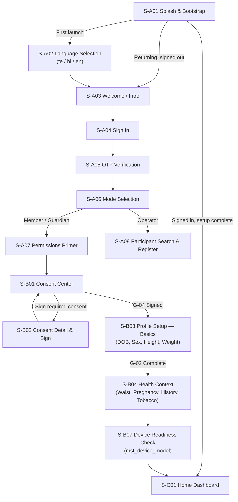
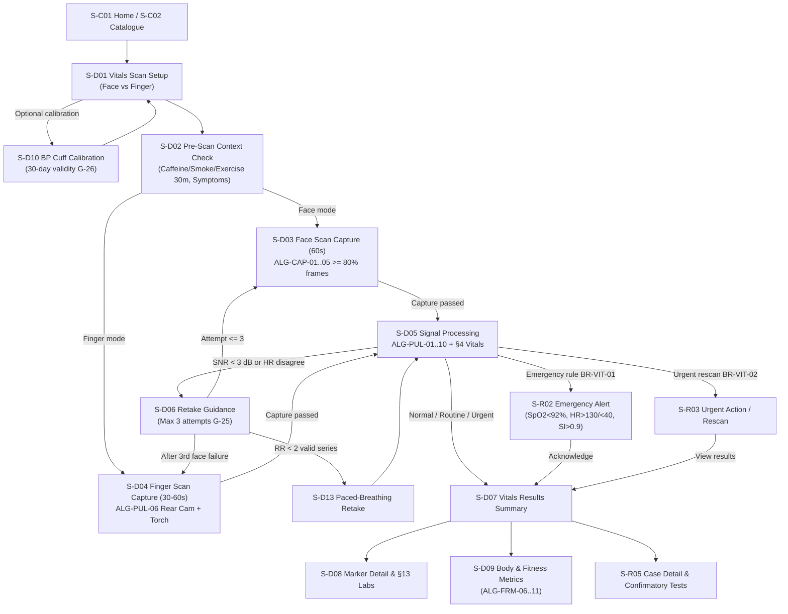

# 06 — User Flows and Navigation

> **Purpose:** Complete route table, navigation hierarchy, shell architecture, deep-link map, and end-to-end user flow diagrams connecting all **82 screens** (`S-A01` … `S-I05`).
> Cross-reference screen details in `05_UI_UX_Screen_Documentation.md` and gates in `07_Feature_Lifecycle_and_States.md`.

---

## 1. Navigation Architecture Principles

1. **Declarative Routing (`AppRouter`):** Every screen has a canonical route path and strongly typed route arguments.
2. **Gate Interception:** Navigating to any route guarded by a gate (`G-01`…`G-37`) evaluates the gate first. If blocked, the router either redirects to the prerequisite flow (with a `returnTo` route) or presents a modal `GateBlocker` sheet (`T-GATE`).
3. **Safety Pre-emption (`G-37`):** Emergency urgency (`ALG-RSK-02`: `emergency`) or Mood Crisis (`PHQ-9 item 9 > 0`) immediately pushes `S-R02 Emergency Alert` or `S-G14 Crisis Support` above all other routes and disables back-swipe dismissal until explicitly acknowledged.
4. **Immersive Capture:** All capture routes (`S-D03`, `S-D04`, `S-E03`, `S-F03`, `S-G03`…`05`, `S-G08`, `S-G10`, `S-G12`, `S-H01`…`H10`) run outside the bottom-navigation shell in portrait-locked, wakelock-enabled full-screen mode with a confirmation dialog on exit.
5. **Active Subject Context:** An active member/dependent pill is kept in `ActiveSubjectScope` (Self, Child Dependent, Newborn Dependent, or Operator Participant). Switching the active subject immediately recomputes age/condition eligibility (`G-09`, `G-10`) across the catalogue.

---

## 2. Master Route Table (`S-xx` → Path, Args, Guards)

| Screen ID | Route Path | Route Arguments | Entry Guards (Gates) | Shell / Presentation |
|---|---|---|---|---|
| **Group A — Access & Onboarding** | | | | |
| `S-A01` | `/splash` | — | — | Full screen |
| `S-A02` | `/language` | `{bool isInitial}` | — | Full screen |
| `S-A03` | `/welcome` | — | — | Full screen |
| `S-A04` | `/auth/sign-in` | — | — | Full screen |
| `S-A05` | `/auth/otp` | `{String phone}` | `G-36` | Full screen |
| `S-A06` | `/mode-select` | — | `G-01` | Full screen |
| `S-A07` | `/permissions-primer` | `{ String? nextRoute }` | `G-01` | Full screen |
| `S-A08` | `/operator/participants` | — | `G-01` (operator role) | Operator shell |
| **Group B — Consent & Profile** | | | | |
| `S-B01` | `/consents` | `{String memberId, String? returnTo}` | `G-01` | Full screen / Push |
| `S-B02` | `/consents/:type` | `{String memberId, ConsentType type, String? returnTo}` | `G-01` | Push |
| `S-B03` | `/profile/basics` | `{String memberId, bool isOnboarding}` | `G-01` | Push |
| `S-B04` | `/profile/health-context` | `{String memberId, bool isOnboarding}` | `G-01`, `G-02` | Push |
| `S-B05` | `/family` | — | `G-01` | Push |
| `S-B06` | `/family/edit` | `{String? dependentId}` | `G-01` | Push |
| `S-B07` | `/device-readiness` | `{bool isOnboarding}` | `G-01` | Push |
| **Group C — Main Shell (4 Tabs)** | | | | |
| `S-C01` | `/home` | — | `G-01` | Shell Tab 0 |
| `S-C02` | `/catalogue` | `{ScreeningCategory? initialCategory}` | `G-01` | Shell Tab 1 |
| `S-C03` | `/history` | `{String? filterType}` | `G-01` | Shell Tab 2 |
| `S-C04` | `/history/session/:sessionId` | `{String sessionId}` | `G-01` | Push |
| `S-C05` | `/trends` | `{String? initialMarkerCode}` | `G-01`, `G-28` (baseline banner) | Push |
| `S-C06` | `/notifications` | — | `G-01` | Push |
| `S-C07` | `/more` | — | `G-01` | Shell Tab 3 |
| **Group D — Vitals** | | | | |
| `S-D01` | `/vitals/setup` | `{VitalsCaptureMode? preferredMode}` | `G-01`, `G-02`, `G-04` | Push |
| `S-D02` | `/vitals/context` | `{VitalsCaptureMode mode}` | `G-01`, `G-02`, `G-04` | Push |
| `S-D03` | `/vitals/capture/face` | `{VitalsSessionConfig config}` | `G-04`, `G-11`, `G-21` | Immersive Capture |
| `S-D04` | `/vitals/capture/finger` | `{VitalsSessionConfig config}` | `G-04`, `G-11`, `G-21` | Immersive Capture |
| `S-D05` | `/vitals/processing` | `{String captureId}` | `G-21` | Full screen |
| `S-D06` | `/vitals/retake` | `{RetakeReason reason, int attempt}` | `G-25` | Full screen |
| `S-D07` | `/vitals/results/:sessionId` | `{String sessionId}` | `G-22`, `G-23`, `G-24` | Push |
| `S-D08` | `/vitals/marker/:code` | `{String sessionId, String markerCode}` | — | Push |
| `S-D09` | `/vitals/body-fitness` | `{String? sessionId}` | `G-02`, `G-29` | Push |
| `S-D10` | `/vitals/bp-calibration` | — | `G-02` | Push |
| `S-D11` | `/vitals/orthostatic` | — | `G-04`, `G-11` | Immersive Capture |
| `S-D12` | `/vitals/hr-recovery` | — | `G-04`, `G-11` | Immersive Capture |
| `S-D13` | `/vitals/paced-breathing` | `{String parentSessionId}` | `G-04`, `G-11` | Immersive Capture |
| **Group E — Image Screenings** | | | | |
| `S-E01` | `/image/:screenType/intro` | `{ImageScreenType screenType}` | `G-04`, `G-09`, `G-10`, `G-24` | Push |
| `S-E02` | `/image/:screenType/colour-card` | `{ImageScreenType screenType}` | `G-11`, `G-20` | Immersive Capture |
| `S-E03` | `/image/:screenType/capture` | `{ImageScreenType screenType, bool hasCard}` | `G-11`, `G-20`, `G-21` | Immersive Capture |
| `S-E04` | `/image/:screenType/review` | `{ImageScreenType screenType, List<CapturedView> views}` | `G-25` | Push |
| `S-E06` | `/image/fundus` | — | `G-04`, `G-15`, `G-31` | Push |
| **Group F — Dental** | | | | |
| `S-F01` | `/dental/intro` | — | `G-05`, `G-09` (child mode 1–12) | Push |
| `S-F02` | `/dental/questionnaire` | — | `G-05` | Push |
| `S-F03` | `/dental/capture` | `{DentalMode mode}` | `G-05`, `G-11`, `G-21` | Immersive Capture |
| `S-F04` | `/dental/results/:examId` | `{String examId}` | `G-24` | Push |
| `S-F05` | `/dental/tooth/:fdi` | `{String examId, int toothFdi}` | — | Modal / Push |
| **Group G — Audio, Sleep, Hearing & Mind** | | | | |
| `S-G01` | `/audio/readiness` | `{String nextRoute}` | `G-12`, `G-16`, `G-17`, `G-18` | Push |
| `S-G02` | `/audio/questionnaires` | `{AudioFlowType flowType}` | `G-04` | Push |
| `S-G03` | `/audio/cough` | `{AudioFlowType flowType}` | `G-12`, `G-17`, `G-18`, `G-21` | Immersive Capture |
| `S-G04` | `/audio/voice` | `{AudioFlowType flowType}` | `G-12`, `G-17`, `G-18`, `G-21` | Immersive Capture |
| `S-G05` | `/audio/exhale` | — | `G-02`, `G-12`, `G-17`, `G-18` | Immersive Capture |
| `S-G06` | `/audio/results/:sessionId` | `{String sessionId}` | `G-23`, `G-24` | Push |
| `S-G07` | `/sleep/setup` | — | `G-04`, `G-12`, `G-30` | Push |
| `S-G08` | `/sleep/active` | `{String sleepSessionId}` | `G-12`, `G-30` | Night Mode |
| `S-G09` | `/sleep/report/:sessionId` | `{String sessionId}` | — | Push |
| `S-G10` | `/hearing/test` | — | `G-04`, `G-18`, `G-19` | Immersive Capture |
| `S-G11` | `/hearing/results/:sessionId` | `{String sessionId}` | — | Push |
| `S-G12` | `/cognitive/speech` | — | `G-04`, `G-09` (age ≥ 50), `G-12` | Immersive Capture |
| `S-G13` | `/mood/check` | — | `G-04`, `G-07` (clinician pathway) | Push |
| `S-G14` | `/mood/crisis` | `{String? sessionId}` | `G-37` (Safety override) | Blocking Full Screen |
| `S-G15` | `/hf/daily-voice` | — | `G-08`, `G-12`, `G-28`, `G-34` | Immersive Capture |
| **Group H — Movement, Stroke & Vision** | | | | |
| `S-H01` | `/movement/tapping-video` | — | `G-04`, `G-11`, `G-21` | Immersive Capture |
| `S-H02` | `/movement/tapping-touch` | — | `G-04` | Immersive Capture |
| `S-H03` | `/movement/gait` | — | `G-04`, `G-13` | Immersive Capture |
| `S-H04` | `/movement/sit-to-stand` | — | `G-04`, `G-13` | Immersive Capture |
| `S-H05` | `/movement/tremor` | — | `G-04`, `G-13` | Immersive Capture |
| `S-H06` | `/stroke/fast` | — | None (Safety — never blocked) | Immersive Capture |
| `S-H07` | `/vision/acuity` | — | `G-04`, `G-11`, `G-16`, `G-33` | Immersive Capture |
| `S-H08` | `/vision/colour` | — | `G-04` | Immersive Capture |
| `S-H09` | `/vision/amsler` | — | `G-04` | Immersive Capture |
| `S-H10` | `/movement/reaction-time` | — | `G-04`, `G-12` | Immersive Capture |
| **Group R — Results, Urgency & Cases** | | | | |
| `S-R01` | `/results/screening/:sessionId` | `{String sessionId}` | `G-23`, `G-24` | Push |
| `S-R02` | `/alerts/emergency` | `{EmergencyAlertPayload payload}` | `G-37` (Safety override) | Blocking Full Screen |
| `S-R03` | `/alerts/urgent` | `{UrgentActionPayload payload}` | — | Modal / Push |
| `S-R04` | `/cases` | `{CaseStatus? filter}` | `G-01` | Push |
| `S-R05` | `/cases/:caseId` | `{String caseId}` | `G-01` | Push |
| `S-R06` | `/cases/:caseId/lab-entry` | `{String caseId, String? markerCode}` | `G-01` | Push |
| `S-R07` | `/reference-invitation/:inviteId` | `{String inviteId}` | `G-01` | Push |
| **Group I — Devices & Settings** | | | | |
| `S-I01` | `/devices` | — | `G-01` | Push |
| `S-I02` | `/devices/ring-pair` | — | `G-01`, `G-15` | Push |
| `S-I03` | `/settings` | — | `G-01` | Push |
| `S-I04` | `/settings/privacy` | — | `G-01` | Push |
| `S-I05` | `/settings/about` | — | — | Push |

---

## 3. End-to-End User Flow Diagrams

### 3.1 Onboarding, Consent, Profile & Device Readiness Flow



### 3.2 Vitals Scan Flow (Face rPPG & Finger PPG, Retakes, Risk Engine, Escalation)



### 3.3 Image Screening & Specialist Review Flow (`ALG-IMG-01..09`)

```mermaid
flowchart TD
  C02["S-C02 Screenings Catalogue"] -->|Check G-04, G-09, G-10| E01["S-E01 Image Screen Intro<br/>(8 configurations)"]
  E01 -->|Card mandatory (Newborn) or preferred| E02["S-E02 Colour Card Setup<br/>ALG-CAP-10 (ΔE <= 5)"]
  E01 -->|No card needed| E03["S-E03 Guided Image Capture<br/>ALG-CAP-06..09 (2s framing)"]
  E02 --> E03
  E03 --> E04["S-E04 Capture Review<br/>(Max 3 retakes per view G-25)"]
  E04 -->|Retake view| E03
  E04 -->|3 failed retakes| R01_NA["S-R01 Result: Not Assessed"]
  E04 -->|Submit| R01["S-R01 Screening Result"]
  R01 -->|High band or prob within ±0.1 of threshold| IMG10["Specialist Review Queue (IMG-10)"]
  R01 -->|Flag raised| R05["S-R05 Case Detail & Confirmatory Tests"]
```

### 3.4 Dental 4-View & Caries-Risk Flow (`ALG-DEN-01..07`)

```mermaid
flowchart TD
  C02["S-C02 Catalogue"] -->|Check G-05 Dental/Guardian Consent| F01["S-F01 Dental Intro<br/>(Adult vs Child 1-12 mode)"]
  F01 --> F02["S-F02 Caries-Risk Questionnaire<br/>(Q_CARIES_RISK)"]
  F02 --> F03["S-F03 Dental 4-View Capture<br/>(Front closed/open, Upper/Lower occlusal)"]
  F03 -->|Missing view allowed -> partial| F04["S-F04 Dental Results & FDI Tooth Chart<br/>(Caries risk, Gum/Plaque, Sealants 16/26/36/46)"]
  F04 --> F05["S-F05 Tooth Detail (FDI + bbox)"]
  F04 -->|Abscess sign (Urgent T13) or Cavity (Routine T14)| R05["S-R05 Case Detail"]
```

### 3.5 Audio, Sleep, Hearing, Cognitive, Mood & Heart-Failure Flows (`ALG-AUD-01..12`)

```mermaid
flowchart TD
  C02["S-C02 Catalogue"] --> G01["S-G01 Audio Readiness Check<br/>CAP-11 Mic Sweep <=6dB + CAP-12 Noise <=45dBA"]
  G01 -->|TB / COPD-Asthma| G02["S-G02 Respiratory Questionnaires<br/>(Q_TB_SYMPTOMS, Q_MMRC, Q_EXPOSURE)"]
  G02 --> G03["S-G03 Cough Task (>=3 valid coughs)"]
  G03 --> G04["S-G04 Voice Tasks ('aaa', 'sss', 'zzz', sentence)"]
  G04 --> G05["S-G05 Forced Exhale (3 blows, 10% repeatability)"]
  G05 --> G06["S-G06 Respiratory & Voice Results"]
  G01 -->|Age >= 50| G12["S-G12 Cognitive Speech (60s animals + picture)"]
  G12 --> R01["S-R01 Screening Result"]
  G01 -->|Clinician pathway G-07| G13["S-G13 Mood Check (PHQ-9 + GAD-7 + 60s speech)"]
  G13 -->|PHQ-9 item 9 > 0 (G-37)| G14["S-G14 Crisis Support (Immediate Override)"]
  G13 -->|Item 9 == 0| R01
  G01 -->|HF Enrolled G-08| G15["S-G15 HF Daily Voice (14d baseline G-28)"]
  C02 -->|Sleep| G07["S-G07 Sleep Setup (Charging + 0.3-1m)"] --> G08["S-G08 Sleep Monitoring (>=4h)"] --> G09["S-G09 Sleep Report (SONAR_RR, AHI, OSA_BAND)"]
  C02 -->|Hearing (Earphones G-19 + <=45dBA G-18)| G10["S-G10 Hearing Test"] --> G11["S-G11 Hearing Results"]
```

### 3.6 Movement, Stroke FAST & Vision Flows (`ALG-MOV-01..13`)

```mermaid
flowchart TD
  C02["S-C02 Catalogue"] -->|Stroke Check (No gates!)| H06["S-H06 Stroke Check (FAST)<br/>Face + Arm Drift + Speech + Onset Time"]
  H06 -->|Any sign > threshold (T10)| R02["S-R02 Emergency Alert (BR-SCR-01)"]
  H06 -->|All negative| R01["S-R01 Screening Result"]
  C02 -->|Motor tests| MOV["S-H01 Video Tap / S-H02 Touch Tap /<br/>S-H03 10m Gait / S-H04 Sit-to-Stand / S-H05 Tremor"]
  MOV --> R01
  C02 -->|Vision tests| VIS["S-H07 Visual Acuity (40±5cm CAP-15) /<br/>S-H08 Colour Plates / S-H09 Amsler Grid / S-H10 Reaction Time"]
  VIS --> R01
```
