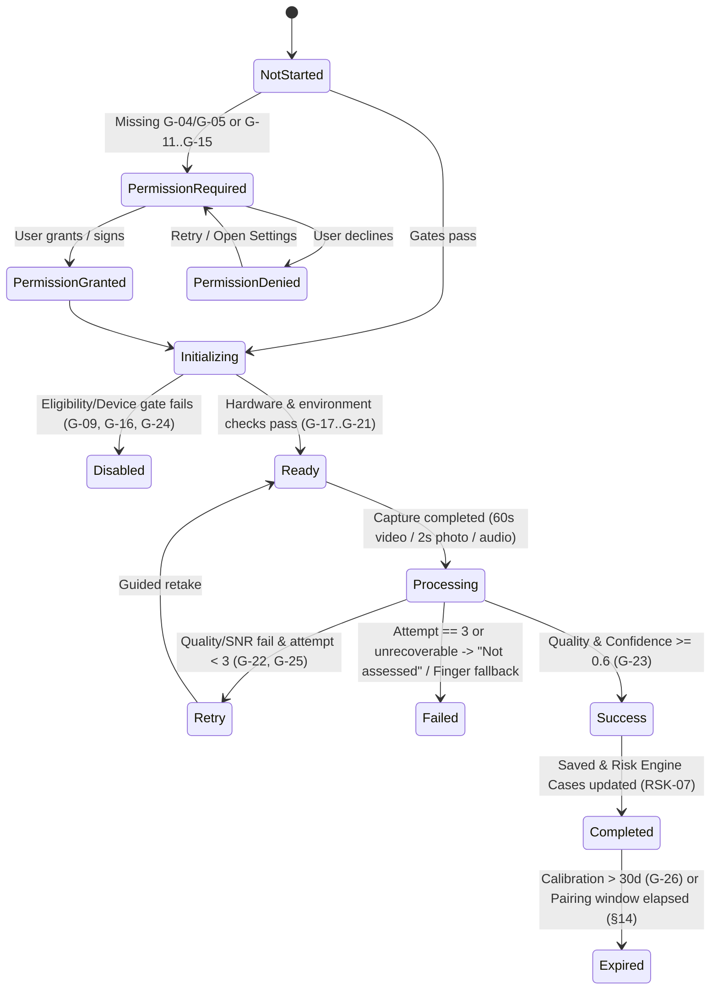

# 07 — Feature Gates, Lifecycles, and Screen State Reference

> **Purpose of this file:** This is your single reference manual whenever you have any doubt about **what a feature or UI screen is for, which Gates (`G-01`…`G-37`) control it, which Lifecycle States it goes through, how it handles failure/retry, and when it is enabled, hidden, or blocked.**

---

## 1. Canonical Lifecycle States

Not every feature uses every state; each feature uses only the subset applicable to its workflow.

| State | Code Enum | Meaning | Typical UI Representation |
|---|---|---|---|
| **Not Started** | `notStarted` | User has not yet initiated the feature or session | Intro screen / Catalogue card "Available" |
| **Initializing** | `initializing` | Hardware (camera, mic, sensors, BLE) or master config loading | Shimmer skeleton or spinner with "Preparing camera…" |
| **Permission Required** | `permissionRequired` | Needs OS runtime permission or clinical consent before proceeding | `GateBlocker` sheet with "Allow Camera" / "Sign Consent" |
| **Permission Granted** | `permissionGranted` | Required OS permission and consent verified | Transitions automatically to `ready` |
| **Permission Denied** | `permissionDenied` | User denied OS permission (soft or permanent) or declined consent | `GateBlocker` with "Open Settings" or alternative mode |
| **Ready** | `ready` | All prerequisites, permissions, and environmental checks pass | Active "Start" button / green `QualityChecklist` |
| **Loading** | `loading` | Fetching profile, history, master tables, or cached sessions | Skeleton cards |
| **Processing** | `processing` | Running signal pipeline (`ALG-PUL`), DSP, ML inference, or risk engine | `S-D05` step progress ring or `Processing` badge |
| **Success** | `success` | Capture/calculation passed quality and confidence (`≥ 0.6`) | Result screen (`S-D07`, `S-R01`, `S-F04`, `S-G06`) |
| **Failed** | `failed` | Quality check failed (`SNR < 3 dB`, blur, noise) or terminal error | `S-D06 Retake Guidance` or `Not Assessed` card |
| **Retry** | `retry` | User is repeating capture within the allowed retake limit (`≤ 3`) | Attempt badge `"Attempt 2 of 3"` + targeted coaching |
| **Completed** | `completed` | Result saved to history, risk flags merged into Cases (`RSK-07`) | Read-only session view (`S-C04`) |
| **Disabled** | `disabled` | Blocked by age/condition eligibility, missing device calibration, or `release_status = disabled` | Catalogue badge `"Not for this age"` / `"In validation"` |
| **Expired** | `expired` | Time-bounded calibration, consent version, or pairing window elapsed | `"BP calibration expired (>30 days)"` badge (`G-26`) |

---

## 2. Master Gate Catalogue (`G-01` … `G-37`)

Every gate has a deterministic rule, a Spec reference, and a recovery action.

| Gate ID | Gate Name | Category | Spec Source & Rule | When Blocked (UI Behaviour) | Recovery / Fix Action |
|---|---|---|---|---|---|
| **G-01** | Authenticated Session | Access | `[STD]` Valid auth token in secure storage | Redirect to `S-A03` / `S-A04` | Sign in with mobile OTP |
| **G-02** | Basic Profile Complete | Data | `[DOC]` §4.6, §5, §8 AUD-05: `dob` (age), `sex`, `height_cm`, `weight_kg` present | `GateBlocker` → `S-B03 Profile Basics` | Enter DOB, sex, height, weight |
| **G-03** | Extended Health Context | Data | `[DOC]` §4.9, §10 RSK-05, §6.1: `waist_cm`, `family_history`, `activity`, `pregnancy`, `history` | Hides `DM_BAND` (§4.9) and `ckd_risk`/`mets_risk` (§10 RSK-05) with inline prompt | Tap `"Complete Health Context"` → `S-B04` |
| **G-04** | Screening Consent | Consent | `[DOC]` §6 intro: Active signed screening consent for current `mst` version | Blocks all screenings → `S-B01`/`S-B02` | Read and sign Screening Consent |
| **G-05** | Dental / Guardian Consent | Consent | `[DOC]` §7.1: Dental consent signed (by guardian if child `< 18`) | Blocks `S-F01`…`S-F04` → `S-B02` | Sign Dental Consent (with guardian fields for child) |
| **G-06** | Training-Data Consent | Consent | `[DOC]` §11.2: Optional consent to use paired record for model building | **Never blocks user screening**; sets `use_for_training = false` on upload | Optional toggle in `S-B01` / `S-I04` |
| **G-07** | Clinician Pathway Active | Access | `[DOC]` §8 AUD-11: Mood screen (`S-G13`) requires active clinician pathway | Catalogue shows `"Clinician pathway only"`; blocks self-service entry | Enabled when clinician orders mood pathway |
| **G-08** | HF Programme Enrolment | Access | `[DOC]` §8 AUD-12: Daily 30-s voice check (`S-G15`) only for enrolled HF patients | Catalogue shows `"Enrolled HF patients only"` | Enrol via HF clinic programme (`S-B01`) |
| **G-09** | Age Eligibility | Eligibility | `[DOC]` Cataract `≥ 40` (or on request, §6.3); Child Eye `1–12 y` (§6.6); Newborn Jaundice `0–28 d` (§6.7); Child Dental `1–12 y`, Sealant `6–9 y` (§7); Cognitive `≥ 50 y` (§8 AUD-10); Body Fat adults `≥ 18 y` (§5 FRM-11) | Catalogue card badged `"Ages X–Y"`; prompts switching active family member | Switch to eligible dependent (`S-B05`) or tap `"Request anyway"` (Cataract only) |
| **G-10** | Condition / History Eligibility | Eligibility | `[DOC]` Oral always offered to tobacco/areca users (§6.4); Diabetic Foot offered to members with diabetes or high DM risk (§6.5) | Highlights as `"Recommended for you"` when matched; available on request otherwise | Update health context (`S-B04`) or run Diabetes Risk scan |
| **G-11** | Camera Permission | Permission | `[DER]` OS camera permission required for Vitals, Image, Dental, Video Tap, Stroke, Acuity | `T-GATE` permission sheet | Grant permission or open OS settings |
| **G-12** | Microphone Permission | Permission | `[DER]` OS mic permission required for Audio (`§8`), Sleep (`AUD-07`), Stroke speech (`MOV-08`), Reaction audio (`MOV-12`) | `T-GATE` permission sheet | Grant mic permission or open OS settings |
| **G-13** | Motion Sensors Available | Permission | `[DOC]` §9 intro: Accelerometer (50 Hz) & Gyroscope (100 Hz) required for Gait (`MOV-03`), Sit-to-Stand (`MOV-04`), Tremor (`MOV-05`) | Blocks sensor test with `"Motion sensors unavailable on this device"` | Run on Flutter mobile device with IMU |
| **G-14** | Notification Permission | Permission | `[DER]` OS notification permission for reminders (`F-35`) & async result alerts | Non-blocking banner on `S-C06` | Enable notifications |
| **G-15** | Bluetooth Permission | Permission | `[DER]` BLE permission for Smart Ring (`S-I02`) and wireless Fundus camera (`S-E06`) | Blocks device scan on `S-I02`/`S-E06` | Grant Nearby Devices / Bluetooth |
| **G-16** | Device Model Supported (`mst_device_model`) | Device | `[DOC]` §4.5 (SpO2 `A, B` coefficients), `CAP-11` (mic profile), `CAP-15` (camera focal length) | SpO2 band hidden ("Recommend oximeter or ring", §4.5); Acuity distance falls back to manual 40 cm tape prompt | Sync latest `mst_device_model` or use external oximeter/ring |
| **G-17** | Microphone Self-Check (`ALG-CAP-11`) | Device | `[DOC]` §2, §8: 100 Hz–8 kHz 1.5 s sweep; `mic_response_dev_db ≤ 6 dB` and `audio_processing_detected == false` | **Blocks all audio tasks** (`§8`) on `S-G01` | Uncover mic, disable OS noise suppression, re-run `S-G01` |
| **G-18** | Quiet Room (`ALG-CAP-12`) | Environment | `[DOC]` §2, §8: 3 s silence; `noise_dba ≤ 45 dBA` | **Blocks audio & hearing tasks** on `S-G01`/`S-G10` | Move to a quieter room and retry 3 s check |
| **G-19** | Earphones Connected | Device | `[DOC]` §8 AUD-09: Wired or Bluetooth earphones detected before Hearing Test (`S-G10`) | Blocks `S-G10` start button | Plug in or pair earphones |
| **G-20** | Colour Card (`ALG-CAP-10`) | Capture | `[DOC]` §2 CAP-10 (`ΔE ≤ 5`): **Mandatory** for Newborn Jaundice (`§6.7` — never shows "normal" without card); **Required** for Adult Jaundice (`§6.2`) & Diabetic Foot size (`§6.5`); **Preferred** for Anaemia (`§6.1`) | Newborn Jaundice blocked if `card_found == false` or `ΔE > 5`; optional screens show `"Proceed without card"` | Place 24-patch colour card next to skin/eye and re-frame |
| **G-21** | Real-Time Capture Quality (`ALG-CAP-01..15`) | Capture | `[DOC]` §2, §3: Face checks `CAP-01..05` must pass for `≥ 80%` of frames (first 3 s dropped); photo checks `CAP-06..09` must pass for `2 s` continuous framing; audio `CAP-13` `clip ≤ 1%`, `SNR ≥ 15 dB` | Pauses/resets timer and displays exact Spec coaching string | Follow live coaching ("Hold still", "Move to brighter place", etc.) |
| **G-22** | Signal Quality & Beat Count (`ALG-PUL-08/09/10`) | Processing | `[DOC]` §3, §4: `pulse_snr_db ≥ 3 dB`; `≥ 20` clean beats for HR/SpO2; `≥ 40` clean beats for BP/Waveform (+ face SNR `≥ 6 dB` or finger); `≥ 50` clean beats & valid IBIs `≥ 50%` for HRV/Stress; `≥ 120 s` for LF/HF; `≥ 32 s` & `≥ 2` series for RR; `≥ 30 s` & `≥ 70%` valid beats for Rhythm | Triggers `S-D06 Retake` (if HR/SNR fails) or hides specific sub-markers (`"HRV not available"`, `"RR not available"`, `"rhythm not assessed"`) | Retake scan, switch to Finger mode, or use Paced-Breathing retake (`S-D13`) |
| **G-23** | Result Confidence (`ALG-RSK-06`) | Display | `[DOC]` §10 RSK-06: `result_confidence = capture_quality × model_confidence × context_factor` (`0.8` if caffeine/smoke/exercise `< 30m`). **Hidden when `< 0.6`** | Hides marker value/band (`"BP not available, use cuff"` / `"Low confidence — retake after resting"`) | Rest 30 min after caffeine/exercise and rescan |
| **G-24** | Algorithm Release Status | Display | `[DOC]` §4 intro, §4.5, §4.6, §4.9, §8 AUD-11: Trained models must pass clinical validation studies before display. Statuses: `validated`, `bandOnly` (BP until mean ≤ 5, SD ≤ 8 mmHg), `research` (generic SpO2, face SpO2), `disabled` | `research` → never shown; `bandOnly` → shows `BP_BAND` only, hides `SBP`/`DBP` numbers; unvalidated → shows `"In clinical validation"` badge (or `[MOCK]` in dev mode) | Controlled via `mst_algorithm` master table |
| **G-25** | Retake Limit (`Max 3`) | Flow | `[DOC]` §4.1, §6 intro: Maximum **3 guided retakes** per session/view | After 3rd failure: Vitals offers **Finger Scan** (`S-D04`) or **Paced Breathing** (`S-D13`); Image screens mark `"Not assessed"` | Switch to Finger Scan or complete session as `"Not assessed"` |
| **G-26** | BP Cuff Calibration Validity | Data | `[DOC]` §4.6: Personal cuff offset valid for **30 days** from paired cuff entry | After 30 days, offset is not applied; banner prompts recalibration | Enter 2 cuff readings on `S-D10` |
| **G-27** | Irregular Rhythm Confirmation | Flow | `[DOC]` §4.7: Positive only if `IRREG_PROB ≥ threshold` on **2 scans**, or **1 scan + smart ring overnight flag** | 1st positive scan shows `"Unconfirmed irregular rhythm — take a second scan to confirm"` | Take confirmation scan or connect Smart Ring (`S-I01`) |
| **G-28** | Personal Baseline Available | Data | `[DOC]` §10 RSK-03 (median of last **3 valid values within 180 days**; SD from last 10); §8 AUD-12 HF Voice (**first 14 days** build baseline) | Trends (`S-C05`) and HF Daily Check (`S-G15`) show progress `"2 of 3 scans"` or `"Day 6 of 14 — building baseline"` | Complete remaining baseline scans |
| **G-29** | Formula Input Completeness | Data | `[DOC]` §5 intro: "A formula never runs if any input is missing, hidden or below its quality threshold." | Formula tile shows which input is missing (e.g., `"Requires validated SBP/DBP"` or `"Add waist circumference"`) | Supply missing profile field or pass upstream vital |
| **G-30** | Sleep Environment Setup | Environment | `[DOC]` §8 AUD-07/08: Phone **charging**, placed on bedside table **0.3–1 m from chest**, recording **≥ 4 hours** for apnoea AHI | Warns if unplugged; if stopped `< 4 h`, shows `SONAR_RR` only and hides `AHI_EST`/`OSA_BAND` | Plug in charger and record ≥ 4 hours |
| **G-31** | Partner Fundus Camera Connected | Device | `[DOC]` §6.8 IMG-09: Clip-on fundus camera attached/connected and partner AI licensed | Blocks capture on `S-E06` | Connect clip-on fundus camera |
| **G-32** | Smart Ring Connected (Enhancer) | Device | `[DOC]` §4.5, §4.7, §8 AUD-08, §13.1: Optional ring provides SpO2 dips for OSA, overnight rhythm flag, and temperature | Non-blocking enhancer; shows `"Connect ring for overnight SpO2 & rhythm"` | Pair ring via `S-I02` |
| **G-33** | Vision Face Distance (`ALG-CAP-15`) | Capture | `[DOC]` §2 CAP-15, §9 MOV-10: Iris-based distance must be **40 ± 5 cm** (35–45 cm) | Pauses Tumbling-E staircase and coaches `"Move closer / further"` | Hold phone at 40 cm |
| **G-34** | Screening Schedule / Frequency | Flow | `[DOC]` §6.5 Diabetic Foot **monthly**; §8 AUD-12 HF Voice **daily** | Surfaces due card on `S-C01 Home`; badges `"Completed today"` after HF check | Follow scheduled reminder |
| **G-35** | Entitlement / Programme Access | Access | `[OPEN]` Subscription/programme tier not specified in Spec | Defaults to **enabled** in Phase 1; configurable via feature flag | See `16_Open_Questions.md` |
| **G-36** | Network Connectivity | System | `[STD]` Needed for OTP, master sync, server ML inference, specialist review (`IMG-10`) | Offline banner; queues captures locally and runs on-device checks/formulas offline | Auto-syncs when online |
| **G-37** | Safety Escalation Override | Safety | `[DOC]` §8 AUD-11 (`PHQ-9 item 9 > 0` → Crisis `S-G14`), §9 MOV-09 (`STROKE_POSITIVE` → Emergency `S-R02`), §10 RSK-02 (`Urgency == emergency` → `S-R02`) | **Pre-empts all navigation**, locks back button until user acknowledges safety screen | Call emergency helpline / clinician and acknowledge |

---

## 3. Feature-by-Feature Lifecycle & Gate Matrix (`F-01` … `F-38`)

| ID | Feature | Relevant Lifecycle States | Entry Gates & Prerequisites | Exit Conditions | Failure & Retry Behaviour |
|---|---|---|---|---|---|
| **F-01** | Authentication & Session | `notStarted → loading → ready / failed → expired` | `G-36` (for OTP) | Token saved in secure storage → `S-A06`/`S-C01` | Wrong OTP: retry up to limit; expired token: silent refresh or re-auth |
| **F-02** | Language & Localisation | `ready → completed` | None | Locale persisted (`en`, `te`, `hi`); sets speech model locale for `AUD-10` | Falls back to English if asset missing |
| **F-03** | Consent Management | `permissionRequired → ready → completed → expired` | `G-01`; guardian details if subject `< 18 y` | Signed version matches `mst` consent version (`G-04`, `G-05`, `G-06`) | If `mst` consent version bumps, transitions to `expired` and re-prompts |
| **F-04** | Member Profile & Health Context | `notStarted → ready → loading → completed` | `G-01` | `G-02` (DOB, sex, height, weight) and `G-03` saved; triggers `FRM-09..11` | Inline range validation (`height 30–250 cm`, `weight 1–300 kg`, `waist 30–200 cm`) |
| **F-05** | Family / Dependents | `notStarted → ready → completed` | `G-01`, `G-05` (guardian consent for child) | Dependent profile created; age in hours & gestation stored for newborns (`0–28 d`) | Validates DOB; switching active dependent updates `G-09` age gates globally |
| **F-06** | Operator (Field Worker) Mode | `notStarted → ready → loading → completed` | `G-01` + Operator role | Active participant selected with guardian/participant consent (`G-04`/`G-05`) | Offline participant registration queued until `G-36` restored |
| **F-07** | Device Capability & Calibration | `initializing → ready / disabled` | `G-01` | `DeviceProfile` resolved against `mst_device_model` (`G-16`) | Unknown phone model: disables SpO2 display (`§4.5`), flags mic/focal calibration status |
| **F-08** | Runtime Permissions | `permissionRequired → permissionGranted / permissionDenied` | `G-11`…`G-15` | OS permission granted | Soft deny: explain & retry; permanent deny: deep-link to OS App Settings |
| **F-09** | Capture Quality Engine (`ALG-CAP`) | `initializing → ready ⇄ failed (coaching) → success` | `G-11`/`G-12` | Video: `CAP-01..05` pass `≥ 80%` of frames; Photo: `CAP-06..09` pass `2 s`; Audio: `CAP-11..13` pass | Real-time coaching messages; motion (`CAP-04`) restarts recording timer |
| **F-10** | Vitals Scan — Face (rPPG) | `notStarted → initializing → ready → processing → retry / failed / success → completed` | `G-02`, `G-04`, `G-11`, `G-21` | 60 s video (first 3 s dropped) processed through `ALG-PUL-01..10` | If `SNR < 3 dB`, `< 20` beats, `|neural - POS| > 5`, or `|spec - beat| > 3`: `retry` up to **3 times** (`G-25`), then offer Finger Mode (`F-11`) |
| **F-11** | Vitals Scan — Finger (PPG + SpO2) | `notStarted → initializing → ready → processing → retry / failed / success → completed` | `G-02`, `G-04`, `G-11`, `G-16` (for SpO2), `G-21` | 30–60 s rear-camera + torch capture processed (`ALG-PUL-06`, `ALG-SPO-01`) | Mean red `> 250` → `"press lighter"`; no pulse → `"cover lens fully"`; no device SpO2 coeffs → hide SpO2 band |
| **F-12** | Vital-Sign Results (`§4.1–4.9`) | `processing → success / disabled / failed → completed` | `G-22`, `G-23` (`conf ≥ 0.6`), `G-24` (release gate), `G-27` (rhythm 2x) | Each marker wrapped in `MarkerEnvelope` with band, confidence, versions | Per-marker graceful degradation: `< 50` beats hides HRV/Stress; `< 2` RR series hides RR & offers `S-D13`; notch missing hides notch markers only; missing waist/BMI hides `DM_BAND` |
| **F-13** | Derived Formulas (`ALG-FRM-01..15`) | `ready → processing → success / disabled` | `G-29` (all inputs valid & above quality threshold) | Exact decimal match to Spec §5 test vectors | Never runs if any upstream input is missing, internal-only, or hidden |
| **F-14** | BP Personal Cuff Calibration | `notStarted → ready → completed → expired` | `G-02` | Mean of 2 cuff readings saved with 30-day expiry (`G-26`) | Expires automatically at 30 days (`G-26`); prompts recalibration |
| **F-15** | Functional Cardio Tests | `notStarted → initializing → ready → processing → success / failed` | `G-04`, `G-11` | Orthostatic (`FRM-14`), HR Recovery (`FRM-15`), or Paced Breathing (`S-D13`) completed | User can abort immediately via `"I feel dizzy"` safety button |
| **F-16** | Image Screenings (`ALG-IMG-01..08`) | `notStarted → initializing → ready → processing → retry / failed / success → completed` | `G-04`, `G-09`, `G-10`, `G-11`, `G-20` (card), `G-21`, `G-24` | Required views pass `CAP-06..09`; high/uncertain (`±0.1` of threshold) routed to `IMG-10` specialist review | Guided retake up to **3 times** per view (`G-25`); after 3 failures → marked `"not assessed"` |
| **F-17** | Fundus Partner Integration (`IMG-09`) | `notStarted → initializing → ready → processing → success / failed` | `G-04`, `G-15`, `G-31` | Partner adapter returns `DR_REFERABLE`, `DR_GRADE`, `GLAUCOMA_SUSPECT` | Partner timeout/disconnect → retry without losing captured fundus images |
| **F-18** | Dental Screening (`ALG-DEN-01..07`) | `notStarted → initializing → ready → processing → success (full or partial) → completed` | `G-05` (guardian for children), `G-09` (child mode 1–12, sealants 6–9), `G-11`, `G-21` | 4 views evaluated → FDI tooth chart, gum/plaque bands, caries risk (`DEN-06`), change vs previous (`DEN-07`) | Missing view does **not** discard exam: marks exam `"partial"` and lists unseen teeth (`§7.1`) |
| **F-19** | Audio Readiness (`CAP-11..14`) | `notStarted → initializing → processing → ready / failed` | `G-12`, `G-16` | Mic sweep deviation `≤ 6 dB`, no OS processing (`G-17`), room noise `≤ 45 dBA` (`G-18`) | Blocks all downstream `§8` audio screens until both checks pass |
| **F-20** | Respiratory & Voice Audio (`AUD-01..06`) | `notStarted → ready → processing → retry / success → completed` | `G-02` (for `AUD-05`), `G-04`, `G-12`, `G-17`, `G-18`, `G-21` | `≥ 3` valid coughs (`AUD-01`), sustained phonation (`AUD-06`), 3 exhales within 10% repeatability (`AUD-05`) | Clip `> 1%` or `SNR < 15 dB` → `"Move phone further / quieter room"` & re-record task |
| **F-21** | Sleep Monitoring (`AUD-07/08`) | `notStarted → ready → processing (overnight) → success / partial → completed` | `G-04`, `G-12`, `G-30` (charging, 0.3–1 m), optional `G-32` (ring) | Overnight 18–20 kHz sonar tracks `SONAR_RR`; if `≥ 4 h`, computes `AHI_EST` & `OSA_BAND` | Recording `< 4 h` → reports `SONAR_RR` only, hides `OSA_BAND` |
| **F-22** | Hearing Screen (`AUD-09`) | `notStarted → ready → processing → success / failed` | `G-04`, `G-18` (`≤ 45 dBA`), `G-19` (earphones) | Pure-tone 0.5/1/2/4 kHz per ear or DIN SRT completed | Earphone unplug mid-test pauses staircase immediately |
| **F-23** | Cognitive Speech (`AUD-10`) | `notStarted → ready → processing → success / disabled` | `G-04`, `G-09` (`age ≥ 50`), `G-12`, `G-17`, `G-18`, education level (`S-B04`) | 60 s animal naming + picture description ASR (`te`/`hi`/`en`) | ASR failure or noise → prompt re-record |
| **F-24** | Mood Screen & Crisis Pathway (`AUD-11`) | `disabled (default) → ready → processing → success / emergency (crisis)` | `G-04`, `G-07` (clinician pathway active) | PHQ-9 + GAD-7 + 60 s speech scored; voice used only if `+0.03 AUC` | **Safety Gate `G-37`:** `PHQ-9 item 9 > 0` immediately opens `S-G14 Crisis Support` |
| **F-25** | Heart-Failure Voice (`AUD-12`) | `disabled → initializing (14d baseline) → ready → success` | `G-08` (enrolled HF), `G-12`, `G-17`, `G-18`, `G-28` (14-day baseline), `G-34` (daily) | Daily 30 s sentence compared against first 14 days → `HF_VOICE_DEV`, `HF_ALERT` | Days 1–14 show `"Baseline building (Day X/14)"` with no alert |
| **F-26** | Motor & Neuro Tests (`MOV-01..05, 13`) | `notStarted → initializing → ready → processing → success / failed` | `G-04`, `G-11` (video tap), `G-13` (IMU 50/100 Hz for gait/STS/tremor) | Timed voice+metronome tasks produce tapping, gait, STS, tremor, and combined PD score (`MOV-13`) | Missing sensor (`G-13`) disables IMU tests; PD score waits until tapping + voice + face all exist |
| **F-27** | Stroke FAST Check (`MOV-06..09`) | `notStarted → ready → processing → success / emergency` | **No blocking gates** (safety-critical) | Face asymmetry + Arm drift (10 s) + Speech repeat + Onset time → `STROKE_POSITIVE` | Any positive sign triggers **`S-R02 Emergency Alert` (`BR-SCR-01`, Case T10)** immediately |
| **F-28** | Vision & Reaction (`MOV-10..12`) | `notStarted → ready → processing → success` | `G-04`, `G-16` & `G-33` (`40 ± 5 cm` for acuity), `G-12` (reaction audio) | `LOGMAR_L/R`, `COLOUR_PLATE_SCORE`, `AMSLER_ABNORMAL`, `RT_VISUAL_MS`/`RT_AUDIO_MS` (discarding `< 100 ms`) | Distance out of `40 ± 5 cm` pauses acuity chart with `"Move closer / further"` |
| **F-29** | Risk Engine (`ALG-RSK-01..07`) | `processing → success` | Deterministic inputs + `mst_*` versions | Computes band (`RSK-01`), urgency (`RSK-02`), baseline (`RSK-03`), change (`RSK-04`), organ risk (`RSK-05`), confidence (`RSK-06`), flag/case (`RSK-07`) | If `result_confidence < 0.6`, result hidden (`G-23`); if quality below threshold, no flag & `"retake"` (`BR-QUA-01`, Case T16) |
| **F-30** | Cases, Flags & Confirmatory Tests | `ready → processing → completed` | `G-01`, `ALG-RSK-07` | Merges flags for same `COND_*` within **30 days** into one open Case; attaches `§13` lab investigations | Sorts `emergency > urgent > routine` (Case T15) |
| **F-31** | Specialist Review (`IMG-10`) | `processing (underReview) → completed (reviewed)` | High band or probability within `±0.1` of threshold (`§6` intro) | Specialist grading updates Case and notifies member | While pending, result card shows `"Under specialist review"` badge |
| **F-32** | Reference Tests & Pairing (`§14`) | `ready → completed / expired` | `G-01`, pairing window & exclusions (`§14`) | Pairs inside window without exclusion graded A–C; outside window or excluded graded **D** (monitoring only, `FRS REF-06`); ≥ 5%/mo negative sampling (`REF-03`) | Expired gap automatically grades pair `D` (excluded from model training) |
| **F-33** | Smart Ring Integration | `notStarted → initializing → ready / failed` | `G-01`, `G-15`, `G-32` | Syncs ring SpO2, temperature, overnight rhythm flag | Disconnected ring falls back gracefully to phone-only mode |
| **F-34** | History, Trends & Baselines | `loading → ready` | `G-01`, `G-28` (`≥ 3` valid values in 180 d for baseline) | Displays chronological sessions, baseline band, and `> 15%` or `> 2 SD` change flags | `< 3` readings shows `"Take N more scans to establish your personal baseline"` |
| **F-35** | Notifications & Reminders | `ready → completed` | `G-01`, `G-14` | Delivers monthly DFU, daily HF, rhythm confirmation, and specialist-review notifications | In-app inbox (`S-C06`) always works even if OS push (`G-14`) is denied |
| **F-36** | Master Data & Version Sync | `initializing → loading → ready` | `G-36` (online update; cached fallback offline) | Atomically updates `mst_*` tables; records `algorithm_version` & `range_version` on every scan | Checksum/network failure keeps last known good cached master bundle |
| **F-37** | Settings, Privacy & About | `ready` | `G-01` | Updates preferences, displays algorithm version register (`S-I05`) | — |
| **F-38** | Algorithm Release Gate | `ready / disabled` | `G-24` (`mst_algorithm.release_status`) | Enforces `validated` / `bandOnly` / `research` / `disabled` across every UI widget | Prevents unvalidated numbers from ever rendering as clinical values |

---

## 4. Screen-by-Screen Purpose, Gates & Lifecycle Quick-Lookup (`S-A01` … `S-I05`)

Use this table to check any of the **82 screens** in seconds.

| Screen ID | Screen Name | Core Purpose | Entry Gates | Active / Runtime Gates | Lifecycle States on Screen | Exit / Failure Routing |
|---|---|---|---|---|---|---|
| `S-A01` | Splash & Bootstrap | Restore auth, load cached `mst_*` masters & device profile | — | `G-01`, `G-36` | `initializing → loading → completed` | `S-A02` (1st run), `S-A03` (signed out), `S-B01`/`S-B03` (incomplete), `S-C01` (ready) |
| `S-A02` | Language Selection | Pick `en` / `te` / `hi` for UI & `AUD-10` ASR | — | — | `ready → completed` | `S-A03` or back to `S-I03` |
| `S-A03` | Welcome / Intro | 3-slide overview & "screening, not diagnosis" positioning | — | — | `ready` | `S-A04` |
| `S-A04` | Sign In | Enter mobile number for OTP | — | `G-36` | `ready → loading → success / failed` | `S-A05` |
| `S-A05` | OTP Verification | Verify 6-digit code & establish session | `G-36` | — | `ready → processing → success / failed` | `S-A06` (new) or `S-A01` router |
| `S-A06` | Mode Selection | Choose Member/Guardian vs Field Operator | `G-01` | Role check | `ready / disabled` | `S-A07` |
| `S-A07` | Permissions Primer | Explain why camera, mic, IMU, BLE are needed | `G-01` | `G-11`…`G-15` | `permissionRequired → permissionGranted / permissionDenied` | `S-B01` (Member) or `S-A08` (Operator) |
| `S-A08` | Operator Participant Hub | Search/register school, anganwadi, or clinic participant | `G-01` | `G-04`, `G-05`, `G-36` | `loading → ready → completed` | `S-C02`, `S-B03`, `S-B02` |
| `S-B01` | Consent Center | View status of all 5 consent types per family member | `G-01` | `G-04`…`G-08` | `loading → ready → completed / expired` | `S-B02`, `S-B03` |
| `S-B02` | Consent Detail & Sign | Read & sign versioned consent (with guardian block if `< 18`) | `G-01` | `G-04`, `G-05`, `G-06` | `ready → processing → completed` | Returns to `S-B01` or `returnTo` route |
| `S-B03` | Profile Setup — Basics | Capture DOB, sex, height, weight & preview BMI (`FRM-09`) | `G-01` | `G-02` | `ready → processing → completed / failed` | `S-B04` |
| `S-B04` | Health Context | Capture waist, pregnancy/gestation, diabetes, tobacco, education | `G-01`, `G-02` | `G-03`, `G-10` | `ready → processing → completed` | `S-B07` or back |
| `S-B05` | Family Members | Switch active subject or manage child/newborn dependents | `G-01` | `G-09` | `loading → ready` | `S-B06`, `S-C01` |
| `S-B06` | Add / Edit Dependent | Add child (`1–12 y`) or newborn (`0–28 d` with hours & gestation) | `G-01` | `G-05` | `ready → processing → completed` | `S-B02` (Guardian consent) |
| `S-B07` | Device Readiness Check | Verify `mst_device_model` support (SpO2, mic, focal length, fps) | `G-01` | `G-16` | `initializing → ready / disabled` | `S-C01` |
| `S-C01` | Home Dashboard | Daily summary, urgent banners, due scans, quick vitals launch | `G-01` | `G-04`, `G-27`, `G-34`, `G-37` | `loading → ready` | `S-D01`, `S-R04`, `S-R05`, `S-C02` |
| `S-C02` | Screenings Catalogue | Browse all 34 screening items with live gate eligibility badges | `G-01` | `G-02`…`G-24`, `G-31`, `G-35` | `ready` (items badged per gate) | Any screening intro or `T-GATE` blocker |
| `S-C03` | History | Filterable chronological log of all sessions | `G-01` | — | `loading → ready` | `S-C04`, `S-C05` |
| `S-C04` | Session Detail | Read-only result view with algorithm & range versions | `G-01` | `G-23`, `G-24` | `loading → ready / processing / failed` | `S-D08`, `S-F05`, `S-R05` |
| `S-C05` | Trends & Baselines | Marker sparklines with personal baseline (`RSK-03`) & change flags (`RSK-04`) | `G-01` | `G-28` | `loading → ready / disabled (<3 scans)` | `S-D08` |
| `S-C06` | Notifications Inbox | Actionable reminders & specialist review updates | `G-01` | `G-14` | `loading → ready` | Deep-links to target screen |
| `S-C07` | Profile & More | Hub for profile, family, consents, devices, settings, about | `G-01` | — | `ready` | `S-B*`, `S-I*`, `S-R04`, `S-R06` |
| `S-D01` | Vitals Scan Setup | Select Face (60 s) vs Finger (30–60 s) & review marker availability | `G-01`, `G-02`, `G-04` | `G-16`, `G-24`, `G-26` | `ready` | `S-D02`, `S-D10` |
| `S-D02` | Pre-Scan Context Check | Log caffeine/smoke/exercise (`< 30m` → `0.8` conf) & symptoms | `G-02`, `G-04` | `G-23` | `ready → completed` | `S-D03` or `S-D04` |
| `S-D03` | Face Scan Capture | 60 s front-camera rPPG with live `ALG-CAP-01..05` checks | `G-04`, `G-11` | `G-21` (`≥80%` frames, drop 3 s) | `initializing → ready ⇄ retry (paused) → processing` | `S-D05` or cancel → `S-D01` |
| `S-D04` | Finger Scan Capture | 30–60 s rear-camera + torch PPG (`ALG-PUL-06`, `ALG-SPO-01`) | `G-04`, `G-11` | `G-16`, `G-21` | `initializing → ready ⇄ retry → processing` | `S-D05` |
| `S-D05` | Signal Processing | Execute `ALG-PUL-01..10`, `§4` vitals, `§5` formulas, `§10` risk | `G-21` | `G-22`, `G-23`, `G-24`, `G-37` | `processing → success / retry / failed` | `S-R02` (emergency), `S-D06` (retake), `S-D07` (results) |
| `S-D06` | Retake Guidance | Coach user after SNR/agreement failure; enforce max 3 retakes | `G-22` failed | `G-25` (`attempt ≤ 3`) | `failed → retry → disabled (after 3)` | `S-D03` (`≤3`), `S-D04` (finger fallback), `S-D13` (RR paced) |
| `S-D07` | Vitals Results Summary | Display all vitals, bands, confidence, derived formulas & cases | `G-22` | `G-23`, `G-24`, `G-27`, `G-29` | `success → completed` | `S-D08`, `S-D09`, `S-R03`, `S-R05` |
| `S-D08` | Marker Detail | Single marker band bar, `§13` confirmatory tests & baseline trend | — | `G-24`, `G-28` | `ready` | `S-C05`, `S-R05` |
| `S-D09` | Body & Fitness Metrics | BMI, WHtR, Body Fat %, HRmax, HRR, VO2max (`ALG-FRM-06..11`) | `G-02` | `G-03`, `G-09`, `G-29` | `ready` | `S-B04` (if waist missing) |
| `S-D10` | BP Cuff Calibration | Enter 2 validated cuff readings (`≤ 10 min` gap, 30-day expiry) | `G-02` | `G-26` | `ready → processing → completed → expired` | `S-D01` |
| `S-D11` | Orthostatic Test | Lying HR (last 30 s) → Standing HR (0–3 min) rise (`ALG-FRM-14`) | `G-04`, `G-11` | `G-21`, `G-22` | `initializing → ready → processing → success / failed` | `S-D07` / `S-R01` |
| `S-D12` | HR Recovery Test | Post-exercise HR minus HR 60 s later (`ALG-FRM-15`, `≥ 12` normal) | `G-04`, `G-11` | `G-21`, `G-22` | `initializing → ready → processing → success / failed` | `S-D07` / `S-R01` |
| `S-D13` | Paced-Breathing Retake | Guided breathing visual pacer when `ALG-RSP-01` has `< 2` valid series | `G-04`, `G-11` | `G-21` | `ready → processing → success / failed` | `S-D05` → `S-D07` |
| `S-E01` | Image Screen Intro (×8) | Explain required views, lighting, flash & colour card per condition | `G-04`, `G-09`, `G-10` | `G-11`, `G-20`, `G-24` | `ready / disabled` | `S-E02` or `S-E03` |
| `S-E02` | Colour Card Setup | Detect 24-patch card & verify post-correction `ΔE ≤ 5` (`CAP-10`) | `G-11` | `G-20` (Mandatory for Newborn) | `initializing → processing → ready / failed` | `S-E03` (blocked for Newborn if no card) |
| `S-E03` | Guided Image Capture | 2 s continuous framing passing `CAP-06` (blur), `CAP-07` (glare), `CAP-08` (IQ `≥0.7`), `CAP-09` (part `≥80%`) | `G-11`, `G-20` | `G-21` | `initializing → ready ⇄ retry → success` | `S-E04` |
| `S-E04` | Capture Review | Inspect thumbnails, retake (`≤ 3` per view) or submit | `G-21` | `G-25` | `ready → processing → success / failed (notAssessed)` | `S-R01` |
| `S-E06` | Fundus Connect & Capture | Pair clip-on fundus camera & run partner AI adapter (`ALG-IMG-09`) | `G-04`, `G-15`, `G-31` | `G-21` | `initializing → ready → processing → success / failed` | `S-R01` |
| `S-F01` | Dental Intro & Consent | Set Adult vs Child (`1–12 y`) mode & verify dental/guardian consent | `G-05` | `G-09`, `G-11` | `ready` | `S-F02` |
| `S-F02` | Caries-Risk Questionnaire | Collect brushing, fluoride, sweets/day, night bottle (`Q_CARIES_RISK`) | `G-05` | — | `ready → completed` | `S-F03` |
| `S-F03` | Dental 4-View Capture | Capture front closed/open, upper/lower occlusal (`ALG-DEN-01`) | `G-05`, `G-11` | `G-21` | `initializing → ready ⇄ retry → success (full/partial)` | `S-F04` |
| `S-F04` | Dental Results & FDI Chart | Interactive FDI chart (`11–48` / `51–85`), caries risk, gum/plaque, sealants (`16/26/36/46`), change (`DEN-07`) | `G-24` | `G-37` (abscess → urgent T13) | `processing → success (full/partial) → completed` | `S-F05`, `S-R05` |
| `S-F05` | Tooth Detail | Single tooth photo crop, bounding box, finding probabilities & history | — | — | `ready` | Back to `S-F04` |
| `S-G01` | Audio Readiness Check | Run `CAP-11` speaker-mic sweep (`≤ 6 dB`) & `CAP-12` room noise (`≤ 45 dBA`) | `G-12`, `G-16` | `G-17`, `G-18` | `initializing → processing → ready / failed` | Next `S-G*` task (blocks if failed) |
| `S-G02` | Respiratory Questionnaires | `Q_TB_SYMPTOMS`, `Q_MMRC`, `Q_EXPOSURE` inputs for `AUD-03/04` | `G-04` | — | `ready → completed` | `S-G03` |
| `S-G03` | Cough Task | Record `≥ 3` valid voluntary coughs (`ALG-AUD-01`, `150–800 ms`) | `G-12`, `G-17`, `G-18` | `G-21` (`CAP-13` clip `≤1%`, SNR `≥15 dB`) | `ready → processing ⇄ retry → success` | `S-G04` or `S-G06` |
| `S-G04` | Voice Tasks | Sustained `"aaa" ≥ 3 s`, `"sss"`, `"zzz"`, fixed sentence (`AUD-04/06`) | `G-12`, `G-17`, `G-18` | `G-21` (`CAP-13`) | `ready → processing ⇄ retry → success` | `S-G05` or `S-G06` |
| `S-G05` | Forced Exhale | 3 forced blows at ~30 cm within 10% repeatability (`ALG-AUD-05`) | `G-02`, `G-12`, `G-17`, `G-18` | `G-21` (`CAP-13`) | `ready → processing ⇄ retry → success` | `S-G06` |
| `S-G06` | Respiratory & Voice Results | Display TB band, OAD band, FEV1/FVC/PEF + GLI-2012 LLN, Praat voice metrics | — | `G-23`, `G-24` | `processing → success → completed` | `S-R05` |
| `S-G07` | Sleep Setup | Verify charger connected, bedside distance `0.3–1 m`, optional ring | `G-04`, `G-12` | `G-30`, `G-32` | `ready` | `S-G08` |
| `S-G08` | Sleep Monitoring | Overnight 18–20 kHz sonar (`AUD-07`) + snore/gasp/apnoea (`AUD-08`, `≥ 4 h`) | `G-12`, `G-30` | `G-30` (`≥ 4 h` for OSA) | `processing (overnight) → success / partial (<4h)` | `S-G09` |
| `S-G09` | Sleep Report | Epoch breathing wave, `SONAR_RR`, `APNOEA_EVENTS`, `AHI_EST`, `OSA_BAND` | — | `G-24`, `G-30` | `success → completed` | `S-R05` |
| `S-G10` | Hearing Test | Adaptive pure-tone (`0.5, 1, 2, 4 kHz`) or Digits-in-Noise (`AUD-09`) | `G-04`, `G-18`, `G-19` | `G-19` (earphones stay plugged) | `ready → processing ⇄ paused → success` | `S-G11` |
| `S-G11` | Hearing Results | Bilateral audiogram (`dB HL`), `DIN_SRT_DB`, `HEARING_BAND` (`< 20 dB` normal) | — | `G-24` | `success → completed` | `S-R05` |
| `S-G12` | Cognitive Speech Tasks | 60 s animal naming + picture description (`AUD-10`, `te`/`hi`/`en`) | `G-04`, `G-09` (`≥ 50 y`), `G-12`, `G-17`, `G-18` | `G-21`, `G-24` | `ready → processing → success / failed` | `S-R01` |
| `S-G13` | Mood Check | PHQ-9 + GAD-7 + 60 s free speech (`AUD-11`, clinician pathway only) | `G-04`, `G-07` | `G-37` (`PHQ-9 item 9 > 0`) | `ready → processing → success / emergency` | **`S-G14` (if item 9 > 0)** else `S-R01` |
| `S-G14` | Crisis Support | Immediate helpline & clinician escalation when `PHQ-9 item 9 > 0` | `G-37` | `G-37` (blocks dismissal) | `emergency → completed (acknowledged)` | Clinician notified / Helpline call |
| `S-G15` | HF Voice Daily Check | Enrolled HF daily 30 s sentence vs 14-day personal baseline (`AUD-12`) | `G-08`, `G-12`, `G-17`, `G-18` | `G-28` (14d baseline), `G-34` | `initializing (Days 1–14) → ready → processing → success` | `S-R05` (if `HF_ALERT`) |
| `S-H01` | Finger Tapping — Video | 10 s per hand "big and fast" (`ALG-MOV-01`, MediaPipe Hands) | `G-04`, `G-11` | `G-21` (`CAP-09`) | `ready → processing → success / retry` | `S-R01` |
| `S-H02` | Finger Tapping — Touch | 10 s per hand alternating two targets (`ALG-MOV-02`) | `G-04` | — | `ready → processing → success` | `S-R01` |
| `S-H03` | Gait Walk Test | 10-m walk with phone in front trouser pocket (`ALG-MOV-03`, 50 Hz accel) | `G-04`, `G-13` | `G-13` | `ready → processing → success / failed` | `S-R01` |
| `S-H04` | Sit-to-Stand Test | 30 s armless chair rises (`ALG-MOV-04`) | `G-04`, `G-13` | `G-13` | `ready → processing → success / failed` | `S-R01` |
| `S-H05` | Tremor Test | 20 s per hand held at arm's length (`ALG-MOV-05`, 100 Hz gyro `3–12 Hz`) | `G-04`, `G-13` | `G-13` | `ready → processing → success` | `S-R01` |
| `S-H06` | Stroke Check (FAST) | Face asymmetry + 10 s arm drift + sentence repeat + onset time (`MOV-06..09`) | **None (Safety)** | `G-37` (`STROKE_POSITIVE`) | `ready → processing → emergency / success` | **`S-R02` (if positive, T10)** else `S-R01` |
| `S-H07` | Visual Acuity | Tumbling-E staircase at `40 ± 5 cm` (`CAP-15`, `MOV-10`, `logMAR`) | `G-04`, `G-11`, `G-16` | `G-33` (`40 ± 5 cm` live) | `ready ⇄ paused (distance) → success` | `S-R01` |
| `S-H08` | Colour Vision | Max-brightness colour plates (`ALG-MOV-11`) | `G-04` | — | `ready → processing → success` | `S-R01` |
| `S-H09` | Amsler Grid | Interactive 30 cm macular grid distortion marking (`ALG-MOV-11`) | `G-04` | — | `ready → completed` | `S-R01` |
| `S-H10` | Reaction Time | 10 visual + 10 sound stimuli (`1–4 s` gap, discard `< 100 ms`, `MOV-12`) | `G-04`, `G-12` | — | `ready → processing → success` | `S-R01` |
| `S-R01` | Screening Result (Shared) | Unified result card, specialist review state (`IMG-10`), `§13` next steps | — | `G-23`, `G-24`, `G-37` | `processing → success / underReview / notAssessed / disabled` | `S-R02`, `S-R05`, `S-C01` |
| `S-R02` | Emergency Alert | Full-screen red emergency interruption (`BR-VIT-01`, `BR-SCR-01`) | `G-37` | `G-37` (must acknowledge) | `emergency → completed` | Call emergency / `S-R05` |
| `S-R03` | Urgent Action / Rescan | Amber prompt for urgent flags (`BR-VIT-02` rescan first, `BR-VIT-03/04/06`, `BR-SCR-02/03`) | — | — | `ready → completed` | Rescan (`S-D03`) or `S-R05` |
| `S-R04` | Cases List | Open/closed cases merged per condition within 30 days (`RSK-07`), sorted urgency first (T15) | `G-01` | — | `loading → ready` | `S-R05` |
| `S-R05` | Case Detail & Confirmatory Tests | Flag timeline, exact `§13` lab investigations & diagnostic cut-offs | `G-01` | — | `loading → ready → completed` | `S-R06` |
| `S-R06` | Lab / Reference Result Entry | Upload/enter confirmatory test & validate `§14` pairing gap + exclusions | `G-01` | Pairing window (`§14`) | `ready → processing → completed / expired (Grade D)` | `S-R05` |
| `S-R07` | Reference Test Invitation | Sampled-negative monthly reference test offer (`≥ 5%`, `FRS REF-03`) | `G-01` | Pairing window | `ready → completed / expired` | `S-R06` |
| `S-I01` | Connected Devices | Manage Smart Ring & clip-on Fundus Camera | `G-01` | `G-15`, `G-31`, `G-32` | `loading → ready` | `S-I02`, `S-E06` |
| `S-I02` | Ring Pairing | BLE scan & pair Smart Ring | `G-01`, `G-15` | `G-32` | `initializing → processing → success / failed` | `S-I01` |
| `S-I03` | Settings | Language, units, theme, notifications, developer mock controls | `G-01` | — | `ready` | `S-A02`, `S-I04`, `S-I05` |
| `S-I04` | Consent & Privacy Management | Review/withdraw consents (`G-04..G-06`) & training opt-out | `G-01` | — | `ready` | `S-B01` |
| `S-I05` | About, Versions & Disclaimers | Display `mst_algorithm` versions, `release_status` (`G-24`), and clinical disclaimers | — | — | `ready` | Back |
