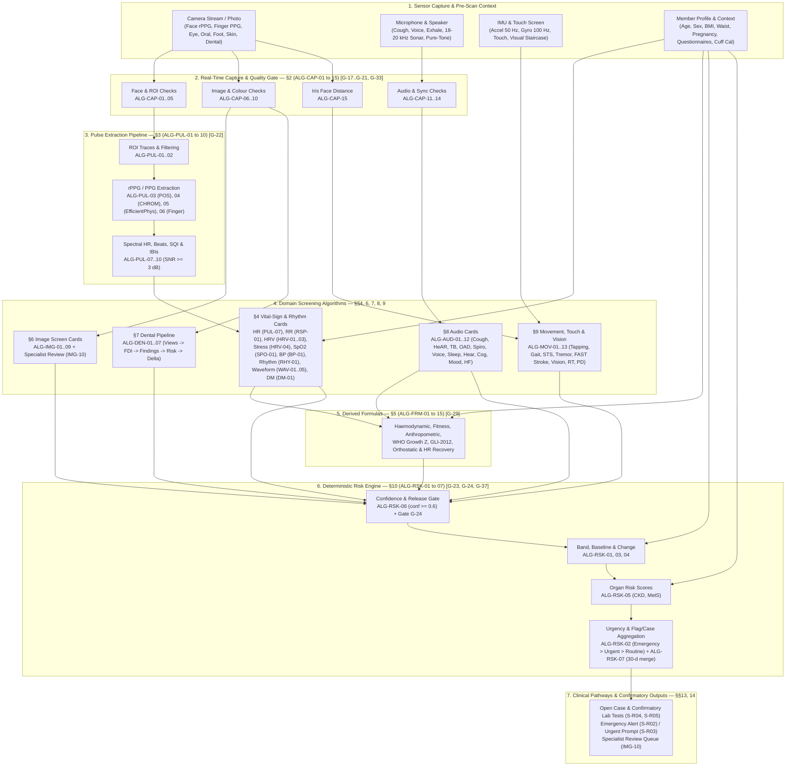

# 09 — AI, ML & Signal-Processing Algorithm Documentation

> **Document ID:** `09_AI_ML_Algorithm_Documentation.md`
> **Source of Truth:** *VitalsMirror — Algorithm Specifications & Test Cards* (Oct 18, 2026 · Dr Hanu Yedluri — **"the Spec"**)
> **Cross-References:** [`00_README_Index.md`](./00_README_Index.md) · [`07_Feature_Lifecycle_and_States.md`](./07_Feature_Lifecycle_and_States.md) · [`08_Health_Readings_and_Metrics.md`](./08_Health_Readings_and_Metrics.md) · [`15_Testing_Strategy.md`](./15_Testing_Strategy.md)

---

## 1. Pipeline Overview & Architecture

VitalsMirror executes a multi-stage screening pipeline across four capture modalities (**Camera Video/Photo**, **Microphone/Speaker Sonar**, **IMU Motion Sensors**, and **Interactive Touch/Visual Stimuli**), supplemented by **Member Profile / Master Data (`mst_*`)** and optional hardware (**Smart Ring**, **Clip-on Fundus Camera**).

Every algorithm in the Spec belongs to one of four **Algorithm Classifications**:
1. **Documented deterministic algorithm** — Explicit mathematical formula, threshold check, or rule engine fully specified in the Spec (`ALG-FRM-*`, `ALG-RSK-*`, `ALG-HRV-01..04`, `ALG-DEN-06/07`, etc.).
2. **Standard DSP (Digital Signal Processing)** — Classical signal/image processing pipeline with defined filter orders, windowing, and peak/fiducial detection (`ALG-CAP-01..07`, `ALG-CAP-10..15`, `ALG-PUL-01..04`, `ALG-PUL-06..10`, `ALG-RSP-01`, `ALG-WAV-01..04`, `ALG-AUD-06/07`, `ALG-MOV-03..05`).
3. **Trained ML model requiring study validation** — Neural network (CNN, MobileNetV3, EfficientPhys, EfficientNet-lite, DenseNet/Swin, YOLO, HeAR) or gradient-boosted/regression model (LightGBM, XGBoost, logistic/linear study regression) that **must pass its designated clinical study (`VIT-*`, `IMG-*`, `DEN-*`, `AUD-*`, `MOV-*`) before user-facing display** under Gate `G-24`.
4. **Partner AI** — Licensed third-party diagnostic/screening adapter (`ALG-IMG-09` Medios AI fundus; optional partner API for `ALG-AUD-03` TB).

### 1.1 End-to-End Algorithm Execution Flowchart



### 1.2 Pipeline Stage Dependency Table

| Stage | Spec Section | Algorithm IDs | Upstream Inputs / Preconditions | Downstream Consumers | Governing Gates |
|---|---|---|---|---|---|
| **Capture & Quality Checks** | §2 | `ALG-CAP-01` to `ALG-CAP-15` | Raw camera frames, photos, mic sweep/silence/task audio, iris landmarks, device profile (`mst_device_model`) | All §3, §6, §7, §8, §9 pipelines; `capture_quality_score` feeds `ALG-RSK-06` | `G-16`–`G-21`, `G-25`, `G-33` |
| **Pulse Pipeline** | §3 | `ALG-PUL-01` to `ALG-PUL-10` | 60 s face video or 30–60 s finger video; `ALG-CAP-01..05` passed for ≥ 80% of frames; first 3 s discarded | All §4 Vital-Sign & Rhythm cards | `G-21`, `G-22`, `G-25` |
| **Vital-Sign & Rhythm Cards** | §4 | `ALG-PUL-07` (final), `ALG-RSP-01`, `ALG-HRV-01..04`, `ALG-SPO-01`, `ALG-BP-01`, `ALG-RHY-01`, `ALG-WAV-01..05`, `ALG-DM-01` | Clean BVP (`bvp_neural`, `bvp_pos`, `bvp_finger`), beat peaks/feet, valid IBIs (`ALG-PUL-08..10`), profile (`G-02`/`G-03`), optional cuff calibration (`G-26`) & Smart Ring (`G-32`) | §5 Formulas (`ALG-FRM-01..08`, `14`, `15`), §10 Risk Engine (`ALG-RSK-01..07`) | `G-02`, `G-03`, `G-22`–`G-27`, `G-32` |
| **Derived Formulas** | §5 | `ALG-FRM-01` to `ALG-FRM-15` | Validated non-hidden outputs from §4 (`HR`, `SBP`, `DBP`, `RR`), §8 (`FEV1`, `FVC`), functional HR series, profile (`age`, `sex`, `weight`, `height`, `waist`), `mst_growth_reference` | UI display (`S-D07`, `S-D09`, `S-D11`, `S-D12`, `S-G06`), `ALG-RSK-01..07` | `G-02`, `G-29` |
| **Image Screens** | §6 | `ALG-IMG-01` to `ALG-IMG-09` + `IMG-10` | Screening consent (`G-04`), `ALG-CAP-06..09` passed, colour card (`ALG-CAP-10` / `G-20`), partner fundus camera (`G-31`) | Specialist review queue (`IMG-10`), `ALG-RSK-01..07`, Cases (`S-R01`, `S-R05`) | `G-04`, `G-09`, `G-10`, `G-20`, `G-21`, `G-24`, `G-25`, `G-31` |
| **Dental Pipeline** | §7 | `ALG-DEN-01` to `ALG-DEN-07` | Dental/guardian consent (`G-05`), 4 intraoral views passing `ALG-CAP-06/07/09`, `Q_CARIES_RISK`, prior dental exam | Tooth chart (`S-F04`, `S-F05`), `ALG-RSK-01..07` (`COND_CARIES`) | `G-05`, `G-09`, `G-21`, `G-24` |
| **Audio Screens** | §8 | `ALG-AUD-01` to `ALG-AUD-12` | `ALG-CAP-11` (mic check), `ALG-CAP-12` (noise ≤ 45 dBA), `ALG-CAP-13` (clip ≤ 1%, SNR ≥ 15 dB); 44.1–48 kHz mono raw audio; questionnaires | `ALG-FRM-13` (from `AUD-05`), Crisis screen (`S-G14`), `ALG-RSK-01..07` | `G-07`, `G-08`, `G-09`, `G-17`–`G-19`, `G-24`, `G-28`, `G-30`, `G-37` |
| **Movement, Touch & Vision** | §9 | `ALG-MOV-01` to `ALG-MOV-13` | Camera landmarks (`MediaPipe`), IMU sensors (`G-13`), touch screen, `ALG-CAP-15` face distance 40 ± 5 cm (`G-33`) | Emergency Stroke Alert (`S-R02`), `ALG-RSK-01..07` | `G-09`, `G-11`, `G-13`, `G-24`, `G-33`, `G-37` |
| **Risk Engine** | §10 | `ALG-RSK-01` to `ALG-RSK-07` | All marker outputs, `mst_reference_range`, `mst_algorithm`, rule catalogue (`BR-VIT-*`, `BR-SCR-*`, `BR-QUA-*`), 180-day member history | Results UI (`S-R01`..`S-R05`), Confirmatory test recommendations (§13) | `G-23`, `G-24`, `G-28`, `G-37` |

---

## 2. Algorithm Release Gate (`G-24`) & Governance Rules

> [!IMPORTANT]
> **Clinical & Regulatory Safety Rule (`[DOC] Spec §1, §4 intro, §4.5, §4.6, §4.9, §8 AUD-11`):**
> All default parameters, thresholds, and release statuses are stored in `mst_algorithm`, `mst_quality_threshold`, and `mst_reference_range`, changeable **only through change control**. Accuracy evidence and targets are tracked in the *Algorithm Accuracy Register*.

### 2.1 Release Status Enum (`AlgorithmReleaseStatus` — Gate `G-24`)

Every algorithm version in `mst_algorithm` carries one of four release states enforced at runtime by Gate `G-24`:

| Status Value | Code Enum | Runtime & UI Display Behaviour | Eligible Algorithms |
|---|---|---|---|
| **`validated`** | `AlgorithmReleaseStatus.validated` | Full output (numeric value + screening band) is computed, stored, and displayed to the member/operator when `result_confidence ≥ 0.6` (`G-23`). | Deterministic formulas (`ALG-FRM-*`), rule engine (`ALG-RSK-*`), classical DSP (`ALG-PUL-07`, `ALG-RSP-01`, `ALG-HRV-01..04`), and any trained model that has passed its Mayura clinical validation study. |
| **`bandOnly`** | `AlgorithmReleaseStatus.bandOnly` | Numeric estimate is stored **internally only** (`internal: true`); the UI displays **only the categorical screening band** (e.g., `normal` / `elevated` / `high` or `low` / `moderate` / `high`). | `ALG-BP-01` (until numeric ISO 81060-2 criteria are passed), `ALG-SPO-01` (`SPO2_EST` is internal; only `SPO2_BAND` shown on calibrated phone models), `ALG-IMG-01` (`HB_EST` internal; `ANAEMIA_BAND` shown). |
| **`research`** | `AlgorithmReleaseStatus.research` | Algorithm may execute silently in the background (if `G-06` training/research consent is granted) to log telemetry/features, but **never displays any value, band, or flag to the user**. | Uncalibrated/generic `ALG-SPO-01` (`A = 110, B = 25`), face-video SpO2, unvalidated ML models prior to study pass, chest-vibration heart sensing (§12). |
| **`disabled`** | `AlgorithmReleaseStatus.disabled` | Algorithm does not execute and its UI entry point or marker card is completely suppressed. | Models that failed validation or features turned off for specific device tiers (`mst_device_model`). |

### 2.2 Explicit Spec Release & Fallback Rules (`[DOC]`)

1. **Mandatory Clinical Study Validation Before Display (`[DOC] Spec §4 intro, §6–§9, §11`):**
   - While `HR`, `RR`, and `HRV` are signal-processing algorithms on §3 outputs, **all trained models** — specifically `ALG-SPO-01` (SpO2), `ALG-BP-01` (BP), `ALG-RHY-01` (Irregular rhythm), `ALG-DM-01` (Diabetes risk), and all image (`ALG-IMG-*`), dental (`ALG-DEN-01..05`), audio (`ALG-AUD-01..05, 08, 10..12`), and movement (`ALG-MOV-01, 06..09, 13`) classifiers/regressors — **must pass their respective internal clinical studies (§11.2) on the locked 20% test set before user-facing display**. Public datasets (§11.1) are for development and benchmarking only.
2. **Blood Pressure (`ALG-BP-01`) Band-Only vs Numeric Rule (`[DOC] Spec §4.6`):**
   - `SBP` and `DBP` (mmHg) are kept internal (`bandOnly` mode) when band agreement is `≥ 85%`.
   - Numeric `SBP`/`DBP` values may be displayed (`validated` mode) **only if** validation per ISO 81060-2 (`VIT-BP-02`: `≥ 85` subjects, required BP distribution, 3 paired cuff readings each) achieves **mean error `≤ 5 mmHg` and SD `≤ 8 mmHg`**.
   - Personal cuff calibration offset expires strictly after **30 days** (`G-26`).
3. **SpO2 (`ALG-SPO-01`) Device Calibration & Generic Fallback Rule (`[DOC] Spec §4.5`):**
   - Requires finger mode, `PI ≥ 0.4%`, `≥ 20` clean beats, and device-specific coefficients `(A, B)` in `mst_device_model` fitted in calibration study `VIT-SPO2-01` (with band agreement `≥ 90%` and **zero `"normal"` results when reference `< 92%`**).
   - The fallback generic coefficients **`A = 110, B = 25`** (and any face-video SpO2) are strictly **`research` only and never displayed to the user**. If a phone model lacks calibrated coefficients in `mst_device_model`, the SpO2 band is hidden and the UI recommends a medical pulse oximeter or Smart Ring.
4. **Diabetes Risk (`ALG-DM-01`) Value-Add Gate over Profile-Only Model (`[DOC] Spec §4.9`):**
   - Trained and validated on `≥ 2,000` scans paired with lab HbA1c within 7 days (`VIT-DM-01`, locked 20% test set).
   - Must achieve `AUC ≥ 0.80` and `sensitivity ≥ 80%`, **and must beat the profile-only model (age, BMI, waist, family history) by `≥ 0.03 AUC`**. If the PPG/facial-colour model does not beat the profile-only model by `≥ 0.03 AUC`, the engine **must fall back to using the profile-only score**.
5. **Mood Voice (`ALG-AUD-11`) Value-Add Gate over PHQ-9 / GAD-7 (`[DOC] Spec §8 ALG-AUD-11`):**
   - Runs in the **clinician pathway only** (`G-07`).
   - In the 200-person clinician interview study, `MOOD_VOICE_SCORE` **must add `≥ 0.03 AUC` over the PHQ-9 / GAD-7 questionnaire alone; otherwise the voice score is not used** (only PHQ-9 and GAD-7 are reported). Regardless of voice model status, **PHQ-9 item 9 `> 0` immediately triggers the crisis support screen (`S-G14`, Gate `G-37`)**.

---

## 3. Section 2 — Capture and Quality Checks (`ALG-CAP-01` to `ALG-CAP-15`)

> **Global Preconditions & Execution Rule (`[DOC] Spec §2`):**
> All `ALG-CAP` checks run **on the phone in real time** (`[DOC]`). A capture is accepted **only when every applicable check passes for the full recording** (or **2 seconds of continuous framing** for photos). Validation study for all capture checks: **`CAP-QA-01`** (`10 phones × 20 people`).

### 3.1 Summary Matrix (`ALG-CAP-01` to `ALG-CAP-15`)

| ID | Name | Classification | Processing Location | UI Screens | Gate |
|---|---|---|---|---|---|
| `ALG-CAP-01` | Face found and posed | Standard DSP / Landmarker | On-device (real-time) `[DOC]` | `S-D03`, `S-H06` | `G-21` |
| `ALG-CAP-02` | ROI segmentation | Standard DSP | On-device (real-time) `[DOC]` | `S-D03` | `G-21` |
| `ALG-CAP-03` | Light level | Standard DSP | On-device (real-time) `[DOC]` | `S-D03`, `S-E03`, `S-F03` | `G-21` |
| `ALG-CAP-04` | Motion | Standard DSP | On-device (real-time) `[DOC]` | `S-D03`, `S-H06` | `G-21` |
| `ALG-CAP-05` | Skin validity | Standard DSP | On-device (real-time) `[DOC]` | `S-D03` | `G-21` |
| `ALG-CAP-06` | Blur | Standard DSP | On-device (real-time) `[DOC]` | `S-E03`, `S-F03` | `G-21` |
| `ALG-CAP-07` | Glare / exposure | Standard DSP | On-device (real-time) `[DOC]` | `S-E03`, `S-F03` | `G-21` |
| `ALG-CAP-08` | Image-quality classifier | Trained ML model requiring study validation | On-device (real-time TFLite) `[DOC]` | `S-E03`, `S-F03` | `G-21`, `G-24` |
| `ALG-CAP-09` | Body-part detection | Trained ML / MediaPipe segmentation | On-device (real-time) `[DOC]` | `S-E03`, `S-F03`, `S-H01`, `S-H06` | `G-21` |
| `ALG-CAP-10` | Colour card | Standard DSP | On-device (real-time) `[DOC]` | `S-E02`, `S-E03`, `S-D03` | `G-20`, `G-21` |
| `ALG-CAP-11` | Microphone self-check | Standard DSP | On-device (real-time) `[DOC]` | `S-B07`, `S-G01` | `G-17` |
| `ALG-CAP-12` | Room noise | Standard DSP | On-device (real-time) `[DOC]` | `S-G01`–`S-G05`, `S-G10`, `S-G12`, `S-G13`, `S-G15` | `G-18` |
| `ALG-CAP-13` | Clipping and audio SNR | Standard DSP | On-device (real-time) `[DOC]` | `S-G03`–`S-G05`, `S-G12`, `S-G13`, `S-G15`, `S-H06` | `G-21` |
| `ALG-CAP-14` | Audio–video sync | Standard DSP | On-device (real-time) `[DOC]` | `S-B07`, `S-G01`, `S-H06` | `G-21` |
| `ALG-CAP-15` | Face distance | Standard DSP | On-device (real-time) `[DOC]` | `S-H07`, `S-H09`, `S-E03` | `G-33` |

---

### 3.2 Detailed Specifications (`ALG-CAP-01` to `ALG-CAP-15`)

#### `ALG-CAP-01` — Face Found and Posed `[DOC] Spec §2`
- **Classification:** Standard DSP (MediaPipe Face Landmarker + 3D pose geometry)
- **Purpose:** Verify a single face is present, sufficiently close, and facing the camera within angular tolerances.
- **Inputs:** Live camera video frames.
- **Preconditions / Preprocessing:** Camera permission (`G-11`); front/rear camera stream active.
- **Step-by-Step Workflow:**
  1. Run MediaPipe Face Landmarker on every video frame (`[DOC] Spec §12`).
  2. Compute bounding face width in pixels (`face_size_px`).
  3. Estimate 3D head pose angles (`yaw_deg`, `pitch_deg`) from canonical 3D facial landmarks.
  4. Evaluate pass rule per frame: `face_size_px ≥ 200 px`, `|yaw_deg| ≤ 15°`, `|pitch_deg| ≤ 15°`.
- **Default Parameters:** `min_face_width_px = 200`, `max_abs_yaw_deg = 15`, `max_abs_pitch_deg = 15`.
- **Output Markers:** `face_size_px` (`px`, range `0–2000`), `yaw_deg` (`deg`, range `−90–90`), `pitch_deg` (`deg`, range `−90–90`).
- **Processing Location:** On-device in real time `[DOC]`.
- **Accuracy / Acceptance & Validation Study:** Study `CAP-QA-01` (10 phones × 20 people, recorded at 4 distances and 5 angles per phone); **correct pass/fail ≥ 98%**.
- **Failure / Fallback Handling:** Display live guidance `"Move closer / face the camera"`; pause/reset capture timer if violated.
- **UI Display Screens:** `S-D03` (Face Scan Capture), `S-H06` (Stroke Check FAST).

#### `ALG-CAP-02` — ROI Segmentation `[DOC] Spec §2`
- **Classification:** Standard DSP (Landmark polygon rasterisation & morphological erosion)
- **Purpose:** Extract 7 skin-only facial Regions of Interest (ROIs) excluding non-skin features.
- **Inputs:** Facial landmarks from `ALG-CAP-01`.
- **Preconditions / Preprocessing:** `ALG-CAP-01` passed on current frame.
- **Step-by-Step Workflow:**
  1. Construct 7 facial polygons (forehead, left/right malar cheeks, etc.) from landmark coordinates.
  2. Apply morphological erosion of `3 px` away from eyes, eyebrows, and lips.
  3. Count valid pixels per polygon (`roi_pixel_count`).
  4. Drop any ROI with `< 400 px`; pass if `≥ 4` ROIs remain valid.
- **Default Parameters:** `num_polygons = 7`, `erosion_px = 3`, `min_roi_pixels = 400`, `min_valid_rois = 4`.
- **Output Markers:** `roi_pixel_count` (`px` per ROI).
- **Processing Location:** On-device in real time `[DOC]`.
- **Accuracy / Acceptance & Validation Study:** Study `CAP-QA-01` (visual review of masks on 200 internal frames); **no mask overlap on eyes/lips/hair in 100% of frames**.
- **Failure / Fallback Handling:** Drop individual ROI if `< 400 px`; fail frame/capture if `< 4` usable ROIs remain.
- **UI Display Screens:** `S-D03` (Face Scan Capture).

#### `ALG-CAP-03` — Light Level `[DOC] Spec §2`
- **Classification:** Standard DSP
- **Purpose:** Ensure scene illumination on skin ROIs is neither too dark nor saturated by direct light.
- **Inputs:** ROI pixel RGB/YUV values from `ALG-CAP-02`.
- **Preconditions / Preprocessing:** Valid ROI masks available.
- **Step-by-Step Workflow:**
  1. Convert ROI pixels to luma ($Y \in [0, 255]$).
  2. Compute spatial and temporal mean luma over a rolling `1-s` window (`illuminance_luma`).
  3. Check `60 ≤ illuminance_luma ≤ 220`.
- **Default Parameters:** `window_s = 1.0`, `min_luma = 60`, `max_luma = 220`.
- **Output Markers:** `illuminance_luma` (unitless luma, range `0–255`).
- **Processing Location:** On-device in real time `[DOC]`.
- **Accuracy / Acceptance & Validation Study:** Study `CAP-QA-01` (light box at 50, 100, 200, 500, 1000 lux with lux-meter-tagged clips); **thresholds map to `< 50 lux` and glare correctly**.
- **Failure / Fallback Handling:** If `< 60`, show `"Move to brighter place"`; if `> 220`, show `"Avoid direct light"`.
- **UI Display Screens:** `S-D03`, `S-E03`, `S-F03`.

#### `ALG-CAP-04` — Motion `[DOC] Spec §2`
- **Classification:** Standard DSP
- **Purpose:** Reject excessive head/camera motion during video capture.
- **Inputs:** Frame-to-frame facial landmarks from `ALG-CAP-01`.
- **Preconditions / Preprocessing:** Landmarks tracked across consecutive frames over 1-second windows.
- **Step-by-Step Workflow:**
  1. Compute root-mean-square (RMS) landmark displacement in pixels per second (`motion_px_s`).
  2. Track percentage of frames in the recording exceeding the per-frame motion threshold (`motion_high_pct`).
  3. Pass if `motion_px_s ≤ 3` and `motion_high_pct ≤ 20%`.
- **Default Parameters:** `max_motion_px_s = 3.0`, `max_high_motion_frames_pct = 20.0`.
- **Output Markers:** `motion_px_s` (`px/s`, range `0–500`), `motion_high_pct` (`%`, range `0–100`).
- **Processing Location:** On-device in real time `[DOC]`.
- **Accuracy / Acceptance & Validation Study:** Study `CAP-QA-01` (100 scripted still / nod / talk clips); **`≥ 95%` correct classification**.
- **Failure / Fallback Handling:** Show `"Hold still"` and restart capture timer.
- **UI Display Screens:** `S-D03`, `S-H06`.

#### `ALG-CAP-05` — Skin Validity `[DOC] Spec §2`
- **Classification:** Standard DSP (Chrominance thresholding)
- **Purpose:** Verify that segmented facial ROIs contain uncovered human skin (detecting masks, scarves, hair, or heavy occlusion) without skin-tone bias.
- **Inputs:** ROI pixels from `ALG-CAP-02`.
- **Preconditions / Preprocessing:** RGB converted to `YCbCr` colour space.
- **Step-by-Step Workflow:**
  1. Transform ROI pixels to `YCbCr`.
  2. Classify a pixel as valid skin if `77 ≤ Cb ≤ 127` and `133 ≤ Cr ≤ 173`.
  3. Compute `skin_valid_pct` = percentage of ROI pixels within the skin chrominance box.
  4. Pass if `skin_valid_pct ≥ 80%`.
- **Default Parameters:** `cb_min = 77`, `cb_max = 127`, `cr_min = 133`, `cr_max = 173`, `min_skin_valid_pct = 80.0`.
- **Output Markers:** `skin_valid_pct` (`%`, range `0–100`).
- **Processing Location:** On-device in real time `[DOC]`.
- **Accuracy / Acceptance & Validation Study:** Study `CAP-QA-01` (100 clips with mask, scarf, beard, makeup across Fitzpatrick skin types I–VI); **`≥ 95%` correct; zero skin-tone bias (equal pass rate on types IV–VI vs I–III)**.
- **Failure / Fallback Handling:** Display `"Remove mask / hair from forehead"`.
- **UI Display Screens:** `S-D03`.

#### `ALG-CAP-06` — Blur `[DOC] Spec §2`
- **Classification:** Standard DSP (Laplacian variance)
- **Purpose:** Reject out-of-focus or motion-blurred clinical photos.
- **Inputs:** Target region of captured image/frame.
- **Preconditions / Preprocessing:** Target region cropped (`ALG-CAP-09`) and converted to greyscale.
- **Step-by-Step Workflow:**
  1. Apply $3 \times 3$ discrete Laplacian operator $\nabla^2 I$ to the target region.
  2. Compute variance of the Laplacian response: $\text{blur\_score} = \text{Var}(\nabla^2 I)$.
  3. Compare against device-calibrated threshold (default `≥ 100`).
- **Default Parameters:** `min_blur_score = 100` (calibrated per device in `mst_device_model`).
- **Output Markers:** `blur_score` (unitless variance, range `0–5000`).
- **Processing Location:** On-device in real time `[DOC]`.
- **Accuracy / Acceptance & Validation Study:** Study `CAP-QA-01` (defocus series 0–5 steps across phone photo series); **rejects `≥ 95%` of unreadable images**.
- **Failure / Fallback Handling:** Trigger camera autofocus tap on target region + prompt retake (`S-E03`, `S-F03`).
- **UI Display Screens:** `S-E03` (Guided Image Capture), `S-F03` (Dental 4-View Capture).

#### `ALG-CAP-07` — Glare / Exposure `[DOC] Spec §2`
- **Classification:** Standard DSP
- **Purpose:** Reject images with excessive specular flash reflection (glare) or underexposed shadows.
- **Inputs:** Captured image / target ROI pixels.
- **Preconditions / Preprocessing:** Luma channel $Y \in [0, 255]$ extracted on target anatomy.
- **Step-by-Step Workflow:**
  1. Count saturated pixels (`luma ≥ 250`) → compute `glare_pct`.
  2. Count dark pixels (`luma ≤ 15`) → compute `dark_pct`.
  3. Pass if `glare_pct ≤ 5%` and `dark_pct ≤ 10%`.
- **Default Parameters:** `saturated_luma_thresh = 250`, `dark_luma_thresh = 15`, `max_glare_pct = 5.0`, `max_dark_pct = 10.0`.
- **Output Markers:** `glare_pct` (`%`, range `0–100`), `dark_pct` (`%`, range `0–100`).
- **Processing Location:** On-device in real time `[DOC]`.
- **Accuracy / Acceptance & Validation Study:** Study `CAP-QA-01` (200 photos across flash angles and dark rooms); **`≥ 95%` correct**.
- **Failure / Fallback Handling:** Show `"Tilt phone / more light"` and prompt retake.
- **UI Display Screens:** `S-E03`, `S-F03`.

#### `ALG-CAP-08` — Image-Quality Classifier `[DOC] Spec §2`
- **Classification:** Trained ML model requiring study validation (`MobileNetV3-small`)
- **Purpose:** Holistic neural quality gate detecting framing, motion, occlusion, or lighting artifacts missed by simple heuristics.
- **Inputs:** Captured image resized to `224×224` RGB.
- **Preconditions / Preprocessing:** `ALG-CAP-06` and `ALG-CAP-07` passed; image normalised to MobileNetV3 input range.
- **Step-by-Step Workflow:**
  1. Resize target image to `224×224`.
  2. Run on-device `MobileNetV3-small` classifier.
  3. Output usability probability `iq_score` (`0–1`) and top failure class `iq_reason`.
  4. Pass if `iq_score ≥ 0.7`.
- **Default Parameters:** `model_arch = MobileNetV3-small`, `input_size = 224x224`, `min_iq_score = 0.7`.
- **Output Markers:** `iq_score` (probability, range `0–1`), `iq_reason` (enum string).
- **Processing Location:** On-device in real time (TFLite) `[DOC]`.
- **Accuracy / Acceptance & Validation Study:** Trained/validated on `5,000` labelled usable/unusable photos per screen (`CAP-QA-01`); **`≥ 95%` of unusable images rejected and `≤ 5%` of usable images rejected**.
- **Failure / Fallback Handling:** Prompt guided retake displaying `iq_reason` (up to `G-25` max 3 retakes).
- **UI Display Screens:** `S-E03`, `S-E04`, `S-F03`.

#### `ALG-CAP-09` — Body-Part Detection `[DOC] Spec §2`
- **Classification:** Trained ML / Standard framework (Per-part segmentation + MediaPipe Hands/Pose)
- **Purpose:** Confirm the expected anatomical region (lower eyelid, sclera, pupil, oral cavity, foot sole, tooth arch, hand, full body) is present and adequately fills the frame.
- **Inputs:** Image or video frame.
- **Preconditions / Preprocessing:** Screen-specific target anatomy selected.
- **Step-by-Step Workflow:**
  1. Run per-part semantic segmentation or MediaPipe Hands/Pose detector (`[DOC] Spec §12`).
  2. Determine boolean `part_found` and compute `mask_coverage_pct` relative to the expected guide box.
  3. Pass if `part_found == true` and `mask_coverage_pct ≥ 80%`.
- **Default Parameters:** `min_coverage_pct = 80.0`.
- **Output Markers:** `part_found` (`bool`), `mask_coverage_pct` (`%`, range `0–100`).
- **Processing Location:** On-device in real time `[DOC]`.
- **Accuracy / Acceptance & Validation Study:** `1,000` partial and wrong-part photos per anatomical site (`CAP-QA-01`); **`≥ 95%` correct**.
- **Failure / Fallback Handling:** Display `"Show the whole [part]"` in live overlay.
- **UI Display Screens:** `S-E03`, `S-F03`, `S-H01`, `S-H06`.

#### `ALG-CAP-10` — Colour Card Detection & Calibration `[DOC] Spec §2`
- **Classification:** Standard DSP (Fiducial marker detection + $3 \times 3$ colour matrix fitting)
- **Purpose:** Detect the physical 24-patch reference colour card and compute an illuminant-invariant colour-correction matrix with residual $\Delta E \le 5$.
- **Inputs:** Image frame containing the 24-patch calibration card.
- **Preconditions / Preprocessing:** Mandatory for Newborn Jaundice (`ALG-IMG-07`), Adult Jaundice (`ALG-IMG-02`), and Diabetic Foot size/colour (`ALG-IMG-05`); preferred for Anaemia (`ALG-IMG-01`) and Diabetes facial colour (`ALG-DM-01`) (`Gate G-20`).
- **Step-by-Step Workflow:**
  1. Detect corner fiducial markers of the 24-patch calibration card (`card_found`).
  2. Sample mean RGB values from each of the 24 patches.
  3. Fit a $3 \times 3$ linear colour-correction matrix mapping observed patch RGB to known reference CIELab / sRGB values.
  4. Apply transformation and compute mean CIELab colour difference $\Delta E$ (`colour_error_de`) across the 24 patches.
  5. Pass if `card_found == true` and `colour_error_de ≤ 5`.
- **Default Parameters:** `num_patches = 24`, `matrix_size = 3x3`, `max_delta_e = 5.0`.
- **Output Markers:** `card_found` (`bool`), `colour_error_de` ($\Delta E$, range `0–50`).
- **Processing Location:** On-device in real time `[DOC]`.
- **Accuracy / Acceptance & Validation Study:** 100 photos of card under 5 different light sources (`CAP-QA-01`); **$\Delta E \le 5$ in `≥ 95%` of photos**.
- **Failure / Fallback Handling:** Card is optional unless required by the screen (`ALG-IMG-07` newborn jaundice **never shows `"normal"` without card**). If required and failed, prompt user on `S-E02` to reposition card and avoid glare.
- **UI Display Screens:** `S-E02` (Colour Card Setup), `S-E03`, `S-D03`.

#### `ALG-CAP-11` — Microphone Self-Check `[DOC] Spec §2, §8`
- **Classification:** Standard DSP (Exponential sine sweep deconvolution & frequency-response check)
- **Purpose:** Verify microphone integrity and ensure OS/hardware noise suppression or AGC is turned off before any audio screening.
- **Inputs:** Recorded microphone signal during a `1.5 s` speaker exponential sine sweep from `100 Hz` to `8 kHz`.
- **Preconditions / Preprocessing:** Microphone permission (`G-12`); raw mono capture at `44.1–48 kHz` with phone audio processing disabled (`[DOC] Spec §8 intro`).
- **Step-by-Step Workflow:**
  1. Emit `1.5 s` exponential sine sweep (`100 Hz – 8 kHz`) through device speaker while recording from mic.
  2. Compute transfer function / frequency response and compare against stored `mst_device_model` acoustic profile.
  3. Measure maximum spectral deviation `mic_response_dev_db` and check for non-linear attenuation/gating signatures (`audio_processing_detected`).
  4. Pass if `mic_response_dev_db ≤ 6 dB` and `audio_processing_detected == false`.
- **Default Parameters:** `sweep_f_min_hz = 100`, `sweep_f_max_hz = 8000`, `sweep_duration_s = 1.5`, `max_deviation_db = 6.0`.
- **Output Markers:** `mic_response_dev_db` (`dB`, range `0–40`), `audio_processing_detected` (`bool`).
- **Processing Location:** On-device in real time `[DOC]`.
- **Accuracy / Acceptance & Validation Study:** Tested across 10 phones with mic covered/uncovered and OS noise suppression on/off (`CAP-QA-01`); **`≥ 95%` detection of covered mic or active processing**.
- **Failure / Fallback Handling:** Show troubleshooting fix (clear mic port / disable audio enhancements) and **block all audio tasks (`Gate G-17`)**.
- **UI Display Screens:** `S-B07` (Device Readiness Check), `S-G01` (Audio Readiness Check).

#### `ALG-CAP-12` — Room Noise `[DOC] Spec §2, §8`
- **Classification:** Standard DSP (A-weighted SPL measurement)
- **Purpose:** Ensure ambient background noise is quiet enough (`≤ 45 dBA`) for clinical audio analysis and audiometry.
- **Inputs:** `3 s` ambient silence recording prior to task.
- **Preconditions / Preprocessing:** `ALG-CAP-11` passed (`G-17`).
- **Step-by-Step Workflow:**
  1. Record `3 s` of room silence at `44.1–48 kHz`.
  2. Apply standard IEC 61672 A-weighting filter.
  3. Compute RMS level in dBFS and add the per-device calibration offset from `mst_device_model` to obtain `noise_dba`.
  4. Pass if `noise_dba ≤ 45 dBA`.
- **Default Parameters:** `silence_window_s = 3.0`, `max_noise_dba = 45.0`.
- **Output Markers:** `noise_dba` (`dBA`, range `20–100`).
- **Processing Location:** On-device in real time `[DOC]`.
- **Accuracy / Acceptance & Validation Study:** 10 phones calibrated against reference sound-level meter at 35, 45, 55, and 65 dBA (`CAP-QA-01`); **within `±3 dB` of reference meter**.
- **Failure / Fallback Handling:** **Block audio tasks (`Gate G-18`)** and prompt user to move to a quieter room.
- **UI Display Screens:** `S-G01` and pre-task checks on `S-G03`–`S-G05`, `S-G10`, `S-G12`, `S-G13`, `S-G15`.

#### `ALG-CAP-13` — Clipping and Audio SNR `[DOC] Spec §2, §8`
- **Classification:** Standard DSP
- **Purpose:** Detect waveform clipping (mic overload) or poor signal-to-noise ratio during cough, voice, or exhalation tasks.
- **Inputs:** Task audio recording.
- **Preconditions / Preprocessing:** `ALG-CAP-11` and `ALG-CAP-12` passed.
- **Step-by-Step Workflow:**
  1. Identify samples with normalised amplitude `|x[n]| ≥ 0.99` (full scale) and compute `clip_pct`.
  2. Estimate signal power during active vocal/cough/exhale segments vs background noise floor (`ALG-CAP-12`) to compute `audio_snr_db`.
  3. Pass if `clip_pct ≤ 1%` and `audio_snr_db ≥ 15 dB`.
- **Default Parameters:** `clip_amplitude_thresh = 0.99`, `max_clip_pct = 1.0`, `min_audio_snr_db = 15.0`.
- **Output Markers:** `clip_pct` (`%`, range `0–100`), `audio_snr_db` (`dB`, range `−10–60`).
- **Processing Location:** On-device in real time `[DOC]`.
- **Accuracy / Acceptance & Validation Study:** 200 clips of loud and soft coughs (`CAP-QA-01`); **`≥ 95%` correct rejection/acceptance**.
- **Failure / Fallback Handling:** Display `"Move phone further / quieter room"` and prompt re-recording.
- **UI Display Screens:** `S-G03`, `S-G04`, `S-G05`, `S-G12`, `S-G13`, `S-G15`, `S-H06`.

#### `ALG-CAP-14` — Audio–Video Sync `[DOC] Spec §2`
- **Classification:** Standard DSP
- **Purpose:** Measure and compensate hardware latency offset between audio and video streams for multimodal tasks.
- **Inputs:** Simultaneous `1 kHz` audio beep (`100 ms`) + white screen flash (`100 ms`).
- **Preconditions / Preprocessing:** Camera and microphone active simultaneously.
- **Step-by-Step Workflow:**
  1. Trigger simultaneous `1 kHz` `100 ms` tone and `100 ms` full-screen white flash.
  2. Detect audio onset where envelope rises `+20 dB` above baseline.
  3. Detect video onset where frame mean luma rises `+15` units above baseline.
  4. Compute `av_offset_ms = t_audio_onset − t_video_onset` and set `sync_found = true` if both onsets are cleanly bounded within `−500 to +500 ms`.
- **Default Parameters:** `beep_freq_hz = 1000`, `pulse_duration_ms = 100`, `audio_onset_db = +20`, `luma_onset_delta = +15`.
- **Output Markers:** `av_offset_ms` (`ms`, range `−500–500`), `sync_found` (`bool`).
- **Processing Location:** On-device in real time `[DOC]`.
- **Accuracy / Acceptance & Validation Study:** 10 phones tested with injected artificial delays `0–300 ms` (`CAP-QA-01`); **estimated offset within `±20 ms` of true delay**.
- **Failure / Fallback Handling:** If `sync_found == false`, prompt re-record.
- **UI Display Screens:** `S-B07`, `S-G01`, `S-H06`.

#### `ALG-CAP-15` — Face Distance `[DOC] Spec §2, §9 MOV-10`
- **Classification:** Standard DSP (Pinhole camera geometry from anatomical iris constant)
- **Purpose:** Measure exact eye-to-screen distance in centimetres without depth hardware, enforcing `40 ± 5 cm` for visual acuity testing.
- **Inputs:** MediaPipe Iris landmarks + camera focal length $f_{\text{px}}$ from `mst_device_model` device profile.
- **Preconditions / Preprocessing:** Face visible in front camera (`ALG-CAP-01`).
- **Step-by-Step Workflow:**
  1. Detect left and right iris contours using MediaPipe Iris landmarks and measure horizontal iris diameter in pixels ($d_{\text{iris,px}}$).
  2. Using known human horizontal anatomical iris diameter $D_{\text{iris}} = 11.7\text{ mm}$ and device focal length $f_{\text{px}}$, compute distance:
     $$\text{face\_distance\_cm} = \frac{1.17\text{ cm} \times f_{\text{px}}}{d_{\text{iris,px}}}$$
  3. For vision testing (`ALG-MOV-10`), enforce `35 cm ≤ face_distance_cm ≤ 45 cm` (`40 ± 5 cm`).
- **Default Parameters:** `iris_diameter_mm = 11.7`, `target_vision_distance_cm = 40.0`, `vision_distance_tolerance_cm = 5.0`.
- **Output Markers:** `face_distance_cm` (`cm`, range `15–100`).
- **Processing Location:** On-device in real time `[DOC]`.
- **Accuracy / Acceptance & Validation Study:** 10 phones evaluated at tape-measured distances `25–60 cm` (`CAP-QA-01`); **within `±3 cm` of tape measurement**.
- **Failure / Fallback Handling:** Display live guidance `"Move closer / further"` and pause vision staircase trial until distance returns to `40 ± 5 cm` (`Gate G-33`).
- **UI Display Screens:** `S-H07` (Visual Acuity), `S-H09` (Amsler Grid), `S-E03`.

---

## 4. Section 3 — Pulse Pipeline (`ALG-PUL-01` to `ALG-PUL-10`)

> **Global Preconditions (`[DOC] Spec §3`):**
> The pulse pipeline converts **60 s of face video** (or **30–60 s of rear-camera finger video**) into a clean blood-volume pulse (BVP) waveform and validated inter-beat interval (IBI) list.
> - **Preconditions for all steps:** `ALG-CAP-01` to `ALG-CAP-05` passed for **`≥ 80%` of frames**; **first `3 s` of recording discarded** to allow camera auto-exposure/focus settling.
>
> [!WARNING]
> **Oct 17 Prototype Regression Note (`[DOC] Spec §3 bottom note`):**
> *"Note on our current prototype: the 17 Oct report showed pulse SNR 2.4 dB with confidence 0.99 'GOOD'. Under `ALG-PUL-09` that scan would be marked **'retake'** (`SNR < 3 dB`)."*
> The production implementation **must never** map `pulse_snr_db < 3.0 dB` to a passing confidence; `ALG-PUL-09` hard-blocks any scan with `pulse_snr_db < 3.0 dB` and forces a guided retake (`Gate G-22`).

### 4.1 Detailed Specifications (`ALG-PUL-01` to `ALG-PUL-10`)

#### `ALG-PUL-01` — ROI Colour Traces `[DOC] Spec §3`
- **Classification:** Standard DSP
- **Purpose:** Compute spatially averaged RGB time series across the 7 facial ROIs and weight each ROI by its local pulse SNR.
- **Inputs:** Video frames (after discarding first `3 s`) and 7 eroded ROI masks from `ALG-CAP-02`.
- **Preconditions / Preprocessing:** `ALG-CAP-01..05` passed on `≥ 80%` of frames; `≥ 4` ROIs have `≥ 400 px`.
- **Step-by-Step Workflow:**
  1. For each frame $t$ and each of the 7 ROIs $k \in \{1..7\}$, compute spatial mean of Red, Green, and Blue channels: $\text{rgb\_trace}[k](t) \in [0, 255]^3$.
  2. Compute local pulse SNR for each ROI over a `10-s` window.
  3. Set $\text{roi\_weight}[k] = 0$ for any ROI with local $\text{SNR} < 0\text{ dB}$.
  4. If `< 4` usable ROIs remain with $\text{SNR} \ge 0\text{ dB}$, fail capture immediately.
  5. Normalise remaining weights so $\sum_{k=1}^{7} \text{roi\_weight}[k] = 1.0$ and form the SNR-weighted combined RGB trace.
- **Default Parameters:** `num_rois = 7`, `snr_window_s = 10.0`, `min_roi_snr_db = 0.0`, `min_usable_rois = 4`.
- **Output Markers:** `rgb_trace[roi]` (`0–255`), `roi_weight` (`0–1`, sum `= 1.0`).
- **Processing Location:** On-device `[DOC]`.
- **Accuracy / Acceptance & Validation Study:** Compare traces with hand-computed spatial means on 10 synthetic frames with known colour; **exact match within `±0.01`**.
- **Failure / Fallback Handling:** ROI with `SNR < 0 dB` gets weight `0`; `< 4` usable ROIs → fail capture and route to `S-D06` (Retake Guidance).
- **UI Display Screens:** `S-D03` (live feedback), `S-D05` (Signal Processing).

#### `ALG-PUL-02` — Detrend and Filter `[DOC] Spec §3`
- **Classification:** Standard DSP (Tarvainen smoothness priors + zero-phase Butterworth filter)
- **Purpose:** Remove slow baseline wander/illumination drift and high-frequency noise outside the human cardiac passband (`0.7–3.0 Hz`, corresponding to `42–180 bpm`).
- **Inputs:** Combined trace from `ALG-PUL-01` (or raw BVP trace from `ALG-PUL-03/04/06`).
- **Preconditions / Preprocessing:** Uniformly sampled time series (or resampled to nominal frame rate).
- **Step-by-Step Workflow:**
  1. Apply smoothness-priors detrending with regularisation parameter $\lambda = 300$:
     $$z_{\text{detrend}} = \left(I - (I + \lambda^2 D_2^T D_2)^{-1}\right) z$$
  2. Apply a 4th-order Butterworth band-pass filter (`0.7–3.0 Hz`) using zero-phase forward–backward filtering (`filtfilt`) to prevent phase distortion of fiducial points.
- **Default Parameters:** `detrend_lambda = 300`, `filter_type = Butterworth`, `filter_order = 4`, `f_low_hz = 0.7`, `f_high_hz = 3.0`, `zero_phase = true`.
- **Output Markers:** `bvp_filtered` (normalised amplitude series).
- **Processing Location:** On-device `[DOC]`.
- **Accuracy / Acceptance & Validation Study:** Inject synthetic `1.2 Hz` sine + `0.1 Hz` drift + white noise; **`0.1 Hz` drift attenuated by `> 20 dB` and `1.2 Hz` cardiac component passes with `< 0.5 dB` loss**.
- **Failure / Fallback Handling:** Deterministic step; numerical NaN/Inf check routes to capture failure.
- **UI Display Screens:** `S-D05`.

#### `ALG-PUL-03` — POS (Plane-Orthogonal-to-Skin) `[DOC] Spec §3, §12`
- **Classification:** Standard DSP (Wang et al., IEEE TBME 2017)
- **Purpose:** Primary analytical colour-space projection extracting blood-volume pulse from facial RGB traces.
- **Inputs:** Combined `rgb_trace` from `ALG-PUL-01`.
- **Preconditions / Preprocessing:** `ALG-PUL-01` passed.
- **Step-by-Step Workflow:**
  1. Segment `rgb_trace` into sliding windows of `1.6 s` (`48 frames` at `30 fps`) with `1-frame` step.
  2. In each window, temporally normalise each channel: $C_n(t) = C(t) / \mu(C) - 1$.
  3. Project onto orthogonal chrominance axes:
     $$S_1(t) = G_n(t) - B_n(t), \quad S_2(t) = G_n(t) + B_n(t) - 2 R_n(t)$$
  4. Combine with adaptive tuning ratio $\alpha = \sigma(S_1) / \sigma(S_2)$:
     $$h(t) = S_1(t) + \alpha S_2(t)$$
  5. Reconstruct full-length signal `bvp_pos` via overlap-add (`h(t) - \mu(h)`) and pass through `ALG-PUL-02`.
- **Default Parameters:** `window_s = 1.6` (`48 frames` at `30 fps`), `method = overlap-add`.
- **Output Markers:** `bvp_pos` (time series).
- **Processing Location:** On-device `[DOC]`.
- **Accuracy / Acceptance & Validation Study:** Benchmark against `rPPG-Toolbox` POS implementation on `UBFC-rPPG` and `PURE` datasets; **Pearson correlation `≥ 0.99` with toolbox output**.
- **Failure / Fallback Handling:** Evaluated alongside `ALG-PUL-04` (CHROM) and `ALG-PUL-05` (Neural).
- **UI Display Screens:** `S-D05`.

#### `ALG-PUL-04` — CHROM (Chrominance-Based rPPG) `[DOC] Spec §3`
- **Classification:** Standard DSP (De Haan & Jeanne, IEEE TBME 2013)
- **Purpose:** Secondary chrominance projection used as fallback when `bvp_pos` has lower spectral SNR than `bvp_chrom`.
- **Inputs:** Combined `rgb_trace` from `ALG-PUL-01`.
- **Preconditions / Preprocessing:** `ALG-PUL-01` passed.
- **Step-by-Step Workflow:**
  1. Normalise RGB channels per sliding window.
  2. Compute standard chrominance signals:
     $$X_s = 3 R_n - 2 G_n, \quad Y_s = 1.5 R_n + G_n - 1.5 B_n$$
  3. Band-pass filter $X_f, Y_f$ and combine with $\alpha = \sigma(X_f) / \sigma(Y_f)$:
     $$\text{bvp\_chrom} = X_f - \alpha Y_f$$
  4. Compare spectral SNR (`ALG-PUL-09`) of `bvp_pos` vs `bvp_chrom`; substitute `bvp_chrom` **only when `POS SNR < CHROM SNR`**.
- **Default Parameters:** `coeff_X = [3, -2, 0]`, `coeff_Y = [1.5, 1.0, -1.5]`.
- **Output Markers:** `bvp_chrom` (time series).
- **Processing Location:** On-device `[DOC]`.
- **Accuracy / Acceptance & Validation Study:** Compare against `rPPG-Toolbox` CHROM on `UBFC-rPPG` and `PURE`; **Pearson correlation `≥ 0.99`**.
- **Failure / Fallback Handling:** Used only when `POS SNR < CHROM SNR`.
- **UI Display Screens:** `S-D05`.

#### `ALG-PUL-05` — Neural Pulse (`EfficientPhys`) `[DOC] Spec §3, §12`
- **Classification:** Trained ML model (`EfficientPhys` INT8 TFLite)
- **Purpose:** Deep-learning spatio-temporal pulse extraction resilient to complex facial motion and lighting changes.
- **Inputs:** Cropped face frames resized to `72×72`.
- **Preconditions / Preprocessing:** `ALG-CAP-01..05` passed; normalised frame-to-frame differences computed.
- **Step-by-Step Workflow:**
  1. Crop face bounding box and downsample each frame to `72×72` RGB.
  2. Compute normalised frame differences $(I_{t+1} - I_t) / (I_{t+1} + I_t)$ via the `EfficientPhys` normalisation module.
  3. Execute quantised `INT8 TFLite` `EfficientPhys` model on the phone (`[DOC]`).
  4. Post-filter output wave through `ALG-PUL-02` to produce `bvp_neural`.
- **Default Parameters:** `model = EfficientPhys_INT8.tflite`, `input_resolution = 72x72`, `max_inference_time_s = 20.0`, `target_latency_s = 15.0`.
- **Output Markers:** `bvp_neural` (time series).
- **Processing Location:** On-device (`INT8 TFLite on phone` explicitly stated in `[DOC] Spec §3`).
- **Accuracy / Acceptance & Validation Study:** Evaluated on `UBFC-rPPG`, `PURE`, `MMPD`, `iBVP`, and Mayura study `VIT-HR-01`; **HR MAE `≤ toolbox reference + 0.5 bpm`; on-device latency `≤ 15 s` for a 60-s clip across 10 phones**.
- **Failure / Fallback Handling:** If TFLite execution fails or inference time `> 20 s` → **fall back to `bvp_pos` only and set provenance flag**.
- **UI Display Screens:** `S-D05`.

#### `ALG-PUL-06` — Finger PPG `[DOC] Spec §3`
- **Classification:** Standard DSP
- **Purpose:** Contact photoplethysmography using rear camera and LED torch for high-SNR waveforms, SpO2, and face-scan fallback.
- **Inputs:** Rear-camera video frames (`30–60 s`) with torch illumination on.
- **Preconditions / Preprocessing:** Finger placed over rear camera lens and flash.
- **Step-by-Step Workflow:**
  1. Crop central `50%` of each frame as ROI.
  2. Compute spatial mean of the Red channel ($\bar{R}(t)$).
  3. Check saturation: if $\bar{R}(t) > 250$, warn `"press lighter"`; if AC pulse amplitude is absent, warn `"cover lens fully"`.
  4. Invert signal ($-\bar{R}(t)$ so systolic blood volume absorption peaks upward) and apply `ALG-PUL-02` detrending and band-pass filter (`0.7–3.0 Hz`) to yield `bvp_finger`.
- **Default Parameters:** `roi_centre_pct = 50`, `saturation_red_max = 250`, `filter = ALG-PUL-02`.
- **Output Markers:** `bvp_finger` (time series).
- **Processing Location:** On-device `[DOC]`.
- **Accuracy / Acceptance & Validation Study:** 30 people × 5 phones across light/normal/hard finger pressures vs reference pulse oximeter (`VIT-HR-01` / `VIT-SPO2-01`); **HR MAE `≤ 2 bpm` vs oximeter**.
- **Failure / Fallback Handling:** Mean red `> 250` → live prompt `"press lighter"`; no detectable pulse → `"cover lens fully"`.
- **UI Display Screens:** `S-D04` (Finger Scan Capture), `S-D05`.

#### `ALG-PUL-07` — Spectral HR (Pipeline Stage) `[DOC] Spec §3`
- **Classification:** Standard DSP (Welch Periodogram with parabolic interpolation & sub-harmonic check)
- **Purpose:** Estimate frequency-domain heart rate from `bvp_pos`, `bvp_neural`, or `bvp_finger` and verify cross-method consistency.
- **Inputs:** `bvp_pos` and `bvp_neural` (face mode) or `bvp_finger` (finger mode).
- **Preconditions / Preprocessing:** Filtered BVP from `ALG-PUL-02..06`.
- **Step-by-Step Workflow:**
  1. Compute Welch power spectral density (PSD) using `10-s` Hann windows, `50%` overlap, and `nfft = 4096`.
  2. Locate dominant spectral peak $f_{\text{peak}}$ within `[0.75, 3.0] Hz` (`45–180 bpm`).
  3. Perform 3-point parabolic interpolation around the discrete FFT bin peak for sub-bin accuracy.
  4. **Harmonic check:** Inspect half-frequency $f_{\text{peak}} / 2$; if $f_{\text{peak}} / 2 \ge 0.75\text{ Hz}$ and its power is `≥ 50%` of the main peak power (indicating a dicrotic-notch 2× harmonic lock), select the lower fundamental peak $f_{\text{peak}} / 2$.
  5. Convert to bpm ($\text{HR} = 60 \times f$) for both POS (`hr_pos_bpm`) and Neural (`hr_neural_bpm`).
  6. Enforce cross-model consistency: if `|hr_neural_bpm − hr_pos_bpm| > 5 bpm`, reject and trigger retake.
- **Default Parameters:** `welch_window_s = 10.0`, `window_type = Hann`, `overlap_pct = 50`, `nfft = 4096`, `f_min_hz = 0.75`, `f_max_hz = 3.0`, `subharmonic_power_ratio = 0.50`, `max_neural_pos_diff_bpm = 5.0`.
- **Output Markers:** `hr_spec_bpm` (`bpm`, range `40–180`), `hr_pos_bpm` (`bpm`), `hr_neural_bpm` (`bpm`).
- **Processing Location:** On-device `[DOC]`.
- **Accuracy / Acceptance & Validation Study:** Synthetic sines `0.8–3.0 Hz` with noise and harmonic-dominant signals + public sets; **synthetic error `≤ 0.5 bpm` and 100% harmonic-case disambiguation**.
- **Failure / Fallback Handling:** `|hr_neural_bpm − hr_pos_bpm| > 5 bpm` → mark `"retake"` (`S-D06`).
- **UI Display Screens:** `S-D05`, `S-D07`, `S-D08` (see §5.1 below for final HR reconciliation).

#### `ALG-PUL-08` — Beat Detection `[DOC] Spec §3`
- **Classification:** Standard DSP (Spline upsampling, prominence peak finder, intersecting-tangent foot detector)
- **Purpose:** Detect precise millisecond timestamps of every systolic peak and pulse onset foot.
- **Inputs:** Filtered BVP waveform (`bvp_neural`/`bvp_pos` or `bvp_finger`).
- **Preconditions / Preprocessing:** Valid BVP trace.
- **Step-by-Step Workflow:**
  1. Upsample BVP waveform to `1 kHz` (`1 ms` resolution) using cubic-spline interpolation.
  2. Detect systolic peaks (`beat_peaks_ms[]`) enforcing minimum inter-peak distance `333 ms` (max `180 bpm`) and peak prominence `≥ 0.3 × local amplitude range`.
  3. Prior to each systolic peak, locate the pulse foot (`beat_feet_ms[]`) using the **intersecting tangents method** (intersection of the horizontal line through the diastolic minimum and the tangent at the point of maximum systolic upstroke slope).
  4. Require `≥ 20` detected beats; otherwise hide all pulse readings.
- **Default Parameters:** `upsample_rate_hz = 1000`, `min_peak_dist_ms = 333`, `min_prominence_ratio = 0.30`, `foot_method = intersecting_tangents`, `min_beats = 20`.
- **Output Markers:** `beat_peaks_ms[]` (`ms[]`), `beat_feet_ms[]` (`ms[]`).
- **Processing Location:** On-device `[DOC]`.
- **Accuracy / Acceptance & Validation Study:** Synthetic PPG with known beat times + Mayura ECG-synced study (`VIT-HR-01`); **`≥ 99%` detection on clean synthetic signals; beat timing error `≤ 10 ms`**.
- **Failure / Fallback Handling:** `< 20` beats → all pulse readings hidden; route to `S-D06` retake.
- **UI Display Screens:** `S-D05`, `S-D07`.

#### `ALG-PUL-09` — Signal Quality (`pulse_snr_db` & Template SQI) `[DOC] Spec §3`
- **Classification:** Standard DSP
- **Purpose:** Quantify spectral and morphological signal quality to gate downstream vitals (`Gate G-22`).
- **Inputs:** Filtered BVP and detected beat peaks/feet from `ALG-PUL-08`.
- **Preconditions / Preprocessing:** Spectral HR $f_{\text{HR}}$ (`ALG-PUL-07`) and beat segments (`ALG-PUL-08`) available.
- **Step-by-Step Workflow:**
  1. **Spectral SNR (de Haan formula):** Using the Welch PSD over `0.7–3.0 Hz`, sum signal power $P_{\text{sig}}$ in the fundamental band $[f_{\text{HR}} - 0.1\text{ Hz}, f_{\text{HR}} + 0.1\text{ Hz}]$ plus first harmonic band $[2 f_{\text{HR}} - 0.2\text{ Hz}, 2 f_{\text{HR}} + 0.2\text{ Hz}]$. Sum noise power $P_{\text{noise}}$ across the remainder of `[0.7, 3.0] Hz`:
     $$\text{pulse\_snr\_db} = 10 \log_{10}\left(\frac{P_{\text{sig}}}{P_{\text{noise}}}\right)$$
  2. **Morphological Template Correlation:** Construct the median ensemble beat template (normalised length). Compute Pearson correlation $r_i$ of each individual beat against the median template. Keep beat $i$ as a **clean beat** if $r_i \ge 0.8$; compute `template_corr_mean` and `clean_beat_count`.
  3. Compute skewness SQI of beat waveforms.
  4. **Gate Rules (`G-22`):**
     - If `pulse_snr_db < 3.0 dB` → **mark scan `"retake"`** (enforcing the Oct 17 prototype fix where 2.4 dB was erroneously passed).
     - HRV (`ALG-HRV-01..04`) requires `clean_beat_count ≥ 50`.
- **Default Parameters:** `fund_half_bw_hz = 0.1`, `harm_half_bw_hz = 0.2`, `passband_hz = [0.7, 3.0]`, `min_template_pearson_r = 0.80`, `min_snr_db = 3.0`, `min_clean_beats_hrv = 50`.
- **Output Markers:** `pulse_snr_db` (`dB`, range `−20–30`), `template_corr_mean` (`0–1`), `clean_beat_count` (`int`).
- **Processing Location:** On-device `[DOC]`.
- **Accuracy / Acceptance & Validation Study:** Synthetic signals with controlled SNR + labelled good/bad clinical clips; **computed SNR within `±0.5 dB` of reference calculation**.
- **Failure / Fallback Handling:** `pulse_snr_db < 3 dB` → `"retake"` (`S-D06`); `clean_beat_count < 50` → hide HRV & Baevsky stress while preserving HR/RR if `clean_beat_count ≥ 20`.
- **UI Display Screens:** `S-D05`, `S-D06`, `S-D07`.

#### `ALG-PUL-10` — IBI Cleaning `[DOC] Spec §3`
- **Classification:** Standard DSP
- **Purpose:** Filter ectopic beats, missed beats, and motion-corrupted intervals from the inter-beat interval (IBI) series.
- **Inputs:** `beat_peaks_ms[]` (and clean beat flags from `ALG-PUL-09`).
- **Preconditions / Preprocessing:** `≥ 20` beats from `ALG-PUL-08`.
- **Step-by-Step Workflow:**
  1. Compute raw inter-beat intervals: $\text{IBI}_k = t_{\text{peak}, k} - t_{\text{peak}, k-1}$ in milliseconds.
  2. Flag $\text{IBI}_k$ as invalid (`ibi_valid_flag[k] = false`) if $\text{IBI}_k < 300\text{ ms}$ (`> 200 bpm`) or $\text{IBI}_k > 2000\text{ ms}$ (`< 30 bpm`).
  3. Flag $\text{IBI}_k$ as invalid/ectopic (`ectopic_count++`) if $|\text{IBI}_k - \text{IBI}_{\text{prev\_valid}}| / \text{IBI}_{\text{prev\_valid}} > 0.20$ (`> 20%` jump from previous valid IBI).
  4. Keep uninterpolated valid IBIs for time-domain HRV (`SDNN`, `RMSSD`, `pNN50`) and Baevsky SI; interpolate across rejected beats **only** when computing frequency-domain HRV (`LF`, `HF`) if needed.
  5. If valid IBIs `< 50%` of total beats, hide HRV outputs.
- **Default Parameters:** `min_ibi_ms = 300`, `max_ibi_ms = 2000`, `max_step_diff_pct = 20.0`, `min_valid_ibi_ratio = 0.50`.
- **Output Markers:** `ibi_ms[]` (`ms[]`), `ibi_valid_flag[]` (`bool[]`), `ectopic_count` (`int`).
- **Processing Location:** On-device `[DOC]`.
- **Accuracy / Acceptance & Validation Study:** Synthetic IBI series with injected ectopic and missed beats; **100% of injected artefacts flagged and 0 valid beats removed**.
- **Failure / Fallback Handling:** Valid IBIs `< 50%` → hide HRV (`"HRV not available"`).
- **UI Display Screens:** `S-D05`, `S-D07`, `S-D08`.

---

## 5. Section 4 — Vital-Sign and Rhythm Cards (`§4.1` to `§4.9`)

### 5.1 Heart Rate — `ALG-PUL-07 (final HR)` `[DOC] Spec §4.1`
- **Classification:** Standard DSP / Documented deterministic reconciliation
- **Purpose:** Compute final resting heart rate from face or finger pulse by reconciling spectral and time-domain IBI estimates.
- **Inputs:** `bvp_neural`, `bvp_pos` (face) or `bvp_finger` (finger); cleaned beat/IBI list (`ALG-PUL-08..10`).
- **Preconditions:** `pulse_snr_db ≥ 3 dB` (`ALG-PUL-09`); `clean_beat_count ≥ 20` (`Gate G-22`).
- **Step-by-Step Workflow:**
  1. Compute spectral HR from neural (`HR_NEURAL`) and POS (`HR_POS`) per `ALG-PUL-07` (verify `|HR_NEURAL − HR_POS| ≤ 5 bpm` in face mode).
  2. Compute beat-based HR from valid IBIs: $\text{HR}_{\text{beat}} = 60\,000 / \text{median}(\text{valid\_ibi\_ms})$.
  3. Compute `HR_SPEC_DIFF = |HR_spectral − HR_beat|`.
  4. If `HR_SPEC_DIFF ≤ 3 bpm`, report final `HR = round((HR_NEURAL + HR_beat) / 2)` (or mean of finger spectral and beat HR in finger mode); else reject and trigger retake.
- **Default Parameters:** `max_spec_beat_diff_bpm = 3.0`, `max_neural_pos_diff_bpm = 5.0`, `max_retakes = 3`.
- **Output Markers:**
  - `HR` (`bpm`, valid range `30–220`, `0` decimals, displayed)
  - `HR_POS` (`bpm`, internal/diagnostic)
  - `HR_NEURAL` (`bpm`, internal/diagnostic)
  - `HR_SPEC_DIFF` (`bpm`, internal/diagnostic)
- **Normal / Screening Ranges (Adults):** Normal `60–100 bpm`; Borderline `50–59` or `101–110 bpm`; Critical `< 40` or `> 130 bpm`.
- **Conditions Informed:** `COND_AF` (context), `COND_INFECTION`, `COND_HYPOXIA` (context), shock index (`ALG-FRM-03`), all HR-dependent formulas (`ALG-FRM-03..08, 14, 15`).
- **Processing Location:** On-device `[DOC]`.
- **Accuracy / Acceptance & Validation Study:** Study **`VIT-HR-01`** (150 participants × 5 phones vs simultaneous ECG across Fitzpatrick skin types I–VI at rest and post-light exercise) + synthetic (`40–180 bpm`) + public (`UBFC-rPPG`, `PURE`, `MMPD`). **Acceptance:** Synthetic error `≤ 0.5 bpm`; clinical MAE `≤ 3 bpm` overall and in **every skin-tone and phone subgroup**.
- **Failure / Fallback Handling:** Spectral–beat disagreement (`> 3 bpm`) → guided retake (max 3, `Gate G-25`) → automatically offer Finger Mode (`S-D04`).
- **UI Display Screens:** `S-D07` (Vitals Results Summary), `S-D08` (Marker Detail).

---

### 5.2 Respiratory Rate — `ALG-RSP-01` `[DOC] Spec §4.2`
- **Classification:** Standard DSP (Multi-series RIIV/RIAV/RIFV + motion spectral fusion)
- **Purpose:** Estimate contactless respiratory rate in breaths per minute (`br/min`).
- **Inputs:** Unfiltered baseline `bvp` (before cardiac band-pass), beat amplitudes (`ALG-PUL-08`), valid IBIs (`ALG-PUL-10`), and vertical motion trajectories of nose/chin/shoulder landmarks (`ALG-CAP-01`).
- **Preconditions:** `≥ 32 s` clean recording (`Gate G-22`).
- **Step-by-Step Workflow:**
  1. Construct 4 respiratory modulation series and resample each to a uniform `4 Hz` grid:
     - `RIIV` (Respiratory-Induced Intensity Variation — baseline BVP envelope)
     - `RIAV` (Respiratory-Induced Amplitude Variation — peak-to-foot beat amplitudes)
     - `RIFV` (Respiratory-Induced Frequency Variation — instantaneous IBI series / respiratory sinus arrhythmia)
     - `MOTION` (vertical landmark displacement of nose/chin/shoulders)
  2. Band-pass filter each series to the respiratory passband `0.1–0.5 Hz` (`6–30 br/min`).
  3. Compute PSD and find dominant spectral peak $f_i$ (converted to $\text{RR}_i = 60 f_i$) for each of the 4 series.
  4. Discard any series whose dominant peak power is `< 20%` of total power in `0.1–0.5 Hz`.
  5. Require `≥ 2` valid series remaining. Compute `RR_SPREAD = max(valid RR_i) − min(valid RR_i)`.
  6. If `RR_SPREAD ≤ 4 br/min`, report `RR = round(median(valid RR_i))`; else trigger retake.
- **Default Parameters:** `resample_hz = 4.0`, `resp_band_hz = [0.1, 0.5]` (`6–30 br/min`), `min_peak_power_pct = 20.0`, `min_valid_series = 2`, `max_spread_br_min = 4.0`, `min_duration_s = 32.0`.
- **Output Markers:**
  - `RR` (`br/min`, valid range `4–60`, `0` decimals, displayed)
  - `RR_RIIV`, `RR_RIAV`, `RR_RIFV`, `RR_MOTION`, `RR_SPREAD` (`br/min`, diagnostic)
- **Normal / Screening Ranges (Adults):** Normal `12–20 br/min`; Borderline `21–24 br/min`; Critical `> 24` or `< 8 br/min`.
- **Conditions Informed:** `COND_INFECTION`, `COND_OAD` (context), `COND_HYPOXIA`, `CR_RATIO` (`ALG-FRM-05`).
- **Processing Location:** On-device `[DOC]`.
- **Accuracy / Acceptance & Validation Study:** Study **`VIT-RR-01`** (150 participants × 5 phones vs chest belt or capnography, including paced breathing at 8, 12, 20, 28 br/min) + synthetic modulated PPG (`6–30 br/min`) + `CapnoBase` / `BIDMC`. **Acceptance:** Clinical MAE `≤ 2 br/min`.
- **Failure / Fallback Handling:** `< 2` valid series or `RR_SPREAD > 4 br/min` → display `"RR not available"` and offer **Paced-Breathing Retake (`S-D13`)**.
- **UI Display Screens:** `S-D07`, `S-D08`, `S-D13`.

---

### 5.3 Heart Rate Variability — `ALG-HRV-01`, `ALG-HRV-02`, `ALG-HRV-03` `[DOC] Spec §4.3`
- **Classification:** Documented deterministic algorithm & Standard DSP (Time-domain `ALG-HRV-01`, Poincaré non-linear `ALG-HRV-02`, Lomb–Scargle frequency-domain `ALG-HRV-03`)
- **Purpose:** Quantify autonomic nervous system balance and parasympathetic recovery.
- **Inputs:** `ibi_ms[]` and `ibi_valid_flag[]` from `ALG-PUL-10`.
- **Preconditions:** `≥ 50` clean beats (`ALG-PUL-09`) for time-domain & Poincaré (`ALG-HRV-01/02`); **`≥ 2 min` (`120 s`) recording** required for frequency-domain (`ALG-HRV-03`).
- **Step-by-Step Workflow:**
  1. Let $I_1, I_2, \dots, I_n$ be valid IBIs in ms, and let $\Delta_k = I_{k+1} - I_k$ for **adjacent valid** beat pairs ($k \in \{1..m\}$).
  2. **`ALG-HRV-01` (Time Domain):**
     - $\text{SDNN} = \sqrt{\frac{1}{n - 1} \sum_{i=1}^{n} (I_i - \bar{I})^2}$ (sample standard deviation with $n-1$ denominator)
     - $\text{RMSSD} = \sqrt{\frac{1}{m} \sum_{k=1}^{m} \Delta_k^2}$
     - $\text{PNN50} = \frac{\text{count}(|\Delta_k| > 50\text{ ms})}{m} \times 100\%$
  3. **`ALG-HRV-02` (Poincaré Plot Geometry):**
     - $\text{SD1} = \sqrt{0.5} \times \text{SD}(\Delta\text{IBI})$ (where $\text{SD}(\Delta\text{IBI})$ is sample SD of successive differences)
     - $\text{SD2} = \sqrt{2 \cdot \text{SDNN}^2 - \text{SD1}^2}$
     - $\text{SD1\_SD2} = \text{SD1} / \text{SD2}$
  4. **`ALG-HRV-03` (Frequency Domain — only if duration `≥ 120 s`):**
     - Compute Lomb–Scargle periodogram on valid IBIs (or spline-interpolated IBI series per `ALG-PUL-10`).
     - Integrate power in Low Frequency (`LF`: `0.04–0.15 Hz`) and High Frequency (`HF`: `0.15–0.40 Hz`).
     - Compute `LF_HF = LF / HF`.
- **Default Parameters:** `min_clean_beats = 50`, `min_freq_domain_duration_s = 120`, `lf_band_hz = [0.04, 0.15]`, `hf_band_hz = [0.15, 0.40]`.
- **Output Markers:** `SDNN`, `RMSSD`, `SD1`, `SD2` (`ms`, `1` decimal); `PNN50` (`%`, `1` decimal); `SD1_SD2` (ratio); `LF`, `HF` (`ms²`); `LF_HF` (ratio).
- **Normal / Screening Ranges:** Age-band tables in `mst_reference_range` (*to be built from Mayura healthy cohort — until populated, UI shows `"Reference range not yet available"` per medical safety rule*); `PNN50 > 3%` normal.
- **Conditions Informed:** Stress band, `COND_DM` (autonomic neuropathy features), `COND_AF` features, personal recovery trends.
- **Processing Location:** On-device `[DOC]`.
- **Accuracy / Acceptance & Validation Study:**
  - **Worked Test Vector (`[DOC]`):** `IBIs = [800, 810, 790, 805, 795] ms` → **`SDNN = 7.9 ms`**, **`RMSSD = 14.4 ms`**, **`PNN50 = 0%`** (must match within `±0.1 ms`).
  - Open-source HRV library comparison on 100 IBI series within `1%`.
  - Clinical study **`VIT-HR-01`** vs ECG R-R intervals: **clinical `RMSSD` MAE `≤ 8 ms`**.
- **Failure / Fallback Handling:** `< 50` clean beats → hide all HRV markers and display `"HRV not available"`. Recording `< 120 s` → hide `LF`, `HF`, `LF_HF`.
- **UI Display Screens:** `S-D07`, `S-D08`, `S-C05` (Trends & Baselines).

---

### 5.4 Stress Index — `ALG-HRV-04 (Baevsky)` `[DOC] Spec §4.4, §12`
- **Classification:** Documented deterministic algorithm (Baevsky 50-ms histogram method)
- **Purpose:** Quantify sympathetic nervous system load (Baevsky Stress Index).
- **Inputs:** Valid IBIs from `ALG-PUL-10`.
- **Preconditions:** `≥ 50` clean beats (`Gate G-22`).
- **Step-by-Step Workflow:**
  1. Trim outliers: exclude the top `2.5%` and bottom `2.5%` of valid IBIs before computing `MxDMn`.
  2. Construct a histogram of valid IBIs using fixed `50-ms` bins.
  3. Find the modal bin (tallest bin):
     - $\text{Mo}$ = centre of the tallest bin in **seconds** ($\text{s}$).
     - $\text{AMo}$ = percentage (`%`, on `0–100` scale) of valid beats falling in that modal bin.
  4. Compute variational range on the trimmed IBIs in **seconds**:
     - $\text{MxDMn} = \max(\text{IBI}_{\text{trimmed}}) - \min(\text{IBI}_{\text{trimmed}})\text{ (s)}$.
  5. Compute Baevsky Stress Index:
     $$\text{BAEVSKY\_SI} = \frac{\text{AMo}}{2 \times \text{Mo} \times \text{MxDMn}}$$
- **Default Parameters:** `bin_width_ms = 50`, `trim_low_pct = 2.5`, `trim_high_pct = 2.5`, `min_mxdmn_s = 0.020`.
- **Output Markers:** `BAEVSKY_SI` (units, valid range `10–2000`, `0` decimals), `STRESS_BAND` (`low` / `moderate` / `high`).
- **Normal / Screening Ranges:** `50–150` Low (`normal`); `151–500` Moderate (`borderline`); `> 500` High (`high`).
- **Conditions Informed:** Stress band; `COND_MOOD` (context only).
- **Processing Location:** On-device `[DOC]`.
- **Accuracy / Acceptance & Validation Study:**
  - **Worked Test Vector (`[DOC]`):** `Mo = 0.80 s`, `AMo = 40%`, `MxDMn = 0.20 s` → **`SI = 40 / (2 × 0.80 × 0.20) = 125`** (Exact match required).
  - Study **`VIT-HR-01`** rest vs mental-arithmetic stress task: **stress task raises `BAEVSKY_SI` in `≥ 80%` of participants**.
- **Failure / Fallback Handling:** If `MxDMn < 20 ms` (`0.020 s`, indicating a very rigid rhythm or pacemaker), report with **low confidence** (triggers `ALG-RSK-06` suppression if `< 0.6`).
- **UI Display Screens:** `S-D07`, `S-D08`.

---

### 5.5 SpO2 Band — `ALG-SPO-01` `[DOC] Spec §4.5`
- **Classification:** Trained / Device-calibrated regression model requiring study validation (`VIT-SPO2-01`)
- **Purpose:** Flag low blood oxygen saturation (`SpO2`) from contact finger video.
- **Inputs:** Rear-camera finger video R, G, B channels (`ALG-PUL-06`). *(Face video is strictly for research only, never displayed.)*
- **Preconditions:** **Finger mode only** (`S-D04`); Perfusion Index `PI ≥ 0.4%` (`ALG-WAV-01`); `≥ 20` clean beats; phone model has calibrated `(A, B)` coefficients in `mst_device_model` (`Gate G-16`, `G-24`).
- **Step-by-Step Workflow:**
  1. For each clean beat, extract `AC` (peak-to-trough amplitude) and `DC` (mean intensity) on the Red and Blue channels.
  2. Compute Ratio of Ratios ($R$):
     $$\text{SPO2\_ROR} = R = \frac{\text{AC}_{\text{red}} / \text{DC}_{\text{red}}}{\text{AC}_{\text{blue}} / \text{DC}_{\text{blue}}}$$
  3. Look up device-model calibration constants $(A, B)$ from `mst_device_model` and compute internal estimate:
     $$\text{SPO2\_EST} = A - B \times R$$
  4. Map `SPO2_EST` to `SPO2_BAND`: `≥ 95%` → `normal`; `92–94%` → `borderline`; `< 92%` → `critical`.
- **Default Parameters:** `min_pi_pct = 0.4`, `min_clean_beats = 20`; device-specific `(A, B)` in `mst_device_model`; fallback generic `A = 110, B = 25` (**research only, never displayed**).
- **Output Markers:** `SPO2_ROR` (ratio, internal), `SPO2_EST` (`%`, internal only), `SPO2_BAND` (`normal` / `borderline` / `critical`, displayed).
- **Normal / Screening Ranges:** `≥ 95%` normal; `92–94%` borderline; `< 92%` critical (`BR-VIT-01` Emergency).
- **Conditions Informed:** `COND_HYPOXIA`, `COND_OAD`, `COND_OSA` (with Smart Ring), `COND_INFECTION`.
- **Processing Location:** On-device `[DOC]`.
- **Accuracy / Acceptance & Validation Study:** Study **`VIT-SPO2-01`** (`≥ 150` participants per phone model calibrated against medical pulse oximeter including controlled breath-hold, validated on held-out subjects): **Band agreement `≥ 90%`; zero `"normal"` bands shown when reference oximeter is `< 92%` in validation set**.
- **Failure / Fallback Handling:** Device without calibrated `(A, B)` coefficients in `mst_device_model` or `PI < 0.4%` → **`SPO2_BAND` not shown; recommend medical pulse oximeter or Smart Ring**.
- **UI Display Screens:** `S-D04`, `S-D07`, `S-D08`, `S-R02` (if `< 92%` critical).

---

### 5.6 Blood Pressure — `ALG-BP-01` `[DOC] Spec §4.6`
- **Classification:** Trained ML model requiring study validation (LightGBM regressors + 1D-CNN on ensemble beat)
- **Purpose:** Estimate systolic (`SBP`) and diastolic (`DBP`) blood pressure and screening band from pulse waveform morphology and demographics, with optional 30-day personal cuff calibration.
- **Inputs:** Pulse waveform markers (`ALG-WAV-01..05`), `PTT_PROXY`, `HR`, `HRV`, `age`, `sex`, `BMI`, and optional personal cuff calibration offset (`S-D10`).
- **Preconditions:** `≥ 40` clean beats for ensemble beat; **finger mode OR face `pulse_snr_db ≥ 6 dB`**; basic profile (`age`, `sex`, `height`, `weight`) complete (`Gate G-02`, `G-22`, `G-24`, `G-26`).
- **Step-by-Step Workflow:**
  1. Assemble the `≈ 40`-feature vector defined in `mst_algorithm` (`ALG-BP-01`: waveform timings, widths, area ratios, SDPPG ratios `b/a..e/a`, `AGING_INDEX`, `PTT_PROXY`, `HR`, `HRV`, `age`, `sex`, `BMI`).
  2. Run two `LightGBM` regressors (for `SBP` and `DBP`) and a 1D-`CNN` on the 100-point normalised ensemble beat (`ALG-WAV-01`); average their predictions.
  3. If a valid personal cuff calibration (`S-D10`) exists within the last **`30 days`** (`Gate G-26`), apply the personal `(ΔSBP, ΔDBP)` offset.
  4. Map `(SBP, DBP)` to `BP_BAND` using `mst_reference_range` (`< 120` and `< 80` → `normal`; `120–139` or `80–89` → `elevated`; `≥ 140` or `≥ 90` → `high`).
  5. Enforce Release Gate `G-24`: display **only `BP_BAND`** unless numeric ISO 81060-2 validation criteria are met.
- **Default Parameters:** `num_features ≈ 40`, `min_clean_beats = 40`, `min_face_snr_db = 6.0`, `calibration_expiry_days = 30`, `min_bp_confidence = 0.6`, `display_mode = bandOnly` (default until numeric validation).
- **Output Markers:** `SBP` (`mmHg`, valid `60–260`, internal until validated), `DBP` (`mmHg`, valid `30–160`, internal until validated), `BP_BAND` (`normal` / `elevated` / `high`, displayed), `BP_CONFIDENCE` (`0–1`).
- **Normal / Screening Ranges (Adults):** `< 120 / < 80 mmHg` normal; `120–139 / 80–89 mmHg` elevated; `≥ 140 / ≥ 90 mmHg` high.
- **Conditions Informed:** `COND_HTN`, `COND_CKD`, `COND_METS`, `shock_index` (`ALG-FRM-03`), `map_mmhg` (`ALG-FRM-01`), `pp_mmhg` (`ALG-FRM-02`), `rpp` (`ALG-FRM-04`).
- **Processing Location:** On-device TFLite/LightGBM or Backend inference `[DER/OPEN]` (tagged per `10_API_and_Backend_Integration.md`; on-device preferred for offline operator mode).
- **Accuracy / Acceptance & Validation Study:**
  - Training study **`VIT-BP-01`** (`≥ 2,000` cuff-paired Mayura scans; `PPG-BP` / `VitalDB` / `MIMIC` for development only).
  - Validation study **`VIT-BP-02`** per **ISO 81060-2** (`≥ 85` subjects, required BP distribution, 3 paired readings each) + subgroup analysis.
  - **Acceptance:** Band agreement `≥ 85%` required for display as `BP_BAND`; numeric `SBP`/`DBP` displayed **only if mean error `≤ 5 mmHg` and SD `≤ 8 mmHg`**.
- **Failure / Fallback Handling:** `BP_CONFIDENCE < 0.6` or insufficient clean beats/SNR → hide result and display `"BP not available, use cuff"`.
- **UI Display Screens:** `S-D07`, `S-D08`, `S-D10` (BP Cuff Calibration).

---

### 5.7 Irregular Rhythm — `ALG-RHY-01` `[DOC] Spec §4.7`
- **Classification:** Trained ML model requiring study validation (Gradient-boosting classifier on IBI nonlinear/entropy features)
- **Purpose:** Screen for possible atrial fibrillation (AF) or frequent ectopic beats.
- **Inputs:** IBI series (`≥ 30 s`) and `ectopic_count` from `ALG-PUL-10`; optional overnight Smart Ring flag (`Gate G-32`).
- **Preconditions:** `≥ 30 s` recording with **`≥ 70%` valid beats** (`Gate G-22`, `G-27`).
- **Step-by-Step Workflow:**
  1. Compute 6 rhythm irregularity features from the IBI series:
     - Normalised RMSSD: $\text{nRMSSD} = \text{RMSSD} / \text{mean}(\text{IBI})$
     - Shannon entropy over a 16-bin IBI histogram
     - Sample entropy ($\text{SampEn}$ with embedding dimension $m = 2$, tolerance $r = 0.2 \times \text{SD}(\text{IBI})$)
     - Turning-point ratio (TPR)
     - Coefficient of variation ($\text{CV} = \text{SD} / \text{mean}$)
     - Poincaré ratio $\text{SD1} / \text{SD2}$ (`ALG-HRV-02`)
  2. Compute ectopic rate per minute: $\text{ECTOPIC\_PM} = \text{ectopic\_count} \times (60 / \text{duration\_s})$.
  3. Run gradient-boosting classifier to output `IRREG_PROB` (`0–1`).
  4. **Confirmation Rule (`Gate G-27`):** Flag `IRREG_BAND = irregular` (and fire `BR-VIT-03` Urgent) **only if `IRREG_PROB ≥ threshold` on 2 separate scans, OR 1 scan + Smart Ring overnight irregular rhythm flag**. A single positive scan without confirmation prompts a repeat confirmation scan (`S-R03`).
- **Default Parameters:** `min_duration_s = 30.0`, `min_valid_beats_pct = 70.0`, `shannon_bins = 16`, `sampen_m = 2`, `sampen_r_sd = 0.2`, `prob_threshold = 0.50` (tuned for `≥ 90%` sensitivity on validation set), `confirmation_scans_required = 2`.
- **Output Markers:** `IRREG_PROB` (`0–1`), `IRREG_BAND` (`regular` / `irregular`), `ECTOPIC_PM` (`/min`).
- **Normal / Screening Ranges:** `regular`; `ECTOPIC_PM ≤ 1 /min`.
- **Conditions Informed:** `COND_AF`.
- **Processing Location:** On-device `[DOC/DER]`.
- **Accuracy / Acceptance & Validation Study:** Study **`VIT-AF-01`** (`≥ 100` confirmed AF patients and `≥ 200` sinus rhythm controls with simultaneous single-lead/12-lead ECG; negative label for training/validation requires `≥ 24 h` Holter per §14): **Sensitivity `≥ 90%`, Specificity `≥ 90%`**.
- **Failure / Fallback Handling:** `< 30 s` or `< 70%` valid beats → display `"rhythm not assessed"`. First unconfirmed positive → prompt repeat scan (`G-27`).
- **UI Display Screens:** `S-D07`, `S-D08`, `S-R03` (Rescan Prompt).

---

### 5.8 Pulse Waveform and Vascular Age — `ALG-WAV-01` to `ALG-WAV-05` `[DOC] Spec §4.8, §12`
- **Classification:** Standard DSP (`ALG-WAV-01..04`) + Study-calibrated linear/polynomial regression (`ALG-WAV-05` Vascular Age)
- **Purpose:** Extract arterial stiffness morphological markers, second-derivative SDPPG wave ratios (`a–e`), perfusion index (`PI`), pulse transit time proxy (`PTT_PROXY`), and vascular age (`VASC_AGE`).
- **Inputs:** Clean beats (`ALG-PUL-09`), `beat_feet_ms[]` (`ALG-PUL-08`), filtered BVP (finger mode preferred; face mode supported).
- **Preconditions:** `≥ 40` clean beats; camera capture at **`≥ 30 fps` (`60 fps` preferred)** (`Gate G-16`, `G-22`).
- **Sub-Algorithm Breakdown & Step-by-Step Workflow:**
  1. **`ALG-WAV-01` — Ensemble Beat & Perfusion Index (`PI`):**
     - Align all clean beats (`≥ 40`) at their onset foot (`beat_feet_ms[]`), resample each beat to `100` equidistant points, and compute the point-wise median to form the canonical ensemble beat.
     - In finger mode, compute Perfusion Index: $\text{PI} = (\text{AC} / \text{DC}) \times 100\%$.
  2. **`ALG-WAV-02` — Fiducial Point Detection (Systolic Peak, Dicrotic Notch, Diastolic Peak):**
     - Smooth ensemble beat and compute 1st and 2nd derivatives using a **Savitzky–Golay filter (`window = 7`, `order = 3`)**.
     - Locate the systolic peak ($T_{\text{sys}}$), the **dicrotic notch** (2nd-derivative zero-crossing after systolic peak), and the diastolic peak ($T_{\text{dia}}$).
  3. **`ALG-WAV-03` — Pulse Contour & Time/Width/Area Markers:**
     - Compute `RISE_TIME` (foot to systolic peak in ms), `NOTCH_TIME` (foot to dicrotic notch in ms), `NOTCH_REL_H` (notch height / systolic peak height, `0–1`).
     - Compute Reflection Index $\text{RI} = H_{\text{dia}} / H_{\text{sys}}$ (`0–1.5`) and Augmentation Index $\text{AIX} = (H_{\text{late\_sys}} - H_{\text{early\_sys}}) / H_{\text{sys}} \times 100\%$.
     - Compute pulse widths at `25%`, `50%`, and `75%` of systolic amplitude (`WIDTH_25`, `WIDTH_50`, `WIDTH_75` in ms) and diastolic-to-systolic `AREA_RATIO` (inflection point area ratio).
  4. **`ALG-WAV-04` — Second Derivative PPG (`SDPPG`) & Aging Index:**
     - Identify the 5 canonical waves of the 2nd derivative of the ensemble beat ($a$: early systolic positive, $b$: early systolic negative, $c$: late systolic reincreasing, $d$: late systolic redecreasing, $e$: early diastolic positive).
     - Compute wave amplitude ratios `SDPPG_BA` ($b/a$), `SDPPG_CA` ($c/a$), `SDPPG_DA` ($d/a$), `SDPPG_EA` ($e/a$) and Takazawa's Aging Index:
       $$\text{AGING\_INDEX} = \frac{b - c - d - e}{a}$$
  5. **`ALG-WAV-05` — Vascular Age & PTT Proxy:**
     - Compute `VASC_AGE` (years) via the regression of `AGING_INDEX` on chronological age fitted on the Mayura healthy reference cohort (`VIT-WAV-01`), and `VASC_AGE_GAP = VASC_AGE − chronological_age`.
     - Compute `PTT_PROXY` (ms) as the cross-correlation phase lag between forehead ROI BVP and cheek (or hand) ROI BVP.
- **Default Parameters:** `min_clean_beats = 40`, `min_fps = 30` (`60` preferred), `ensemble_points = 100`, `savgol_window = 7`, `savgol_order = 3`.
- **Output Markers:** `PI` (`%`), `RISE_TIME` (`ms`), `NOTCH_TIME` (`ms`), `NOTCH_REL_H` (`0–1`), `RI` (`0–1.5`), `AIX` (`%`), `WIDTH_25` / `WIDTH_50` / `WIDTH_75` (`ms`), `AREA_RATIO`, `SDPPG_BA` / `SDPPG_CA` / `SDPPG_DA` / `SDPPG_EA`, `AGING_INDEX`, `VASC_AGE` (`years`), `VASC_AGE_GAP` (`years`), `PTT_PROXY` (`ms`).
- **Normal / Screening Ranges:** Age-band tables in `mst_reference_range` (to be built from Mayura healthy cohort); **`VASC_AGE_GAP ≤ 5 years` normal** (`> 10 years` triggers lipid/HbA1c/hs-CRP/ABI pathway in §13.1).
- **Conditions Informed:** `COND_HTN`, `COND_DM`, cardiovascular risk, `ALG-BP-01` features.
- **Processing Location:** On-device `[DOC]`.
- **Accuracy / Acceptance & Validation Study:** Study **`VIT-WAV-01`** (300 participants: finger video PPG vs reference contact PPG + arterial-stiffness PWV/ABI where available) + synthetic beats with known fiducials: **Fiducials within `10 ms` on synthetic beats; finger vs contact PPG correlation `r ≥ 0.8` for `b/a` and `AIx`**.
- **Failure / Fallback Handling:** If dicrotic notch is not found (common in stiff/elderly arteries or low-fps face video) → **hide notch-dependent markers (`NOTCH_TIME`, `NOTCH_REL_H`, `RI`, `AREA_RATIO`) while keeping non-notch markers (`RISE_TIME`, `WIDTH_*`, `SDPPG_*`, `PI`)**.
- **UI Display Screens:** `S-D07`, `S-D08`.

---

### 5.9 Diabetes Risk — `ALG-DM-01` `[DOC] Spec §4.9`
- **Classification:** Trained ML model requiring study validation (Two gradient-boosting classifiers for HbA1c `≥ 5.7%` and `≥ 6.5%`)
- **Purpose:** Non-invasive screening risk that lab `HbA1c ≥ 5.7%` (prediabetes) or `≥ 6.5%` (diabetes).
- **Inputs:** Pulse waveform markers (`ALG-WAV-01..05`), HRV markers (`ALG-HRV-01..03`), resting `HR` (`ALG-PUL-07`), colour-corrected facial skin CIELab `a*` and `b*` on forehead/cheeks (`ALG-CAP-10`), `BP_BAND` (`ALG-BP-01`), and profile fields: `age`, `BMI` (`ALG-FRM-09`), `waist` (cm), `family_history_dm`, `physical_activity` (`Gate G-02`, `G-03`).
- **Preconditions:** Vitals session passed quality (`Gate G-22`); profile complete including `waist` and `BMI` (`Gate G-02`, `G-03`).
- **Step-by-Step Workflow:**
  1. Verify `waist` and `BMI` are present; if missing, abort and hide band.
  2. Construct feature vector combining demographic/anthropometric risk factors (`age`, `BMI`, `waist`, `family_history`, `activity`), haemodynamic/autonomic markers (`HR`, `RMSSD`, `SDNN`, `BP_BAND`), arterial stiffness markers (`AGING_INDEX`, `SDPPG_*`, `RISE_TIME`), and facial skin glycation/perfusion chrominance (`CIELab a*, b*`).
  3. Execute two gradient-boosting classifiers (or fall back to the profile-only logistic/GBDT model if Gate `G-24` value-add criterion is not met):
     - Model 1 outputs `DM_PROB_57` = $P(\text{HbA1c} \ge 5.7\%)$.
     - Model 2 outputs `DM_PROB_65` = $P(\text{HbA1c} \ge 6.5\%)$.
  4. Map probabilities against validation thresholds to assign `DM_BAND`: `low` / `prediabetes_risk` / `diabetes_risk`.
  5. Whenever `DM_BAND != low`, **always recommend a confirmatory lab HbA1c / FPG test** (§13.1) and trigger eye (`ALG-IMG-09`), foot (`ALG-IMG-05`), and dental (`ALG-DEN-*`) follow-ups when high.
- **Default Parameters:** Thresholds selected on validation set for `≥ 80%` sensitivity; locked test set `= 20%`; minimum AUC gain over profile-only `= 0.03`.
- **Output Markers:** `DM_PROB_57` (`0–1`), `DM_PROB_65` (`0–1`), `DM_BAND` (`low` / `prediabetes_risk` / `diabetes_risk`).
- **Normal / Screening Ranges:** `low` risk.
- **Conditions Informed:** `COND_DM`, `ALG-RSK-05` (`ckd_risk`, `mets_risk`); triggers eye, foot, and dental follow-ups when high.
- **Processing Location:** On-device or Backend `[DER/OPEN]`.
- **Accuracy / Acceptance & Validation Study:** Study **`VIT-DM-01`** (`≥ 2,000` scans paired with lab HbA1c within 7 days; locked 20% test set): **`AUC ≥ 0.80`; sensitivity `≥ 80%` at chosen threshold; MUST beat profile-only model (`age`, `BMI`, `waist`, `family_history`) by `≥ 0.03 AUC`, otherwise use profile-only score (`[DOC]`)**.
- **Failure / Fallback Handling:** Missing `waist` or `BMI` → **`DM_BAND` not shown** (prompt user to complete `S-B03`/`S-B04`). If full model AUC gain `< 0.03`, automatically run profile-only score.
- **UI Display Screens:** `S-D07`, `S-D08`, `S-R05`.

---

## 6. Section 5 — Formula Cards (`ALG-FRM-01` to `ALG-FRM-15`)

> **Global Preconditions & Execution Rule (`[DOC] Spec §5`):**
> - Every `ALG-FRM-*` card is a **Documented deterministic algorithm** executing **on-device `[DOC]`**.
> - **Gate `G-29` (Input Completeness Rule):** A formula **never runs** if any required input is missing, hidden (e.g. `SBP`/`DBP` in `bandOnly` mode cannot feed `MAP`/`PP`/`Shock Index`/`RPP` for user display unless numeric BP is available or cuff-entered), or below its quality threshold (`[DOC] Spec §5 intro`).
> - Every formula must reproduce its Spec test vector **exactly to the stated decimal places** in unit tests.

### 6.1 Complete Specification Table (`ALG-FRM-01` to `ALG-FRM-15`)

| ID | Name & Exact Mathematical Formula | Required Inputs & Preconditions (`G-29`) | Output Marker (`code`, unit, decimals, valid range) | Adult Normal Range | Worked Test Vector → Expected Output | UI Screens |
|---|---|---|---|---|---|---|
| **`ALG-FRM-01`** | **Mean Arterial Pressure (MAP)**<br>$$\text{MAP} = \text{DBP} + \frac{\text{SBP} - \text{DBP}}{3}$$ | `SBP`, `DBP` (`mmHg`, validated numeric or cuff) | `map_mmhg`<br>(`mmHg`, `1` dec, `40–180`) | `70–100 mmHg` | `SBP = 117`, `DBP = 77`<br>→ **`90.3`** | `S-D07`, `S-D08` |
| **`ALG-FRM-02`** | **Pulse Pressure (PP)**<br>$$\text{PP} = \text{SBP} - \text{DBP}$$ | `SBP`, `DBP` (`mmHg`) | `pp_mmhg`<br>(`mmHg`, `0` dec, `10–120`) | `30–50 mmHg` | `SBP = 117`, `DBP = 77`<br>→ **`40`** | `S-D07`, `S-D08` |
| **`ALG-FRM-03`** | **Shock Index (SI)**<br>$$\text{shock\_index} = \frac{\text{HR}}{\text{SBP}}$$ | `HR` (`bpm`), `SBP` (`mmHg`) | `shock_index`<br>(`ratio`, `2` dec, `0.2–3.0`) | `0.5–0.7`<br>(`> 0.9` Emergency `BR-VIT-01`) | `HR = 92`, `SBP = 117`<br>→ **`0.79`** | `S-D07`, `S-D08`, `S-R02` |
| **`ALG-FRM-04`** | **Rate Pressure Product (RPP)**<br>$$\text{RPP} = \text{HR} \times \text{SBP}$$ | `HR` (`bpm`), `SBP` (`mmHg`) | `rpp`<br>(`bpm·mmHg`, `0` dec, `3000–40000`) | `< 12000 bpm·mmHg` | `HR = 92`, `SBP = 117`<br>→ **`10764`** | `S-D07`, `S-D08` |
| **`ALG-FRM-05`** | **Cardio-Respiratory Ratio (CR Ratio)**<br>$$\text{cr\_ratio} = \frac{\text{HR}}{\text{RR}}$$ | `HR` (`bpm`), `RR` (`br/min`) | `cr_ratio`<br>(`ratio`, `2` dec, `1–20`) | `3–6` | `HR = 92`, `RR = 21`<br>→ **`4.38`** | `S-D07`, `S-D08` |
| **`ALG-FRM-06`** | **Age-Predicted Max HR (Tanaka 2001)**<br>$$\text{HR}_{\max} = 208 - 0.7 \times \text{age}$$ | `age` (`years`, from profile `G-02`) | `hrmax_bpm`<br>(`bpm`, `1` dec, `120–210`) | — (reference intermediate) | `age = 26`<br>→ **`189.8`** | `S-D09` |
| **`ALG-FRM-07`** | **Heart Rate Reserve (Karvonen)**<br>$$\text{HRR} = \text{HR}_{\max} - \text{HR}_{\text{rest}}$$ | `hrmax_bpm` (`ALG-FRM-06`), `HR` (`bpm`) | `hrr_bpm`<br>(`bpm`, `1` dec, `20–180`) | Higher is fitter | `HRmax = 189.8`, `HR = 92`<br>→ **`97.8`** | `S-D09` |
| **`ALG-FRM-08`** | **VO2max Estimate (Uth et al.)**<br>$$\text{VO}_{2\max} = 15.3 \times \frac{\text{HR}_{\max}}{\text{HR}_{\text{rest}}}$$ | `hrmax_bpm` (`ALG-FRM-06`), `HR` (`bpm`); **must be labelled `"estimate"`** | `vo2max_est`<br>(`mL/kg/min`, `1` dec, `10–80`) | Age/sex table in `mst_reference_range` | `15.3 × 189.8 / 92`<br>→ **`31.6`** | `S-D09` |
| **`ALG-FRM-09`** | **Body Mass Index (BMI)**<br>$$\text{BMI} = \frac{\text{weight\_kg}}{\text{height\_m}^2}$$ | `weight` (`kg`), `height` (`m`) (`G-02`) | `bmi`<br>(`kg/m²`, `2` dec, `10–70`) | `18.5–22.9 kg/m²` (Asian adult cut-off; `≥ 23` triggers §13.1) | `70 kg`, `1.78 m`<br>→ **`22.09`** | `S-D09`, `S-B03` |
| **`ALG-FRM-10`** | **Waist-to-Height Ratio (WHtR)**<br>$$\text{WHtR} = \frac{\text{waist\_cm}}{\text{height\_cm}}$$ | `waist` (`cm`, `G-03`), `height` (`cm`, `G-02`) | `whtr`<br>(`ratio`, `3` dec, `0.3–1.0`) | `< 0.500` | `waist = 85 cm`, `height = 178 cm`<br>→ **`0.478`** | `S-D09` |
| **`ALG-FRM-11`** | **Body Fat % (Deurenberg 1991)**<br>$$\text{BF\%} = 1.2\cdot\text{BMI} + 0.23\cdot\text{age} - 10.8\cdot\text{sex} - 5.4$$<br>*(where $\text{sex} = 1$ for male, $0$ for female)* | `bmi` (`ALG-FRM-09`), `age` (`years ≥ 18`), `sex` (`male = 1, female = 0`); **adults only; labelled `"estimate"`** | `body_fat_pct`<br>(`%`, `2` dec, `3–60`) | Men `10–20%`<br>Women `20–30%` | `BMI = 22.09`, `age = 26`, `male (1)`<br>→ **`16.29`** | `S-D09` |
| **`ALG-FRM-12`** | **WHO Child Growth Z-Score (LMS Method)**<br>$$z = \begin{cases} \frac{(X / M)^L - 1}{L \times S} & L \neq 0 \\ \frac{\ln(X / M)}{S} & L = 0 \end{cases}$$ | Child measurement $X$ (height, weight, or BMI), age/sex-matched $L, M, S$ from `mst_growth_reference` | `haz`, `waz`, `bmiz`<br>(`z`, `2` dec, `−6.00 to +6.00`) | `−2.00 to +2.00`<br>(`< −2` growth faltering §13.2) | `X = 18, L = −0.5, M = 16, S = 0.08` → **`1.43`**;<br>`X = M` → **`0.00`** | `S-B06`, `S-D09` |
| **`ALG-FRM-13`** | **GLI-2012 Spirometry % Predicted & LLN**<br>$$\text{Pred} = \exp(a_0 + a_1 \ln(\text{height}) + a_2 \ln(\text{age}) + \text{spline}), \quad \text{LLN} = \text{Pred} \times (1 - 1.645 \cdot S \cdot L)^{\dots}$$ | `sex`, `age`, `height`, measured `FEV1` & `FVC` (`ALG-AUD-05`), GLI-2012 lookup coefficients | `fev1_pred_pct`, `fvc_pred_pct` (`%`, `0` dec), `ratio_lln` (ratio) | `FEV1/FVC ≥ ratio_lln` | 5 official GLI calculator cases → **within `1%` of official GLI calculator** | `S-G06` |
| **`ALG-FRM-14`** | **Orthostatic HR Rise**<br>$$\Delta\text{HR}_{\text{ortho}} = \max(\text{HR}_{\text{standing, 0–3 min}}) - \text{mean}(\text{HR}_{\text{lying, last 30 s}})$$ | Guided lying-to-standing HR series (`S-D11`) | `ortho_hr_rise_bpm`<br>(`bpm`, `0` dec, `−20–80`) | `< 30 bpm`<br>(`≥ 30 bpm` flags POTS/orthostatic trigger §13.1) | Lying mean `70`, standing max `104`<br>→ **`34`** (flag) | `S-D11` |
| **`ALG-FRM-15`** | **1-Minute Heart Rate Recovery (HRR-1m)**<br>$$\text{HR}_{\text{rec,1m}} = \text{HR}_{\text{end\_exercise}} - \text{HR}_{\text{+60s}}$$ | Guided post-exercise HR series at `0 s` and `+60 s` (`S-D12`) | `hr_recovery_1m_bpm`<br>(`bpm`, `0` dec, `−10–80`) | `≥ 12 bpm` | End exercise `120`, at `+60 s` `105`<br>→ **`15`** (normal) | `S-D12` |

---

## 7. Section 6 — Image Screen Cards (`ALG-IMG-01` to `ALG-IMG-09` + `IMG-10`)

> **Shared Preconditions, Failure Rule & Specialist Review (`IMG-10`) (`[DOC] Spec §6 intro`):**
> - **Preconditions:** Screening consent (`Gate G-04`); `ALG-CAP-06` (blur), `ALG-CAP-07` (glare/exposure), `ALG-CAP-08` (MobileNetV3 image quality `≥ 0.7`), and `ALG-CAP-09` (body-part coverage `≥ 80%`) passed (`Gate G-21`); colour card (`ALG-CAP-10`, `ΔE ≤ 5`, `Gate G-20`) where required; `2 s` of continuous framing before shutter capture (`Spec §2`).
> - **Shared Failure Rule (`Gate G-25`):** Unusable image → guided retake (**max 3 retakes**) → mark `"not assessed"`.
> - **Specialist Review Escalation (`IMG-10` / Feature `F-31`):** Every **high** band result OR **uncertain** result (**probability within `±0.1` of the decision threshold**) is automatically routed to the asynchronous **Specialist Review queue (`IMG-10`)** and displayed as pending/reviewed on `S-R01` / `S-R05`.

### 7.1 Detailed Specifications (`ALG-IMG-01` to `ALG-IMG-09` + `IMG-10`)

#### `ALG-IMG-01` — Anaemia `[DOC] Spec §6.1`
- **Classification:** Trained ML model requiring study validation (Palpebral conjunctiva segmentation + colour features + CNN regression)
- **Purpose:** Estimate haemoglobin (`Hb`) screening band from lower-eyelid palpebral conjunctiva colour.
- **Inputs:** 2 photos per eye (lower lid gently pulled down), camera flash ON, 24-patch colour card preferred (`ALG-CAP-10`); profile `age`, `sex`, `pregnancy` (`Gate G-02`, `G-03`, `G-20`).
- **Preconditions:** `G-04`, `G-21` (`ALG-CAP-06..09`), `G-24`.
- **Step-by-Step Workflow:**
  1. Segment palpebral conjunctiva ROI on each eye image (`ALG-CAP-09`).
  2. Apply $3 \times 3$ colour correction (`ALG-CAP-10`) when card is present, or flash white-balance normalisation.
  3. Extract colorimetric and vascular features: mean CIELab `a*`, erythema index, red/green ratio, and conjunctival micro-vessel density.
  4. Run CNN regressor to output internal `HB_EST` (`g/dL`, 1 decimal) and `ANAEMIA_PROB` (`0–1`).
  5. Apply WHO age/sex/pregnancy haemoglobin cut-offs to assign `ANAEMIA_BAND`. Route high or threshold-borderline (`±0.1`) cases to `IMG-10`.
- **Default Parameters (WHO Anaemia Thresholds):**
  - Men: `< 13.0 g/dL`
  - Non-pregnant women: `< 12.0 g/dL`
  - Pregnant women: `< 11.0 g/dL` (triggers `BR-SCR-03` **Urgent** when high in pregnancy, Test Case `T12`)
  - Children `5–11 y`: `< 11.5 g/dL`
  - Children `6–59 months`: `< 11.0 g/dL`
- **Output Markers:** `HB_EST` (`g/dL`, `1` decimal, **internal only**), `ANAEMIA_PROB` (`0–1`), `ANAEMIA_BAND` (`normal` / `borderline` / `high`).
- **Conditions Informed:** `COND_ANAEMIA`.
- **Processing Location:** On-device or Backend `[DER/OPEN]`.
- **Accuracy / Acceptance & Validation Study:** Study **`IMG-AN-01`** (`300` participants with same-day venous lab Hb analyser within `≤ 7 days` pairing window, including `≥ 100` anaemic and pregnancy subgroup; public conjunctiva datasets for development only): **Sensitivity `≥ 85%`, Specificity `≥ 85%`**.
- **Failure / Fallback Handling:** Unusable image → guided retake (max 3) → `"not assessed"`.
- **UI Display Screens:** `S-E01`–`S-E04`, `S-R01` (Screening Result), `S-R05`.

#### `ALG-IMG-02` — Jaundice (Adult) `[DOC] Spec §6.2`
- **Classification:** Trained ML model requiring study validation (Sclera segmentation + CIELab `b*` + CNN classifier)
- **Purpose:** Flag raised serum bilirubin from yellow discolouration of the sclera.
- **Inputs:** Eye photos looking upward (exposing inferior bulbar sclera), flash ON, **colour card (`ALG-CAP-10`)**.
- **Preconditions:** `G-04`, `G-20` (colour card), `G-21` (`ALG-CAP-06..09`), `G-24`.
- **Step-by-Step Workflow:**
  1. Segment sclera region (`ALG-CAP-09`) and mask out conjunctival blood vessels and specular flash glare (`ALG-CAP-07`).
  2. Apply 24-patch colour-card correction (`ALG-CAP-10`).
  3. Extract scleral yellowness (`SCLERA_BSTAR` = mean CIELab `b*`) and pass cropped sclera + `b*` through CNN classifier to produce `JAUNDICE_PROB` and `JAUNDICE_BAND`.
- **Default Parameters:** Positive reference cut-off: **serum total bilirubin `> 2.5 mg/dL`** (visible scleral icterus threshold `~2.5–3.0 mg/dL`).
- **Output Markers:** `SCLERA_BSTAR` (CIELab `b*`), `JAUNDICE_PROB` (`0–1`), `JAUNDICE_BAND` (`normal` / `high`).
- **Conditions Informed:** `COND_JAUNDICE` (Urgent confirmatory LFT + bilirubin per §13.2).
- **Processing Location:** On-device or Backend `[DER/OPEN]`.
- **Accuracy / Acceptance & Validation Study:** Study **`IMG-JA-01`** (`300` participants from liver clinic + general population with same-day serum bilirubin, max pairing gap `≤ 2 days`): **Sensitivity `≥ 85%`, Specificity `≥ 90%`**.
- **Failure / Fallback Handling:** Unusable image or missing colour card → guided retake (max 3) → `"not assessed"`.
- **UI Display Screens:** `S-E01`–`S-E04`, `S-R01`, `S-R05`.

#### `ALG-IMG-03` — Cataract `[DOC] Spec §6.3`
- **Classification:** Trained ML model requiring study validation (`EfficientNet-lite` classifier per eye)
- **Purpose:** Detect visible crystalline lens opacity (cataract).
- **Inputs:** Front-of-eye macro photo for each eye (left and right) with flash ON; `age`.
- **Preconditions:** Offered to members **`age ≥ 40` or on request** (`Gate G-09`); `G-04`, `G-21`, `G-24`.
- **Step-by-Step Workflow:**
  1. Detect and crop the pupil / lens aperture region (`ALG-CAP-09`) for left and right eyes separately.
  2. Run `EfficientNet-lite` binary/multi-class opacity classifier per eye (`CATARACT_PROB_L`, `CATARACT_PROB_R`).
  3. Derive overall `CATARACT_BAND` from the higher-risk eye; escalate high/uncertain (`±0.1`) to `IMG-10`.
- **Default Parameters:** `eligibility_min_age = 40` (or on request), `model = EfficientNet-lite`.
- **Output Markers:** `CATARACT_PROB_L` (`0–1`), `CATARACT_PROB_R` (`0–1`), `CATARACT_BAND` (`normal` / `high`).
- **Conditions Informed:** `COND_CATARACT`.
- **Processing Location:** On-device (TFLite `EfficientNet-lite`) `[DOC/DER]`.
- **Accuracy / Acceptance & Validation Study:** Study **`IMG-CA-01`** (`300` participants vs same-day ophthalmologist slit-lamp grading, pairing window `≤ 90 days`): **Sensitivity `≥ 85%`**.
- **Failure / Fallback Handling:** Unusable pupil crop / heavy corneal glare covering lens → guided retake (max 3) → `"not assessed"`.
- **UI Display Screens:** `S-E01`, `S-E03`, `S-E04`, `S-R01`.

#### `ALG-IMG-04` — Oral Lesion `[DOC] Spec §6.4`
- **Classification:** Trained ML model requiring study validation (`DenseNet` / `Swin` multi-view classifier + Grad-CAM / attention heat-map localisation)
- **Purpose:** Triage oral potentially malignant disorders (OPMD / pre-cancer) and oral cancer.
- **Inputs:** Multi-view intraoral photos: **both buccal mucosa (cheeks), left/right lateral tongue borders, floor of mouth, and palate**; profile history of **tobacco / areca nut (betel quid) use** (`Gate G-10`).
- **Preconditions:** Always offered to tobacco/areca users (`G-10`); `G-04`, `G-21`, `G-24`.
- **Step-by-Step Workflow:**
  1. Validate each required intraoral view (`ALG-CAP-06..09`).
  2. Run `DenseNet` / `Swin` classifier on each view to obtain view-level probabilities for `not_suspicious`, `suspicious`, and `high_risk`, plus spatial heat-map localisation (`lesion_regions`).
  3. Aggregate across views by taking the **maximum severity / probability over all views** (`max over views`).
  4. Route any `suspicious`, `high_risk`, or uncertain (`±0.1`) case to `IMG-10` Specialist Review and Urgent oral-medicine biopsy pathway (§13.2).
- **Default Parameters:** `classes = [not_suspicious, suspicious, high_risk]`, `aggregation = max_over_views`, `always_offer_if_tobacco = true`.
- **Output Markers:** `ORAL_CLASS` (`not_suspicious` / `suspicious` / `high_risk`), `ORAL_PROB_SUSP` (`0–1`), `ORAL_PROB_HIGH` (`0–1`), `lesion_regions` (bounding polygons/heat-maps).
- **Conditions Informed:** `COND_ORAL_CA`.
- **Processing Location:** On-device or Backend `[DER/OPEN]`.
- **Accuracy / Acceptance & Validation Study:** Study **`IMG-OR-01`** (`300` participants with oral-medicine specialist exam and histopathology biopsy where indicated, including an **untrained-photographer subgroup**): **Sensitivity `≥ 85%` overall and `≥ 80%` for untrained photographers**.
- **Failure / Fallback Handling:** Unusable view → guided retake (max 3) → `"not assessed"`.
- **UI Display Screens:** `S-E01`, `S-E03`, `S-E04`, `S-R01`, `S-R05`.

#### `ALG-IMG-05` — Diabetic Foot `[DOC] Spec §6.5`
- **Classification:** Trained ML model requiring study validation (`YOLO`-family object detector + wound area segmentation)
- **Purpose:** Detect diabetic foot ulcers (DFU) and pre-ulcerative signs (callus, erythema/maceration/colour change) and measure wound surface area in $\text{cm}^2$.
- **Inputs:** Photos of **both plantar soles, both heels, and interdigital spaces (between toes)**; **24-patch colour card (`ALG-CAP-10`) for metric scale and colour calibration**.
- **Preconditions:** Offered **monthly** (`Gate G-34`) to members with known diabetes or high `DM_BAND` (`Gate G-10`); `G-04`, `G-20`, `G-21`, `G-24`.
- **Step-by-Step Workflow:**
  1. Detect calibration card (`ALG-CAP-10`) to establish pixel-to-millimetre scale ($\text{mm/px}$) and colour correction.
  2. Run `YOLO`-family detector across all foot views to localise `ulcer`, `callus`, and `colour_change` regions.
  3. Run semantic segmentation on any detected ulcer to count wound pixels and convert to metric area `WOUND_AREA` ($\text{cm}^2$) using the card scale factor.
  4. Assign `DFU_CLASS` (`normal` / `at_risk` / `ulcer`) and `DFU_PROB`. Ulcer triggers Urgent foot-clinic pathway (§13.2).
- **Default Parameters:** `detector = YOLO_family`, `classes = [normal, at_risk, ulcer]`, `schedule = monthly` (`30 days`).
- **Output Markers:** `DFU_CLASS` (`normal` / `at_risk` / `ulcer`), `DFU_PROB` (`0–1`), `WOUND_AREA` (`cm²`, `1` decimal).
- **Conditions Informed:** `COND_DFU`.
- **Processing Location:** On-device or Backend `[DER/OPEN]`.
- **Accuracy / Acceptance & Validation Study:** Study **`IMG-DF-01`** (`300` patients vs same-day diabetic foot-clinic exam, max pairing gap `≤ 3 days`; DFU Challenge datasets for development only): **Ulcer sensitivity `≥ 85%`**.
- **Failure / Fallback Handling:** Unusable image → guided retake (max 3) → `"not assessed"`.
- **UI Display Screens:** `S-E01`–`S-E04`, `S-R01`, `S-R05`, `S-C06` (Monthly reminder).

#### `ALG-IMG-06` — Child Eye `[DOC] Spec §6.6`
- **Classification:** Hybrid Standard DSP (Hirschberg corneal reflex geometry + Brückner red-reflex asymmetry) + Trained ML detector (leukocoria / white pupil) requiring study validation
- **Purpose:** Screen children (`age 1–12`) for strabismus (squint), anisometropia/unequal red reflex, and retinoblastoma/cataract leukocoria (white pupil).
- **Inputs:** Flash photo taken in a **dim room** with the child looking directly at the phone light from **`0.5–1.0 m` distance**; child `age` (`1–12 years`).
- **Preconditions:** Child `age 1–12 years` (`Gate G-09`); guardian consent (`G-04`/`G-05`); `G-21`, `G-24`.
- **Step-by-Step Workflow:**
  1. Detect both pupils and limbus diameters (`ALG-CAP-09`).
  2. Compute Brückner red-reflex brightness and colour asymmetry between left and right pupils (`REFLEX_ASYM`).
  3. **Hirschberg Test:** Locate the first Purkinje corneal light reflex in each eye, measure horizontal decentering offset in mm relative to pupil centre, and convert to prism/angular deviation `HIRSCHBERG_DEG` using the Hirschberg ratio (`≈ 12–15° per mm` of reflex offset, calibrated on study data).
  4. Run **white-pupil (leukocoria) detector** to output `WHITE_PUPIL_PROB`.
  5. Assign `CHILD_EYE_BAND`. **Any white-pupil positive is always `Urgent` (`BR-SCR-02`, Test Case `T11`)**.
- **Default Parameters:** `eligible_age_years = [1, 12]`, `capture_distance_m = [0.5, 1.0]`, `hirschberg_deg_per_mm = 12–15` (study-calibrated), `white_pupil_urgency = urgent`.
- **Output Markers:** `REFLEX_ASYM` (`0–1`), `HIRSCHBERG_DEG` (`deg`), `WHITE_PUPIL_PROB` (`0–1`), `CHILD_EYE_BAND` (`normal` / `refer` / `white_pupil_urgent`).
- **Conditions Informed:** `COND_CHILD_EYE`.
- **Processing Location:** On-device `[DOC/DER]`.
- **Accuracy / Acceptance & Validation Study:** Study **`IMG-CE-01`** (`300` children in schools and clinics vs paediatric ophthalmologist cover test, cycloplegic refraction, and dilated fundus exam): **Overall sensitivity `≥ 80%`; white-pupil sensitivity `≥ 95%`**.
- **Failure / Fallback Handling:** Child not looking at camera / pupils constricted by bright room → prompt dim room + retake (max 3) → `"not assessed"`.
- **UI Display Screens:** `S-E01`, `S-E03`, `S-E04`, `S-R01`, `S-R03` (if `white_pupil` Urgent).

#### `ALG-IMG-07` — Newborn Jaundice `[DOC] Spec §6.7`
- **Classification:** Trained ML / Colorimetric regression model requiring study validation + NICE/AAP hour-specific nomogram lookup
- **Purpose:** Estimate total serum bilirubin in neonates (`0–28 days`) and flag babies above the hour-specific phototherapy consideration line.
- **Inputs:** Skin photo of newborn **forehead and sternum (chest)** with **24-patch colour card (mandatory in frame, `Gate G-20`)**; newborn **`age_in_hours`** (`0–672 h`) and **`gestation`** (weeks at birth).
- **Preconditions:** Neonate `0–28 days` (`Gate G-09`); **colour card mandatory (`ALG-CAP-10`, `G-20`)**; `age_in_hours` and `gestation` entered.
- **Step-by-Step Workflow:**
  1. Verify colour card is detected and `colour_error_de ≤ 5` (`ALG-CAP-10`). **Hard safety rule (`[DOC]`): Never show `"normal"` without a valid colour card.**
  2. Colour-correct forehead and chest skin ROIs.
  3. Run colorimetric regression model to estimate transcutaneous/serum bilirubin `NEO_BILI_EST` (`mg/dL`).
  4. Compare `NEO_BILI_EST` against the gestation- and **age-in-hours treatment chart (nomogram)** in `mst_reference_range`.
  5. Set `NEO_JAUNDICE_BAND = high` (Urgent) if at or above the phototherapy-consideration line.
- **Default Parameters:** `eligible_age_days = [0, 28]`, `colour_card_mandatory = true`, `high_band_rule = above_phototherapy_consideration_line`.
- **Output Markers:** `NEO_BILI_EST` (`mg/dL`, `1` decimal, internal), `NEO_JAUNDICE_BAND` (`low_intermediate` / `high`).
- **Conditions Informed:** `COND_NEO_JAUNDICE` (Urgent serum bilirubin + Coombs + G6PD per §13.2).
- **Processing Location:** On-device or Backend `[DER/OPEN]`.
- **Accuracy / Acceptance & Validation Study:** Study **`IMG-NJ-01`** (`300` neonates in newborn unit vs same-hour serum or transcutaneous bilirubin, max pairing gap `≤ 6 hours`): **Sensitivity `≥ 90%` at the phototherapy treatment threshold**.
- **Failure / Fallback Handling:** Missing or invalid colour card → **block capture / never show `"normal"`**; prompt retake with card on chest/forehead.
- **UI Display Screens:** `S-E01`–`S-E04`, `S-R01`, `S-R03`.

#### `ALG-IMG-08` — Skin Conditions `[DOC] Spec §6.8`
- **Classification:** Trained ML model requiring study validation (CNN skin lesion classifier)
- **Purpose:** Triage common dermatological conditions and flag suspicious/malignant lesions.
- **Inputs:** Close-up macro photo of skin lesion with on-screen distance/scale guide (or colour card).
- **Preconditions:** `G-04`, `G-21` (`ALG-CAP-06..09`), `G-24`.
- **Step-by-Step Workflow:**
  1. Validate focus (`ALG-CAP-06`), glare (`ALG-CAP-07`), and lesion framing (`ALG-CAP-09`).
  2. Run multi-class skin lesion classifier to output `SKIN_CLASS`, `SKIN_PROB`, and `SKIN_BAND`.
  3. Escalate suspicious lesions or uncertain (`±0.1`) probabilities to `IMG-10` Specialist Review.
- **Default Parameters:** Thresholds set after pilot study (`mst_algorithm`).
- **Output Markers:** `SKIN_CLASS` (category code), `SKIN_PROB` (`0–1`), `SKIN_BAND` (`benign_common` / `routine_refer` / `suspicious_urgent`).
- **Conditions Informed:** `COND_SKIN` (Urgent dermatology/biopsy if suspected malignancy per §13.2).
- **Processing Location:** On-device or Backend `[DER/OPEN]`.
- **Accuracy / Acceptance & Validation Study:** Pilot + dermatologist validation study (`ISIC archive` for development only): **Suspicious-lesion sensitivity `≥ 85%` vs dermatologist**.
- **Failure / Fallback Handling:** Unusable image → guided retake (max 3) → `"not assessed"`.
- **UI Display Screens:** `S-E01`, `S-E03`, `S-E04`, `S-R01`.

#### `ALG-IMG-09` — Diabetic Retinopathy & Glaucoma (Partner AI) `[DOC] Spec §6.8, §12`
- **Classification:** Partner AI (Medios AI, Mumbai or equivalent licensed fundus AI via adapter)
- **Purpose:** Screen for referable diabetic retinopathy (`DR`) and suspected glaucoma (`GLAUCOMA_SUSPECT`) from non-mydriatic clip-on smartphone fundus camera images.
- **Inputs:** Retinal fundus photos (macula-centred and disc-centred per eye) captured via connected clip-on fundus camera (`Gate G-31`).
- **Preconditions:** Partner clip-on fundus hardware connected (`Gate G-31`); `G-04`, `G-24`.
- **Step-by-Step Workflow:**
  1. Capture retinal fundus images on `S-E06` via clip-on fundus camera.
  2. Pass fundus images through the **Partner AI SDK / Adapter** (`Medios AI` per `Spec §12`).
  3. Map partner outputs into canonical VitalsMirror markers: `DR_REFERABLE` (`bool`), `DR_GRADE` (ICDR scale: none / mild NPDR / moderate NPDR / severe NPDR / PDR / macular oedema), and `GLAUCOMA_SUSPECT` (`bool` based on cup-to-disc ratio / RNFL).
  4. Route referable DR or glaucoma suspect to `IMG-10` and ophthalmology pathway (§13.2).
- **Default Parameters:** Referable DR = **ICDR grade moderate NPDR or worse, or macular oedema** (§13.2).
- **Output Markers:** `DR_REFERABLE` (`bool`), `DR_GRADE` (enum), `GLAUCOMA_SUSPECT` (`bool`).
- **Conditions Informed:** `COND_DR`, `COND_GLAUCOMA`.
- **Processing Location:** Partner AI SDK (on-device offline TFLite SDK or Partner API via adapter) `[DOC]`.
- **Accuracy / Acceptance & Validation Study:** Partner's licensed performance verified on **`100` Mayura cases vs ophthalmologist dilated fundus exam / OCT** (pairing window `≤ 90 days`).
- **Failure / Fallback Handling:** Un-gradable fundus image (miosis/cataract) → prompt dark-room pupil dilation or direct slit-lamp/dilated eye referral.
- **UI Display Screens:** `S-E06` (Fundus Camera Connect & Capture), `S-R01`, `S-R05`.

#### `IMG-10` — Specialist Review Escalation Gate `[DOC] Spec §6 intro`
- **Classification:** Documented deterministic routing rule + asynchronous clinician review workflow (`F-31`)
- **Purpose:** Ensure human specialist oversight for every high-risk or borderline-uncertain image screening output.
- **Inputs:** Any `ALG-IMG-01..09` output probability $p$, decision threshold $\tau$, and assigned band.
- **Step-by-Step Workflow:**
  1. Check if `band == high / suspicious / ulcer / referable` **OR** $|p - \tau| \le 0.10$ (uncertain zone).
  2. If true, create an `IMG-10` review task packaging the de-identified colour-corrected images, capture quality metrics (`ALG-CAP-06..10`), and model heat-maps/probabilities.
  3. Display status badge on `S-R01` / `S-R05` (`"Sent for specialist review"` → `"Specialist reviewed"`).

---

## 8. Section 7 — Dental Cards (`ALG-DEN-01` to `ALG-DEN-07`)

> **Pipeline Architecture (`[DOC] Spec §7 intro`):**
> Dental screening runs as **one unified pipeline per exam**:
> `Validate 4 views (DEN-01)` → `Find & number teeth in FDI (DEN-02)` → `Detect findings per tooth & merge across views (DEN-03)` → `Gum & plaque segmentation (DEN-04)` → `Sealant need on first permanent molars (DEN-05)` → `Caries-risk rule BR-DEN (DEN-06)` → `Compare with previous exam (DEN-07)`.
> - **Child Mode (`ages 1–12`):** Changes the capture guidance and UI tooth chart (`primary 51–85` under 6 y; `mixed` 6–12 y; `permanent 11–48` for ≥ 12 y), **not the underlying detection models**.
> - **Preconditions:** Dental consent (`Gate G-05`, guardian signature for children); views pass `ALG-CAP-06` (blur), `ALG-CAP-07` (glare), and `ALG-CAP-09` (arch coverage).

### 8.1 Detailed Specifications (`ALG-DEN-01` to `ALG-DEN-07`)

#### `ALG-DEN-01` — Dental View Classifier `[DOC] Spec §7.1`
- **Classification:** Trained ML model requiring study validation (CNN view classifier)
- **Purpose:** Confirm that each of the 4 required intraoral photographs matches its expected anatomical view.
- **Inputs:** Up to 4 intraoral photos: (1) `front_closed` (anterior teeth in occlusion), (2) `front_open` (anterior open bite), (3) `upper_occlusal` (upper biting surfaces), (4) `lower_occlusal` (lower biting surfaces).
- **Preconditions:** `G-05`, `G-21` (`ALG-CAP-06/07/09`).
- **Step-by-Step Workflow:**
  1. Classify each captured photo into `{front_closed, front_open, upper_occlusal, lower_occlusal, invalid}`.
  2. Record `dental_exam.views_completed` (`0–4`) and set `dental_exam.partial = (views_completed < 4)`.
- **Default Parameters:** `required_views = 4`.
- **Output Markers:** `dental_exam.views_completed` (`int`, `0–4`), `dental_exam.partial` (`bool`).
- **Processing Location:** On-device `[DOC/DER]`.
- **Accuracy / Acceptance & Validation Study:** Study **`DEN-01`** (`≥ 200` children ages 2–12, `≥ 100` adults).
- **Failure / Fallback Handling:** If any view is missing after retries, **do not discard the exam**: mark `dental_exam.partial = true`, proceed with available views, and explicitly list which teeth were not seen in the report (`S-F04`).
- **UI Display Screens:** `S-F03` (Dental 4-View Capture), `S-F04`.

#### `ALG-DEN-02` — Tooth Detection and FDI Numbering `[DOC] Spec §7.1`
- **Classification:** Trained ML model (Object detector) + Documented arch-ordering heuristic requiring study validation
- **Purpose:** Localise individual teeth with bounding boxes and assign standard FDI two-digit tooth codes (`11–48` permanent, `51–85` primary).
- **Inputs:** Validated views from `ALG-DEN-01` + member `age` (for dentition stage prior: `< 6 y` primary `51–85`; `6–12 y` mixed; `> 12 y` permanent `11–48`).
- **Preconditions:** `ALG-DEN-01` completed (`≥ 1` valid view).
- **Step-by-Step Workflow:**
  1. Run tooth object detector on each view (keeping boxes with `detection_confidence ≥ 0.5`).
  2. Fit upper/lower parabolic arch curve per view and sort detected tooth centroids in view-specific left-to-right arch order.
  3. Assign **FDI tooth numbers** (`tooth_fdi`: `51–85` primary or `11–48` permanent) using arch position and age-appropriate dentition rules.
- **Default Parameters:** `min_detection_confidence = 0.50`, `primary_age_max = 5`, `mixed_age_range = [6, 12]`.
- **Output Markers:** `tooth_fdi` (FDI code), `bbox` (`[x, y, w, h]` per view).
- **Conditions Informed:** `COND_CARIES`.
- **Processing Location:** On-device or Backend `[DER/OPEN]`.
- **Accuracy / Acceptance & Validation Study:** Study **`DEN-01`**: **Tooth numbering accuracy `≥ 95%` correct** against double-labelled dentist annotations.
- **Failure / Fallback Handling:** Unseen quadrant/teeth flagged as `"not visualised"` on `S-F04` tooth chart.
- **UI Display Screens:** `S-F04` (Dental Results & Tooth Chart), `S-F05` (Tooth Detail).

#### `ALG-DEN-03` — Per-Tooth Caries & Lesion Classifier `[DOC] Spec §7.1`
- **Classification:** Trained ML model requiring study validation (Per-tooth CNN classifier + cross-view severity merger)
- **Purpose:** Classify decay and periapical findings on each detected tooth and deduplicate across views.
- **Inputs:** Cropped tooth bounding boxes (`ALG-DEN-02`) across all completed views.
- **Preconditions:** `ALG-DEN-02` completed.
- **Step-by-Step Workflow:**
  1. For each detected tooth crop, run the multi-class dental lesion classifier across the 5 finding classes (ordered by increasing clinical severity):
     - `white_spot` (early demineralisation / ICDAS 1–2)
     - `enamel_break` (localised enamel breakdown / ICDAS 3)
     - `cavity` (frank dentinal cavitation / ICDAS 4–6)
     - `broken_black` (arrested/grossly broken down crown)
     - `abscess_sign` (gingival swelling / sinus tract / periapical abscess sign — triggers **Urgent `BR-SCR-02`**, Test Case `T13`)
  2. Enforce at most `1` finding per class per tooth surface.
  3. **Cross-View Deduplication Rule (`[DOC]`):** When the same `tooth_fdi` is seen in multiple views (e.g., `front_open` and `upper_occlusal`), **merge duplicates by keeping the highest-severity finding**.
- **Default Parameters:** Finding probability thresholds tuned for target sensitivity (`mst_algorithm`); `max_findings_per_class_per_surface = 1`; `merge_rule = max_severity`.
- **Output Markers:** `tooth_fdi`, `finding_code` (`white_spot` / `enamel_break` / `cavity` / `broken_black` / `abscess_sign`), `finding_prob` (`0–1`), `bbox`.
- **Conditions Informed:** `COND_CARIES`.
- **Processing Location:** On-device or Backend `[DER/OPEN]`.
- **Accuracy / Acceptance & Validation Study:** Study **`DEN-01`** (`≥ 200` children ages 2–12, `≥ 100` adults; dentist visual ICDAS exam same day in schools, anganwadis, and clinic; subgroups: age 2–5, 6–12, adults; parent vs operator photographer): **Cavity sensitivity `≥ 85%` and specificity `≥ 85%`; white-spot sensitivity `≥ 80%`**.
- **Failure / Fallback Handling:** Low-confidence crop marked `"uncertain — check with dentist"`.
- **UI Display Screens:** `S-F04`, `S-F05`.

#### `ALG-DEN-04` — Gum Inflammation and Plaque `[DOC] Spec §7.2`
- **Classification:** Trained ML model requiring study validation (Semantic segmentation per sextant)
- **Purpose:** Assess gingival inflammation (gingivitis redness/edema) and visible dental plaque across dental sextants.
- **Inputs:** `front_closed` and `front_open` views from `ALG-DEN-01`.
- **Preconditions:** Anterior views passed quality checks.
- **Step-by-Step Workflow:**
  1. Segment marginal gingiva and tooth cervical thirds across each visible sextant.
  2. Quantify gingival margin redness/swelling (`GUM_INFLAM_BAND`) and visible biofilm/plaque coverage (`PLAQUE_BAND`).
- **Default Parameters:** Sextant thresholds calibrated against Löe & Silness Gingival Index (`mst_algorithm`).
- **Output Markers:** `GUM_INFLAM_BAND` (`low` / `moderate` / `high`), `PLAQUE_BAND` (`low` / `moderate` / `high`).
- **Conditions Informed:** `COND_GUM_DISEASE` (§13.2 recommends periodontal probing + HbA1c if diabetic).
- **Processing Location:** On-device or Backend `[DER/OPEN]`.
- **Accuracy / Acceptance & Validation Study:** Study **`DEN-01`** vs dentist Gingival Index: **Sensitivity `≥ 80%`**.
- **Failure / Fallback Handling:** Lips covering gingiva → `"gum margin not fully visible"`.
- **UI Display Screens:** `S-F04`.

#### `ALG-DEN-05` — Sealant Need `[DOC] Spec §7.2`
- **Classification:** Trained ML model requiring study validation (Occlusal pit/fissure classifier)
- **Purpose:** Identify newly erupted first permanent molars with deep retentive pits/fissures that would benefit from preventive pit-and-fissure sealants.
- **Inputs:** `upper_occlusal` and `lower_occlusal` views; detected crops of **first permanent molars (`FDI 16, 26, 36, 46`)**; child **`age 6–9 years`**.
- **Preconditions:** Member `age 6–9 years` (`Gate G-09`); occlusal views present; target molar (`16, 26, 36, 46`) erupted and cavitated-caries-free.
- **Step-by-Step Workflow:**
  1. Filter `ALG-DEN-02` detections for FDI `16, 26, 36, 46` in children aged `6–9`.
  2. Run deep pit/fissure detector on each non-cavitated first permanent molar.
  3. Output list of FDI codes requiring preventive sealant (`sealant_needed_teeth[]`).
- **Default Parameters:** `target_fdi = [16, 26, 36, 46]`, `eligible_age_years = [6, 9]`.
- **Output Markers:** `sealant_needed_teeth[]` (`int[]` of FDI codes).
- **Conditions Informed:** `COND_CARIES` (preventive pathway).
- **Processing Location:** On-device or Backend `[DER/OPEN]`.
- **Accuracy / Acceptance & Validation Study:** Study **`DEN-01`** vs dentist sealant assessment: **Cohen's kappa agreement $\kappa \ge 0.60$**.
- **Failure / Fallback Handling:** Molar not erupted or occluded by saliva/tongue → omit from evaluation and note on chart.
- **UI Display Screens:** `S-F04`, `S-F05`.

#### `ALG-DEN-06` — Caries Risk (`BR-DEN` / `FRS 12.4`) `[DOC] Spec §7.2, §7.3`
- **Classification:** Documented deterministic rule engine (`Rule BR-DEN`)
- **Purpose:** Combine visual tooth findings (`ALG-DEN-03`) and dietary/hygiene questionnaire responses (`Q_CARIES_RISK`) into an overall caries risk level (`low` / `moderate` / `high`).
- **Inputs:** Merged tooth findings (`ALG-DEN-03`) + `Q_CARIES_RISK` answers (`night_bottle_feeding`, `sweets_per_day`, `brushing_per_day`, `fluoride_paste`) from `S-F02`.
- **Preconditions:** `ALG-DEN-03` and `S-F02` questionnaire completed.
- **Step-by-Step Deterministic Decision Logic (`Rule BR-DEN` derived from Spec §7.3 test vectors):**
  1. **High Risk (`high`):**
     - `≥ 1` cavitated lesion (`cavity`, `enamel_break`, `broken_black`, or `abscess_sign`) on any tooth (**Case 1**: one cavity on 54, no bad habits → `High`); **OR**
     - `≥ 2` teeth with `white_spot` lesions (**Case 2**: white spots on 51 and 61, no bad habits → `High`); **OR**
     - `≥ 1` `white_spot` lesion **AND** high-risk feeding/dietary habit such as `night_bottle_feeding == true` (or frequent sugar without fluoride protection) (**Case 3**: one white spot on 52 + night bottle feeding → `High`).
  2. **Moderate Risk (`moderate`):**
     - Exactly `1` `white_spot` lesion with protective hygiene (`brushing ≥ 2/day` with `fluoride_paste == true` and `sweets_per_day ≤ 2`) and no night bottle feeding (**Case 4**: one white spot on 52 + brushing twice daily, fluoride paste, sweets 1/day → `Moderate`); **OR**
     - `0` lesions (`no_lesions`), **AND** (`sweets_per_day ≥ 3` OR `brushing_per_day < 2` / no fluoride) (**Case 5**: no lesions + sweets 4/day, brushing once daily → `Moderate`).
  3. **Low Risk (`low`):**
     - `0` lesions (`no_lesions`) **AND** `sweets_per_day ≤ 2` **AND** no night bottle feeding (**Case 6**: no lesions + sweets 2/day → `Low`).
- **Default Parameters:** Rule table `BR-DEN` in `mst_algorithm` (must pass 100% of Cases 1–6 in §12.4 below).
- **Output Markers:** `caries_risk_level` (`low` / `moderate` / `high`).
- **Conditions Informed:** `COND_CARIES`.
- **Processing Location:** On-device `[DOC]`.
- **Accuracy / Acceptance & Validation Study:** **100% pass on Spec §7.3 Caries-Risk Rule Test Vectors (Cases 1–6)**.
- **Failure / Fallback Handling:** If `Q_CARIES_RISK` is incomplete, compute minimum risk floor from visual findings alone and prompt questionnaire completion.
- **UI Display Screens:** `S-F02`, `S-F04`.

#### `ALG-DEN-07` — Dental Change Over Time `[DOC] Spec §7.2`
- **Classification:** Documented deterministic tooth-by-tooth comparator
- **Purpose:** Track longitudinal progression, arrest, or new decay per FDI tooth across sequential exams.
- **Inputs:** Current exam merged `tooth_fdi` findings (`ALG-DEN-03`) + previous dental exam findings for the same member (`Gate G-28`).
- **Preconditions:** At least 1 prior dental exam stored in member history.
- **Step-by-Step Workflow:**
  1. Match teeth between current and previous exams by exact `tooth_fdi` number.
  2. For each matched `tooth_fdi`:
     - No prior finding → current finding present: mark `new`.
     - Prior finding severity $<$ current finding severity (e.g. `white_spot` → `cavity`): mark `progressed`.
     - Prior finding severity $==$ current finding severity: mark `unchanged`.
     - Prior finding treated/filled or remineralised: mark `resolved_or_restored`.
- **Default Parameters:** Severity rank: `none (0) < white_spot (1) < enamel_break (2) < cavity (3) < broken_black (4) < abscess_sign (5)`.
- **Output Markers:** `change_vs_previous` (per-tooth and exam-level summary: `new` / `progressed` / `unchanged` / `resolved`).
- **Conditions Informed:** `COND_CARIES`.
- **Processing Location:** On-device `[DOC]`.
- **Accuracy / Acceptance & Validation Study:** Study **`DEN-01`** longitudinal arm (paired scans `3–6 months` apart vs dentist-confirmed change): **Agreement `≥ 85%`**.
- **Failure / Fallback Handling:** No prior exam → omit longitudinal delta (`"First dental baseline recorded"`). Unvisualised tooth in either exam → mark `"not comparable"`.
- **UI Display Screens:** `S-F04`, `S-F05`, `S-C05` (Trends & Baselines).

---

## 9. Section 8 — Audio Cards (`ALG-AUD-01` to `ALG-AUD-12`)

> **Global Audio Preconditions & Recording Format (`[DOC] Spec §8 intro`):**
> - Every `ALG-AUD-*` algorithm requires **`ALG-CAP-11` (mic self-check passed, `Gate G-17`)**, **`ALG-CAP-12` (room noise `≤ 45 dBA`, `Gate G-18`)**, and **`ALG-CAP-13` (clipping `≤ 1%`, audio SNR `≥ 15 dB`, `Gate G-21`)** to pass.
> - Raw audio is recorded at **`44.1–48 kHz`, mono, with all phone OS audio processing (NS/AGC/AEC) turned OFF**, and **downsampled to `16 kHz` for ML models** unless stated otherwise (e.g. `18–20 kHz` ultrasonic sleep sonar `ALG-AUD-07` uses native `48 kHz`).

### 9.1 Detailed Specifications (`ALG-AUD-01` to `ALG-AUD-12`)

#### `ALG-AUD-01` — Cough Detector `[DOC] Spec §8`
- **Classification:** Trained ML model requiring study validation (Log-mel CNN event detector)
- **Purpose:** Detect and segment valid voluntary cough events while rejecting speech, throat-clearing, laughter, or ambient bangs.
- **Inputs:** Cough task audio (`S-G03`) downsampled to `16 kHz`.
- **Preconditions:** `ALG-CAP-11..13` passed (`G-17`, `G-18`, `G-21`).
- **Step-by-Step Workflow:**
  1. Compute `64-band` log-mel spectrogram using `25-ms` Hann frames and `10-ms` hop.
  2. Run 2D-CNN frame/event classifier to output cough probability trajectory.
  3. Accept a candidate segment as a valid cough event (`cough_events[]`) if `prob ≥ 0.5` and event duration is within **`150–800 ms`**.
  4. Count `COUGH_COUNT_VALID`. Pass task when `COUGH_COUNT_VALID ≥ 3`.
- **Default Parameters:** `sample_rate_hz = 16000`, `n_mels = 64`, `win_ms = 25`, `hop_ms = 10`, `prob_thresh = 0.50`, `duration_ms = [150, 800]`, `min_valid_coughs = 3`.
- **Output Markers:** `COUGH_COUNT_VALID` (`int`, range `0–10`), `cough_events[]` (`[start_ms, end_ms, prob][]`).
- **Normal / Screening Ranges:** `≥ 3` valid coughs required for downstream `ALG-AUD-03` / `ALG-AUD-04`.
- **Processing Location:** On-device (TFLite) `[DOC]`.
- **Accuracy / Acceptance & Validation Study:** Labelled cough vs speech/claps/laugh dataset (`COUGHVID` and `Coswara` for development; `AUD-TB-01` / `AUD-OAD-01` for clinical acceptance): **Precision `≥ 95%` and Recall `≥ 95%`**.
- **Failure / Fallback Handling:** `< 3` valid coughs detected → prompt user on `S-G03` to cough again (up to 3 attempts).
- **UI Display Screens:** `S-G03` (Cough Task).

#### `ALG-AUD-02` — Health-Audio Embedding (`HeAR`) `[DOC] Spec §8, §12`
- **Classification:** Trained ML foundation model (`Google HeAR` or equivalent health-acoustic encoder)
- **Purpose:** Extract a general-purpose fixed-dimensional health-acoustic representation from cough, breath, and voice segments.
- **Inputs:** Validated audio segments (`16 kHz`) from `ALG-AUD-01` (cough), `S-G04` (voice), or `S-G05` (breath/exhale).
- **Preconditions:** Valid segments isolated by `ALG-AUD-01` or voice activity detector.
- **Step-by-Step Workflow:**
  1. Slice valid audio into `2-s` windows.
  2. Pass each `2-s` window through the health-audio foundation model (`HeAR` or equivalent).
  3. Mean-pool window embeddings across the recording to produce `audio_embedding[]`.
- **Default Parameters:** `window_s = 2.0`, `pooling = mean`, `min_cross_phone_cosine_sim = 0.90`.
- **Output Markers:** `audio_embedding[]` (`float[]` vector, internal).
- **Processing Location:** On-device or Backend `[DER/OPEN]` (subject to foundation model size and licence check).
- **Accuracy / Acceptance & Validation Study:** Commercial licence check verified; **embedding stability across 5 phone models (`cosine similarity ≥ 0.90` on the same person, same day)**.
- **Failure / Fallback Handling:** If embedding service/model unavailable, downstream classifiers use acoustic feature vector fallback or report `"not assessed"`.
- **UI Display Screens:** Internal intermediate feeding `ALG-AUD-03`, `ALG-AUD-04`, `ALG-AUD-12`.

#### `ALG-AUD-03` — Tuberculosis (TB) Risk `[DOC] Spec §8, §12`
- **Classification:** Trained ML model requiring study validation (`AUD-TB-01`) or Partner API (e.g. Swaasa benchmark)
- **Purpose:** Triage presumptive tuberculosis risk to prioritise confirmatory sputum NAAT (`CBNAAT` / `TrueNat`) and chest X-ray.
- **Inputs:** `≥ 3` valid coughs (`ALG-AUD-01`), `audio_embedding[]` (`ALG-AUD-02`), acoustic cough features, and TB symptom questionnaire `Q_TB_SYMPTOMS` (`cough ≥ 2 weeks`, fever, night sweats, weight loss, haemoptysis) from `S-G02`.
- **Preconditions:** `COUGH_COUNT_VALID ≥ 3`; `Q_TB_SYMPTOMS` completed; `G-24`.
- **Step-by-Step Workflow:**
  1. Concatenate `audio_embedding[]`, spectral/temporal cough phase features, and `Q_TB_SYMPTOMS` vector (or invoke licensed Partner API adapter).
  2. Run classifier to output `TB_PROB` (`0–1`) and assign `TB_BAND` (`low` / `high`).
  3. High TB risk or classic TB symptoms fires **`BR-SCR-02` Urgent** (Test Case `T15`) and recommends Sputum NAAT + Chest X-ray (§13.2).
- **Default Parameters:** Threshold set on validation set to achieve `≥ 90%` sensitivity.
- **Output Markers:** `TB_PROB` (`0–1`), `TB_BAND` (`low` / `high`).
- **Normal / Screening Ranges:** `low`.
- **Conditions Informed:** `COND_TB`.
- **Processing Location:** On-device, Backend, or Partner API `[DOC: "classifier; or partner API"]`.
- **Accuracy / Acceptance & Validation Study:** Study **`AUD-TB-01`** (`500` presumptive TB patients with same-window `≤ 14 days` sputum NAAT + chest X-ray): **Sensitivity `≥ 90%` (WHO triage target); specificity reported**.
- **Failure / Fallback Handling:** `< 3` valid coughs → retake cough task; if audio fails after 3 attempts, evaluate symptom-only referral rule (`Q_TB_SYMPTOMS`).
- **UI Display Screens:** `S-G02`, `S-G03`, `S-G06` (Respiratory & Voice Results), `S-R05`.

#### `ALG-AUD-04` — Airway Obstruction (COPD / Asthma) `[DOC] Spec §8, §12`
- **Classification:** Trained ML model requiring study validation (Gradient boosting on engineered acoustic/clinical features + CNN on log-mel)
- **Purpose:** Flag obstructive airway disease (`COND_OAD`: COPD or asthma) and differentiate asthma vs COPD likelihood.
- **Inputs:** Voluntary coughs (`S-G03`), sustained vowel `"aaa"`, sustained sibilants `"sss"` / `"zzz"`, standard sentence (`S-G04`), quiet/deep breath sounds, forced exhale (`S-G05`); dyspnoea scale `Q_MMRC` and smoking/biomass exposure `Q_EXPOSURE` (`S-G02`).
- **Preconditions:** `ALG-CAP-11..13` passed; respiratory audio tasks and questionnaires completed; `G-24`.
- **Step-by-Step Workflow:**
  1. Extract multi-task acoustic features:
     - `13 MFCCs + Δ (first derivatives)`, spectral centroid, spectral roll-off, spectral flatness, zero-crossing rate (`ZCR`), sub-band energies.
     - Cough phase lengths (inspiratory, compressive, expulsatory) and cough wetness index.
     - **Wheeze detector:** continuous tonal spectral peak lasting `≥ 100 ms`.
     - Inspiratory-to-expiratory (`I:E`) duration ratio.
     - Voice quality features from `ALG-AUD-06` and forced-exhale spirometry proxies from `ALG-AUD-05`.
  2. Fuse engineered features + `Q_MMRC` + `Q_EXPOSURE` in a gradient-boosting classifier alongside a 2D-CNN on log-mel spectrograms.
  3. Output `OAD_PROB` (`0–1`), `OAD_BAND` (`low` / `moderate` / `high`), and `ASTHMA_VS_COPD_PROB`.
- **Default Parameters:** `mfcc_count = 13`, `wheeze_min_duration_ms = 100`.
- **Output Markers:** `OAD_PROB` (`0–1`), `OAD_BAND` (`low` / `moderate` / `high`), `ASTHMA_VS_COPD_PROB` (`0–1`).
- **Normal / Screening Ranges:** `low`.
- **Conditions Informed:** `COND_OAD` (§13.2 pre/post-bronchodilator spirometry + CBC eosinophils).
- **Processing Location:** On-device or Backend `[DER/OPEN]`.
- **Accuracy / Acceptance & Validation Study:** Study **`AUD-OAD-01`** (`300` participants including `≥ 100` post-bronchodilator spirometry-confirmed obstruction within `≤ 14 days`; `ICBHI 2017` database for development only): **Sensitivity `≥ 80%` and Specificity `≥ 80%`**.
- **Failure / Fallback Handling:** Incomplete sub-task → prompt re-record of failed task; require at least cough + exhale + questionnaire.
- **UI Display Screens:** `S-G02`–`S-G06`, `S-R05`.

#### `ALG-AUD-05` — Smartphone Lung Function (Audio Spirometry) `[DOC] Spec §8, §12`
- **Classification:** Standard DSP (Hilbert envelope + LPC tract resonances) + Trained ML regression requiring study validation (`AUD-OAD-01`, SpiroSmart method)
- **Purpose:** Estimate `FEV1`, `FVC`, `FEV1/FVC` ratio, and `PEF` from 3 uncalibrated forced exhalations recorded at arm's length.
- **Inputs:** **3 forced exhalations** recorded with phone held at **arm's length (`~30 cm`)** (`S-G05`); profile `height`, `age`, `sex` (`Gate G-02`).
- **Preconditions:** `G-02`, `ALG-CAP-11..13` passed, `3` forced exhale manoeuvres completed, `G-24`.
- **Step-by-Step Workflow:**
  1. For each of the 3 forced exhalations, extract the acoustic amplitude envelope via the **Hilbert transform (`10-ms` smoothing window)** as a tracheal/lip airflow proxy.
  2. Integrate cumulative envelope area over time as a volume proxy, and extract **Linear Predictive Coding (`LPC`)** vocal-tract resonance tracks.
  3. Regress acoustic flow/volume curves onto `FEV1_L`, `FVC_L`, and `PEF_LS` (`L/s`).
  4. **ATS/ERS Repeatability Check:** Verify that the top two efforts agree within **`≤ 10%`** (`repeatability = within 10%`); select the **best of 3** efforts.
  5. Pass `FEV1_L`, `FVC_L`, `age`, `sex`, `height` to **`ALG-FRM-13` (GLI-2012)** to compute `% predicted` (`fev1_pred_pct`, `fvc_pred_pct`) and lower limit of normal (`RATIO_LLN`).
- **Default Parameters:** `distance_cm ≈ 30`, `num_efforts = 3`, `hilbert_window_ms = 10`, `max_repeatability_diff_pct = 10.0`.
- **Output Markers:** `FEV1_L` (`0.3–7.0 L`, `2` dec), `FVC_L` (`0.3–8.0 L`, `2` dec), `FEV1_FVC` (`0.20–1.00`, `2` dec), `PEF_LS` (`0.5–15.0 L/s`, `1` dec), `fev1_pred_pct` (`%`), `fvc_pred_pct` (`%`), `RATIO_LLN` (ratio).
- **Normal / Screening Ranges:** `FEV1_FVC ≥ RATIO_LLN`.
- **Conditions Informed:** `COND_OAD`.
- **Processing Location:** On-device `[DOC/DER]`.
- **Accuracy / Acceptance & Validation Study:** Study **`AUD-OAD-01`** (`300` participants tested against clinical ATS/ERS spirometer in the same session): **`FEV1/FVC` MAE `≤ 0.08`; `FEV1` relative error `≤ 10%`**.
- **Failure / Fallback Handling:** Repeatability `> 10%` or blow `< 3 s` → guide user to take a deeper breath and blow harder/longer (up to 5 total blows).
- **UI Display Screens:** `S-G05` (Forced Exhale), `S-G06`.

#### `ALG-AUD-06` — Voice Features `[DOC] Spec §8, §12`
- **Classification:** Standard DSP (Praat / Parselmouth acoustic voice perturbation & cepstral analysis)
- **Purpose:** Extract clinical phonatory and aerodynamic voice quality biomarkers.
- **Inputs:** Sustained vowel `"aaa"` (`≥ 3 s`), sustained voiceless fricative `"sss"`, sustained voiced fricative `"zzz"`, and a standard reading sentence (`S-G04`).
- **Preconditions:** `ALG-CAP-11..13` passed; `"aaa"` duration `≥ 3 s`.
- **Step-by-Step Workflow:**
  1. Isolate the **middle `3 s`** of the sustained `"aaa"` vowel to exclude onset/offset transients.
  2. Track fundamental frequency (`F0_HZ`) within **`75–500 Hz`** using autocorrelation/cross-correlation pitch tracking (Praat algorithm).
  3. Compute cycle-to-cycle frequency perturbation **`JITTER_PCT` (local %)**, amplitude perturbation **`SHIMMER_PCT` (local %)**, **Harmonics-to-Noise Ratio (`HNR_DB`)**, and **Smoothed Cepstral Peak Prominence (`CPPS_DB`)**.
  4. Measure **Maximum Phonation Time (`MPT_S`)** = duration of the longest continuous `"aaa"` phonation in seconds.
  5. Compute **s/z ratio (`SZ_RATIO`)** = duration of `"sss"` divided by duration of `"zzz"`.
- **Default Parameters:** `f0_range_hz = [75, 500]`, `analysis_segment = middle_3s`.
- **Output Markers:** `F0_HZ` (`Hz`), `JITTER_PCT` (`%`), `SHIMMER_PCT` (`%`), `HNR_DB` (`dB`), `CPPS_DB` (`dB`), `MPT_S` (`s`), `SZ_RATIO` (ratio).
- **Normal / Screening Ranges (Adults):** `JITTER_PCT < 1.04%`; `SHIMMER_PCT < 3.81%`; `HNR_DB > 20 dB`; `MPT_S ≥ 15 s` (adult); `SZ_RATIO < 1.4`.
- **Conditions Informed:** Feeds `ALG-AUD-04` (OAD), `ALG-AUD-12` (Heart failure voice), `ALG-MOV-13` (Parkinson's hypophonia/dysphonia), laryngeal/voice screening.
- **Processing Location:** On-device `[DOC]`.
- **Accuracy / Acceptance & Validation Study:** Benchmarked against **Praat desktop software on 50 recordings**: **all 7 markers within `≤ 2%` of Praat desktop output**.
- **Failure / Fallback Handling:** Phonation `< 3 s` → prompt user to hold `"aaa"` for at least 5 seconds.
- **UI Display Screens:** `S-G04` (Voice Tasks), `S-G06`.

#### `ALG-AUD-07` — Sleep Sonar (Contactless Respiration) `[DOC] Spec §8, §12`
- **Classification:** Standard DSP (FMCW / phase-coherent ultrasonic chirp sonar `18–20 kHz`, ApneaApp method)
- **Purpose:** Track contactless chest-wall breathing motion and respiratory rate throughout sleep using inaudible ultrasonic speaker chirps.
- **Inputs:** Phone placed on bedside table, **plugged into charger (`Gate G-30`)**, **`0.3–1.0 m` from sleeper's chest**, native `48 kHz` audio stream.
- **Preconditions:** `Gate G-30` (phone charging & stationary on bedside table); `ALG-CAP-11` passed.
- **Step-by-Step Workflow:**
  1. Emit continuous inaudible ultrasonic frequency-modulated chirps in the **`18–20 kHz`** band via the phone speaker.
  2. Demodulate reflected microphone echoes and track chest-wall phase displacement to reconstruct the respiratory waveform `sonar_breath_wave`.
  3. Estimate `SONAR_RR` (`br/min`) for every `30-s` sleep epoch.
- **Default Parameters:** `chirp_band_khz = [18.0, 20.0]`, `distance_m = [0.3, 1.0]`, `epoch_s = 30`.
- **Output Markers:** `SONAR_RR` (`br/min`), `sonar_breath_wave` (time series).
- **Normal / Screening Ranges:** `12–20 br/min`.
- **Conditions Informed:** `COND_OSA` (feeds `ALG-AUD-08`).
- **Processing Location:** On-device in real time (night mode `S-G08`) `[DOC]`.
- **Accuracy / Acceptance & Validation Study:** Study **`AUD-OSA-01`** (`50` overnight recordings vs polysomnography respiratory inductance plethysmography belt): **`SONAR_RR` MAE `≤ 2 br/min`**.
- **Failure / Fallback Handling:** Echo SNR lost (person rolled `> 1 m` away or blanket occlusion) → mark 30-s epoch as invalid (excluded from `VALID_SLEEP_H` denominator in `ALG-AUD-08`).
- **UI Display Screens:** `S-G07` (Sleep Setup), `S-G08` (Sleep Monitoring), `S-G09` (Sleep Report).

#### `ALG-AUD-08` — Sleep Apnoea (OSA) `[DOC] Spec §8`
- **Classification:** Standard DSP + Clinical rule/model requiring study validation (`AUD-OSA-01`)
- **Purpose:** Estimate Apnoea–Hypopnoea Index (`AHI_EST`) and obstructive sleep apnoea severity band (`OSA_BAND`) from overnight sonar breathing, audible snore/gasp events, and optional Smart Ring SpO2.
- **Inputs:** `sonar_breath_wave` (`ALG-AUD-07`) + audible microphone stream (snore, resuscitative gasp) for **`≥ 4 hours` of valid sleep**; optional overnight **Smart Ring SpO2 (`Gate G-32`)**.
- **Preconditions:** `VALID_SLEEP_H ≥ 4.0 hours`; `G-24`.
- **Step-by-Step Workflow:**
  1. **Apnoea Event Detection:** Flag an apnoea event (`APNOEA_EVENTS++`) whenever `sonar_breath_wave` breathing amplitude drops by **`≥ 90%` for `≥ 10 s`** relative to the preceding baseline window.
  2. **Hypopnoea Event Detection:** Flag a hypopnoea event (`HYPOPNOEA_EVENTS++`) whenever breathing amplitude drops by **`≥ 30%` for `≥ 10 s`** (requiring a concurrent **SpO2 desaturation dip `≥ 3%` if Smart Ring is present**, or acoustic snore/arousal termination if ring-free).
  3. Compute estimated Apnoea–Hypopnoea Index:
     $$\text{AHI\_EST} = \frac{\text{APNOEA\_EVENTS} + \text{HYPOPNOEA\_EVENTS}}{\text{VALID\_SLEEP\_H}}$$
  4. Assign `OSA_BAND` per standard AASM clinical grading (`< 5` normal, `5–14` mild, `15–29` moderate, `≥ 30` severe).
- **Default Parameters:** `min_valid_sleep_h = 4.0`, `apnoea_drop_pct = 90`, `hypopnoea_drop_pct = 30`, `min_event_duration_s = 10`, `ring_spo2_dip_pct = 3.0`.
- **Output Markers:** `APNOEA_EVENTS` (`int`), `HYPOPNOEA_EVENTS` (`int`), `AHI_EST` (`events/h`, `1` dec), `OSA_BAND` (`normal` / `mild` / `moderate` / `severe`), `VALID_SLEEP_H` (`hours`, `1` dec).
- **Normal / Screening Ranges:** `AHI < 5` normal; `5–14` mild; `15–29` moderate; `≥ 30` severe (`moderate` or `severe` triggers home sleep test / PSG referral per §13.2).
- **Conditions Informed:** `COND_OSA`.
- **Processing Location:** On-device `[DOC]`.
- **Accuracy / Acceptance & Validation Study:** Study **`AUD-OSA-01`** (`150` participants vs overnight polysomnography / home sleep apnoea test, max pairing gap `≤ 60 days`): **`AUC ≥ 0.85` for identifying moderate-to-severe OSA (`AHI ≥ 15`)**.
- **Failure / Fallback Handling:** `VALID_SLEEP_H < 4.0 h` → report `"Insufficient valid sleep time (< 4 h) — please repeat overnight session"`.
- **UI Display Screens:** `S-G08`, `S-G09` (Sleep Report), `S-R05`.

#### `ALG-AUD-09` — Hearing Screen `[DOC] Spec §8, §12`
- **Classification:** Documented deterministic psychophysical staircase algorithm (Hughson–Westlake adaptive pure-tone + Digits-in-Noise SRT)
- **Purpose:** Screen for hearing loss across speech frequencies (`0.5, 1, 2, 4 kHz`) per ear or via speech-in-noise reception threshold.
- **Inputs:** Wired/Bluetooth earphones connected (`Gate G-19`), quiet room `≤ 45 dBA` (`ALG-CAP-12` / `Gate G-18`), member `age`.
- **Preconditions:** `Gate G-18` (`noise_dba ≤ 45 dBA`), `Gate G-19` (earphones connected).
- **Step-by-Step Workflow:**
  1. **Mode A — Pure-Tone Staircase:** Present pure tones at **`0.5, 1, 2, and 4 kHz`** separately to left (`L`) and right (`R`) ears using an adaptive **up `5 dB` (on miss) / down `10 dB` (on hit)** Hughson–Westlake staircase to determine hearing thresholds `HEAR_L_500`, `HEAR_L_1000`, `HEAR_L_2000`, `HEAR_L_4000` and `HEAR_R_*` in `dB HL`.
  2. **Mode B — Digits-in-Noise (DIN) Fallback (for uncalibrated earphones):** Present spoken digit triplets in speech-shaped masking noise using an adaptive SNR staircase to find the 50% **Speech Reception Threshold (`DIN_SRT_DB`)**.
  3. Grade `HEARING_BAND` per **WHO 2021 world report on hearing grading** (`< 20 dB HL` normal in better ear).
- **Default Parameters:** `frequencies_hz = [500, 1000, 2000, 4000]`, `step_up_db = 5`, `step_down_db = 10`, `who_normal_max_db_hl = 20`.
- **Output Markers:** `HEAR_L_500..4000`, `HEAR_R_500..4000` (`dB HL`), `DIN_SRT_DB` (`dB SNR`), `HEARING_BAND` (`normal` / `mild` / `moderate` / `severe` / `refer`).
- **Normal / Screening Ranges:** All pure-tone thresholds `< 20 dB HL` (WHO 2021); `DIN_SRT_DB` below normative cut-off.
- **Conditions Informed:** `COND_HEARING_LOSS` (§13.2 pure-tone audiometry + tympanometry + ENT exam).
- **Processing Location:** On-device `[DOC]`.
- **Accuracy / Acceptance & Validation Study:** Study **`AUD-HEAR-01`** (`300` participants vs clinical sound-booth pure-tone audiometry, max pairing gap `≤ 30 days`): **Sensitivity `≥ 80%` for detecting `≥ 35 dB HL` hearing loss**.
- **Failure / Fallback Handling:** Earphones disconnected mid-test or ambient noise spikes `> 45 dBA` → pause staircase trial and prompt user.
- **UI Display Screens:** `S-G10` (Hearing Test), `S-G11` (Hearing Results).

#### `ALG-AUD-10` — Cognitive Speech Screen `[DOC] Spec §8`
- **Classification:** Trained ML model requiring study validation (Multilingual ASR `te/hi/en` + linguistic/fluency feature classifier, `AUD-COG-01`)
- **Purpose:** Screen older adults (`age ≥ 50`) for mild cognitive impairment (MCI) or dementia using semantic verbal fluency and picture description.
- **Inputs:** `60-s` **animal-naming task** (semantic verbal fluency) + spontaneous **picture description** audio (`S-G12`); member **`age ≥ 50`** (`Gate G-09`), **`education_level`** (`G-02`/`G-03`), and language (`Telugu / Hindi / English`, `F-02`).
- **Preconditions:** Member `age ≥ 50`; `ALG-CAP-11..13` passed; `G-24`.
- **Step-by-Step Workflow:**
  1. Transcribe speech with word-level timestamps using multilingual Automatic Speech Recognition (`ASR` supporting **Telugu `te`, Hindi `hi`, English `en`**).
  2. Extract 5 neuro-linguistic biomarkers:
     - `FLUENCY_COUNT`: unique valid animal names produced in `60 s` (excluding repetitions and non-animal intrusions)
     - Repetition count
     - `PAUSE_RATE`: frequency of hesitations / silent pauses **`> 2 s`**
     - `SPEECH_RATE`: words/syllables per minute
     - `LEXICAL_DIV`: type–token ratio / lexical diversity and picture-description semantic **information units**
  3. Normalise against age- and education-stratified norms (`mst_reference_range`) and run classifier to output `COG_BAND`.
- **Default Parameters:** `animal_fluency_duration_s = 60`, `long_pause_thresh_s = 2.0`, `min_age_years = 50`, `languages = [te, hi, en]`.
- **Output Markers:** `FLUENCY_COUNT` (`int`), `PAUSE_RATE` (`/min`), `SPEECH_RATE` (`wpm`), `LEXICAL_DIV` (`0–1`), `COG_BAND` (`normal` / `refer`).
- **Normal / Screening Ranges:** Age- and education-level norms in `mst_reference_range`.
- **Conditions Informed:** `COND_COGNITIVE` (§13.2 clinician MoCA + B12, folate, TSH, electrolytes, brain imaging).
- **Processing Location:** On-device or Backend ASR + classifier `[DER/OPEN]`.
- **Accuracy / Acceptance & Validation Study:** Study **`AUD-COG-01`** (`300` participants aged `≥ 50` vs clinician-administered Montreal Cognitive Assessment `MoCA`, max pairing gap `≤ 30 days`; `ADReSS` dataset for development): **Classification accuracy `≥ 80%` vs MoCA**.
- **Failure / Fallback Handling:** ASR confidence too low or unintelligible audio → prompt quiet re-record.
- **UI Display Screens:** `S-G12` (Cognitive Speech Tasks), `S-R01`.

#### `ALG-AUD-11` — Mood Voice & Questionnaires (Clinician Pathway Only) `[DOC] Spec §8`
- **Classification:** Documented deterministic questionnaire scoring (`PHQ-9`, `GAD-7`) + Trained ML prosodic model requiring study validation (`MOOD_VOICE_SCORE`)
- **Purpose:** Support depression and anxiety screening **strictly within an active clinician pathway (`Gate G-07`)** with immediate self-harm crisis escalation (`Gate G-37`).
- **Inputs:** `60-s` free-response speech audio + completed **PHQ-9** (9 items, `0–3` each) and **GAD-7** (7 items, `0–3` each) questionnaires (`S-G13`).
- **Preconditions:** **Clinician pathway active (`Gate G-07`)**; `ALG-CAP-11..13` passed for voice component.
- **Step-by-Step Workflow:**
  1. **Immediate Safety Override (`Gate G-37`, `[DOC]`):** Check **PHQ-9 Item 9** (thoughts of self-harm / better off dead). If **`PHQ9_item9 > 0`**, **immediately trigger the Crisis Support screen (`S-G14`) and Emergency alert (`G-37`)**.
  2. Sum item scores to compute `PHQ9` (`0–27`) and `GAD7` (`0–21`).
  3. Extract prosodic, vocal energy, pause duration, and speech-rate features from the `60-s` free speech to compute `MOOD_VOICE_SCORE`.
  4. **Release Gate Rule (`G-24`, `[DOC]`):** Include `MOOD_VOICE_SCORE` **only if clinical validation proves that voice adds `≥ 0.03 AUC` over the `PHQ-9` / `GAD-7` questionnaire alone; otherwise `MOOD_VOICE_SCORE` is not used**.
- **Default Parameters:** `free_speech_s = 60`, `phq9_normal_max = 4`, `gad7_normal_max = 4`, `phq9_moderate_cutoff = 10`, `gad7_moderate_cutoff = 10`, `min_auc_gain_over_questionnaire = 0.03`.
- **Output Markers:** `MOOD_VOICE_SCORE` (`0–1`, conditional on `G-24`), `PHQ9` (`0–27`), `GAD7` (`0–21`).
- **Normal / Screening Ranges:** `PHQ-9 < 5` normal (`≥ 10` moderate); `GAD-7 < 5` normal (`≥ 10` moderate).
- **Conditions Informed:** `COND_MOOD`.
- **Processing Location:** On-device `[DOC]`.
- **Accuracy / Acceptance & Validation Study:** `200`-participant clinician psychiatric interview study (`DAIC-WOZ` for development): **Voice must add `≥ 0.03 AUC` over `PHQ-9`/`GAD-7` questionnaire alone, else voice is not used (`[DOC]`)**.
- **Failure / Fallback Handling:** If audio quality fails, always score and report `PHQ9` and `GAD7` questionnaires and enforce the Item 9 crisis rule.
- **UI Display Screens:** `S-G13` (Mood Check), `S-G14` (Crisis Support).

#### `ALG-AUD-12` — Heart-Failure Voice Monitoring `[DOC] Spec §8, §12`
- **Classification:** Trained ML / Personal-baseline acoustic deviation model requiring study validation (HearO-style longitudinal vocal fold edema tracker)
- **Purpose:** Provide early warning (`≥ 7 days` prior to decompensation) of pulmonary/systemic fluid build-up in enrolled heart-failure (HF) patients.
- **Inputs:** Daily `30-s` recording of a fixed standard sentence (`S-G15`) by an **enrolled HF programme patient (`Gate G-08`)**.
- **Preconditions:** **Enrolled in HF programme (`Gate G-08`)**; **personal vocal baseline established over the first `14 days` (`Gate G-28`)**; `ALG-CAP-11..13` passed; `G-24`.
- **Step-by-Step Workflow:**
  1. During days `1–14` of enrolment (while clinically euvolemic/stable), extract daily voice features (`ALG-AUD-06` + spectral/cepstral embeddings `ALG-AUD-02`) to build the patient's personal acoustic baseline distribution.
  2. From day `15` onward, compare each daily `30-s` sentence against the 14-day personal baseline to compute `HF_VOICE_DEV` (standardised deviation score).
  3. Trigger `HF_ALERT = true` (**Urgent** pathway: NT-proBNP/BNP, weight, electrolytes, clinician review per §13.2) when `HF_VOICE_DEV` crosses the multi-day drift threshold.
- **Default Parameters:** `sentence_duration_s = 30`, `baseline_days = 14`, `max_false_alerts_per_patient_month = 1.0`.
- **Output Markers:** `HF_VOICE_DEV` (deviation score), `HF_ALERT` (`bool`).
- **Normal / Screening Ranges:** `HF_ALERT == false` (No alert).
- **Conditions Informed:** `COND_HF_DECOMP` (Heart-failure fluid overload).
- **Processing Location:** On-device or Backend longitudinal tracker `[DER/OPEN]`.
- **Accuracy / Acceptance & Validation Study:** `6-month` prospective HF clinic cohort study vs hospital admissions / IV or oral diuretic escalations (pairing window `≤ 3 days`): **Detects `≥ 70%` of fluid-overload events `≥ 7 days` early at `≤ 1` false alert per patient-month**.
- **Failure / Fallback Handling:** `< 14` days of baseline recordings (`Gate G-28`) → display `"Building personal voice baseline (Day X of 14)"` without firing alerts.
- **UI Display Screens:** `S-G15` (Heart-Failure Voice Daily Check), `S-C06` (Daily reminder), `S-R03`, `S-R05`.

---

## 10. Section 9 — Movement, Touch and Vision Cards (`ALG-MOV-01` to `ALG-MOV-13`)

> **Global Preconditions (`[DOC] Spec §9 intro`):**
> Movement tests are timed and paced by the app (voice instructions + metronome) so results compare reproducibly across visits. Motion-sensor tests (`ALG-MOV-03, 04, 05`) require native Flutter sensor access (`Gate G-13`).

### 10.1 Detailed Specifications (`ALG-MOV-01` to `ALG-MOV-13`)

#### `ALG-MOV-01` — Finger Tapping (Video) `[DOC] Spec §9, §12`
- **Classification:** Standard DSP on MediaPipe Hands landmarks
- **Purpose:** Quantify bradykinesia (slowness, rhythm irregularity, and amplitude fatigue/decrement) via contactless hand video.
- **Inputs:** `10 s` video per hand (`S-H01`), hand held in frame performing repetitive thumb-to-index finger taps `"as big and fast as possible"`.
- **Preconditions:** `ALG-CAP-09` (hand in frame); camera at `≥ 30 fps`.
- **Step-by-Step Workflow:**
  1. Track 21 3D hand keypoints per frame using **MediaPipe Hands** (`[DOC] Spec §9`).
  2. Compute Euclidean distance between thumb tip (landmark 4) and index fingertip (landmark 8), **normalised by hand size** (wrist-to-middle-MCP distance) to eliminate camera-distance drift.
  3. Detect local maxima (openings/taps) over the `10-s` window to compute `TAP_COUNT`, mean frequency `TAP_FREQ` (`Hz`), inter-tap interval coefficient of variation `TAP_CV` (`%`), and amplitude/velocity fatigue **`TAP_DECREMENT` (`%` drop from first 3 s to last 3 s)**.
- **Default Parameters:** `duration_per_hand_s = 10`, `normal_max_decrement_pct = 20.0`.
- **Output Markers:** `TAP_COUNT` (`0–80`), `TAP_FREQ` (`Hz`), `TAP_DECREMENT` (`%`), `TAP_CV` (`%`).
- **Normal / Screening Ranges:** Age norms in `mst_reference_range`; **`TAP_DECREMENT < 20%` normal**.
- **Conditions Informed:** `COND_PD` (feeds `ALG-MOV-13`).
- **Processing Location:** On-device `[DOC]`.
- **Accuracy / Acceptance & Validation Study:** Study **`MOV-PD-01`** vs neurologist **MDS-UPDRS Item 3.4 (Finger Tapping)** rating: **Cohen's kappa agreement $\kappa \ge 0.60$**.
- **Failure / Fallback Handling:** Hand leaves frame for `> 1 s` → prompt restart of `10-s` hand trial.
- **UI Display Screens:** `S-H01` (Finger Tapping — Video).

#### `ALG-MOV-02` — Finger Tapping (Touch) `[DOC] Spec §9`
- **Classification:** Documented deterministic algorithm
- **Purpose:** Measure distal motor speed and rhythm regularity via alternating two-target screen tapping.
- **Inputs:** Touch-down timestamps on two separated on-screen targets for `10 s` per hand (`S-H02`).
- **Preconditions:** Touch screen active.
- **Step-by-Step Workflow:**
  1. Record millisecond timestamps of alternating taps on Target A and Target B over `10 s` per hand.
  2. Compute total alternating taps `TOUCH_TAP_COUNT` and inter-tap interval coefficient of variation `INTER_TAP_CV = (SD(Δt) / mean(Δt)) × 100%`.
- **Default Parameters:** `duration_per_hand_s = 10`, `num_targets = 2`.
- **Output Markers:** `TOUCH_TAP_COUNT` (`int`), `INTER_TAP_CV` (`%`).
- **Normal / Screening Ranges:** Age norms in `mst_reference_range`.
- **Conditions Informed:** `COND_PD` (feeds `ALG-MOV-13`).
- **Processing Location:** On-device `[DOC]`.
- **Accuracy / Acceptance & Validation Study:** Study **`MOV-PD-01`**: **Test–retest Intraclass Correlation Coefficient `ICC ≥ 0.80`**.
- **Failure / Fallback Handling:** `< 5` taps recorded → prompt user to tap both targets alternately.
- **UI Display Screens:** `S-H02` (Finger Tapping — Touch).

#### `ALG-MOV-03` — Gait (10-Metre Walk) `[DOC] Spec §9`
- **Classification:** Standard DSP (Accelerometer step-cycle detection)
- **Purpose:** Assess functional mobility, step regularity, and fall risk over a 10-metre walk.
- **Inputs:** Tri-axial **accelerometer sampled at `50 Hz`** with phone placed in **front trouser pocket** during a timed **`10-m` walk** (`S-H03`).
- **Preconditions:** Motion sensor permission/availability (`Gate G-13`).
- **Step-by-Step Workflow:**
  1. Gravity-align accelerometer signal to isolate the vertical body axis at `50 Hz`.
  2. Band-pass filter and detect heel-strike peaks to count `STEPS`, compute `CADENCE` (`steps/min`), and step-time variability `STEP_CV` (`%`).
  3. Compute walking speed `GAIT_SPEED = 10.0 m / walk_duration_s` (`m/s`).
- **Default Parameters:** `accel_rate_hz = 50`, `walk_distance_m = 10.0`, `normal_older_adult_speed_m_s = 0.8`.
- **Output Markers:** `STEPS` (`int`), `CADENCE` (`steps/min`), `STEP_CV` (`%`), `GAIT_SPEED` (`m/s`, `2` dec).
- **Normal / Screening Ranges:** **`GAIT_SPEED ≥ 0.8 m/s` (older adults)**.
- **Conditions Informed:** Mobility / fall risk, `COND_PD`.
- **Processing Location:** On-device `[DOC]`.
- **Accuracy / Acceptance & Validation Study:** `100` participants benchmarked against measured 10-m walkway and stopwatch: **Speed error `≤ 0.1 m/s`**.
- **Failure / Fallback Handling:** Phone not in pocket / no periodic gait signal detected → prompt retry.
- **UI Display Screens:** `S-H03` (Gait Walk Test).

#### `ALG-MOV-04` — 30-Second Sit-to-Stand (STS) `[DOC] Spec §9`
- **Classification:** Standard DSP (Vertical acceleration cycle counter)
- **Purpose:** Quantify lower-extremity strength and fall risk via the 30-second chair-stand test.
- **Inputs:** Vertical acceleration (`50 Hz` accelerometer) during **`30 s`** of repeated rising from and sitting onto an **armless chair** (`S-H04`).
- **Preconditions:** `Gate G-13`; chair without arms.
- **Step-by-Step Workflow:**
  1. Low-pass filter vertical acceleration (`0.2–2.0 Hz`) to isolate full sit-to-stand-to-sit body vertical displacement cycles over the `30-s` window.
  2. Count completed stand-sit cycles (`STS_COUNT_30S`).
- **Default Parameters:** `test_duration_s = 30`, `example_norm_60_64y = 12`.
- **Output Markers:** `STS_COUNT_30S` (`int`).
- **Normal / Screening Ranges:** Age/sex norms in `mst_reference_range` (e.g., **`≥ 12` repetitions for age `60–64`**).
- **Conditions Informed:** Fall risk / sarcopenia.
- **Processing Location:** On-device `[DOC]`.
- **Accuracy / Acceptance & Validation Study:** `100` participants vs human observer count: **Exact count match in `≥ 95%` of participants**.
- **Failure / Fallback Handling:** Sensor dropout → prompt repeat test.
- **UI Display Screens:** `S-H04` (Sit-to-Stand Test).

#### `ALG-MOV-05` — Postural / Rest Tremor `[DOC] Spec §9`
- **Classification:** Standard DSP (Gyroscope Welch PSD peak analysis)
- **Purpose:** Detect and characterise pathological hand tremor frequency (`3–12 Hz`) and angular velocity amplitude.
- **Inputs:** Tri-axial **gyroscope sampled at `100 Hz`** while phone is held still at **arm's length for `20 s` per hand** (`S-H05`).
- **Preconditions:** `Gate G-13` (gyroscope available at `100 Hz`).
- **Step-by-Step Workflow:**
  1. Compute resultant angular velocity magnitude $\omega(t) = \sqrt{\omega_x^2 + \omega_y^2 + \omega_z^2}$ (`deg/s`) at `100 Hz`.
  2. Compute PSD over the pathological tremor band **`3–12 Hz`** (covering Parkinsonian rest/re-emergent tremor `4–6 Hz` and essential postural tremor `5–10 Hz`).
  3. Identify dominant spectral peak `TREMOR_FREQ` (`Hz`) and RMS amplitude `TREMOR_AMP` (`deg/s`) if the peak rises significantly above the device noise floor.
- **Default Parameters:** `gyro_rate_hz = 100`, `duration_per_hand_s = 20`, `tremor_band_hz = [3.0, 12.0]`.
- **Output Markers:** `TREMOR_FREQ` (`Hz`, `1` dec), `TREMOR_AMP` (`deg/s`, `1` dec).
- **Normal / Screening Ranges:** **No spectral peak above sensor noise floor**.
- **Conditions Informed:** `COND_PD`, essential tremor.
- **Processing Location:** On-device `[DOC]`.
- **Accuracy / Acceptance & Validation Study:** Neurology clinic tremor cases + healthy controls (`MOV-PD-01`): **Sensitivity `≥ 80%`**.
- **Failure / Fallback Handling:** Voluntary gross arm movement (`< 2 Hz` high amplitude) → prompt `"Hold arm steady"` and restart `20-s` capture.
- **UI Display Screens:** `S-H05` (Tremor Test).

#### `ALG-MOV-06` — Stroke Check: Face Asymmetry (FAST — F) `[DOC] Spec §9, §12`
- **Classification:** Standard DSP + Trained ML classifier requiring study validation (`MOV-STR-01`)
- **Purpose:** Detect acute unilateral facial droop / weakness from video at rest and during a Volitional smile.
- **Inputs:** Front-camera face video at rest and smiling (`S-H06`).
- **Preconditions:** `ALG-CAP-01` and `ALG-CAP-04` passed (`head straight`).
- **Step-by-Step Workflow:**
  1. Track 2D/3D facial landmarks (`MediaPipe Face Landmarker`).
  2. Define the inter-pupillary / bi-ocular reference line and measure perpendicular distances from the **left and right mouth corners (cheilion) to the eye line** at rest and at peak smile excursion.
  3. Compute normalised left-vs-right mouth droop and excursion ratio `FACE_ASYM_SCORE` (`0–1`) and affected side `FACE_ASYM_SIDE` (`left` / `right` / `none`).
- **Default Parameters:** Threshold calibrated on `MOV-STR-01` for `≥ 95%` sensitivity.
- **Output Markers:** `FACE_ASYM_SCORE` (`0–1`), `FACE_ASYM_SIDE` (`none` / `left` / `right`).
- **Normal / Screening Ranges:** `FACE_ASYM_SCORE < threshold`.
- **Conditions Informed:** `COND_STROKE` (feeds `ALG-MOV-09`).
- **Processing Location:** On-device in real time `[DOC]`.
- **Accuracy / Acceptance & Validation Study:** Study **`MOV-STR-01`** (stroke unit patients + controls including Bell's palsy): **Sensitivity `≥ 95%` for facial weakness**.
- **Failure / Fallback Handling:** Head tilted or face occluded → live prompt `"Look straight at the camera"` (`ALG-CAP-01`).
- **UI Display Screens:** `S-H06` (Stroke Check FAST), `S-R02` (Emergency Alert).

#### `ALG-MOV-07` — Stroke Check: Arm Drift (FAST — A) `[DOC] Spec §9`
- **Classification:** Standard DSP on MediaPipe Pose landmarks requiring study validation (`MOV-STR-01`)
- **Purpose:** Detect unilateral pronator drift or downward arm drift over a 10-second arm raise.
- **Inputs:** `10 s` full-upper-body video with **both arms raised forward to shoulder height, palms up, eyes closed** (`S-H06`).
- **Preconditions:** `ALG-CAP-09` (upper body and both wrists visible in frame).
- **Step-by-Step Workflow:**
  1. Track shoulder, elbow, and wrist keypoints using **MediaPipe Pose** over `10 s`.
  2. Measure vertical wrist height drop from `t = 0 s` to `t = 10 s` for left (`ARM_DRIFT_L`) and right (`ARM_DRIFT_R`) arms, normalised as `cm` or `% of arm length`.
  3. Flag positive if either arm drifts downward past the clinical threshold.
- **Default Parameters:** `hold_duration_s = 10`.
- **Output Markers:** `ARM_DRIFT_L`, `ARM_DRIFT_R` (`cm` or `% of arm length`).
- **Normal / Screening Ranges:** `ARM_DRIFT_L/R < threshold`.
- **Conditions Informed:** `COND_STROKE` (feeds `ALG-MOV-09`).
- **Processing Location:** On-device in real time `[DOC]`.
- **Accuracy / Acceptance & Validation Study:** Study **`MOV-STR-01`** (stroke unit vs controls): **Sensitivity `≥ 85%`**.
- **Failure / Fallback Handling:** Wrists outside camera frame → voice prompt `"Step back so both arms are visible"`.
- **UI Display Screens:** `S-H06`, `S-R02`.

#### `ALG-MOV-08` — Stroke Check: Speech Slurring / Dysarthria (FAST — S) `[DOC] Spec §9`
- **Classification:** Trained ML / ASR model requiring study validation (`MOV-STR-01`)
- **Purpose:** Detect acute dysarthria (slurred speech) or aphasia during repetition of a fixed phrase.
- **Inputs:** Audio recording of the member repeating a fixed standard sentence (`S-H06`).
- **Preconditions:** `ALG-CAP-11..13` passed.
- **Step-by-Step Workflow:**
  1. Evaluate forced-alignment speech recognition phoneme/word confidence against the known target sentence.
  2. Compute articulation rate (syllables/s) and spectral consonant clarity vs normative baseline to output `SPEECH_ABN_PROB` (`0–1`).
- **Default Parameters:** Threshold set on `MOV-STR-01` for `≥ 80%` sensitivity.
- **Output Markers:** `SPEECH_ABN_PROB` (`0–1`).
- **Normal / Screening Ranges:** `SPEECH_ABN_PROB < threshold`.
- **Conditions Informed:** `COND_STROKE` (feeds `ALG-MOV-09`).
- **Processing Location:** On-device `[DOC]`.
- **Accuracy / Acceptance & Validation Study:** Study **`MOV-STR-01`** (stroke unit): **Sensitivity `≥ 80%`**.
- **Failure / Fallback Handling:** Room noise / clipping → prompt immediate repeat of sentence.
- **UI Display Screens:** `S-H06`, `S-R02`.

#### `ALG-MOV-09` — Stroke Decision (FAST — T / Act-Now Flag) `[DOC] Spec §9`
- **Classification:** Documented deterministic disjunction rule (`OR` gate)
- **Purpose:** Combine Face (`ALG-MOV-06`), Arm (`ALG-MOV-07`), and Speech (`ALG-MOV-08`) checks with symptom onset time to trigger an immediate **Emergency Act-Now Alert (`BR-SCR-01`)**.
- **Inputs:** Outputs of `ALG-MOV-06`, `ALG-MOV-07`, `ALG-MOV-08`, plus user-entered `symptom_onset_time`.
- **Preconditions:** At least one FAST sub-check evaluated.
- **Step-by-Step Workflow:**
  1. Set `STROKE_POSITIVE = true` if **any** single sign (`FACE_ASYM_SCORE`, `ARM_DRIFT_L/R`, or `SPEECH_ABN_PROB`) exceeds its threshold.
  2. Populate `signs[]` with all positive components and record `onset_time` for thrombolysis window reporting.
  3. If `STROKE_POSITIVE == true`, immediately fire **`BR-SCR-01` Emergency (`Gate G-37`, Test Case `T10`)** and navigate to **`S-R02` (Emergency Alert: Call Emergency Services / Stroke Unit CT Brain immediately)**.
- **Default Parameters:** Logical `OR` across F, A, S signs.
- **Output Markers:** `STROKE_POSITIVE` (`bool`), `signs[]` (`string[]`).
- **Normal / Screening Ranges:** `STROKE_POSITIVE == false` (`Negative`).
- **Conditions Informed:** `COND_STROKE`.
- **Processing Location:** On-device `[DOC]`.
- **Accuracy / Acceptance & Validation Study:** Study **`MOV-STR-01`** (`200` participants including `≥ 100` acute stroke unit cases, same-day neurologist + CT/MRI brain): **Combined sensitivity `≥ 95%`**.
- **Failure / Fallback Handling:** Any single positive sub-test immediately triggers `STROKE_POSITIVE = true` even if other sub-tests were skipped.
- **UI Display Screens:** `S-H06`, `S-R02` (Emergency Alert).

#### `ALG-MOV-10` — Visual Acuity (Tumbling-E Staircase) `[DOC] Spec §9`
- **Classification:** Documented deterministic psychophysical staircase + physical DPI/distance angular geometry
- **Purpose:** Measure monocular distance/near visual acuity in `logMAR` for each eye.
- **Inputs:** Live iris distance **`40 ± 5 cm` (`ALG-CAP-15` / `Gate G-33`)**, device screen DPI from `mst_device_model`, user swipe/button responses to 4-orientation Tumbling-E optotypes with one eye covered (`S-H07`).
- **Preconditions:** `Gate G-33` (`face_distance_cm` maintained within `35–45 cm`).
- **Step-by-Step Workflow:**
  1. Continuously monitor `face_distance_cm` via `ALG-CAP-15`.
  2. For a target `logMAR` level, compute the exact optotype stroke width (`1 arcmin` at `logMAR 0.0`, total letter height `5 arcmin`):
     $$h_{\text{mm}} = 2 \times d_{\text{mm}} \times \tan\left(\frac{5 \times 10^{\text{logMAR}}}{2 \times 60}\text{ deg}\right)$$
     and convert $h_{\text{mm}}$ to screen pixels using device DPI.
  3. Run an adaptive Tumbling-E staircase from `logMAR 1.0` down to `−0.3` for left (`LOGMAR_L`) and right (`LOGMAR_R`) eyes.
- **Default Parameters:** `distance_cm = 40 ± 5`, `optotype = Tumbling_E`, `logmar_range = [-0.3, 1.3]`, `normal_max_logmar = 0.2`.
- **Output Markers:** `LOGMAR_L`, `LOGMAR_R` (`logMAR`, valid range `−0.3 to +1.3`, `1` dec).
- **Normal / Screening Ranges:** **`≤ 0.2 logMAR`** (`≈ 6/9.5` Snellen or better).
- **Conditions Informed:** Refractive error / visual impairment, `COND_CATARACT`.
- **Processing Location:** On-device `[DOC]`.
- **Accuracy / Acceptance & Validation Study:** `200` participants vs clinical optometrist ETDRS/Snellen chart: **Within `±0.1 logMAR` in `≥ 85%` of eyes**.
- **Failure / Fallback Handling:** Distance drifts outside `35–45 cm` → pause current optotype presentation and display `"Hold phone at 40 cm"`.
- **UI Display Screens:** `S-H07` (Visual Acuity).

#### `ALG-MOV-11` — Colour Vision and Amsler Grid `[DOC] Spec §9`
- **Classification:** Documented deterministic scoring
- **Purpose:** Screen for red–green colour vision deficiency (pseudoisochromatic plates) and macular metamorphopsia/scotoma (Amsler grid).
- **Inputs:** Screen brightness set to `100%` max; user responses to digital Ishihara/pseudoisochromatic plates (`S-H08`) and interactive touch marking of wavy/missing lines on an **Amsler grid held at `30 cm`** (`S-H09`).
- **Preconditions:** Screen brightness `= max`; night-shift / true-tone colour filters disabled.
- **Step-by-Step Workflow:**
  1. Present sequence of colour vision plates and tally correct responses (`COLOUR_PLATE_SCORE`).
  2. Display standard $10\text{ cm} \times 10\text{ cm}$ Amsler grid with central fixation dot at `30 cm` per eye; set `AMSLER_ABNORMAL = true` if the member marks any metamorphopsia (wavy lines) or scotoma (missing/blurred boxes).
- **Default Parameters:** `screen_brightness = 100%`, `amsler_distance_cm = 30`.
- **Output Markers:** `COLOUR_PLATE_SCORE` (`int`), `AMSLER_ABNORMAL` (`bool`).
- **Normal / Screening Ranges:** All screening plates correct; `AMSLER_ABNORMAL == false` (no distortion).
- **Conditions Informed:** Colour deficiency, macular degeneration / diabetic macular oedema.
- **Processing Location:** On-device `[DOC]`.
- **Accuracy / Acceptance & Validation Study:** Benchmarked vs clinical optometrist Ishihara book and printed Amsler grid: **Agreement `≥ 90%`**.
- **Failure / Fallback Handling:** Low screen brightness → auto-boost brightness before starting test.
- **UI Display Screens:** `S-H08` (Colour Vision), `S-H09` (Amsler Grid).

#### `ALG-MOV-12` — Reaction Time `[DOC] Spec §9`
- **Classification:** Documented deterministic algorithm
- **Purpose:** Measure simple visual and auditory psychomotor processing speed.
- **Inputs:** Touch response latencies (`ms`) across **10 visual stimuli** and **10 auditory stimuli** presented with randomised inter-stimulus intervals of **`1–4 s`** (`S-H10`).
- **Preconditions:** Touch screen and speaker active (`ALG-CAP-11`).
- **Step-by-Step Workflow:**
  1. Present 10 visual flash trials and 10 audio tone trials with uniform random gaps $\Delta t \sim U(1.0\text{ s}, 4.0\text{ s})$.
  2. **Anticipation Filter (`[DOC]`):** Discard any false-start/anticipatory tap with latency **`< 100 ms`**.
  3. Compute the **median** reaction time across valid trials for visual (`RT_VISUAL_MS`) and auditory (`RT_AUDIO_MS`) blocks.
- **Default Parameters:** `visual_trials = 10`, `audio_trials = 10`, `random_gap_s = [1.0, 4.0]`, `min_valid_rt_ms = 100`, `summary_stat = median`.
- **Output Markers:** `RT_VISUAL_MS` (`ms`, `0` dec), `RT_AUDIO_MS` (`ms`, `0` dec).
- **Normal / Screening Ranges:** Age norms in `mst_reference_range`.
- **Conditions Informed:** Cognitive / psychomotor slowing.
- **Processing Location:** On-device `[DOC]`.
- **Accuracy / Acceptance & Validation Study:** `100`-person test–retest reliability study: **`ICC ≥ 0.80`**.
- **Failure / Fallback Handling:** `> 3` anticipatory taps (`< 100 ms`) → remind user to wait for the stimulus and add replacement trials.
- **UI Display Screens:** `S-H10` (Reaction Time).

#### `ALG-MOV-13` — Parkinson's Composite Score `[DOC] Spec §9, §12`
- **Classification:** Trained ML multimodal classifier requiring study validation (`MOV-PD-01`)
- **Purpose:** Combine motor tapping, voice phonation, and facial expressivity (hypomimia) biomarkers into a Parkinson's disease screening probability and band.
- **Inputs:** Finger-tapping features (`ALG-MOV-01` / `ALG-MOV-02`: `TAP_FREQ`, `TAP_DECREMENT`, `TAP_CV`), voice perturbation/cepstral features (`ALG-AUD-06`: `JITTER_PCT`, `SHIMMER_PCT`, `HNR_DB`, `CPPS_DB`), and facial expressivity / blink-rate variance from face video; optional tremor features (`ALG-MOV-05`).
- **Preconditions:** Tapping, voice, and face tasks completed; `G-24`.
- **Step-by-Step Workflow:**
  1. Assemble multimodal feature vector across motor (`MOV-01/02/05`), phonatory (`AUD-06`), and facial expressivity domains.
  2. Run trained classifier to output `PD_PROB` (`0–1`) and `PD_BAND` (`low` / `refer`).
- **Default Parameters:** Threshold calibrated on `MOV-PD-01`.
- **Output Markers:** `PD_PROB` (`0–1`), `PD_BAND` (`low` / `refer`).
- **Normal / Screening Ranges:** `low`.
- **Conditions Informed:** `COND_PD` (§13.2 neurologist clinical exam + B12/TSH to exclude mimics).
- **Processing Location:** On-device or Backend `[DER/OPEN]`.
- **Accuracy / Acceptance & Validation Study:** Study **`MOV-PD-01`** (`300` participants including `≥ 100` neurologist-diagnosed Parkinson's patients, max pairing gap `≤ 90 days`; `mPower` dataset for development): **`AUC ≥ 0.80`**.
- **Failure / Fallback Handling:** Missing modality (e.g. voice or tapping skipped) → do not run composite score; prompt completion of missing sub-test.
- **UI Display Screens:** `S-H01`–`S-H05`, `S-R01`, `S-R05`.

---

## 11. Section 10 — Deterministic Risk Engine (`ALG-RSK-01` to `ALG-RSK-07`)

> **Determinism Guarantee (`[DOC] Spec §10 intro`):**
> The risk engine is **100% deterministic**: given the exact same readings, master tables (`mst_reference_range`, `mst_algorithm`, `mst_condition`), and version numbers, it **always produces the exact same bands, urgency levels, flags, and cases**. All fixed test cases (`T1`–`T16`) must pass 100% before any master-data change goes live (`F-36`).

### 11.1 Detailed Specifications (`ALG-RSK-01` to `ALG-RSK-07`)

#### `ALG-RSK-01` — Band Assignment `[DOC] Spec §10`
- **Classification:** Documented deterministic algorithm
- **Purpose:** Map every numeric reading or model probability into its canonical screening band (`normal`, `borderline`/`elevated`/`moderate`, `critical`/`high`).
- **Inputs:** Marker `parameter_code`, numeric `value`, and member `age`, `sex`, `pregnancy` status (`Gate G-02`, `G-03`); `mst_reference_range`.
- **Preconditions:** Marker passed quality and confidence gates (`ALG-RSK-06` `result_confidence ≥ 0.6`).
- **Step-by-Step Workflow:**
  1. Query `mst_reference_range` matching `(parameter_code, age, sex, pregnancy)`.
  2. **Boundary Inclusivity Rule (`[DOC]`):** Boundaries are **inclusive on the normal side** (e.g., for adult HR normal `60–100 bpm`, `60` and `100` are `normal`, `59` and `101` are `borderline`).
  3. Return `band` and the `range_version` string for audit traceability.
- **Default Parameters:** `normal_boundary_inclusive = true`.
- **Output Markers:** `band` (enum), `range_version` (`string`).
- **Processing Location:** On-device `[DOC]`.
- **Accuracy / Acceptance:** **100% of boundary test cases pass** in unit tests.
- **UI Display Screens:** All result screens (`S-D07`, `S-D08`, `S-R01`..`S-R05`).

#### `ALG-RSK-02` — Urgency Rules `[DOC] Spec §10`
- **Classification:** Documented deterministic rule engine (`BR-VIT-*`, `BR-SCR-*`, `BR-QUA-*`)
- **Purpose:** Evaluate all active clinical escalation rules across session markers and symptoms and assign the highest winning urgency.
- **Inputs:** Session markers, bands (`ALG-RSK-01`), derived formulas (`ALG-FRM-*`), pre-scan symptoms (e.g. chest pain, fever), and rule catalogue (`BR-VIT-01..06`, `BR-SCR-01..04`, `BR-QUA-01`).
- **Preconditions:** Session completed.
- **Step-by-Step Workflow:**
  1. First evaluate quality gate rule `BR-QUA-01`: any marker with quality below threshold or `result_confidence < 0.6` generates **no clinical flag** and returns `"retake"` (Test Case `T16`).
  2. Evaluate all active rules (`BR-VIT-*`, `BR-SCR-*`) against valid markers and context.
  3. Collect all fired `rule_codes[]` and resolve overall urgency by strict precedence:
     $$\mathbf{emergency} > \mathbf{urgent} > \mathbf{routine} > \text{none}$$
  4. When multiple flags exist with different urgencies (e.g., Test Case `T15`: Anaemia high [`routine`] + TB high [`urgent`]), **sort and display the higher-urgency flag first (`Urgent shown first`)**.
- **Default Parameters:** Precedence order `emergency > urgent > routine`.
- **Output Markers:** `urgency` (`none` / `routine` / `urgent` / `emergency`), `rule_codes[]` (`string[]`).
- **Processing Location:** On-device `[DOC]`.
- **Accuracy / Acceptance:** **100% of Rule Test Cases `T1`–`T16` pass** (see §12.5).
- **UI Display Screens:** `S-R01`, `S-R02` (Emergency Alert), `S-R03` (Urgent Action / Rescan Prompt), `S-R04`, `S-R05`.

#### `ALG-RSK-03` — Personal Baseline `[DOC] Spec §10`
- **Classification:** Documented deterministic rolling statistical estimator
- **Purpose:** Compute a member's personal normal baseline value and variability (`SD`) for each longitudinal parameter.
- **Inputs:** Historical valid readings for the member and parameter over the past **`180 days`** (`Gate G-28`).
- **Preconditions:** At least **`3` valid values within the last `180 days`** (`G-28`).
- **Step-by-Step Workflow:**
  1. Filter member's historical readings for `parameter_code` where `valid == true`, `result_confidence ≥ 0.6`, and `timestamp ≥ now − 180 days`.
  2. If `< 3` readings exist, baseline is not yet established (`baseline_value = null`).
  3. Compute **`baseline_value` = median of the last `3` valid values** within 180 days.
  4. Compute **`baseline_sd` = sample standard deviation of up to the last `10` valid values** within 180 days (requires `≥ 3` values).
- **Default Parameters:** `lookback_days = 180`, `median_count = 3`, `sd_window_count = 10`.
- **Output Markers:** `baseline_value` (`double?`), `baseline_sd` (`double?`).
- **Processing Location:** On-device `[DOC]`.
- **Accuracy / Acceptance:** **100% pass on deterministic unit tests**.
- **UI Display Screens:** `S-C05` (Trends & Baselines), `S-D08`.

#### `ALG-RSK-04` — Meaningful Change Detection `[DOC] Spec §10`
- **Classification:** Documented deterministic algorithm
- **Purpose:** Flag statistically or clinically meaningful personal change from a member's own baseline (`ALG-RSK-03`).
- **Inputs:** Current reading $x$, `baseline_value` ($\mu_b$), and `baseline_sd` ($\sigma_b$) from `ALG-RSK-03`.
- **Preconditions:** `ALG-RSK-03` baseline available (`G-28`).
- **Step-by-Step Workflow:**
  1. Compute relative percentage change:
     $$\text{change\_pct} = \frac{|x - \mu_b|}{\mu_b} \times 100\%$$
  2. Set `change_flag = true` if **`change_pct > 15%` (default)** **OR** **$|x - \mu_b| > 2 \times \sigma_b$** (`> 2 personal SD`).
- **Default Parameters:** `default_change_pct_thresh = 15.0`, `z_score_thresh = 2.0`.
- **Output Markers:** `change_flag` (`bool`), `change_pct` (`%`, `1` dec).
- **Processing Location:** On-device `[DOC]`.
- **Accuracy / Acceptance:** **Simulated step and ramp trends flagged at exact threshold in unit tests**.
- **UI Display Screens:** `S-C05`, `S-D07`, `S-D08`.

#### `ALG-RSK-05` — Kidney (`CKD`) and Metabolic (`MetS`) Organ Risk Scores `[DOC] Spec §10`
- **Classification:** Trained / Calibrated multivariable logistic risk model requiring study validation
- **Purpose:** Compute composite chronic kidney disease (`ckd_risk`) and metabolic syndrome / fatty-liver (`mets_risk`) organ risk scores.
- **Inputs:** `BP_BAND` (`ALG-BP-01`), `DM_BAND` (`ALG-DM-01`), `waist` / `WHtR` (`ALG-FRM-10`), `BMI` (`ALG-FRM-09`), and personal/family medical history (`Gate G-03`, `G-29`).
- **Preconditions:** **Shown ONLY when `BP_BAND`, `DM_BAND`, `waist`, and medical `history` are all present (`[DOC] Spec §10`, `Gate G-03`, `G-29`)**.
- **Step-by-Step Workflow:**
  1. Verify all 4 required inputs (`BP_BAND`, `DM_BAND`, `waist`, `history`) are non-null and valid; if any is missing, suppress both scores.
  2. Compute logistic regression linear predictors $\eta_{\text{ckd}}$ and $\eta_{\text{mets}}$ using coefficients from `mst_algorithm`:
     $$p = \frac{1}{1 + e^{-\eta}}$$
  3. Map probabilities to `ckd_risk` and `mets_risk` bands; high risk recommends serum creatinine/eGFR + urine ACR (`CKD`) or ALT/AST/GGT + lipids + liver ultrasound + FIB-4 (`MetS`) per §13.1.
- **Default Parameters:** Logistic coefficients stored in `mst_algorithm`; all 4 inputs mandatory.
- **Output Markers:** `ckd_risk` (score & band), `mets_risk` (score & band).
- **Conditions Informed:** `COND_CKD`, `COND_METS`.
- **Processing Location:** On-device `[DOC]`.
- **Accuracy / Acceptance & Validation Study:** Calibrated and validated on Mayura lab-confirmed cohort (creatinine/eGFR/ACR and LFT/ultrasound within `≤ 30 days` per §14): **Calibration slope `0.9–1.1` on Mayura lab-confirmed cohort**.
- **Failure / Fallback Handling:** Missing `BP_BAND`, `DM_BAND`, `waist`, or `history` → **scores hidden** (`G-29`).
- **UI Display Screens:** `S-D07`, `S-R01`, `S-R05`.

#### `ALG-RSK-06` — Result Confidence (`Gate G-23`) `[DOC] Spec §10`
- **Classification:** Documented deterministic multiplicative formula
- **Purpose:** Compute a single unified confidence score (`0–1`) for every screening result and hide any result with confidence `< 0.6`.
- **Inputs:**
  - `capture_quality_score` $\in [0, 1]$ (from `ALG-CAP-*` / `ALG-PUL-09`)
  - `model_confidence` $\in [0, 1]$ (from the domain algorithm or `1.0` for deterministic formulas)
  - Pre-scan context flags (`caffeine`, `smoking`, or `exercise` within the last `30 minutes`, collected on `S-D02`)
- **Preconditions:** Capture and domain algorithm completed.
- **Step-by-Step Workflow:**
  1. Determine `context_factor`:
     $$\text{context\_factor} = \begin{cases} 0.8 & \text{if caffeine, smoke, or exercise in last 30 min} \\ 1.0 & \text{otherwise} \end{cases}$$
  2. Compute the product:
     $$\text{result\_confidence} = \text{capture\_quality\_score} \times \text{model\_confidence} \times \text{context\_factor}$$
  3. **Display Gate (`Gate G-23`, `[DOC]`):** If **`result_confidence < 0.6`**, **hide the result** and prompt a retake (`BR-QUA-01`).
- **Default Parameters:** `context_penalty_factor = 0.8`, `context_window_min = 30`, `min_display_confidence = 0.60`.
- **Output Markers:** `result_confidence` (`0–1`, `2` dec).
- **Processing Location:** On-device `[DOC]`.
- **Accuracy / Acceptance:** **100% of results with `result_confidence < 0.6` are hidden in automated tests**.
- **UI Display Screens:** Gate `G-23` governing all result screens; `S-D02` (Pre-Scan Context Check).

#### `ALG-RSK-07` — Flag & Case Aggregation (30-Day Deduplication) `[DOC] Spec §10`
- **Classification:** Documented deterministic entity-resolution rule
- **Purpose:** Ensure at most **one active flag and one open follow-up Case per condition (`COND_*`)**, merging repeat detections within 30 days.
- **Inputs:** Newly triggered condition code `COND_*`, `urgency` (`ALG-RSK-02`), contributing markers, and the member's existing open cases (`S-R04`).
- **Preconditions:** One or more non-normal flags triggered with `result_confidence ≥ 0.6`.
- **Step-by-Step Workflow:**
  1. Map triggered markers/rules to their target `mst_condition` code (`COND_HTN`, `COND_AF`, `COND_DM`, `COND_ANAEMIA`, `COND_TB`, etc.).
  2. Query the member's existing Cases for the same `COND_*` code that are currently **open** and created/updated within the last **`30 days`**.
  3. If an open Case exists within `30 days`:
     - **Merge** the new flag and session reading evidence into the existing `case_id` (escalating case urgency if the new `urgency` is higher).
  4. Otherwise, create a new `case_id` and link the confirmatory investigations from `mst_confirmatory_test` (Spec §13).
- **Default Parameters:** `merge_window_days = 30`.
- **Output Markers:** `flag_id` (`UUID`), `case_id` (`UUID`).
- **Processing Location:** On-device (with backend sync) `[DOC]`.
- **Accuracy / Acceptance:** **Zero duplicate open cases for the same `COND_*` within 30 days in integration tests**.
- **UI Display Screens:** `S-R04` (Cases List), `S-R05` (Case Detail & Confirmatory Tests).

---

## 12. Complete Test Vectors Reference Table (`[DOC] Spec §§3, 4.3, 4.4, 5, 7.3, 10`)

Every deterministic test vector below is mandated by the Spec and **must be asserted in automated Dart unit tests (`15_Testing_Strategy.md`) before any build or `mst_*` master-data update is released**.

### 12.1 Pulse Quality & HRV / Stress Test Vectors (`§3, §4.3, §4.4`)

| Vector ID | Algorithm ID | Input Test Vector | Expected Output | Tolerance / Acceptance |
|---|---|---|---|---|
| **`TV-PUL-09-OCT17`** | `ALG-PUL-09` | Oct 17 prototype report: `pulse_snr_db = 2.4 dB` (previously shown as confidence `0.99 "GOOD"`) | Scan marked **`"retake"`** (`pulse_snr_db < 3.0 dB` fails Gate `G-22`) | Exact state (`retake`) |
| **`TV-HRV-01`** | `ALG-HRV-01` | Valid IBIs: `[800, 810, 790, 805, 795] ms` ($n = 5$; mean $= 800\text{ ms}$; successive diffs $\Delta = [+10, -20, +15, -10]\text{ ms}$) | **`SDNN = 7.9 ms`** ($\sqrt{250/4} = 7.9057$)<br>**`RMSSD = 14.4 ms`** ($\sqrt{825/4} = 14.3614$)<br>**`PNN50 = 0%`** ($0/4 > 50\text{ ms}$) | Exact (`±0.1 ms`, `0%`) |
| **`TV-HRV-04`** | `ALG-HRV-04` | `Mo = 0.80 s`, `AMo = 40%`, `MxDMn = 0.20 s` | **`BAEVSKY_SI = 125`** ($40 / (2 \times 0.80 \times 0.20) = 125$, `STRESS_BAND = low`) | Exact (`125`) |

---

### 12.2 Derived Formula Test Vectors (`ALG-FRM-01` to `ALG-FRM-15`, `Spec §5`)

| Algorithm ID | Formula | Input Vector | Expected Output | Unit & Decimals | Acceptance |
|---|---|---|---|---|---|
| **`ALG-FRM-01`** | $\text{MAP} = \text{DBP} + (\text{SBP} - \text{DBP}) / 3$ | `SBP = 117`, `DBP = 77` | **`90.3`** | `mmHg` (`1` dec) | Exact |
| **`ALG-FRM-02`** | $\text{PP} = \text{SBP} - \text{DBP}$ | `SBP = 117`, `DBP = 77` | **`40`** | `mmHg` (`0` dec) | Exact |
| **`ALG-FRM-03`** | $\text{Shock Index} = \text{HR} / \text{SBP}$ | `HR = 92`, `SBP = 117` | **`0.79`** | `ratio` (`2` dec) | Exact |
| **`ALG-FRM-04`** | $\text{RPP} = \text{HR} \times \text{SBP}$ | `HR = 92`, `SBP = 117` | **`10764`** | `bpm·mmHg` (`0` dec) | Exact |
| **`ALG-FRM-05`** | $\text{CR Ratio} = \text{HR} / \text{RR}$ | `HR = 92`, `RR = 21` | **`4.38`** | `ratio` (`2` dec) | Exact |
| **`ALG-FRM-06`** | $\text{HR}_{\max} = 208 - 0.7 \times \text{age}$ | `age = 26` | **`189.8`** | `bpm` (`1` dec) | Exact |
| **`ALG-FRM-07`** | $\text{HRR} = \text{HR}_{\max} - \text{HR}_{\text{rest}}$ | `HRmax = 189.8`, `HRrest = 92` | **`97.8`** | `bpm` (`1` dec) | Exact |
| **`ALG-FRM-08`** | $\text{VO}_{2\max} = 15.3 \times \text{HR}_{\max} / \text{HR}_{\text{rest}}$ | `HRmax = 189.8`, `HRrest = 92` | **`31.6`** | `mL/kg/min` (`1` dec) | Exact; labelled `"estimate"` |
| **`ALG-FRM-09`** | $\text{BMI} = \text{weight} / \text{height}^2$ | `weight = 70 kg`, `height = 1.78 m` | **`22.09`** | `kg/m²` (`2` dec) | Exact |
| **`ALG-FRM-10`** | $\text{WHtR} = \text{waist} / \text{height}$ | `waist = 85 cm`, `height = 178 cm` | **`0.478`** | `ratio` (`3` dec) | Exact |
| **`ALG-FRM-11`** | $\text{Body Fat} = 1.2\cdot\text{BMI} + 0.23\cdot\text{age} - 10.8\cdot\text{sex} - 5.4$ | `BMI = 22.09`, `age = 26`, `sex = male (1)` | **`16.29`** | `%` (`2` dec) | Exact; labelled `"estimate"`; adults only |
| **`ALG-FRM-12`** | $\text{WHO } z = ((X / M)^L - 1) / (L \times S)$ | **Vector A:** `X = 18, L = −0.5, M = 16, S = 0.08`<br>**Vector B:** `X = M` | **Vector A:** **`1.43`**<br>**Vector B:** **`0.00`** | `z` (`2` dec) | Exact; matches WHO Anthro for 10 published cases |
| **`ALG-FRM-13`** | GLI-2012 predicted & LLN | 5 reference cases from official GLI calculator | Matches GLI predicted `%` & `ratio_lln` | `%` (`0` dec), `ratio` | Within `1%` of official GLI calculator |
| **`ALG-FRM-14`** | $\text{Orthostatic Rise} = \max(\text{HR}_{\text{stand, 0–3m}}) - \text{mean}(\text{HR}_{\text{lying, last 30s}})$ | `Lying mean = 70`, `Standing max = 104` | **`34`** (`flag`, since `≥ 30`) | `bpm` (`0` dec) | Exact |
| **`ALG-FRM-15`** | $\text{HR Recovery} = \text{HR}_{\text{end}} - \text{HR}_{\text{+60s}}$ | `End exercise = 120`, `60 s later = 105` | **`15`** (`normal`, since `≥ 12`) | `bpm` (`0` dec) | Exact |

---

### 12.3 Dental Caries-Risk Rule Test Vectors (Cases 1–6, `ALG-DEN-06` / `Rule BR-DEN`, `Spec §7.3`)

| Case | Visual Tooth Findings (`ALG-DEN-03`) | Dietary & Hygiene Habits (`Q_CARIES_RISK`) | Expected Caries Risk (`caries_risk_level`) | Acceptance |
|---|---|---|---|---|
| **Case 1** | One cavity on tooth `54` | None | **`High`** | 100% pass |
| **Case 2** | White spots on teeth `51` and `61` | None | **`High`** | 100% pass |
| **Case 3** | One white spot on tooth `52` | Night bottle feeding | **`High`** *(white spot + night feeding)* | 100% pass |
| **Case 4** | One white spot on tooth `52` | Brushing twice daily, fluoride paste, sweets `1/day` | **`Moderate`** | 100% pass |
| **Case 5** | No lesions | Sweets `4/day`, brushing once daily | **`Moderate`** | 100% pass |
| **Case 6** | No lesions | Sweets `2/day` | **`Low`** | 100% pass |

---

### 12.4 Risk Engine Rule Test Cases (`T1`–`T16`, `ALG-RSK-02`, `Spec §10`)

| Case | Inputs | Expected Urgency (`urgency`) | Rules Fired (`rule_codes[]`) |
|---|---|---|---|
| **`T1`** | SpO2 band critical (`< 92%`) | **`Emergency`** | `BR-VIT-01` |
| **`T2`** | `HR = 135 bpm`, others normal | **`Emergency`** | `BR-VIT-01` |
| **`T3`** | `HR = 105 bpm` at rest, `RR = 22 br/min` | **`Urgent (rescan first)`** | `BR-VIT-02` |
| **`T4`** | `SBP = 117`, `HR = 92` → `shock_index = 0.79` | **`None`** | — |
| **`T5`** | `SBP = 95`, `HR = 100` → `shock_index = 1.05` | **`Emergency`** | `BR-VIT-01` |
| **`T6`** | Irregular rhythm on `2` scans | **`Urgent`** | `BR-VIT-03` |
| **`T7`** | BP band `high`, no symptoms | **`Routine`** | `BR-VIT-04` |
| **`T8`** | BP band `high` + chest pain | **`Urgent`** | `BR-VIT-04` |
| **`T9`** | Temperature `38.4 °C` + `RR = 22 br/min` | **`Urgent`** | `BR-VIT-06` |
| **`T10`** | Stroke positive (`STROKE_POSITIVE == true`) | **`Emergency`** | `BR-SCR-01` |
| **`T11`** | Child white pupil | **`Urgent`** | `BR-SCR-02` |
| **`T12`** | Anaemia `high`, pregnant | **`Urgent`** | `BR-SCR-03` |
| **`T13`** | Dental abscess sign | **`Urgent`** | `BR-SCR-02` |
| **`T14`** | Dental cavity only | **`Routine`** | `BR-SCR-04` |
| **`T15`** | Two flags: anaemia `high` (`routine`) + TB `high` (`urgent`) | **`Urgent shown first`** | `BR-SCR-02`, `BR-SCR-04` |
| **`T16`** | `HR` value with quality below threshold | **`No flag; "retake"`** | `BR-QUA-01` |

---

## 13. Datasets, Validation Studies & Pairing Governance (`Spec §§11, 14`)

> [!CAUTION]
> **Governance & Licensing Rules (`[DOC] Spec §11`):**
> 1. **Public datasets (§11.1) are for development and benchmarking only**; every clinical acceptance decision is made exclusively on **Mayura's own internal study data (§11.2)** collected under ethics approval with same-day/paired reference tests.
> 2. **Commercial Licence Audit:** Check each public dataset's licence before any commercial use — several are strictly research-only.
> 3. **20% Locked Test Set & Subgroup Stratification (`[DOC] Spec §11.2`):** Every internal dataset **holds `20%` of participants out as a locked test set**, stores **`phone_model`, `skin_type` (Fitzpatrick I–VI), `age`, and `sex`** for mandatory subgroup analysis, and **keeps only training-consented records (`Gate G-06`) for model building**.

### 13.1 Public Datasets Catalogue (Development & Benchmarking Only — `Spec §11.1`)

| Dataset | Content | Used For | Licence Note (`[DOC]`) |
|---|---|---|---|
| **`UBFC-rPPG`** | Face video + finger contact PPG | Pulse pipeline (`ALG-PUL-03..05`), `HR` | Research use; check terms |
| **`PURE`** | Face video with controlled head motion + PPG | Pulse extraction, motion robustness (`ALG-PUL-03..05`) | Research use |
| **`MMPD`** | Mobile-phone face video across varied skin tones, lighting, motion | On-phone pulse, skin-tone subgroup tests (`ALG-PUL-05`, `HR`) | Research use |
| **`iBVP`** | RGB-thermal face video with signal-quality labels | Pulse extraction (`ALG-PUL-05`), SQI (`ALG-PUL-09`) | Research use |
| **`SCAMPS`** | Synthetic face videos with ground-truth physiology | Neural pulse pre-training (`ALG-PUL-05`) | Check terms |
| **`UBFC-Phys` / `BP4D+`** | Face video with physiological signals (incl. BP in `BP4D+`) | Pulse & BP feature development (`ALG-BP-01`) | Licence agreement required |
| **`CapnoBase`, `BIDMC`** | Contact PPG + reference capnography / respiration | Respiratory rate algorithm (`ALG-RSP-01`) | Research use |
| **`PPG-BP`, `VitalDB`, `MIMIC`** | Contact PPG + arterial/cuff blood pressure | BP feature engineering (`ALG-BP-01`) | Credentialed / research access |
| **`COUGHVID`, `Coswara`** | Crowd-sourced cough & respiratory recordings | Cough detector (`ALG-AUD-01`) | Check terms |
| **`ICBHI 2017`** | Respiratory lung sound database with wheeze/crackle labels | Breath-sound & wheeze features (`ALG-AUD-04`) | Research use |
| **`DFU Challenge datasets`** | Annotated diabetic foot ulcer photographs | Foot ulcer detector & segmentation (`ALG-IMG-05`) | Licence agreement |
| **`ISIC Archive`** | Dermoscopic and clinical skin lesion images | Skin classifier development (`ALG-IMG-08`) | Mostly CC licences; check per image |
| **`mPower`** | Smartphone voice, finger tapping, and gait recordings (Parkinson's) | Parkinson's feature development (`ALG-MOV-01..03, 13`) | Qualified researcher access |
| **`DAIC-WOZ`** | Clinical interview audio with depression scores | Mood prosody/voice features (`ALG-AUD-11`) | Research licence |
| **`ADReSS`** | Picture-description speech with dementia labels | Cognitive speech features (`ALG-AUD-10`) | Research licence |

---

### 13.2 Internal Clinical Studies Catalogue (Acceptance Data — `Spec §11.2`)

| Study ID | Algorithms Validated | Reference Gold-Standard Test | Minimum Sample Size | Max Reference Pairing Window & Exclusions (`Spec §14`) |
|---|---|---|---|---|
| **`VIT-HR-01` / `VIT-RR-01`** | `HR` (`ALG-PUL-07`), `RR` (`ALG-RSP-01`), `HRV` (`ALG-HRV-01..03`), `Stress` (`ALG-HRV-04`) | Simultaneous ECG, respiratory chest belt / capnography | `150 participants × 5 phones` | Simultaneous (study) or `≤ 5 min` (device). *Excl:* exercise, caffeine, or smoking in previous 30 min unless recorded as context. |
| **`VIT-SPO2-01`** | `SpO2` band (`ALG-SPO-01`) | Medical pulse oximeter, controlled breath-hold | `150` per calibrated phone model | `≤ 5 min`. *Excl:* cold or poorly perfused fingers flagged by oximeter. |
| **`VIT-BP-01` / `VIT-BP-02`** | Blood Pressure (`ALG-BP-01`) | Validated cuff (ISO 81060-2, mean of 2–3 readings) | `≥ 2,000` training (`VIT-BP-01`); `≥ 85` ISO validation (`VIT-BP-02`) | `≤ 10 min`. *Excl:* talking or moving between readings. |
| **`VIT-AF-01`** | Irregular rhythm (`ALG-RHY-01`) | Single-lead / 12-lead ECG; 24–48 h Holter | `300` (`≥ 100` AF, `≥ 200` sinus rhythm) | ECG `≤ 1 h`; Holter starting `≤ 7 days`. *Excl:* **Negative label requires `≥ 24 h` Holter, not single ECG**. |
| **`VIT-WAV-01`** | Waveform & Vascular Age (`ALG-WAV-01..05`) | Contact PPG; carotid-femoral PWV / ABI where available | `300` | `≤ 30 days`. *Excl:* new lipid or BP medicine between scan and test. |
| **`VIT-DM-01`** | Diabetes risk (`ALG-DM-01`) | Venous lab `HbA1c` (or FPG) | `2,000` | `HbA1c ≤ 30 days` (`≤ 7 days` in study card §4.9); `FPG ≤ 7 days`. *Excl:* pregnancy, transfusion `< 3 mo`, Hb variant, new DM therapy. |
| **`IMG-AN-01`** | Anaemia (`ALG-IMG-01`) | Venous CBC haemoglobin (lab analyser) | `300` (incl. `≥ 100` anaemic + pregnancy subgroup) | `≤ 7 days` (same-day in study). *Excl:* transfusion, iron infusion, or acute bleeding between scan and test. |
| **`IMG-JA-01`** | Jaundice adult (`ALG-IMG-02`) | Serum total & direct bilirubin | `300` | `≤ 2 days` (same-day in study). |
| **`IMG-CA-01`** | Cataract (`ALG-IMG-03`) | Ophthalmologist slit-lamp grading | `300` | `≤ 90 days` (same-day in study). *Excl:* eye surgery between scan and exam. |
| **`IMG-OR-01`** | Oral lesion (`ALG-IMG-04`) | Oral-medicine specialist exam; biopsy & histopathology | `300` (incl. untrained-photographer subgroup) | Exam `≤ 14 days`; biopsy `≤ 60 days` (biopsy overrides exam). *Excl:* treatment between. |
| **`IMG-DF-01`** | Diabetic foot (`ALG-IMG-05`) | Clinician diabetic foot-clinic exam | `300` | `≤ 3 days` (same-day in study). *Excl:* wound treatment between. |
| **`IMG-CE-01`** | Child eye (`ALG-IMG-06`) | Paediatric ophthalmologist exam (cover test, cycloplegic refraction, dilated fundus) | `300` (schools + clinics) | `≤ 30 days`. *Excl:* glasses or patching started between. |
| **`IMG-NJ-01`** | Newborn jaundice (`ALG-IMG-07`) | Serum or transcutaneous bilirubin in newborn unit | `300` | `≤ 6 hours` (same-hour in study). *Excl:* phototherapy between scan and test. |
| **`DEN-01`** | Dental pipeline (`ALG-DEN-01..07`) | Dentist visual ICDAS exam (20% double-labelled photos) | `≥ 200` children (ages 2–12) + `≥ 100` adults | `≤ 14 days` (same-day in study). *Excl:* dental treatment between scan and exam. |
| **`AUD-TB-01`** | TB risk (`ALG-AUD-01..03`) | Sputum NAAT (`CBNAAT`/`TrueNat`) + chest X-ray | `500` presumptive TB | `≤ 14 days`. *Excl:* TB treatment started before sample. |
| **`AUD-OAD-01`** | Obstruction & Lung function (`ALG-AUD-04, 05`) | Clinical ATS/ERS spirometry (pre/post-bronchodilator) | `300` (incl. `≥ 100` confirmed obstruction) | `≤ 14 days` (same session in study). *Excl:* exacerbation or new inhaler between. |
| **`AUD-OSA-01`** | Sleep sonar & apnoea (`ALG-AUD-07, 08`) | Overnight polysomnography (PSG) or home sleep test | `150` (`50` vs PSG belt for `AUD-07`) | `≤ 60 days`. *Excl:* started CPAP or `≥ 5%` weight change between. |
| **`AUD-HEAR-01`** | Hearing screen (`ALG-AUD-09`) | Clinical pure-tone audiometry | `300` | `≤ 30 days`. *Excl:* ear infection or wax removal between. |
| **`MOV-STR-01`** | Stroke FAST (`ALG-MOV-06..09`) | Stroke-unit neurologist + non-contrast CT / MRI brain | `200` (incl. `≥ 100` acute stroke + Bell's palsy controls) | `Same day`. |
| **`MOV-PD-01`** | Finger tap, tremor, Parkinson's (`ALG-MOV-01..05, 13`) | Neurologist MDS-UPDRS exam & clinical PD diagnosis | `300` (incl. `≥ 100` diagnosed PD) | `≤ 90 days`. |
| **`AUD-COG-01`** | Cognitive speech (`ALG-AUD-10`) | Clinician Montreal Cognitive Assessment (`MoCA`) | `300` | `≤ 30 days`. *Excl:* acute illness, delirium, sedating medicine change. |
| **`CAP-QA-01`** | All capture checks (`ALG-CAP-01..15`) | Labelled good/bad captures, calibrated lux meter, sound-level meter, tape measure | `10 phones × 20 people` | Simultaneous hardware measurement. |

- **Out-of-Window Grading (`FRS REF-06`, `[DOC] Spec §14`):** Reference pairs falling outside the maximum gap window or violated by an exclusion are **graded `D` and used for post-market monitoring only (never for model training or validation acceptance)**.
- **Sampled Negatives (`FRS REF-03`, `[DOC] Spec §14`):** At least **`5%` of screen-negative members per screen are offered the reference test each month** (`S-R07` Reference Test Invitation) so that true sensitivity and Negative Predictive Value (`NPV`) can be measured in the field; the sample is inverse-probability weighted back to the screened population in accuracy reports.

---

## 14. Algorithm Reference Links & Scientific Provenance (`Spec §12`)

| Algorithm(s) | Method Source (`[DOC] Spec §12`) | Evidence / Benchmark Source (`[DOC] Spec §12`) |
|---|---|---|
| **`ALG-PUL-01`–`05`** *(Pulse extraction, POS, CHROM, Neural)* | `rPPG-Toolbox` code & paper; **POS:** Wang et al., *"Algorithmic Principles of Remote PPG"*, IEEE TBME 2017 (`doi:10.1109/TBME.2016.2609282`) | **EfficientPhys** (WACV 2023 / arXiv); **PhysMamba**; **FactorizePhys**; cross-dataset rPPG benchmarks |
| **`ALG-PUL-07`** *(Spectral HR)* | Welch, *"The use of fast Fourier transform for the estimation of power spectra"*, IEEE Trans. Audio Electroacoustics 1967 (`doi:10.1109/TAU.1967.1161901`) | `rPPG-Toolbox` benchmarks |
| **Video compression risk** | **PhysBench** | — |
| **`ALG-RSP-01`** *(Respiration)* | `RIIV`/`RIAV`/`RIFV` respiratory modulation fusion (*Frontiers in Physiology* 2018) | Multi-task PPG respiration (*PLOS ONE*) |
| **`ALG-HRV-04`** *(Baevsky Stress Index)* | Baevsky formula and 50-ms histogram method; index ranges in clinical study **`NCT05655832`** | Kubios vs original Baevsky formula comparison |
| **`ALG-RHY-01`** *(Irregular rhythm)* | Systolic-peak learning (Sun 2022) | Couderc 2022; Smartphone PPG atrial fibrillation meta-analysis |
| **`ALG-WAV-01`–`05`** *(Waveform, SDPPG Aging Index)* | SDPPG aging index $(b - c - d - e)/a$ (Takazawa et al.); SDPPG vs pulse wave velocity in 524 hypertensives | PPG features vs BP review (Elgendi 2024); cross-dataset feature correlations; new aging index |
| **`ALG-SPO-01`** *(SpO2)* | Facial-video SpO2 without reference values; ratio-of-ratios optical oximetry | Deep-learning facial SpO2 |
| **`ALG-BP-01`** *(Blood Pressure)* | XGBoost/LightGBM face-video BP; PPG→rPPG transfer learning (*WACV 2025*) | Camera BP review; **IEEE 1708-2025** standard for wearable/cuffless BP measuring devices |
| **`ALG-DM-01`** *(Diabetes Risk)* | PPG morphological/autonomic indices + age for diabetes screening | NuraLogix transdermal optical HbA1c risk benchmark |
| **`ALG-FRM-06`–`08`** *(HRmax, HRR, VO2max)* | Tanaka, Monahan & Seals, *JACC* 2001 (`HRmax = 208 − 0.7 × age`); Karvonen HRR; Uth et al. VO2max ratio | — |
| **`ALG-FRM-12`** *(Child Growth)* | **WHO Child Growth Standards** (`LMS` method & WHO Anthro tables) | — |
| **`ALG-FRM-13`** *(Spirometry % Predicted)* | **GLI-2012** (Global Lung Function Initiative) multi-ethnic reference equations (*Eur Respir J* 2012) | — |
| **`ALG-IMG-01`** *(Anaemia)* | Palpebral conjunctiva smartphone app (Appiahene 2023) | Conjunctiva deep-learning haemoglobin estimation |
| **`ALG-IMG-02`** *(Adult Jaundice)* | **BiliScreen** scleral icterus smartphone system | — |
| **`ALG-IMG-03`** *(Cataract)* | Smartphone anterior-segment cataract screening (*ESCRS 2025*) | Smartphone multimodal cataract screening (India) |
| **`ALG-IMG-04`** *(Oral Lesion)* | Smartphone OPMD deep-learning models (*Cancers* 2023) | Field validation in 5,025 people |
| **`ALG-IMG-05`** *(Diabetic Foot)* | Smartphone DFU detection (Cassidy 2023) | Severity-aware DFU detection & segmentation model |
| **`ALG-IMG-06`** *(Child Eye)* | Smartphone Hirschberg corneal reflex + eccentric photorefraction (*JMIR* 2020) | **KidsVisionCheck** |
| **`ALG-IMG-09`** *(Retinopathy — Partner)* | **Medios AI**, Mumbai (*JAMA Ophthalmology*) | Real-world Dominica diabetic retinopathy evaluation |
| **`ALG-DEN-02/03`** *(Dental Caries)* | Smartphone caries detection app (*Scientific Reports* 2024); early childhood caries (ECC) phone system | 50,179-photo dental caries pipeline; ECC prevalence in India |
| **`ALG-AUD-02/03`** *(Embedding, TB)* | **Google HeAR** (Health Acoustic Representations) | **Swaasa** cough TB clinical validation |
| **`ALG-AUD-04`** *(Airway Obstruction)* | Speech-sound asthma acoustic features (**IISc Bangalore**); COPD/asthma cough features | Voice features vs FEV1 in COPD |
| **`ALG-AUD-05`** *(Lung Function)* | **SpiroSmart** smartphone microphone spirometry | — |
| **`ALG-AUD-06`** *(Voice Features)* | **Parselmouth** (`Praat` in Python/C++); **openSMILE** | **TACTICAS** voice biomarker study |
| **`ALG-AUD-07/08`** *(Sleep Sonar & OSA)* | **ApneaApp** `18–20 kHz` FMCW sonar | Smartphone overnight audio vs polysomnography |
| **`ALG-AUD-09`** *(Hearing)* | **hearScreen** calibrated pure-tone screening | **hearWHO** digits-in-noise vs SHOEBOX (*JAMA Network Open*) |
| **`ALG-AUD-10`** *(Cognition)* | Spontaneous speech analysis for Mild Cognitive Impairment (MCI) | IBM mobile speech cognitive screening app |
| **`ALG-AUD-11`** *(Mood)* | Voice biomarkers for depression systematic review | — |
| **`ALG-AUD-12`** *(Heart Failure)* | **HearO** speech fluid-status monitoring study | HearO acute decompensated heart-failure fluid study |
| **`ALG-MOV-01/13`** *(Parkinson's)* | **TapTalk** motor/speech tasks; video foundation models for PD bradykinesia | **PARK** framework; NTU multidomain PD benchmark |
| **`ALG-MOV-06`–`09`** *(Stroke FAST)* | **FAST-AI** automated acute stroke triage | — |
| **`ALG-CAP-01, 09, 15`, `ALG-MOV-01, 06, 07`** | **Google MediaPipe** (Face Landmarker, Iris, Hands, Pose) | — |
| **Chest-vibration heart sensing** *(Research only)* | Smartphone video/accelerometer seismocardiography (SCG) | Phone accelerometer HR vs ECG |

---

## 15. Flutter Engine Interface Contracts (`lib/domain/algorithms/`)

To enforce **Gate `G-23` (`result_confidence ≥ 0.6`)**, **Gate `G-24` (`AlgorithmReleaseStatus`)**, **Gate `G-29` (Formula input completeness)**, and strict separation between deterministic on-device engines and replaceable `[MOCK]` / TFLite / backend-trained models, all algorithms in the Flutter codebase implement the following Dart contracts.

### 15.1 `MarkerEnvelope<T>` & Release Gate Wrapper

```dart
// lib/domain/algorithms/marker_envelope.dart

/// Gate G-24: Algorithm release states governed by mst_algorithm.
enum AlgorithmReleaseStatus {
  validated, // Numeric value + screening band displayed (if confidence >= 0.6)
  bandOnly,  // Numeric value kept internal; only screening band displayed
  research,  // Telemetry logged (if G-06 consented); NEVER displayed to user
  disabled,  // Algorithm suppressed completely
}

/// Gate G-24 / Spec §1: Classification of algorithm provenance.
enum AlgorithmClassification {
  deterministic,          // Explicit mathematical formula or rule engine (ALG-FRM, ALG-RSK, ALG-HRV)
  standardDsp,            // Classical signal/image processing (ALG-CAP, ALG-PUL, ALG-RSP, ALG-WAV)
  trainedModelStudyGated, // ML regressor/classifier requiring clinical study pass before display
  partnerAi,              // Licensed third-party AI adapter (ALG-IMG-09, optional ALG-AUD-03)
}

/// Screening urgency hierarchy (ALG-RSK-02): emergency > urgent > routine > none.
enum ScreeningUrgency { none, routine, urgent, emergency }

/// Canonical wrapper for every marker emitted by §§2-10 algorithms.
class MarkerEnvelope<T> {
  final String algorithmId;          // e.g. 'ALG-BP-01', 'ALG-FRM-01'
  final String algorithmVersion;     // From mst_algorithm
  final String parameterCode;        // e.g. 'SBP', 'BP_BAND', 'MAP_MMHG'
  final T? rawValue;                 // Numeric or structured value (internal if bandOnly)
  final String? unit;                // e.g. 'mmHg', 'bpm', '%'
  final int? decimals;               // Display rounding precision from Spec
  final String? band;                // From ALG-RSK-01 (e.g. 'normal', 'elevated', 'high')
  final String? rangeVersion;        // From mst_reference_range
  final double captureQualityScore;  // 0.0 - 1.0 (from ALG-CAP / ALG-PUL-09)
  final double modelConfidence;      // 0.0 - 1.0 (1.0 for deterministic formulas)
  final double contextFactor;        // 0.8 if caffeine/smoke/exercise in last 30m, else 1.0
  final AlgorithmReleaseStatus releaseStatus;
  final bool isInternalOnly;         // True for HB_EST, SPO2_EST, NEO_BILI_EST, unvalidated SBP/DBP
  final bool isMock;                 // [MOCK] provenance flag during development
  final String? failureReason;       // e.g. 'SNR_BELOW_3DB', 'MISSING_WAIST_OR_BMI'

  const MarkerEnvelope({
    required this.algorithmId,
    required this.algorithmVersion,
    required this.parameterCode,
    this.rawValue,
    this.unit,
    this.decimals,
    this.band,
    this.rangeVersion,
    required this.captureQualityScore,
    required this.modelConfidence,
    this.contextFactor = 1.0,
    required this.releaseStatus,
    this.isInternalOnly = false,
    this.isMock = false,
    this.failureReason,
  });

  /// ALG-RSK-06: Product of capture quality, model confidence, and context factor.
  double get resultConfidence =>
      captureQualityScore * modelConfidence * contextFactor;

  /// Gate G-23 & Gate G-24: Whether ANY output (band or value) may be shown to the user.
  bool get canDisplayToUser =>
      failureReason == null &&
      resultConfidence >= 0.60 &&
      (releaseStatus == AlgorithmReleaseStatus.validated ||
          releaseStatus == AlgorithmReleaseStatus.bandOnly);

  /// Gate G-24: Whether the numeric rawValue itself may be shown on UI cards.
  bool get canDisplayNumericValue =>
      canDisplayToUser &&
      !isInternalOnly &&
      releaseStatus == AlgorithmReleaseStatus.validated &&
      rawValue != null;

  /// Gate G-29: Whether this marker can be consumed by a downstream §5 ALG-FRM formula.
  bool get isUsableForDerivedFormula =>
      failureReason == null &&
      resultConfidence >= 0.60 &&
      releaseStatus == AlgorithmReleaseStatus.validated &&
      rawValue != null;
}
```

### 15.2 Stage Engine Abstract Interfaces

```dart
// lib/domain/algorithms/algorithm_contracts.dart

import 'marker_envelope.dart';

/// §2 Real-time Capture Quality Check Contract (ALG-CAP-01 to ALG-CAP-15).
abstract class CaptureQualityCheck<TInput> {
  String get algorithmId; // 'ALG-CAP-01' .. 'ALG-CAP-15'
  Future<CaptureCheckResult> evaluateFrame(
    TInput frameOrSignal,
    Map<String, dynamic> thresholdConfig, // From mst_quality_threshold
  );
}

class CaptureCheckResult {
  final String algorithmId;
  final bool passed;
  final Map<String, num> metrics; // e.g. {'face_size_px': 240, 'yaw_deg': 4.2}
  final String? userGuidancePrompt; // e.g. 'Move closer / face the camera'

  const CaptureCheckResult({
    required this.algorithmId,
    required this.passed,
    required this.metrics,
    this.userGuidancePrompt,
  });
}

/// §3 Pulse Extraction & SQI Pipeline Contract (ALG-PUL-01 to ALG-PUL-10).
abstract class PulsePipelineEngine {
  /// Precondition: ALG-CAP-01..05 passed for >= 80% of frames; first 3 s discarded.
  /// Enforces ALG-PUL-09: pulse_snr_db < 3.0 dB MUST return retakeRequired = true.
  Future<PulsePipelineOutput> processRecording(PulseRecordingInput input);
}

class PulsePipelineOutput {
  final List<double> bvpFiltered;
  final List<double> bvpPos;
  final List<double>? bvpNeural;
  final List<int> beatPeaksMs;
  final List<int> beatFeetMs;
  final List<int> ibiMs;
  final List<bool> ibiValidFlags;
  final int ectopicCount;
  final int cleanBeatCount;
  final double pulseSnrDb;
  final double templateCorrMean;
  final bool retakeRequired; // True if pulseSnrDb < 3.0 or cleanBeatCount < 20 or |neural-POS| > 5 bpm
  final String? retakeReason;

  const PulsePipelineOutput({
    required this.bvpFiltered,
    required this.bvpPos,
    this.bvpNeural,
    required this.beatPeaksMs,
    required this.beatFeetMs,
    required this.ibiMs,
    required this.ibiValidFlags,
    required this.ectopicCount,
    required this.cleanBeatCount,
    required this.pulseSnrDb,
    required this.templateCorrMean,
    required this.retakeRequired,
    this.retakeReason,
  });
}

/// §5 Deterministic Derived Formula Contract (ALG-FRM-01 to ALG-FRM-15).
abstract class DerivedFormulaCard {
  String get algorithmId; // 'ALG-FRM-01' .. 'ALG-FRM-15'
  List<String> get requiredInputs;

  /// Gate G-29: Returns null / hidden envelope if any required input is missing,
  /// hidden (bandOnly), or has resultConfidence < 0.60.
  MarkerEnvelope<double> compute(Map<String, MarkerEnvelope<dynamic>> inputs);
}

/// §§4, 6, 7, 8, 9 Domain Screening Card Contract (On-Device DSP/TFLite, Backend, or Partner AI).
abstract class ScreeningAlgorithmCard<TInput> {
  String get algorithmId;
  AlgorithmClassification get classification;
  AlgorithmReleaseStatus get releaseStatus; // Loaded from mst_algorithm (Gate G-24)

  Future<List<MarkerEnvelope<dynamic>>> execute(
    TInput input, {
    required double captureQualityScore,
    required bool hasRecentConfounder, // Caffeine / smoke / exercise within 30 min -> 0.8x
  });
}

/// §10 Deterministic Risk Engine Contract (ALG-RSK-01 to ALG-RSK-07).
abstract class RiskEngine {
  /// Evaluates band assignment (RSK-01), urgency rules (RSK-02: Emergency > Urgent > Routine),
  /// 180-day personal baseline & change (RSK-03/04), organ risks (RSK-05),
  /// confidence gate >= 0.6 (RSK-06), and 30-day open-case deduplication (RSK-07).
  RiskEvaluationBundle evaluateSession({
    required List<MarkerEnvelope<dynamic>> markers,
    required Map<String, dynamic> memberProfile,
    required List<String> activeSymptoms,
    required Map<String, List<HistoricalReading>> history180d,
    required List<OpenConditionCase> openCasesLast30d,
  });
}
```
