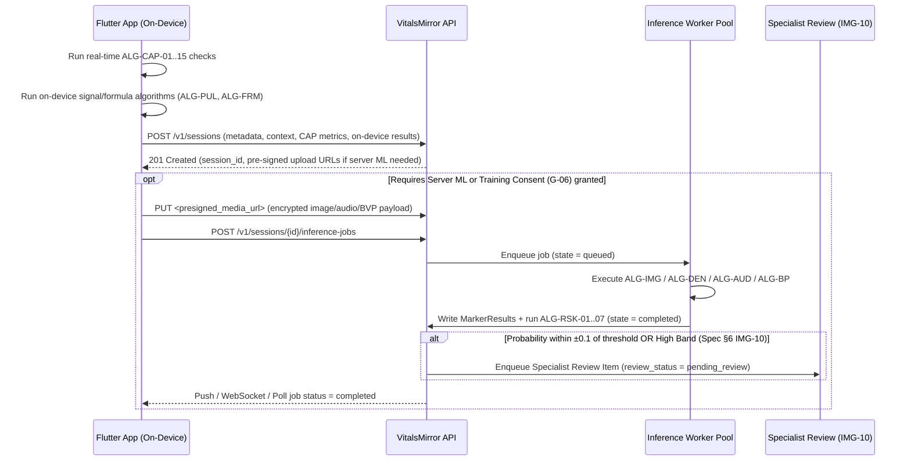

# 10 — API & Backend Integration Specification

> **Document ID:** `10_API_and_Backend_Integration.md`
> **Primary Provenance:** `[DER]` / `[OPEN]` / `[DOC]` (where algorithm/master-data contracts are mandated by the Spec)
> **Cross-References:** `00_README_Index.md` · `07_Feature_Lifecycle_and_States.md` · `08_Health_Readings_and_Metrics.md` · `09_AI_ML_Algorithm_Documentation.md` · `11_Data_Models_and_Entities.md` · `12_Error_Handling_and_Validation.md`

---

## 1. Architectural Overview & Provenance

> [!IMPORTANT]
> The primary source document (*VitalsMirror — Algorithm Specifications & Test Cards*, Oct 18, 2026) is an **algorithm and clinical validation specification**, not a backend transport specification. All REST endpoints, HTTP headers, and JSON wire schemas in this document are tagged **`[DER]`** (derived directly from required Spec workflows, master tables, and outputs) or **`[OPEN]`** (pending final confirmation against the external *FRS* and *Master Data, Algorithms & Data Dictionary*). Until backend services and cloud-hosted ML models are provisioned, all client repositories operate against deterministic **`[MOCK]`** adapters.

### 1.1 Responsibilities Split: On-Device vs Backend

| Domain | Execution Location | Tag | Spec Basis |
|---|---|---|---|
| Real-time capture checks (`ALG-CAP-01`…`15`) | **On-device** (100% real-time) | `[DOC]` | Spec §2 ("All checks run on the phone in real time") |
| Pulse extraction & IBI pipeline (`ALG-PUL-01`…`10`) | **On-device** (POS, CHROM, INT8 TFLite `EfficientPhys`, Welch, spline) | `[DOC]` | Spec §3 (`ALG-PUL-05`: INT8 TFLite on phone, latency ≤ 15 s) |
| Deterministic formulas (`ALG-FRM-01`…`15`) | **On-device** (+ server audit mirror) | `[DOC]` | Spec §5 |
| Trained Vitals / Image / Dental / Audio / Neuro ML (`ALG-BP-01`, `ALG-IMG-*`, `ALG-DEN-*`, `ALG-AUD-*`, `ALG-MOV-*`) | **Hybrid** (On-device TFLite/ONNX or Async Server Inference Job) | `[DOC]` / `[DER]` | Spec §4, §6, §7, §8, §9 |
| Deterministic Risk Engine (`ALG-RSK-01`…`07`) | **Both** (On-device immediate preview using cached `mst_*` + Server authoritative evaluation & Case merge) | `[DOC]` | Spec §10 |
| Master-data distribution & change control (`mst_*`) | **Backend → Client cache** | `[DOC]` | Spec §1, §4.5, §4.6, §5, §10, §13, §14 |
| Specialist Review Queue (`IMG-10`) | **Backend clinical portal** | `[DOC]` | Spec §6 intro |
| Reference Pairing (`§14`) & Sampled Negatives (`REF-03`) | **Backend clinical validation engine** | `[DOC]` | Spec §13, §14, FRS REF-03, REF-06 |

### 1.2 Base URL, Versioning & Standard Headers `[STD]` `[OPEN]`

- **Base URL:** `https://api.vitalsmirror.mayura.health/v1` (configurable per environment: `dev`, `staging`, `study`, `prod`).
- **Transport Security:** TLS 1.3 minimum; certificate pinning enabled in production builds.
- **Required Request Headers:**

| Header | Type | Purpose | Tag |
|---|---|---|---|
| `Authorization` | `Bearer <jwt>` | Member or Operator session token (`G-01`) | `[STD]` |
| `X-Request-Id` | `UUIDv4` | Distributed trace correlation ID | `[STD]` |
| `X-Idempotency-Key` | `UUIDv4` | Required on all mutating `POST` / `PUT` requests for offline queue replay safety | `[DER]` |
| `X-Device-Model` | `String` | `<manufacturer>/<model>` matched against `mst_device_model` (`G-16`) | `[DOC]` |
| `X-App-Version` | `SemVer` | Client build version (e.g., `1.0.0+42`) | `[STD]` |
| `X-Master-Bundle-Version` | `String` | Active client `mst_*` bundle version string for determinism verification (`F-36`) | `[DOC]` |
| `Accept-Language` | `en` \| `te` \| `hi` | Active UI and speech locale (`F-02`, `ALG-AUD-10`) | `[DER]` |

---

## 2. Master-Data Synchronisation API (`mst_*`) (`F-36`, `S-A01`, `S-I05`)

The Spec mandates that all default parameters, quality thresholds, reference ranges, device calibration coefficients, and confirmatory test pathways live in versioned master tables (`mst_*`) changeable **only through change control** (Spec §1, §10). Every screening result records the exact version of the `mst_*` records used to compute it.

### 2.1 Master Tables Inventory `[DOC]`

| Master Table Name | Spec Section | Purpose & Key Contents |
|---|---|---|
| `mst_algorithm` | §1, §4 intro, §4.5, §4.6, §8 | Algorithm ID (`ALG-*`), semantic version, release gate status (`validated`, `band_only`, `research`, `disabled` — `F-38`, `G-24`), tunable default parameters, model weights URI/checksum, decision thresholds (e.g., `IRREG_PROB` = 0.5, `IMG-10` ±0.1 window). |
| `mst_quality_threshold` | §1, §2, §3 | Pass/fail thresholds for `ALG-CAP-01`…`15` and `ALG-PUL-01`…`10` (e.g., `face_size_px >= 200`, `illuminance_luma` 60–220, `noise_dba <= 45`, `pulse_snr_db >= 3.0`, `min_clean_beats_hrv = 50`). |
| `mst_reference_range` | §1, §4, §5, §10 (`ALG-RSK-01`) | Parameter normal/borderline/critical boundaries stratified by `parameter_code`, `sex`, `age_min_months`, `age_max_months`, `is_pregnant`, `trimester`. Boundaries are **inclusive on the normal side** (`ALG-RSK-01`). Marks `"to be built"` cohorts (e.g., HRV age bands) with `status: "pending_cohort"` so the UI displays *"Reference range not yet available"*. |
| `mst_condition` | §1, §4–§10 | Health condition registry (`COND_AF`, `COND_INFECTION`, `COND_HYPOXIA`, `COND_DM`, `COND_HTN`, `COND_CKD`, `COND_METS`, `COND_MOOD`, `COND_OAD`, `COND_OSA`, `COND_ANAEMIA`, `COND_JAUNDICE`, `COND_CATARACT`, `COND_ORAL_CA`, `COND_DFU`, `COND_CHILD_EYE`, `COND_NEO_JAUNDICE`, `COND_CARIES`, etc.), localized names, descriptions, and default merge window (`30 days` per `ALG-RSK-07`). |
| `mst_growth_reference` | §5 (`ALG-FRM-12`) | WHO Child Growth Standards `L`, `M`, `S` parameters by sex and age (days/months) for `haz`, `waz`, and `bmiz` calculation. |
| `mst_confirmatory_test` | §13, §14 | Links each marker/condition trigger to confirmatory lab investigations (§13.1, §13.2), usual diagnostic cut-offs, urgency level, and §14 reference pairing rules (`max_gap_seconds`, `exclusion_codes[]`, negative label requirements). |
| `mst_pathway` | §8 (`AUD-11`, `AUD-12`), §10, §13 | Clinical escalation pathways, urgency rules (`BR-VIT-01`…`06`, `BR-SCR-01`…`04`, `BR-QUA-01`, `BR-DEN`), rescan intervals, crisis helpline metadata (`S-G14`), and specialist referral workflows. |
| `mst_device_model` | §2 (`CAP-06`, `CAP-11`, `CAP-12`, `CAP-15`), §4.5 | Per-phone hardware profile: camera focal length (`CAP-15`), Laplacian blur calibration (`CAP-06`), speaker-mic sweep reference profile (`CAP-11`), A-weighted SPL offset (`CAP-12`), supported FPS (`4.8`), and finger SpO2 coefficients `A` and `B` (`ALG-SPO-01`, null if uncalibrated). |

### 2.2 Master-Data Sync Endpoints `[DER]`

```http
GET /v1/master-data/manifest
If-None-Match: "bundle-2026.10.18-r3-sha256:9f86d08..."
```

- **Response `200 OK`** (or `304 Not Modified` if `ETag` matches):

```json
{
  "bundle_version": "2026.10.18-r3",
  "etag": "bundle-2026.10.18-r3-sha256:9f86d081884c7d659a2feaa0c55ad015",
  "published_at": "2026-10-18T09:00:00Z",
  "change_control_ticket": "CC-MAYURA-2026-0142",
  "approved_by_clinical_safety_lead": "Dr Hanu Yedluri",
  "tables": {
    "mst_algorithm": {
      "version": "2026.10.18.1",
      "record_count": 63,
      "sha256": "3a7bd3e2360a3d29eea436fcfb7e44c735d117c42d1c1835420b6b9942dd4f1b",
      "download_url": "/v1/master-data/tables/mst_algorithm?v=2026.10.18.1"
    },
    "mst_quality_threshold": {
      "version": "2026.10.18.1",
      "record_count": 25,
      "sha256": "4b227777d4dd1fc61c6f884f48641d02b4d121d3fd328cb08b5531fcacdabf8a",
      "download_url": "/v1/master-data/tables/mst_quality_threshold?v=2026.10.18.1"
    },
    "mst_reference_range": {
      "version": "2026.10.18.2",
      "record_count": 210,
      "sha256": "ef2d127de37b942baad06145e54b0c619a1f22327b2ebbcfbec78f5564afe39d",
      "download_url": "/v1/master-data/tables/mst_reference_range?v=2026.10.18.2"
    },
    "mst_condition": {
      "version": "2026.10.18.1",
      "record_count": 28,
      "sha256": "e7f6c011776e8db7cd330b54174fd76f7d0216b612387a5ffcfb81e6f0919683",
      "download_url": "/v1/master-data/tables/mst_condition?v=2026.10.18.1"
    },
    "mst_growth_reference": {
      "version": "2026.01.01.1",
      "record_count": 1856,
      "sha256": "7902699be42c8a8e46fbbb4501726517e86b22c56a189f7625a6da49081b2451",
      "download_url": "/v1/master-data/tables/mst_growth_reference?v=2026.01.01.1"
    },
    "mst_confirmatory_test": {
      "version": "2026.10.18.1",
      "record_count": 32,
      "sha256": "2c624232cdd221771294dfbb310aca000a0df6ac8b66b696d90ef06fdefb64a3",
      "download_url": "/v1/master-data/tables/mst_confirmatory_test?v=2026.10.18.1"
    },
    "mst_pathway": {
      "version": "2026.10.18.1",
      "record_count": 44,
      "sha256": "19581e27de7ced00ff1ce50b2047e7a567c76b1cbaebabe5ef03f7c3017bb5b7",
      "download_url": "/v1/master-data/tables/mst_pathway?v=2026.10.18.1"
    },
    "mst_device_model": {
      "version": "2026.10.18.4",
      "record_count": 48,
      "sha256": "4a44dc15364204a80fe80e9039455cc1608281820fe2b24f1e5233ade6af1dd5",
      "download_url": "/v1/master-data/tables/mst_device_model?v=2026.10.18.4"
    }
  }
}
```

### 2.3 Atomic Swap & Change-Control Audit Rules `[DOC]` `[DER]`

1. **Checksum Verification:** When any table version in `/v1/master-data/manifest` differs from the local SQLite/Drift database, the client downloads the updated table JSON, verifies its SHA-256 against `tables[tableName].sha256`, and applies all table updates inside a **single atomic transaction**.
2. **Offline Fallback:** An embedded seed bundle (`bundle_version: "2026.10.18-seed"`) ships inside the Flutter asset bundle so cold boot without internet (`G-36`) still enforces all Spec defaults.
3. **Audit Stamp:** Every `CaptureSession`, `MarkerResult`, and `RiskAssessment` stores `algorithm_version`, `threshold_version`, and `range_version` so historical results are never retroactively altered when master tables update.

---

## 3. Authentication, Profiles & Consents API

### 3.1 Authentication & Operator Mode (`F-01`, `F-06`, `S-A04`…`S-A08`) `[STD]` `[OPEN]`

| Method & Path | Purpose | Request Body | Response Summary |
|---|---|---|---|
| `POST /v1/auth/otp/request` | Send 6-digit OTP to mobile number (`S-A04`) | `{ "phone_e164": "+919876543210", "role_intent": "member" \| "operator" }` | `{ "challenge_id": "uuid", "expires_in_sec": 180, "resend_after_sec": 30 }` |
| `POST /v1/auth/otp/verify` | Verify OTP & issue JWT pair (`S-A05`) | `{ "challenge_id": "uuid", "otp_code": "123456", "device_fingerprint": "..." }` | `{ "access_token": "...", "refresh_token": "...", "actor_role": "member" \| "operator", "member_id": "uuid" }` |
| `POST /v1/auth/token/refresh` | Rotate access token (`G-01`) | `{ "refresh_token": "..." }` | `{ "access_token": "...", "refresh_token": "...", "expires_in_sec": 3600 }` |
| `POST /v1/auth/logout` | Revoke active refresh token | `{ "refresh_token": "..." }` | `204 No Content` |
| `GET /v1/operator/participants` | Operator search in schools / anganwadis / clinics (`F-06`, `S-A08`) | Query: `?q=name_or_phone&facility_id=...` | Paginated list of `MemberSummary` records |

### 3.2 Member, Dependents & Health Context (`F-04`, `F-05`, `S-B03`…`S-B06`) `[DOC]` `[DER]`

Profile fields directly gate algorithms (`G-02`, `G-03`, `G-09`, `G-10`, `G-29`):
- **Basic Profile (`G-02`):** `date_of_birth` (or `age_hours` for newborns 0–28 days in `ALG-IMG-07`), `sex` (`male`/`female`), `height_cm`, `weight_kg`.
- **Extended Health Context (`G-03`, `G-10`):** `waist_cm` (`ALG-DM-01`, `ALG-FRM-10`, `ALG-RSK-05`), `is_pregnant` & `gestation_weeks` (`ALG-IMG-01`, `ALG-IMG-07`, `ALG-RSK-01`), `family_history_diabetes` (`ALG-DM-01`), `physical_activity_level` (`ALG-DM-01`), `tobacco_or_areca_use` (`ALG-IMG-04`), `known_diabetes` (`ALG-IMG-05`), `education_years` (`ALG-AUD-10`), `hf_programme_enrolled` & `hf_enrolment_date` (`G-08`, `ALG-AUD-12`), `clinician_pathway_active` (`G-07`, `ALG-AUD-11`), `fitzpatrick_skin_type` (`I`–`VI`, study metadata §11.2).

| Method & Path | Purpose | Gate / Screen |
|---|---|---|
| `GET /v1/members/me` | Fetch authenticated member profile + latest health context | `S-B03`, `S-B04`, `S-C07` |
| `PUT /v1/members/me/profile` | Update basic & extended health context | `G-02`, `G-03` |
| `GET /v1/members/me/dependents` | List family dependents (children 1–12 y, newborns 0–28 d, adult relatives) | `F-05`, `S-B05` |
| `POST /v1/members/me/dependents` | Register a child/newborn or adult dependent (`relationship`, `guardian_member_id`) | `F-05`, `S-B06` |
| `PUT /v1/members/{subject_id}/profile` | Update dependent or operator-managed participant profile | `S-B06`, `S-A08` |
| `POST /v1/members/{subject_id}/bp-calibrations` | Record validated cuff SBP/DBP calibration pair (valid for 30 days per `ALG-BP-01`, `G-26`) | `F-14`, `S-D10` |

### 3.3 Versioned Consent Management (`F-03`, `S-B01`, `S-B02`, `S-I04`) `[DOC]`

The Spec requires explicit, auditable consent before specific captures and before including any scan in model training (§6 intro, §7.1, §8 `AUD-11`/`12`, §11.2):

| Consent Type Code | Gate | Blocking? | Spec Requirement |
|---|---|---|---|
| `CONSENT_SCREENING` | `G-04` | **Yes** (blocks all screenings) | Spec §6 intro; general non-diagnostic screening consent |
| `CONSENT_DENTAL` | `G-05` | **Yes** (blocks `ALG-DEN-*`) | Spec §7.1; requires **guardian signature** when subject age < 18 y |
| `CONSENT_TRAINING_DATA` | `G-06` | **No** (opt-in only) | Spec §11.2 ("keeps only training-consented records for model building") |
| `CONSENT_CLINICIAN_MOOD` | `G-07` | **Yes** (blocks `ALG-AUD-11`) | Spec §8 `AUD-11` (mood screening restricted to active clinician pathway) |
| `CONSENT_HF_PROGRAMME` | `G-08` | **Yes** (blocks `ALG-AUD-12`) | Spec §8 `AUD-12` (enrolled heart-failure voice cohort) |

```http
POST /v1/members/{subject_id}/consents
Content-Type: application/json
```

```json
{
  "consent_type": "CONSENT_DENTAL",
  "document_version": "2026.10.1",
  "language": "te",
  "granted": true,
  "signed_by_member_id": "a1b2c3d4-e5f6-7890-abcd-ef1234567890",
  "signer_relationship": "guardian_parent",
  "photographer_role": "parent",
  "captured_at": "2026-10-18T10:15:00Z"
}
```

---

## 4. Capture Session, Async Inference & Specialist Review API

### 4.1 Session Creation & Media Upload Lifecycle (`F-09`…`F-28`) `[DER]`



### 4.2 Endpoints `[DER]`

| Method & Path | Purpose |
|---|---|
| `POST /v1/sessions` | Create capture session with pre-scan context (`caffeine_30m`, `smoking_30m`, `exercise_30m` for `ALG-RSK-06`), device info, `QualityMetricResult[]`, and any on-device `MarkerResult[]`. |
| `POST /v1/sessions/{session_id}/media-urls` | Request pre-signed S3/GCS upload URLs for images (eye, oral, dental 4-view, foot, skin, fundus), audio (16/44.1 kHz WAV/FLAC), or raw BVP/IBI traces. |
| `POST /v1/sessions/{session_id}/inference-jobs` | Trigger server-side ML pipeline after media upload completes. |
| `GET /v1/sessions/{session_id}/inference-jobs/{job_id}` | Poll async inference job status (`queued` → `processing` → `completed` \| `failed`). |
| `GET /v1/sessions/{session_id}/results` | Retrieve full standardized result envelope (vitals, image, dental, audio, movement, risk flags, and case links). |

### 4.3 Async Inference Job States `[DER]`

| State | Meaning | Client UI Behaviour (`S-D05`, `S-R01`) |
|---|---|---|
| `queued` | Media uploaded; awaiting GPU/CPU worker | Show processing state on `S-D05` / `S-E04` |
| `processing` | Model pipeline executing (`ALG-IMG-*`, `ALG-DEN-*`, `ALG-AUD-*`) | Show progress indicator; allow user to background and receive notification (`F-35`) |
| `completed` | All markers computed and `ALG-RSK-01`…`07` evaluated | Navigate to `S-D07` / `S-R01` / `S-F04` / `S-G06` (or `S-R02` if `emergency`) |
| `failed` | Unrecoverable processing error or server quality rejection | Map to `AppFailure` (`12_Error_Handling_and_Validation.md`); prompt retake if `retake_count < 3` |

### 4.4 Specialist Review Queue (`IMG-10`, `F-31`, `S-R01`, `S-R05`) `[DOC]` `[DER]`

Per Spec §6 intro:
> *"Every high or uncertain result (probability within ±0.1 of threshold) goes to specialist review (IMG-10)."*

- **Trigger Rule:** For any `ALG-IMG-01`…`09` (and oral/skin/dental escalations), if `band == "high"` (or `"suspicious"` / `"ulcer"` / `"referable"`) **OR** `|model_probability - decision_threshold| <= 0.10`, the backend automatically creates a `SpecialistReviewTicket` with `status: "pending_specialist_review"`.
- **Endpoints:**
  - `GET /v1/sessions/{session_id}/specialist-review` — Returns current review status (`not_required`, `pending_specialist_review`, `confirmed_by_specialist`, `downgraded_by_specialist`, `unreadable_retake_requested`), reviewer specialty, and clinical notes.
  - `POST /v1/specialist-reviews/{ticket_id}/decision` `[OPEN]` — Used by the clinician/specialist portal to submit adjudication, which updates the linked `CaseRecord` and dispatches a push notification (`F-35`, `S-C06`).

---

## 5. Risk Engine, Cases, Reference Pairing & Sampled Negatives API

### 5.1 Risk Engine, Flags & 30-Day Case Aggregation (`F-29`, `F-30`, `ALG-RSK-01`…`07`) `[DOC]`

When a session finishes, `ALG-RSK-01`…`07` execute deterministically:
1. **Confidence Gate (`ALG-RSK-06`, `G-23`):**
   $$\text{result\_confidence} = q_{\text{capture}} \times c_{\text{model}} \times f_{\text{context}}$$
   where $f_{\text{context}} = 0.8$ if caffeine, smoking, or exercise occurred in the last 30 minutes (else $1.0$). If $\text{result\_confidence} < 0.6$, the marker is marked `is_hidden: true` (`hidden_reason: "low_confidence"`).
2. **Urgency Precedence (`ALG-RSK-02`):** Evaluates active rules (`BR-VIT-01`…`06`, `BR-SCR-01`…`04`, `BR-QUA-01`, `BR-DEN`); highest urgency wins (`emergency` > `urgent` > `routine`).
3. **30-Day Condition Case Merge (`ALG-RSK-07`):**
   - If a `ConditionFlag` fires for `condition_code` (e.g., `COND_ANAEMIA`), the backend checks if the subject has an existing open `CaseRecord` for `COND_ANAEMIA` created or updated within the last **30 days**.
   - If yes → attaches the new `flag_id` and `session_id` to the existing `case_id` and upgrades `case.urgency` if the new flag is more urgent.
   - If no → opens a new `CaseRecord` and populates recommended confirmatory tests from `mst_confirmatory_test` (Spec §13).

| Method & Path | Purpose | Screen |
|---|---|---|
| `GET /v1/members/{subject_id}/cases` | List open and closed condition cases (merged within 30 days per `ALG-RSK-07`) | `S-R04` |
| `GET /v1/cases/{case_id}` | Get case detail, linked flags, specialist review state, and §13 confirmatory tests | `S-R05` |
| `GET /v1/members/{subject_id}/baselines` | Get personal baselines (`ALG-RSK-03`: median of last 3 in 180 d, SD of last 10; plus 14-day HF baseline `ALG-AUD-12`) | `S-C05` |

### 5.2 Confirmatory Lab Result Upload & Reference Pairing (`F-32`, `S-R06`, Spec §13 & §14) `[DOC]` `[OPEN]`

When a member, operator, or lab integration uploads a reference investigation result (e.g., Lab HbA1c, CBC Hb, Serum Bilirubin, 12-lead ECG, Spirometry, Dentist ICDAS exam), the backend pairs it with the triggering screening scan and assigns a **Pairing Quality Grade (`A`–`D`)** per **Spec §14** and **FRS REF-06**:

| Grade | Definition | Used for Model Training / Validation? |
|---|---|---|
| **Grade A** | Simultaneous or same-session study capture under clinical protocol (`§11.2`), zero exclusions | **Yes** (Gold standard) |
| **Grade B** | Within §14 `max_gap` window (either direction), zero §14 exclusions, accredited lab/device | **Yes** |
| **Grade C** | Within §14 `max_gap` window, minor metadata gap (e.g., lab analyser model unrecorded) but no physiological exclusion | **Validation monitoring only** |
| **Grade D** | **Outside §14 `max_gap` window OR broken by a §14 exclusion** (e.g., blood transfusion between scan and Hb test; single ECG used for negative AF label instead of ≥24 h Holter; phototherapy between scan and newborn bilirubin) | **Monitoring only — NEVER used for training** (`Spec §14`, `FRS REF-06`) |

```http
POST /v1/members/{subject_id}/reference-results
Content-Type: application/json
```

```json
{
  "case_id": "c9012345-6789-4abc-def0-123456789012",
  "paired_session_id": "s1234567-89ab-4cde-f012-3456789abcde",
  "marker_or_screen_code": "ANAEMIA",
  "investigation_code": "LAB_CBC_HB",
  "collected_at": "2026-10-20T08:30:00Z",
  "numeric_value": 10.4,
  "unit": "g/dL",
  "categorical_outcome": "positive_anaemia",
  "lab_reference_low": 12.0,
  "lab_reference_high": 15.5,
  "exclusions_checked": {
    "transfusion_between_scan_and_test": false,
    "iron_infusion_between_scan_and_test": false,
    "acute_bleeding_between_scan_and_test": false
  },
  "evidence_document_media_id": "m7777777-8888-4999-aaaa-bbbbbbbbbbbb"
}
```

- **Response `201 Created`:**

```json
{
  "reference_result_id": "r5555555-6666-4777-8888-999999999999",
  "paired_session_id": "s1234567-89ab-4cde-f012-3456789abcde",
  "gap_seconds": 166200,
  "max_allowed_gap_seconds": 604800,
  "within_window": true,
  "exclusion_violated": false,
  "pairing_grade": "B",
  "eligible_for_training": true,
  "case_status_updated": "confirmed_in_care"
}
```

### 5.3 Sampled-Negative Invitations (`F-32`, `S-R07`, FRS REF-03) `[DOC]` `[DER]`

Per Spec §14 (`FRS REF-03`):
> *"Sampled negatives (FRS REF-03): at least 5% of screen-negative members per screen are offered the reference test each month, so that sensitivity and NPV can be measured; the sample is weighted back to the screened population in accuracy reports."*

| Method & Path | Purpose |
|---|---|
| `GET /v1/members/{subject_id}/reference-invitations` | Fetch active sampled-negative reference test invitations (`sampling_stratum_weight`, `screen_code`, `recommended_test_code`, `expires_at`, `voucher_code`) for display on `S-R07`. |
| `POST /v1/reference-invitations/{invitation_id}/respond` | Member accepts or declines the free/subsidized confirmatory reference test (`accepted` \| `declined`). |

---

## 6. Partner & Hardware Integrations

### 6.1 Fundus Camera & Partner AI Adapter (`ALG-IMG-09`, `F-17`, `S-E06`, `G-31`) `[DOC]` `[DER]`

Spec §6.8 & §12 specify a clip-on fundus camera connected to a partner AI engine (e.g., Medios AI, Mumbai) via an adapter interface:
- **Hardware Input:** Non-mydriatic / clip-on smartphone fundus camera (`G-31`: USB-C / Wi-Fi / BLE local link). Captures macula-centred and disc-centred retinal images per eye.
- **Adapter Contract (`FundusPartnerAdapter`):**
  1. Validates retinal image gradability (`CAP-08` equivalent partner gradability flag).
  2. Executes partner inference (on-device SDK or partner cloud endpoint `POST /v1/partners/fundus/analyze`).
  3. Maps partner output into VitalsMirror canonical markers:
     - `DR_REFERABLE` (`boolean` — true if Moderate NPDR or worse, or macular oedema per ICDR)
     - `DR_GRADE` (`none` \| `mild_npdr` \| `moderate_npdr` \| `severe_npdr` \| `pdr` \| `dme`)
     - `GLAUCOMA_SUSPECT` (`boolean` — optic disc cup-to-disc ratio / RNFL suspicion)
  4. Feeds `COND_DR` / `COND_GLAUCOMA` into `ALG-RSK-01`…`07` and automatically triggers `IMG-10` specialist review when `DR_REFERABLE == true` or `GLAUCOMA_SUSPECT == true`.

### 6.2 TB Cough Partner API Adapter (`ALG-AUD-03`, `F-20`, `S-G03`, `S-G06`) `[DOC]` `[DER]`

Spec §8 `ALG-AUD-03` & §12 state: *"Embedding + cough features + symptoms → classifier; or partner API (e.g. Swaasa TB validation)"*.
- **Adapter Contract (`TbRiskEvaluator`):**
  - **Preconditions:** `CAP-11`, `CAP-12`, `CAP-13` passed; `COUGH_COUNT_VALID >= 3` from `ALG-AUD-01`; `Q_TB_SYMPTOMS` completed (cough > 2 weeks, fever, night sweats, weight loss, haemoptysis).
  - **Mode A (Internal Model):** Uses `ALG-AUD-02` HeAR embeddings + acoustic cough features + `Q_TB_SYMPTOMS`.
  - **Mode B (Partner API via Backend Proxy `POST /v1/partners/tb-cough/evaluate`):** Sends anonymized 16 kHz mono WAV containing ≥ 3 valid cough segments + age, sex, and symptom flags to the licensed partner API; normalizes the response to `TB_PROB` (`0.0–1.0`) and `TB_BAND` (`low` \| `high`).

### 6.3 Google HeAR Health-Audio Embedding Service (`ALG-AUD-02`, `F-20`) `[DOC]` `[DER]`

Spec §8 `ALG-AUD-02` & §12 specify **Google HeAR** (or equivalent foundation model) for health-audio representation:
- **Signal Specification:** 16 kHz mono PCM, segmented into **2-second windows** (32,000 samples per window), mean-pooled across valid windows into a fixed-length vector `audio_embedding[]` (e.g., 512-float vector).
- **Endpoint (`POST /v1/audio/embeddings:extract`):** Accepts base64/multipart 16 kHz audio segments and returns `audio_embedding[]` + `model_version` (`hear-v1.0`), ensuring cross-phone cosine similarity $\ge 0.90$ on same-person same-day recordings.

### 6.4 Smart Ring BLE & SDK Integration (`F-33`, `S-I01`, `S-I02`, `G-32`) `[DOC]` `[OPEN]`

The Spec references an optional Smart Ring enhancer in four workflows:
1. **SpO2 Fallback & Overnight Oximetry (`Spec §4.5`, `§8 AUD-08`):** Provides continuous/spot `SPO2_EST` and overnight SpO2 dips ($\ge 3\%$ dip paired with $\ge 30\%$ sonar breathing drop for hypopnoea scoring in `ALG-AUD-08`).
2. **Irregular Rhythm Confirmation (`Spec §4.7`, `G-27`):** `ALG-RHY-01` flags positive irregular rhythm if `IRREG_PROB >= threshold` on **2 camera scans, OR 1 camera scan + Smart Ring overnight rhythm flag**.
3. **Skin / Body Temperature (`Spec §10 T9`, `§13.1`, `§14`):** Provides `TEMP_C` (°C); triggers `BR-VIT-06` urgent flag when `TEMP_C >= 38.0` °C with `RR > 20` or `SpO2 < 95%`.

- **BLE Gatt / SDK Sync Contract (`POST /v1/members/{subject_id}/ring-telemetry`):**

```json
{
  "ring_device_id": "RING-MAYURA-88A1",
  "firmware_version": "2.4.1",
  "synced_at": "2026-10-18T07:05:00Z",
  "spot_readings": [
    { "timestamp": "2026-10-18T07:00:00Z", "spo2_pct": 97, "temp_c": 36.8, "hr_bpm": 64 }
  ],
  "overnight_summary": {
    "sleep_session_id": "s9988776-5544-4332-1100-aabbccddeeff",
    "start_at": "2026-10-17T22:30:00Z",
    "end_at": "2026-10-18T06:30:00Z",
    "irregular_rhythm_flag": false,
    "irregular_episodes_count": 0,
    "spo2_desaturation_events_3pct": [
      { "onset_at": "2026-10-18T02:14:20Z", "duration_sec": 18, "nadir_spo2_pct": 91 }
    ]
  }
}
```

---

## 7. Standardized Result Envelope JSON Example `[DOC]` `[DER]`

Every screening session returns a unified JSON envelope so all UI screens (`S-D07`, `S-R01`, `S-R02`, `S-R03`, `S-C04`) render bands, confidence, suppression rules, and risk flags consistently.

```json
{
  "session_id": "s1234567-89ab-4cde-f012-3456789abcde",
  "subject_id": "m1111111-2222-4333-8444-555555555555",
  "captured_by_member_id": "m1111111-2222-4333-8444-555555555555",
  "photographer_role": "self",
  "session_type": "vitals_face",
  "captured_at": "2026-10-18T11:20:00Z",
  "master_bundle_version": "2026.10.18-r3",
  "device_model_code": "samsung/SM-S911B",
  "pre_scan_context": {
    "caffeine_last_30m": false,
    "smoking_last_30m": false,
    "exercise_last_30m": false,
    "context_confidence_factor": 1.0
  },
  "quality_summary": {
    "passed": true,
    "capture_quality_score": 0.92,
    "metrics": [
      { "check_id": "ALG-CAP-01", "passed": true, "value": 340, "unit": "px" },
      { "check_id": "ALG-CAP-03", "passed": true, "value": 142, "unit": "luma" },
      { "check_id": "ALG-CAP-04", "passed": true, "value": 1.4, "unit": "px/s" },
      { "check_id": "ALG-CAP-05", "passed": true, "value": 94.2, "unit": "%" },
      { "check_id": "ALG-PUL-09", "passed": true, "value": 7.8, "unit": "dB" }
    ]
  },
  "pulse_pipeline_summary": {
    "recording_duration_s": 60,
    "usable_rois_count": 6,
    "pulse_snr_db": 7.8,
    "template_corr_mean": 0.89,
    "total_beats_detected": 74,
    "clean_beat_count": 68,
    "valid_ibi_pct": 91.9,
    "ectopic_count": 0
  },
  "markers": [
    {
      "marker_code": "HR",
      "algorithm_id": "ALG-PUL-07",
      "algorithm_version": "1.2.0",
      "release_status": "validated",
      "numeric_value": 72,
      "display_decimals": 0,
      "unit": "bpm",
      "band": "normal",
      "range_version": "2026.10.18.2",
      "result_confidence": 0.91,
      "is_hidden": false,
      "hidden_reason": null,
      "baseline": {
        "baseline_value": 70.0,
        "baseline_sd": 3.2,
        "change_pct": 2.86,
        "change_flag": false
      }
    },
    {
      "marker_code": "BP_BAND",
      "algorithm_id": "ALG-BP-01",
      "algorithm_version": "0.9.0",
      "release_status": "band_only",
      "numeric_value": null,
      "internal_values": { "sbp_mmhg": 128, "dbp_mmhg": 84 },
      "display_decimals": 0,
      "unit": "mmHg",
      "band": "elevated",
      "range_version": "2026.10.18.2",
      "result_confidence": 0.78,
      "is_hidden": false,
      "hidden_reason": "numeric_suppressed_band_only_release"
    }
  ],
  "risk_assessment": {
    "highest_urgency": "routine",
    "rules_fired": ["BR-VIT-04"],
    "flags": [
      {
        "flag_id": "f8888888-9999-4aaa-bbbb-cccccccccccc",
        "condition_code": "COND_HTN",
        "urgency": "routine",
        "trigger_markers": ["BP_BAND"],
        "case_id": "c9012345-6789-4abc-def0-123456789012",
        "merged_into_existing_case": true,
        "recommended_investigations": [
          "Clinic cuff BP on 2 visits or 24-h ambulatory BP",
          "Serum creatinine + eGFR, urine ACR, fasting glucose / HbA1c, lipid profile, 12-lead ECG"
        ]
      }
    ]
  },
  "specialist_review": {
    "required": false,
    "status": "not_required"
  }
}
```

---

## 8. Offline Queue, Idempotency & Mock-to-Production Swap Strategy

### 8.1 Offline-First Outbox & Idempotency (`G-36`) `[DER]`

Field workers (`F-06`) in schools and anganwadis frequently operate with intermittent connectivity:
1. **Local Persistence:** Every completed session, consent signature, and profile update is written first to an encrypted local SQLite/Drift table (`sync_outbox_queue`) with a client-generated UUID (`session_id` / `idempotency_key`).
2. **On-Device Determinism:** Because `mst_*` tables are cached locally, on-device algorithms (`ALG-CAP`, `ALG-PUL`, `ALG-RSP`, `ALG-HRV`, `ALG-FRM`, and cached `ALG-RSK`) produce immediate screening bands and emergency alerts (`S-R02`) even when offline.
3. **Chunked Resumable Media Upload:** When connectivity returns, large media payloads (e.g., 4 dental photos or cough WAV files) upload via resumable pre-signed URLs before the `/inference-jobs` trigger is sent.
4. **Server Idempotency:** Repeat `POST` requests with the same `X-Idempotency-Key` return the original response without duplicating `CaptureSession`, `ConditionFlag`, or `CaseRecord` rows.

### 8.2 Mock-to-Production Swap Strategy (`[MOCK]` → `[DOC]`)

All data sources in the Flutter app are bound through abstract repository interfaces (`13_Flutter_Architecture.md`):

| Repository / Service Interface | `[MOCK]` Implementation (Phase 1–3) | Production Implementation (Phase 4+) |
|---|---|---|
| `MasterDataRepository` | Loads bundled JSON seed matching Spec §2–§14 tables | Syncs `/v1/master-data/manifest` with ETag & SHA-256 verification |
| `VitalsInferenceService` | Runs exact Spec §5 formulas & §4.3/4.4 test vectors; deterministic mock ML for `ALG-BP-01`, `ALG-RHY-01`, `ALG-DM-01` | Runs INT8 TFLite `EfficientPhys` (`ALG-PUL-05`) + validated LightGBM/CNN models |
| `ImageScreeningService` | Simulates `ALG-IMG-01`…`09` outputs + `IMG-10` specialist review states | Executes on-device/server CNNs & `FundusPartnerAdapter` |
| `DentalScreeningService` | Executes exact `ALG-DEN-06` test vectors (§7.3 Cases 1–6) + mock FDI tooth boxes | Runs `ALG-DEN-01`…`05` YOLO/classifier models |
| `AudioScreeningService` | Simulates `ALG-AUD-01`…`12` markers & crisis pathway trigger (`PHQ-9 item 9 > 0`) | Connects to on-device DSP + Google HeAR (`ALG-AUD-02`) + TB Partner API |
| `RiskEngineService` | **100% Real Implementation from Day 1** — runs deterministic `ALG-RSK-01`…`07` and passes all 16 rule test cases (`T1`–`T16`) | Identical deterministic engine mirrored on backend |
