# 11 — Data Models, Entities & Master-Data Schemas

> **Document ID:** `11_Data_Models_and_Entities.md`
> **Primary Provenance:** `[DOC]` (all Spec-mandated markers, master tables, and inputs) / `[DER]` (relational/envelope wrappers)
> **Cross-References:** `00_README_Index.md` · `08_Health_Readings_and_Metrics.md` · `09_AI_ML_Algorithm_Documentation.md` · `10_API_and_Backend_Integration.md` · `12_Error_Handling_and_Validation.md`

---

## 1. Domain Entity-Relationship Diagram

```mermaid
erDiagram
    MEMBER ||--o{ DEPENDENT : "manages (F-05)"
    MEMBER ||--|| HEALTH_PROFILE : "has (F-04)"
    DEPENDENT ||--|| HEALTH_PROFILE : "has (F-05)"
    MEMBER ||--o{ CONSENT_RECORD : "grants/signs (F-03)"
    MEMBER ||--o{ PERSONAL_BASELINE : "tracks (ALG-RSK-03)"
    MEMBER ||--o{ BP_CUFF_CALIBRATION : "calibrates (ALG-BP-01)"
    MEMBER ||--o{ CAPTURE_SESSION : "undergoes"
    DEVICE_PROFILE ||--o{ CAPTURE_SESSION : "captures (mst_device_model)"

    CAPTURE_SESSION ||--o{ QUALITY_METRIC_RESULT : "validates (ALG-CAP)"
    CAPTURE_SESSION ||--o| PULSE_PIPELINE_SUMMARY : "extracts (ALG-PUL)"
    CAPTURE_SESSION ||--o{ MARKER_RESULT : "produces"
    CAPTURE_SESSION ||--o| VITALS_SESSION_RESULT : "summarises (Sec 4-5)"
    CAPTURE_SESSION ||--o| IMAGE_SCREENING_RESULT : "summarises (Sec 6)"
    CAPTURE_SESSION ||--o| DENTAL_EXAM_RESULT : "summarises (Sec 7)"
    DENTAL_EXAM_RESULT ||--o{ TOOTH_FINDING : "contains FDI teeth"
    CAPTURE_SESSION ||--o| AUDIO_SCREENING_RESULT : "summarises (Sec 8)"
    CAPTURE_SESSION ||--o| SLEEP_SESSION_RESULT : "summarises (AUD-07/08)"
    CAPTURE_SESSION ||--o| HEARING_RESULT : "summarises (AUD-09)"
    CAPTURE_SESSION ||--o| MOVEMENT_RESULT : "summarises (Sec 9)"
    CAPTURE_SESSION ||--o| STROKE_FAST_RESULT : "summarises (MOV-06..09)"
    CAPTURE_SESSION ||--|| RISK_ASSESSMENT : "evaluates (ALG-RSK)"

    RISK_ASSESSMENT ||--o{ CONDITION_FLAG : "raises"
    CASE_RECORD ||--o{ CONDITION_FLAG : "merges 30d (ALG-RSK-07)"
    CASE_RECORD ||--o{ CONFIRMATORY_INVESTIGATION : "recommends (Sec 13)"
    CAPTURE_SESSION ||--o{ REFERENCE_PAIRING_RECORD : "pairs (Sec 14)"

    MST_ALGORITHM ||--o{ MARKER_RESULT : "governs"
    MST_QUALITY_THRESHOLD ||--o{ QUALITY_METRIC_RESULT : "thresholds"
    MST_REFERENCE_RANGE ||--o{ MARKER_RESULT : "bands (ALG-RSK-01)"
    MST_CONDITION ||--o{ CONDITION_FLAG : "defines"
    MST_GROWTH_REFERENCE ||--o{ VITALS_SESSION_RESULT : "WHO LMS (ALG-FRM-12)"
    MST_CONFIRMATORY_TEST ||--o{ CONFIRMATORY_INVESTIGATION : "maps"
    MST_PATHWAY ||--o{ RISK_ASSESSMENT : "escalates"
    MST_DEVICE_MODEL ||--|| DEVICE_PROFILE : "calibrates"
```



---

## 2. Core Enums & Value Types `[DOC]` `[DER]`

| Enum Name | Values | Spec Basis |
|---|---|---|
| `ActorRole` | `member`, `operator`, `clinician_reviewer` | §7.1 ("parent vs operator"), §6 ("IMG-10") |
| `PhotographerRole` | `self`, `parent_guardian`, `operator` | §6.4 ("untrained photographers"), §7.1 |
| `BiologicalSex` | `male`, `female` | §4.6, §5 (`ALG-FRM-11` male=1, `ALG-FRM-12`, `ALG-FRM-13`), §6.1 |
| `FitzpatrickSkinType` | `type_i`, `type_ii`, `type_iii`, `type_iv`, `type_v`, `type_vi` | §2 `ALG-CAP-05`, §4.1, §11.2 |
| `PhysicalActivityLevel` | `sedentary`, `light`, `moderate`, `vigorous` | §4.9 `ALG-DM-01` |
| `TobaccoArecaStatus` | `never`, `former`, `current_smoker`, `current_smokeless_areca`, `both` | §6.4 `ALG-IMG-04` |
| `ConsentType` | `screening`, `dental_guardian`, `training_data`, `clinician_mood_pathway`, `hf_programme` | §6 intro, §7.1, §8 `AUD-11`/`12`, §11.2 |
| `AlgorithmReleaseStatus` | `validated`, `band_only`, `research`, `disabled` | §4 intro, §4.5, §4.6, §8 `AUD-11` (`F-38`, `G-24`) |
| `ScreeningBand` | `normal`, `borderline`, `critical`, `low`, `moderate`, `high`, `elevated`, `regular`, `irregular`, `prediabetes_risk`, `diabetes_risk`, `not_suspicious`, `suspicious`, `high_risk`, `at_risk`, `ulcer`, `refer`, `mild`, `severe`, `positive`, `negative`, `not_assessed` | §4–§10 |
| `UrgencyLevel` | `none`, `preventive`, `routine`, `urgent`, `emergency` | §10 `ALG-RSK-02` (`emergency > urgent > routine`), §13 |
| `DentitionStage` | `primary_under_6y` (FDI 51–85), `mixed_6_to_12y`, `permanent_11_to_48` | §7.1 `ALG-DEN-01`…`03` |
| `DentalViewType` | `front_closed`, `front_open`, `upper_occlusal`, `lower_occlusal` | §7.1 (4 views) |
| `ToothFindingClass` | `white_spot`, `enamel_break`, `cavity`, `broken_or_black`, `abscess_sign` | §7.1 (`ALG-DEN-03` severity order) |
| `SpecialistReviewStatus` | `not_required`, `pending_specialist_review`, `confirmed_by_specialist`, `downgraded_by_specialist`, `retake_requested` | §6 intro (`IMG-10`) |
| `PairingGrade` | `grade_a`, `grade_b`, `grade_c`, `grade_d` | §14 & FRS REF-06 |

---

## 3. Master-Data Tables (`mst_*`) (`F-36`) `[DOC]`

All `mst_*` records are read-only on the client and updated exclusively via signed change-control bundles (`10_API_and_Backend_Integration.md` §2).

### 3.1 `mst_algorithm`
| Field | Type | Nullable | Description |
|---|---|---|---|
| `algorithm_id` | `String` (PK) | No | e.g., `ALG-CAP-01`, `ALG-PUL-07`, `ALG-BP-01`, `ALG-DEN-03` |
| `name` | `String` | No | Human-readable name |
| `version` | `String` | No | SemVer (e.g., `1.2.0`) |
| `release_status` | `AlgorithmReleaseStatus` | No | `validated` \| `band_only` \| `research` \| `disabled` (`G-24`) |
| `execution_target` | `String` | No | `on_device` \| `server` \| `hybrid` \| `partner_api` |
| `default_parameters_json` | `Map<String, dynamic>` | No | Tunable defaults (e.g., `{"lambda": 300, "bandpass_hz": [0.7, 3.0]}`) |
| `decision_threshold` | `double?` | Yes | Classification cut-off (e.g., `0.5` for `ALG-RHY-01`) |
| `specialist_review_margin` | `double?` | Yes | `0.10` for `IMG-10` (±0.1 around threshold) |
| `conditions_informed` | `List<String>` | No | Foreign keys to `mst_condition.condition_code` |
| `updated_at` | `DateTime` | No | Change-control timestamp |

### 3.2 `mst_quality_threshold`
| Field | Type | Nullable | Description |
|---|---|---|---|
| `check_id` | `String` (PK) | No | `ALG-CAP-01`…`15`, `ALG-PUL-01`, `ALG-PUL-07`…`10` |
| `parameter_code` | `String` | No | e.g., `face_size_px`, `illuminance_luma`, `pulse_snr_db` |
| `min_value` | `double?` | Yes | Inclusive minimum (e.g., `60.0` for luma, `3.0` for SNR) |
| `max_value` | `double?` | Yes | Inclusive maximum (e.g., `220.0` for luma, `45.0` for `noise_dba`) |
| `min_pass_frame_pct` | `double` | No | e.g., `80.0`% for `ALG-PUL` preconditions |
| `max_retakes` | `int` | No | Default `3` (`G-25`) |
| `failure_message_key` | `String` | No | Localisation key for coaching message |
| `version` | `String` | No | Master version string |

### 3.3 `mst_reference_range`
| Field | Type | Nullable | Description |
|---|---|---|---|
| `range_id` | `String` (PK) | No | Unique range row ID |
| `parameter_code` | `String` | No | Marker code (`HR`, `RR`, `BAEVSKY_SI`, `SPO2_EST`, `SBP`, `DBP`, `HB_EST`, etc.) |
| `sex` | `BiologicalSex?` | Yes | `null` = applies to both sexes |
| `age_min_months` | `int` | No | Inclusive minimum age in months (`0` for newborn) |
| `age_max_months` | `int` | No | Inclusive maximum age in months |
| `is_pregnant` | `bool?` | Yes | `true` for pregnancy-specific thresholds (e.g., `HB_EST < 11.0` g/dL) |
| `normal_min` | `double?` | Yes | Inclusive normal lower bound (`ALG-RSK-01`) |
| `normal_max` | `double?` | Yes | Inclusive normal upper bound (`ALG-RSK-01`) |
| `borderline_low_min` | `double?` | Yes | e.g., `50` bpm for HR |
| `borderline_high_max` | `double?` | Yes | e.g., `110` bpm for HR |
| `critical_low_max` | `double?` | Yes | e.g., `< 40` bpm for HR |
| `critical_high_min` | `double?` | Yes | e.g., `> 130` bpm for HR |
| `cohort_status` | `String` | No | `active` \| `pending_cohort` (shows *"Reference range not yet available"* when pending, e.g., HRV age tables) |
| `version` | `String` | No | Master version string |

### 3.4 `mst_condition`, `mst_growth_reference`, `mst_confirmatory_test`, `mst_pathway`, `mst_device_model`
- **`mst_condition`:** `condition_code` (PK, e.g., `COND_AF`, `COND_DM`, `COND_ANAEMIA`), `title_i18n`, `merge_window_days` (default `30` per `ALG-RSK-07`), `organ_system`.
- **`mst_growth_reference`:** `growth_id` (PK), `indicator` (`haz` \| `waz` \| `bmiz`), `sex`, `age_days`, `l_val` ($L$), `m_val` ($M$), `s_val` ($S$) for `ALG-FRM-12`.
- **`mst_confirmatory_test`:** `test_code` (PK), `marker_or_screen_code`, `trigger_description`, `investigations_list[]`, `diagnostic_cutoff_text`, `default_urgency` (`UrgencyLevel`), `pairing_max_gap_seconds` (§14), `pairing_exclusions[]` (§14).
- **`mst_pathway`:** `rule_code` (PK, e.g., `BR-VIT-01`…`06`, `BR-SCR-01`…`04`, `BR-QUA-01`, `BR-DEN`), `condition_expression`, `urgency_output` (`UrgencyLevel`), `requires_rescan_first` (`bool`), `action_template_key`.
- **`mst_device_model`:** `device_model_code` (PK, `<oem>/<model>`), `focal_length_mm`, `blur_laplacian_threshold` (`CAP-06`), `mic_sweep_profile_db[]` (`CAP-11`), `spl_offset_dba` (`CAP-12`), `max_supported_fps`, `spo2_coeff_a` (`double?`), `spo2_coeff_b` (`double?`), `is_supported` (`bool`).

---

## 4. Identity, Profile, Consent & Device Entities

### 4.1 `Member` & `Dependent` (`F-01`, `F-04`, `F-05`)
| Field | Type | Nullable | Description |
|---|---|---|---|
| `id` | `String` (UUID) | No | Primary key (`subject_id`) |
| `guardian_member_id` | `String?` | Yes | Null for primary adult member; points to adult `Member.id` for child/newborn/dependent (`F-05`) |
| `relationship` | `String` | No | `self`, `child`, `newborn`, `spouse`, `parent`, `other_dependent` |
| `full_name` | `String` | No | Display name |
| `phone_e164` | `String?` | Yes | Required for primary member (`S-A04`); optional for dependents |
| `preferred_language` | `String` | No | `en`, `te`, `hi` (`F-02`) |
| `actor_role` | `ActorRole` | No | `member` or `operator` |
| `created_at` | `DateTime` | No | Registration timestamp |

### 4.2 `HealthProfile` (`F-04`, `G-02`, `G-03`, `G-09`, `G-10`) `[DOC]`
| Field | Type | Nullable | Spec Consumers |
|---|---|---|---|
| `subject_id` | `String` (PK/FK) | No | Links to `Member` or `Dependent` |
| `date_of_birth` | `DateTime` | No | All age-gated screens (`G-09`), `ALG-FRM-06`, `ALG-FRM-11`, `ALG-FRM-12`, `ALG-FRM-13` |
| `birth_timestamp_utc` | `DateTime?` | Yes | Required for newborns 0–28 days to compute exact `age_in_hours` (`ALG-IMG-07`) |
| `sex` | `BiologicalSex` | No | `ALG-BP-01`, `ALG-FRM-11`..`13`, `ALG-IMG-01`, `ALG-AUD-05`, `ALG-RSK-01` |
| `height_cm` | `double` | No | `G-02`; valid `30.0–250.0` cm (`ALG-FRM-09`, `ALG-FRM-10`, `ALG-FRM-12`, `ALG-FRM-13`, `ALG-AUD-05`) |
| `weight_kg` | `double` | No | `G-02`; valid `1.0–300.0` kg (`ALG-FRM-09`, `ALG-FRM-12`, `ALG-BP-01`) |
| `waist_cm` | `double?` | Yes | `G-03`; valid `30.0–200.0` cm (`ALG-FRM-10`, `ALG-DM-01`, `ALG-RSK-05`) |
| `is_pregnant` | `bool` | No | Default `false`; used in `ALG-IMG-01` (Hb < 11.0), `ALG-RSK-01`, `BR-SCR-03`, §14 HbA1c exclusion |
| `gestation_weeks` | `int?` | Yes | Valid `4–42` weeks (`ALG-IMG-01`, `ALG-IMG-07` newborn gestational age at birth) |
| `family_history_diabetes` | `bool?` | Yes | First-degree relative with DM (`ALG-DM-01`) |
| `family_history_cvd_htn` | `bool?` | Yes | Used in organ risk (`ALG-RSK-05`) |
| `physical_activity_level` | `PhysicalActivityLevel?` | Yes | Used in `ALG-DM-01` |
| `tobacco_areca_status` | `TobaccoArecaStatus?` | Yes | `G-10`; tobacco/areca users always offered oral screen (`ALG-IMG-04`) |
| `known_diabetes` | `bool` | No | Default `false`; offers monthly diabetic foot screen (`ALG-IMG-05`) |
| `known_hypertension` | `bool` | No | Default `false`; context for `ALG-BP-01` and `ALG-RSK-05` |
| `education_years` | `int?` | Yes | Valid `0–30`; required for cognitive speech norms (`ALG-AUD-10`) |
| `hf_programme_enrolled` | `bool` | No | `G-08`; unlocks daily heart-failure voice check (`ALG-AUD-12`) |
| `hf_enrolment_date` | `DateTime?` | Yes | Tracks 14-day personal baseline window (`ALG-AUD-12`) |
| `clinician_pathway_active` | `bool` | No | `G-07`; required for mood screen (`ALG-AUD-11`) |
| `fitzpatrick_skin_type` | `FitzpatrickSkinType?` | Yes | Subgroup fairness auditing (`ALG-CAP-05`, §11.2) |
| `updated_at` | `DateTime` | No | Last profile modification |

### 4.3 `ConsentRecord` (`F-03`, `G-04`…`G-08`) & `BpCuffCalibration` (`F-14`, `G-26`)
- **`ConsentRecord`:** `consent_id` (UUID), `subject_id`, `consent_type` (`ConsentType`), `document_version`, `language`, `granted` (`bool`), `signed_by_member_id` (guardian ID if child < 18 y per `ALG-DEN-01`), `signer_relationship`, `signed_at`, `revoked_at?`.
- **`BpCuffCalibration`:** `calibration_id` (UUID), `subject_id`, `cuff_sbp_mmhg` (`double`, mean of 2 readings), `cuff_dbp_mmhg` (`double`), `paired_session_id`, `calibrated_at`, `expires_at` (`calibrated_at + 30 days` per `ALG-BP-01`, `G-26`).

---

## 5. Session, Quality, Pulse & Universal Marker Envelope

### 5.1 `CaptureSession` & `QualityMetricResult` (`ALG-CAP-01`…`15`) `[DOC]`
| Field (`CaptureSession`) | Type | Nullable | Description |
|---|---|---|---|
| `session_id` | `String` (UUID) | No | Primary key |
| `subject_id` | `String` | No | Member or Dependent screened |
| `captured_by_member_id` | `String` | No | Self, parent, or operator ID |
| `photographer_role` | `PhotographerRole` | No | `self` \| `parent_guardian` \| `operator` (§6.4, §7.1) |
| `session_type` | `String` | No | `vitals_face`, `vitals_finger`, `image_anaemia`, `dental_4view`, `audio_resp`, `sleep_sonar`, `stroke_fast`, etc. |
| `device_model_code` | `String` | No | FK to `mst_device_model` |
| `master_bundle_version` | `String` | No | Active `mst_*` bundle version |
| `caffeine_last_30m` | `bool` | No | Pre-scan context (`ALG-RSK-06` factor `0.8` if any true) |
| `smoking_last_30m` | `bool` | No | Pre-scan context (`ALG-RSK-06`) |
| `exercise_last_30m` | `bool` | No | Pre-scan context (`ALG-RSK-06`) |
| `retake_count` | `int` | No | `0–3` (`G-25`) |
| `capture_quality_score` | `double` | No | `0.0–1.0` composite score feeding `ALG-RSK-06` |
| `quality_metrics` | `List<QualityMetricResult>` | No | Individual `ALG-CAP-01`…`15` outputs |
| `started_at` / `completed_at` | `DateTime` | No | Session timestamps |

**`QualityMetricResult` fields:** `check_id` (`ALG-CAP-01`…`15`), `passed` (`bool`), `measured_value` (`double`), `secondary_value` (`double?`, e.g., `pitch_deg`, `dark_pct`, `audio_snr_db`), `unit`, `failure_reason_code` (`String?`).

### 5.2 `PulsePipelineSummary` (`ALG-PUL-01`…`10`) `[DOC]`
| Field | Type | Unit / Range | Spec Source |
|---|---|---|---|
| `mode` | `String` | `face` \| `finger` | §3 |
| `recording_duration_s` | `double` | `30–120` s (first 3 s discarded) | §3 intro |
| `usable_rois_count` | `int` | `0–7` (must be $\ge 4$, each $\ge 400$ px) | `ALG-CAP-02`, `ALG-PUL-01` |
| `roi_weights` | `List<double>` | 7 weights summing to `1.0` (0 if ROI SNR < 0 dB) | `ALG-PUL-01` |
| `pos_used_fallback_only` | `bool` | `true` if `EfficientPhys` failed or took > 20 s | `ALG-PUL-05` |
| `chrom_selected_over_pos` | `bool` | `true` when `POS SNR < CHROM SNR` | `ALG-PUL-04` |
| `hr_spec_bpm` | `double` | `40–180` bpm (Welch 10-s Hann, nfft 4096) | `ALG-PUL-07` |
| `hr_pos_bpm` | `double` | `40–180` bpm | `ALG-PUL-07` |
| `hr_neural_bpm` | `double?` | `40–180` bpm | `ALG-PUL-07` |
| `beat_peaks_ms` | `List<int>` | Upsampled 1 kHz peak timestamps | `ALG-PUL-08` |
| `beat_feet_ms` | `List<int>` | Intersecting-tangent foot timestamps | `ALG-PUL-08` |
| `pulse_snr_db` | `double` | `-20.0` to `30.0` dB (pass $\ge 3.0$ dB) | `ALG-PUL-09` |
| `template_corr_mean` | `double` | `0.0–1.0` (beat kept if Pearson $r \ge 0.8$) | `ALG-PUL-09` |
| `clean_beat_count` | `int` | $\ge 20$ for HR/SpO2, $\ge 40$ for BP/Waveform, $\ge 50$ for HRV/Stress | `ALG-PUL-08`, `ALG-PUL-09` |
| `ibi_ms` | `List<int>` | Valid `300–2000` ms | `ALG-PUL-10` |
| `ibi_valid_flag` | `List<bool>` | False if $> 20\%$ diff from previous valid IBI | `ALG-PUL-10` |
| `ectopic_count` | `int` | Count of rejected ectopic/artefact beats | `ALG-PUL-10` |

### 5.3 Universal `MarkerResult<T>` Envelope `[DOC]` `[DER]`
Every single marker across §§4–9 is wrapped in `MarkerResult<T>` so confidence gating (`G-23`), release-status gating (`G-24`), and baseline comparison (`ALG-RSK-03`/`04`) work uniformly:
| Field | Type | Nullable | Description |
|---|---|---|---|
| `marker_code` | `String` | No | Canonical code (e.g., `HR`, `RMSSD`, `BP_BAND`, `ANAEMIA_BAND`, `FEV1_L`) |
| `algorithm_id` | `String` | No | Producing algorithm (`ALG-*`) |
| `algorithm_version` | `String` | No | Version from `mst_algorithm` |
| `release_status` | `AlgorithmReleaseStatus` | No | `validated`, `band_only`, `research`, `disabled` |
| `value` | `T?` | Yes | Numeric or structured value (null in UI when `band_only` or `is_hidden`) |
| `internal_raw_value` | `double?` | Yes | Stored for audit/study (`SPO2_EST`, `SBP`, `DBP`, `HB_EST`) even when UI shows band only |
| `unit` | `String?` | Yes | `bpm`, `br/min`, `ms`, `%`, `mmHg`, `g/dL`, `mg/dL`, `L`, `dB HL`, `logMAR`, etc. |
| `decimals` | `int` | No | Display precision per Spec (`0`, `1`, `2`, `3`) |
| `band` | `ScreeningBand` | No | Band assigned by `ALG-RSK-01` or model classifier |
| `range_version` | `String?` | Yes | `mst_reference_range` version used |
| `result_confidence` | `double` | No | `0.0–1.0` computed by `ALG-RSK-06` (`< 0.6` → hidden) |
| `is_hidden` | `bool` | No | `true` if `result_confidence < 0.6`, beat count too low, notch missing, etc. |
| `hidden_reason` | `String?` | Yes | e.g., `low_confidence`, `insufficient_clean_beats`, `device_uncalibrated` |
| `baseline_comparison` | `PersonalBaselineComparison?` | Yes | `baseline_value`, `baseline_sd`, `change_pct`, `change_flag` (`ALG-RSK-03`/`04`) |

---

## 6. Domain Result Entities (Sections 4–9) `[DOC]`

### 6.1 `VitalsSessionResult` (Spec §4 & §5)
| Category | Marker Codes & Types Included |
|---|---|
| **Heart Rate (§4.1)** | `HR` (`int`, 30–220 bpm), `HR_POS` (`double`), `HR_NEURAL` (`double?`), `HR_SPEC_DIFF` (`double`) |
| **Respiration (§4.2)** | `RR` (`int`, 4–60 br/min), `RR_RIIV`, `RR_RIAV`, `RR_RIFV`, `RR_MOTION`, `RR_SPREAD` (`double`, max 4 br/min) |
| **HRV (§4.3)** | `SDNN`, `RMSSD`, `SD1`, `SD2` (`double`, ms, 1 dec), `PNN50` (`double`, %, 1 dec), `SD1_SD2` (`double`), `LF`, `HF` (`double?`, ms²), `LF_HF` (`double?`, only if $\ge 120$ s) |
| **Stress (§4.4)** | `BAEVSKY_SI` (`double`, 10–2000), `STRESS_BAND` (`low` \| `moderate` \| `high`) |
| **SpO2 (§4.5)** | `SPO2_ROR` (`double`), `SPO2_EST` (`double`, %, internal), `SPO2_BAND` (`normal` $\ge 95$ \| `borderline` 92–94 \| `critical` $< 92$) |
| **Blood Pressure (§4.6)** | `SBP` (`double`, 60–260 mmHg, internal), `DBP` (`double`, 30–160 mmHg, internal), `BP_BAND` (`normal` \| `elevated` \| `high`), `BP_CONFIDENCE` (`double`, 0–1) |
| **Rhythm (§4.7)** | `IRREG_PROB` (`double`, 0–1), `IRREG_BAND` (`regular` \| `irregular`), `ECTOPIC_PM` (`double`, /min), `confirmation_status` (`confirmed_2_scans` \| `confirmed_with_ring` \| `awaiting_second_scan`) |
| **Waveform & Vascular Age (§4.8)** | `PI` (%), `RISE_TIME` (ms), `NOTCH_TIME` (`double?`, ms), `NOTCH_REL_H` (`double?`, 0–1), `RI` (`double?`, 0–1.5), `AIX` (`double?`, %), `WIDTH_25`, `WIDTH_50`, `WIDTH_75` (ms), `AREA_RATIO` (`double?`), `SDPPG_BA`, `SDPPG_CA`, `SDPPG_DA`, `SDPPG_EA`, `AGING_INDEX`, `VASC_AGE` (years), `VASC_AGE_GAP` (years), `PTT_PROXY` (ms) |
| **Diabetes Risk (§4.9)** | `DM_PROB_57` (`double`, 0–1), `DM_PROB_65` (`double`, 0–1), `DM_BAND` (`low` \| `prediabetes_risk` \| `diabetes_risk`) |
| **Derived Formulas (§5)** | `map_mmhg` (1 dec), `pp_mmhg` (0 dec), `shock_index` (2 dec), `rpp` (0 dec), `cr_ratio` (2 dec), `hrmax_bpm` (1 dec), `hrr_bpm` (1 dec), `vo2max_est` (1 dec), `bmi` (2 dec), `whtr` (3 dec), `body_fat_pct` (2 dec), `haz`, `waz`, `bmiz` (2 dec, children), `ortho_hr_rise_bpm` (0 dec), `hr_recovery_1m_bpm` (0 dec) |

### 6.2 `ImageScreeningResult` (Spec §6 `ALG-IMG-01`…`09` & `IMG-10`)
| Screen (`ALG-IMG-*`) | Specific Fields & Marker Codes |
|---|---|
| **Common Envelope** | `screen_code`, `colour_card_detected` (`bool`), `colour_error_de` (`double?`, $\Delta E \le 5$), `specialist_review_status` (`SpecialistReviewStatus`), `specialist_review_ticket_id` (`String?`) |
| **6.1 Anaemia (`IMG-01`)** | `hb_est_g_dl` (`double`, 1 dec, internal), `anaemia_prob` (`0–1`), `anaemia_band` |
| **6.2 Adult Jaundice (`IMG-02`)** | `sclera_bstar` (`double`), `jaundice_prob` (`0–1`), `jaundice_band` |
| **6.3 Cataract (`IMG-03`)** | `cataract_prob_l` (`0–1`), `cataract_prob_r` (`0–1`), `cataract_band` |
| **6.4 Oral Lesion (`IMG-04`)** | `oral_class` (`not_suspicious` \| `suspicious` \| `high_risk`), `oral_prob_susp` (`0–1`), `oral_prob_high` (`0–1`), `lesion_regions` (`List<BoundingBoxHeatmap>`) |
| **6.5 Diabetic Foot (`IMG-05`)** | `dfu_class` (`normal` \| `at_risk` \| `ulcer`), `dfu_prob` (`0–1`), `wound_area_cm2` (`double?`) |
| **6.6 Child Eye (`IMG-06`)** | `reflex_asym` (`double`), `hirschberg_deg` (`double`), `white_pupil_prob` (`0–1`), `child_eye_band` |
| **6.7 Newborn Jaundice (`IMG-07`)** | `age_hours_at_scan` (`int`, 0–672), `neo_bili_est_mg_dl` (`double`), `neo_jaundice_band` (never `"normal"` without colour card) |
| **6.8 Skin (`IMG-08`)** | `skin_class` (`String`), `skin_prob` (`0–1`), `skin_band` |
| **6.8 Fundus Partner (`IMG-09`)** | `dr_referable` (`bool`), `dr_grade` (`String`), `glaucoma_suspect` (`bool`) |

### 6.3 `DentalExamResult` & `ToothFinding` (Spec §7 `ALG-DEN-01`…`07`)
| Field (`DentalExamResult`) | Type | Nullable | Description |
|---|---|---|---|
| `exam_id` | `String` (UUID) | No | Primary key |
| `dentition_stage` | `DentitionStage` | No | `primary_under_6y` (51–85), `mixed_6_to_12y`, `permanent_11_to_48` |
| `views_completed` | `List<DentalViewType>` | No | Subset of the 4 required dental views |
| `is_partial` | `bool` | No | `true` if `< 4` views passed quality (`ALG-DEN-01` failure rule) |
| `unseen_teeth_fdi` | `List<int>` | No | FDI numbers not visible due to missing views |
| `tooth_findings` | `List<ToothFinding>` | No | Per-tooth merged findings (`ALG-DEN-03`) |
| `gum_inflam_band` | `ScreeningBand` | No | From `ALG-DEN-04` per-sextant segmentation |
| `plaque_band` | `ScreeningBand` | No | From `ALG-DEN-04` |
| `sealant_needed_teeth` | `List<int>` | No | Subset of `[16, 26, 36, 46]` for age 6–9 y (`ALG-DEN-05`) |
| `caries_questionnaire` | `CariesRiskHabits` | No | `night_bottle_feeding`, `brushing_per_day`, `fluoride_paste`, `sweets_per_day` (`Q_CARIES_RISK`) |
| `caries_risk_level` | `ScreeningBand` | No | `low` \| `moderate` \| `high` from rule `BR-DEN` (`ALG-DEN-06`) |
| `change_vs_previous` | `Map<int, String>?` | Yes | Map of `tooth_fdi` → `new` \| `progressed` \| `stable` (`ALG-DEN-07`) |

**`ToothFinding` fields (`ALG-DEN-01`…`03`):**
- `tooth_fdi` (`int` — valid permanent `11–18, 21–28, 31–38, 41–48`; valid primary `51–55, 61–65, 71–75, 81–85`)
- `finding_code` (`ToothFindingClass` — `white_spot`, `enamel_break`, `cavity`, `broken_or_black`, `abscess_sign`)
- `finding_prob` (`double`, `0.0–1.0`)
- `bbox` (`NormalizedRect` — `[x, y, w, h]`)
- `source_view` (`DentalViewType`)

### 6.4 `AudioScreeningResult`, `SleepSessionResult` & `HearingResult` (Spec §8 `ALG-AUD-01`…`12`)
- **`AudioScreeningResult`:**
  - **Cough & TB (`AUD-01`..`03`):** `cough_count_valid` (`int`, 0–10, need $\ge 3$), `cough_events` (`List<AudioSegmentWindow>`), `audio_embedding` (`List<double>`, HeAR 2-s mean-pooled), `tb_prob` (`0–1`), `tb_band`, `q_tb_symptoms` (`Map<String, bool>`).
  - **Obstruction & Spirometry (`AUD-04`, `AUD-05`, `FRM-13`):** `oad_prob`, `oad_band`, `asthma_vs_copd_prob`, `fev1_l` (`0.3–7.0` L), `fvc_l` (`0.3–8.0` L), `fev1_fvc` (`0.2–1.0`), `pef_ls` (`0.5–15.0` L/s), `fev1_pred_pct` (`int`), `fvc_pred_pct` (`int`), `ratio_lln` (`double`), `exhale_repeatable_within_10pct` (`bool`).
  - **Voice Quality (`AUD-06`):** `f0_hz` (`75–500` Hz), `jitter_pct` (normal `< 1.04%`), `shimmer_pct` (normal `< 3.81%`), `hnr_db` (normal `> 20` dB), `cpps_db`, `mpt_s` (normal $\ge 15$ s adult), `sz_ratio` (normal `< 1.4`).
  - **Cognitive Speech (`AUD-10`):** `speech_language` (`te` \| `hi` \| `en`), `fluency_count` (`int`), `pause_rate` (`double`, pauses > 2 s), `speech_rate` (`double`), `lexical_div` (`double`), `cog_band`.
  - **Mood & Crisis (`AUD-11`):** `mood_voice_score` (`double?`), `phq9_score` (`int`, 0–27), `phq9_item9_score` (`int`, 0–3 — **$> 0$ triggers immediate crisis screen `S-G14`**), `gad7_score` (`int`, 0–21).
  - **Heart-Failure Voice (`AUD-12`):** `hf_voice_dev` (`double`), `hf_alert` (`bool`), `baseline_days_collected` (`int`, requires 14 days).
- **`SleepSessionResult` (`AUD-07`, `AUD-08`):** `valid_sleep_h` (`double`, requires $\ge 4.0$ h), `sonar_rr_epochs` (`List<double>`, 30-s epochs, normal 12–20 br/min), `apnoea_events` (`int`, $\ge 90\%$ drop for $\ge 10$ s), `hypopnoea_events` (`int`, $\ge 30\%$ drop for $\ge 10$ s + optional ring $\ge 3\%$ SpO2 dip), `ahi_est` (`double`, events/valid h), `osa_band` (`normal` $< 5$ \| `mild` 5–14 \| `moderate` 15–29 \| `severe` $\ge 30$), `ring_spo2_connected` (`bool`).
- **`HearingResult` (`AUD-09`):** `earphones_verified` (`bool`), `thresholds_left_db_hl` (`Map<int, double>` for `500, 1000, 2000, 4000` Hz), `thresholds_right_db_hl` (`Map<int, double>`), `din_srt_db` (`double?`), `hearing_band` (WHO 2021 grading: normal all $< 20$ dB HL).

### 6.5 `MovementResult` & `StrokeFastResult` (Spec §9 `ALG-MOV-01`…`13`)
- **`MovementResult`:**
  - **Tapping Video (`MOV-01`):** `tap_count_l/r` (`0–80`), `tap_freq_hz_l/r`, `tap_decrement_pct_l/r` (normal `< 20%`), `tap_cv_pct_l/r`.
  - **Tapping Touch (`MOV-02`):** `touch_tap_count_l/r`, `inter_tap_cv_l/r`.
  - **Gait (`MOV-03`):** `steps` (`int`), `cadence_spm` (`double`), `step_cv_pct` (`double`), `gait_speed_m_s` (`double`, normal $\ge 0.8$ m/s older adults).
  - **Sit-to-Stand (`MOV-04`):** `sts_count_30s` (`int`).
  - **Tremor (`MOV-05`):** `tremor_freq_hz_l/r` (`3–12` Hz), `tremor_amp_deg_s_l/r`.
  - **Vision & Reaction (`MOV-10`..`12`):** `logmar_l` (`-0.3` to `1.3`, normal $\le 0.2$), `logmar_r`, `colour_plate_score` (`int`), `amsler_abnormal_l/r` (`bool`), `rt_visual_ms` (`double`, discards `< 100` ms), `rt_audio_ms` (`double`).
  - **Parkinson's Composite (`MOV-13`):** `pd_prob` (`0–1`), `pd_band`.
- **`StrokeFastResult` (`MOV-06`…`09`):** `face_asym_score` (`0–1`), `face_asym_side` (`left` \| `right` \| `none`), `arm_drift_l_pct` (`double`), `arm_drift_r_pct` (`double`), `speech_abn_prob` (`0–1`), `symptom_onset_at` (`DateTime?`), `stroke_positive` (`bool` — positive if **any** sign exceeds threshold), `positive_signs` (`List<String>`).

---

## 7. Risk Engine, Cases, Confirmatory Tests & Baselines (Spec §10, §13, §14) `[DOC]`

### 7.1 `RiskAssessment` & `ConditionFlag` (`ALG-RSK-01`…`07`)
| Field (`RiskAssessment`) | Type | Nullable | Description |
|---|---|---|---|
| `assessment_id` | `String` (UUID) | No | Primary key |
| `session_id` | `String` | No | FK to `CaptureSession` |
| `highest_urgency` | `UrgencyLevel` | No | `emergency` > `urgent` > `routine` > `preventive` > `none` (`ALG-RSK-02`) |
| `requires_immediate_rescan` | `bool` | No | e.g., `T3`: HR 105 at rest, RR 22 → Urgent (rescan first) (`BR-VIT-02`) |
| `rules_fired` | `List<String>` | No | e.g., `["BR-VIT-01", "BR-SCR-02"]` |
| `ckd_risk` | `double?` | Yes | Shown only when BP band, DM band, waist, and history present (`ALG-RSK-05`) |
| `mets_risk` | `double?` | Yes | Shown only when BP band, DM band, waist, and history present (`ALG-RSK-05`) |
| `flags` | `List<ConditionFlag>` | No | Ordered with highest urgency first (`T15`) |

### 7.2 `CaseRecord`, `ConfirmatoryInvestigation`, `ReferencePairingRecord` & `PersonalBaseline`
- **`CaseRecord` (`ALG-RSK-07`, `F-30`):** `case_id` (UUID), `subject_id`, `condition_code` (`COND_*`), `status` (`open`, `awaiting_confirmatory_test`, `pending_specialist_review`, `confirmed_in_care`, `ruled_out`, `closed`), `highest_urgency` (`UrgencyLevel`), `opened_at`, `last_merged_flag_at` (merges same `condition_code` if `now - opened_at <= 30 days` and open), `flag_ids` (`List<String>`), `recommended_investigations` (`List<ConfirmatoryInvestigation>`).
- **`ReferencePairingRecord` (§14, `FRS REF-06`, `F-32`):** `pairing_id` (UUID), `session_id`, `case_id?`, `marker_or_screen_code`, `investigation_code`, `scan_at`, `reference_test_at`, `gap_seconds` (`int`), `max_allowed_gap_seconds` (`int`), `exclusions_triggered` (`List<String>`), `pairing_grade` (`PairingGrade` — `A`, `B`, `C`, or `D`), `is_sampled_negative` (`bool` — `FRS REF-03`), `sampling_weight` (`double?`).
- **`PersonalBaseline` (`ALG-RSK-03`, `ALG-RSK-04`, `F-34`):** `subject_id`, `parameter_code`, `baseline_median` (median of last 3 valid values within 180 days), `baseline_sd` (SD from last 10 valid values), `sample_count_180d` (`int`), `updated_at`.

---

## 8. Dart Immutable Model Class Sketches `[DER]`

```dart
import 'package:flutter/foundation.dart';

enum AlgorithmReleaseStatus { validated, bandOnly, research, disabled }

enum UrgencyLevel { none, preventive, routine, urgent, emergency }

enum ToothFindingClass {
  whiteSpot,
  enamelBreak,
  cavity,
  brokenOrBlack,
  abscessSign,
}

@immutable
class PersonalBaselineComparison {
  final double baselineValue;
  final double? baselineSd;
  final double changePct;
  final bool changeFlag; // > 15% default or > 2 personal SD (ALG-RSK-04)

  const PersonalBaselineComparison({
    required this.baselineValue,
    this.baselineSd,
    required this.changePct,
    required this.changeFlag,
  });
}

@immutable
class MarkerResult<T> {
  final String markerCode;
  final String algorithmId;
  final String algorithmVersion;
  final AlgorithmReleaseStatus releaseStatus;
  final T? value;
  final double? internalRawValue;
  final String? unit;
  final int decimals;
  final String band;
  final String? rangeVersion;
  final double resultConfidence; // ALG-RSK-06: capture * model * contextFactor
  final bool isHidden;           // true when resultConfidence < 0.6 or gate fails
  final String? hiddenReason;
  final PersonalBaselineComparison? baselineComparison;

  const MarkerResult({
    required this.markerCode,
    required this.algorithmId,
    required this.algorithmVersion,
    required this.releaseStatus,
    this.value,
    this.internalRawValue,
    this.unit,
    required this.decimals,
    required this.band,
    this.rangeVersion,
    required this.resultConfidence,
    required this.isHidden,
    this.hiddenReason,
    this.baselineComparison,
  });

  /// Enforces G-23 (confidence >= 0.6) and G-24 (release status gate).
  bool get canDisplayNumeric =>
      !isHidden &&
      resultConfidence >= 0.6 &&
      releaseStatus == AlgorithmReleaseStatus.validated &&
      value != null;

  bool get canDisplayBand =>
      !isHidden &&
      resultConfidence >= 0.6 &&
      (releaseStatus == AlgorithmReleaseStatus.validated ||
          releaseStatus == AlgorithmReleaseStatus.bandOnly);
}

@immutable
class ToothFinding {
  final int toothFdi; // 11-48 permanent, 51-85 primary (ALG-DEN-02)
  final ToothFindingClass findingCode;
  final double findingProb;
  final List<double> bbox; // [x, y, w, h] normalised 0..1

  const ToothFinding({
    required this.toothFdi,
    required this.findingCode,
    required this.findingProb,
    required this.bbox,
  });
}

@immutable
class ConditionFlag {
  final String flagId;
  final String conditionCode; // mst_condition code, e.g. COND_ANAEMIA
  final UrgencyLevel urgency;
  final List<String> rulesFired;
  final List<String> triggerMarkers;
  final String caseId; // Merged within 30 days per ALG-RSK-07
  final bool mergedIntoExistingCase;

  const ConditionFlag({
    required this.flagId,
    required this.conditionCode,
    required this.urgency,
    required this.rulesFired,
    required this.triggerMarkers,
    required this.caseId,
    required this.mergedIntoExistingCase,
  });
}
```
