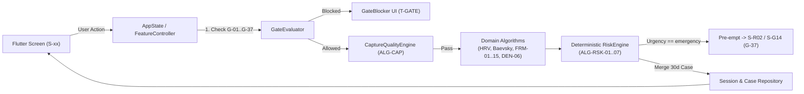

# 13 — Flutter Application Architecture

> **Purpose:** Defines the scalable, feature-first Clean Architecture for VitalsMirror in Flutter (`sdk: ^3.12.2`), ensuring zero coupling between UI widgets, deterministic health algorithms, and replaceable mock/backend data sources.

---

## 1. Architectural Principles

1. **Feature-First Modular Structure:** Code is organized by domain/feature (`access`, `consent_profile`, `shell`, `vitals`, `image_screening`, `dental`, `audio_screening`, `movement_vision`, `results_cases`, `devices_settings`), with shared primitives in `lib/core/`.
2. **Clean Layer Separation:**
   - **Presentation Layer (`presentation/`):** Screens (`S-A01`…`S-I05`), reusable widgets, and reactive `ChangeNotifier`/`ValueNotifier` controllers. Zero medical calculation logic inside widgets.
   - **Domain Layer (`domain/`):** Immutable entities, `MarkerEnvelope<T>`, deterministic calculators (`FormulasEngine`, `HrvCalculator`, `BaevskyStressCalculator`, `CariesRiskEngine`, `RiskEngine`), gate evaluators (`GateEvaluator` for `G-01`…`G-37`), and repository interfaces.
   - **Data Layer (`data/`):** Master data registry (`mst_*` tables), in-memory/local persistence, and mock implementations clearly marked with `// MOCK:` comments so backend/ML engineers can drop in production adapters without touching UI or domain code.
3. **Zero External Bloat:** Uses pure Flutter SDK + standard Material 3 custom theme (`MirrorTheme`) so the project compiles and runs out-of-the-box on every target without fragile native plugin dependencies during Phase 1 UI & algorithm verification.
4. **Centralized Gate & Lifecycle Engine:** Every feature and screen evaluates `GateEvaluator` (`G-01`…`G-37`) and exposes a strongly typed `FeatureLifecycleState` (`notStarted`, `initializing`, `permissionRequired`, `ready`, `processing`, `retry`, `success`, `failed`, `completed`, `disabled`, `expired`).

---

## 2. Directory Structure (`lib/`)

```text
lib/
├── main.dart                                  # App entry point & AppScope provider
├── app.dart                                   # MaterialApp, MirrorTheme, AppRouter
├── core/
│   ├── config/
│   │   ├── app_environment.dart               # Dev / Staging / Prod + Mock banner flag
│   │   └── master_data_registry.dart          # mst_algorithm, mst_quality_threshold, mst_reference_range, mst_confirmatory_test
│   ├── design_system/
│   │   ├── mirror_colors.dart                 # Semantic & surface colour tokens
│   │   ├── mirror_typography.dart             # Tabular-numeral typography scale
│   │   ├── mirror_spacing.dart                # 4-pt spacing & radius tokens
│   │   ├── mirror_theme.dart                  # Light & Dark ThemeData
│   │   ├── band_style.dart                    # Deterministic Band -> Color + Icon + Label
│   │   └── widgets/
│   │       ├── vm_button.dart                 # Primary, tonal, outline, danger buttons
│   │       ├── vm_card.dart                   # Surface, hero, interactive cards
│   │       ├── band_chip.dart                 # Accessible band badge (icon + text + colour)
│   │       ├── urgency_banner.dart            # Emergency / Urgent / Routine alert banner
│   │       ├── metric_tile.dart               # Value, unit, band, confidence, hidden reason
│   │       ├── confidence_meter.dart          # 0.0-1.0 segmented confidence bar (G-23)
│   │       ├── quality_checklist.dart         # Live ALG-CAP-01..15 coaching checklist
│   │       ├── capture_frame.dart             # Face oval, finger circle, arch & part guides
│   │       ├── countdown_ring.dart            # Animated capture timer (pauses on CAP fail)
│   │       ├── gate_blocker.dart              # T-GATE modal/inline gate resolution card
│   │       ├── waveform_view.dart             # CustomPainter rPPG/PPG & sonar waveform
│   │       ├── tooth_chart_view.dart          # Interactive FDI 11-48 / 51-85 dental chart
│   │       └── disclaimer_note.dart           # Clinical screening vs diagnosis footer
│   ├── domain/
│   │   ├── entities/
│   │   │   ├── enums.dart                     # LifecycleState, GateId, UrgencyLevel, BandType, ReleaseStatus
│   │   │   ├── member_profile.dart            # Member, Dependent, HealthContext, ConsentRecord
│   │   │   ├── marker_envelope.dart           # MarkerEnvelope<T> with version & confidence
│   │   │   ├── screening_catalogue_item.dart  # 34 catalogue items + gate rules
│   │   │   └── case_record.dart               # ConditionFlag, CaseRecord, ConfirmatoryTest, PairingRule
│   │   ├── algorithms/
│   │   │   ├── capture_quality_engine.dart    # ALG-CAP-01..15 rules & coaching strings
│   │   │   ├── hrv_baevsky_engine.dart        # Exact ALG-HRV-01..04 (SDNN, RMSSD, pNN50, SD1/SD2, Baevsky SI)
│   │   │   ├── formulas_engine.dart           # Exact ALG-FRM-01..15 with Spec test vectors
│   │   │   ├── caries_risk_engine.dart        # Exact ALG-DEN-06 (Cases 1-6)
│   │   │   └── risk_engine.dart               # Deterministic ALG-RSK-01..07 (Cases T1-T16)
│   │   └── gates/
│   │       └── gate_evaluator.dart            # Evaluates G-01..G-37 for any member & screen
│   ├── router/
│   │   └── app_router.dart                    # Registry of all 82 screens (S-A01..S-I05)
│   └── state/
│       └── app_state.dart                     # Central reactive controller (active member, sessions, cases, mocks)
└── features/
    ├── access/                                # S-A01..S-A08 (Splash, Language, Auth, Mode, Permissions, Operator)
    ├── consent_profile/                       # S-B01..S-B07 (Consents, Profile Basics/Context, Family, Device Check)
    ├── shell/                                 # S-C01..S-C07 (Home, Catalogue, History, Session, Trends, Inbox, More)
    ├── vitals/                                # S-D01..S-D13 (Setup, Context, Face/Finger Capture, Processing, Retake, Results, Detail, Body/Fitness, BP Calib, Ortho, HR Rec, Paced RR)
    ├── image_screening/                       # S-E01..S-E04, S-E06 (8 Image configs, Colour Card, Guided Capture, Review, Fundus)
    ├── dental/                                # S-F01..S-F05 (Intro, Caries Q, 4-View Capture, FDI Results, Tooth Detail)
    ├── audio_screening/                       # S-G01..S-G15 (Audio Readiness, Resp Q, Cough, Voice, Exhale, Sleep, Hearing, Cognitive, Mood, Crisis, HF Voice)
    ├── movement_vision/                       # S-H01..S-H10 (Video/Touch Tap, Gait, Sit-to-Stand, Tremor, Stroke FAST, Acuity, Colour, Amsler, Reaction Time)
    ├── results_cases/                         # S-R01..S-R07 (Shared Result, Emergency S-R02, Urgent S-R03, Cases List/Detail, Lab Entry, Sampled Negatives)
    └── devices_settings/                      # S-I01..S-I05 (Connected Devices, Ring Pairing, Settings, Privacy, About & Algorithm Versions)
```

---

## 3. Data Flow & State Management Diagram



---

## 4. Environment, Security & Logging Standards

1. **Environment Configuration (`AppEnvironment`):**
   - `devMock`: Enables interactive simulation controls on capture screens (allowing testers to simulate passing capture, failing `ALG-CAP` checks, low SNR `< 3 dB`, or emergency triggers `T1`–`T16`) and displays a `"MOCK / DEMO MODE"` chip in the app bar.
   - `staging` / `prod`: Connects to backend endpoints defined in `10_API_and_Backend_Integration.md` and enforces `mst_algorithm.release_status` (`G-24`).
2. **PHI-Safe Logging:** No personal identifiers (name, phone, DOB, raw face photos, voice audio) are ever written to console logs. Only opaque IDs (`session_id`, `algorithm_version`, `range_version`, `rule_codes[]`) are logged.
