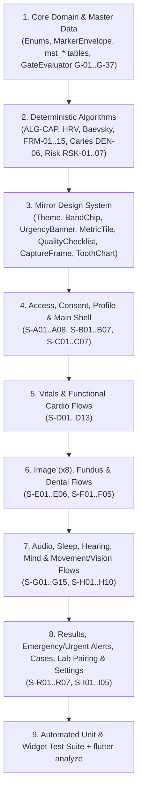

# 14 — Development Roadmap

> **Purpose:** Sequenced execution plan from requirement analysis and documentation through full Flutter UI implementation, deterministic algorithm integration, and automated test verification.

---

## 1. Phase Breakdown

| Phase | Milestone | Key Deliverables | Status |
|---|---|---|---|
| **Phase 1** | Complete Document Analysis | Full extraction and structured mapping of all 14 Spec sections (`ALG-CAP`, `ALG-PUL`, `§4` Vitals, `ALG-FRM`, `ALG-IMG`, `ALG-DEN`, `ALG-AUD`, `ALG-MOV`, `ALG-RSK`, `§11–14`) | Completed |
| **Phase 2** | Complete Application Documentation | 17 permanent technical reference documents (`00_README_Index.md` … `16_Open_Questions_and_Assumptions.md`) | Completed |
| **Phase 3** | Screen-by-Screen UI/UX Planning | All **82 screens** (`S-A01`…`S-I05`) + 8 image configurations + "Mirror" Design System documented in `05_UI_UX_Screen_Documentation.md` and `06_User_Flows_and_Navigation.md` | Completed |
| **Phase 4** | Feature Gates & Lifecycle Specification | All **37 gates (`G-01`…`G-37`)** and **38 features (`F-01`…`F-38`)** state machines documented in `07_Feature_Lifecycle_and_States.md` | Completed |
| **Phase 5** | Flutter Application Architecture | Feature-first Clean Architecture (`lib/core` + `lib/features`) documented in `13_Flutter_Architecture.md` | Completed |
| **Phase 6** | AI/ML & Deterministic Algorithm Engine | Domain implementations of `ALG-CAP-01..15`, `ALG-HRV-01..04`, `ALG-FRM-01..15`, `ALG-DEN-06`, and `ALG-RSK-01..07` + mock interfaces for trained models | In Progress |
| **Phase 7** | Full Flutter UI Implementation | Theme, Design System components, Gate/Lifecycle Evaluator, and all **82 screens** across Groups A–I & R | In Progress |
| **Phase 8** | Testing & Quality Assurance | Unit tests for all Spec test vectors (HRV, Baevsky, FRM-01..15, Caries Cases 1–6, Risk Cases T1–T16), widget tests, and `flutter analyze` zero-error check | Planned |
| **Phase 9** | Clinical Model & Backend Integration (Post-UI) | Native camera/audio DSP plugins, TFLite `EfficientPhys` (`ALG-PUL-05`), Mayura clinical validation studies (`VIT-*`, `IMG-*`, `DEN-01`, `AUD-*`, `MOV-*`), live REST APIs | Future Phase |

---

## 2. Implementation Sequence (Inside Phase 6–8)

